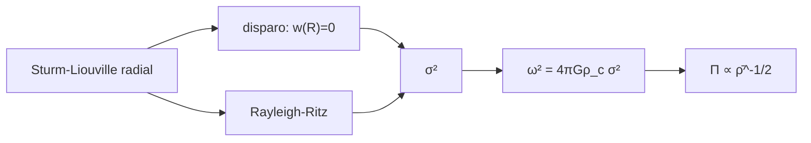

# B37-C07 — Oscilaciones radiales y relación período-densidad media

<!-- nav:top -->
[🏠 Programa](../../../../README.md) · [📚 Bloque B37](../../../tronco-comun/B37-interiores-estelares-y-asterosismologia.md) · [← Anterior: B37-C06 — Calibración de modelos estelares con el Sol y binarias](../B37-C06-calibracion-de-modelos-estelares-con-el-sol-y-binarias/CLASE.md) · [Siguiente: B37-C08 — Oscilaciones no radiales: modos p, g y mixtos →](../B37-C08-oscilaciones-no-radiales-modos-p-g-y-mixtos/CLASE.md)
<!-- /nav -->

## 1. Ubicación, nivel y alcance

Clase 7 del bloque B37. Nivel N3. Una estrella que se contrae y expande como un todo oscila en modos **radiales**. Aquí calculas el modo fundamental de un politropo `n = 3` por **disparo** y por **Rayleigh–Ritz** (dos vías independientes) y deduces la **relación período–densidad media**. Usas [B05](../../../tronco-comun/B05-fisica-fundamental-para-el-espacio.md). El modelo de juguete no es una estrella pulsante real.

## 2. Por qué esta clase existe

El período fundamental fija la densidad media. La decisión central: **¿cuánto vale el período de un modo radial y cómo escala con la densidad?**

## 3. Lo que podrás hacer al terminar

1. Plantear la ecuación radial adiabática en forma de Sturm–Liouville.
2. Hallar el modo fundamental por disparo.
3. Acotarlo con el principio variacional.
4. Verificar el caso exacto `Γ₁ = 4/3`.
5. Obtener `Π` para el Sol de juguete.
6. Mostrar que `Π ∝ ρ̄⁻¹ᐟ²`.

La evidencia es la **ficha de oscilaciones radiales** del ejercicio 12 (sección 20).

## 4. Con qué llegas y cómo comprobarlo

1. ¿Qué es una incertidumbre?
2. ¿Qué es una simulación Monte Carlo?
3. ¿Qué es una tabla de resultados?
4. ¿Qué es un valor ilustrativo?
5. ¿Qué es una verificación?

<details>
<summary>Ver respuestas</summary>

1. Un intervalo en que se espera el valor verdadero. 2. Repetir con números aleatorios de semilla fija. 3. Un resumen ordenado de cálculos. 4. Un valor propuesto para el ejemplo, no medido. 5. Comparar un cálculo con un caso independiente.
</details>

Con cuatro o cinco aciertos, sigue; si no, repasa los prerrequisitos.

## 5. Un caso de contexto y casos de referencia

Con `Γ₁ = 5/3`, el modo fundamental de un politropo `n = 3` tiene `σ² = ω²/(4πGρ_c) = 0,0569`; el método de Rayleigh–Ritz con bases de grado 0, 1, 2 y 3 da `0,0816; 0,0602; 0,0571; 0,0569`. Para la masa y el radio solares nominales, `Π = 0,914 h`. Es el **ejemplo conductor**; el modelo es **ilustrativo**.

## 6. Vocabulario

Un **modo radial** conserva la simetría esférica (`l = 0`). El **índice adiabático** `Γ₁`. El **disparo** integra desde el centro y ajusta `ω²` para cumplir la frontera. El **cociente de Rayleigh** es una cota superior del valor propio. La **relación período–densidad** `Π √(ρ̄/ρ̄_☉) = Q` es constante.

## 7. Modelo mental: una cuerda de guitarra

Es como una cuerda: el tono fundamental depende de su longitud y tensión. En una estrella depende de su tamaño y masa, o sea de la densidad media: una estrella más densa vibra más rápido.



*Descripción textual:* la ecuación radial se resuelve por disparo y por un método variacional, y la frecuencia se escala con la densidad central.

Analogía: una cuerda de guitarra. Límite: politropo `n = 3` con `Γ₁` independiente (no autoconsistente).

## 8. La explicación, paso a paso

### 8.1 El caso exacto

Con `Γ₁ = 4/3` un politropo `n = 3` es neutro: la expansión homóloga `ξ_r ∝ r` es solución con `ω² = 0`. El laboratorio lo comprueba con `w = 0` en la superficie y con el cociente de Rayleigh igual a `0`; es una verificación por construcción del código.

### 8.2 El modo fundamental

Para `Γ₁ = 5/3`:

| Método | `σ²` |
|---|---|
| disparo | 0,0569 |
| Rayleigh–Ritz, grado 0 (`η = 1`) | 0,0816 |
| grado 1 | 0,0602 |
| grado 2 | 0,0571 |
| grado 3 | 0,0569 |

Todas las cotas variacionales están por encima del valor del disparo y convergen a él.

### 8.3 La escala

La masa nominal `M = 1,9884 × 10³⁰ kg` y `R = 6,957 × 10⁸ m` dan `ρ̄ = 1409,8 kg/m³` y `ρ_c = 54,1825 ρ̄`. Entonces `ω = 1,9099 × 10⁻³ rad/s` y `Π = 0,914 h`, es decir `Π/τ_din = 2,065` con `τ_din = √(R³/GM) = 1592,9 s`. Con una densidad media 100 veces menor, `Π = 9,138 h`: el cociente es `10,0000`.

### 8.4 Lectura

`Π ∝ ρ̄⁻¹ᐟ²` no es una aproximación: es consecuencia de las unidades de la ecuación. Lo que depende del modelo es el coeficiente `Q = 0,914 h` (un modelo real tiene otro). El politropo con `Γ₁ = 5/3` no es autoconsistente.

## 9. Magnitudes, símbolos y unidades

| Símbolo | Qué es | Unidad | Valor / nota |
|---|---|---|---|
| `σ²` | frecuencia adimensional | — | 0,0569 |
| `Γ₁` | índice adiabático | — | 5/3 |
| `Π` | período fundamental | h | 0,914 |
| `ρ̄` | densidad media | kg/m³ | 1409,8 |
| `τ_din` | `√(R³/GM)` | s | 1592,9 |

## 10. Convenciones y referencias

Adiabático, sin rotación; el politropo `n = 3` con `Γ₁ = 5/3` es un modelo de juguete; `G` de NIST; `GM`, `R` de la UAI.

## 11. De dónde sale lo que afirmamos

| ID | Fuente | Localizador | Respalda | Estado |
|---|---|---|---|---|
| S1 | NIST, *Fundamental Physical Constants* (CODATA 2022) | https://physics.nist.gov/cuu/Constants/Table/allascii.txt | `G` | Consultada el 2026-11-09 |
| S2 | UAI, Resolución B3 de 2015 (arXiv:1510.07674) | https://arxiv.org/abs/1510.07674 | valores nominales solares (GM, R, T_ef) | Solo resumen, consultado el 2026-11-09 |

Límites: el modelo no es una estrella pulsante real.

## 12. Cómo ver los modos

| Método | `σ²` |
|---|---|
| disparo | 0,0569 |
| RR grado 3 | 0,0569 |
| RR grado 0 | 0,0816 |

Descripción larga: la base de mayor grado converge al disparo.

## 13. Ejemplo trabajado: el período

**Paso 1 · Frecuencia.** `ω² = 4πGρ_c σ²`, con `ρ_c = 7,6385 × 10⁴ kg/m³`: `ω = 1,9099 × 10⁻³ rad/s`.

**Paso 2 · Período.** `Π = 2π/ω = 3290 s`.

**Paso 3 · Horas.** `3290/3600 = 0,914 h`.

## 14. Distintas formas de describir una vibración global

**Por método:** disparo y Rayleigh–Ritz. **Por escala:** `ρ̄`. **Por caso exacto:** `Γ₁ = 4/3`. **Por cota:** variacional.

## 15. Práctica guiada

**Ejercicio 1 · con los pasos indicados.** Período desde `ω = 1,9099 × 10⁻³ rad/s`. *Pasos:* `2π/ω`.

<details><summary>Solución comentada</summary>

`3290 s = 0,914 h`.
</details>

**Ejercicio 2 · con una pista.** Cociente `Π(ρ̄/100)/Π(ρ̄)`.

<details><summary>Solución comentada</summary>

`√100 = 10`.
</details>

**Ejercicio 3 · casi autónomo.** `σ²` de grado 1 respecto del disparo.

<details><summary>Solución comentada</summary>

`0,0602/0,0569 = 1,058`: 5,8 % mayor.
</details>

## 16. Práctica autónoma, transferencia e integrador

**Ejercicio 4.** `Π/τ_din`.

<details><summary>Solución comentada</summary>

`3290/1592,9 = 2,065`.
</details>

**Ejercicio 5.** ¿Qué ocurre con `ω²` si `Γ₁` baja a 4/3?

<details><summary>Solución comentada</summary>

Vale cero.
</details>

**Ejercicio 6.** `ω τ_din` desde `Π/τ_din`.

<details><summary>Solución comentada</summary>

`2π/2,065 = 3,043`.
</details>

**Ejercicio 7.** ¿Por qué el grado 3 casi coincide con el disparo?

<details><summary>Solución comentada</summary>

La base ya aproxima la autofunción.
</details>

**Ejercicio 8.** `ρ_c/ρ̄` del politropo.

<details><summary>Solución comentada</summary>

`54,1825`.
</details>

**Ejercicio 9 · transferencia.** **Transferencia.** Un compañero dice que `Q = 0,914 h` es el valor del Sol. Responde.

<details><summary>Solución comentada</summary>

Es el de un politropo de juguete.
</details>

**Ejercicio 10 · transferencia.** **Transferencia.** ¿Por qué `Π ∝ ρ̄⁻¹ᐟ²`?

<details><summary>Solución comentada</summary>

Porque `ω² ∝ Gρ̄` por análisis dimensional.
</details>

**Ejercicio 11 · transferencia.** **Transferencia.** ¿Qué cota da el cociente de Rayleigh?

<details><summary>Solución comentada</summary>

Una cota superior del valor propio.
</details>

**Ejercicio 12.** **Integrador.** Elabora tu *ficha de oscilaciones radiales*: modo fundamental y escala.

<details><summary>Solución comentada</summary>

Secciones 8.1–8.4.
</details>

**Ejercicio 12 · integrador.** **Integrador.** Elabora tu *ficha de oscilaciones radiales*: modo fundamental y escala.

<details><summary>Solución modelo</summary>

Secciones 8.1–8.4.
</details>

## 17. Laboratorio: modo radial fundamental

El script [radiales.py](radiales.py) calcula el modo por disparo y Rayleigh–Ritz (**comprueba** que las cotas están por encima y convergen al 1 %).

**Datos:** `G` de NIST, `GM`, `R` de la UAI; modelo **ilustrativo**. **Predice antes de ejecutar:** ¿será la cota mayor o menor que el disparo? (mayor.) **Ejecución del 2026-11-09 (Python 3.12.9):**

```text
Python 3.12.9 (biblioteca estandar)
perfil n = 3: 3442 puntos hasta xi = 6.884 (xi_1 = 6.89685)
Gamma_1 = 4/3: w(superficie) con sigma^2 = 0 vale 0.00e+00 (el modo homologo eta = 1 es solucion exacta)
Gamma_1 = 5/3: sigma^2 (disparo) = 0.0569
Rayleigh-Ritz con base de grado 0, 1, 2, 3 en (xi/xi_1)^2: 0.0816 ; 0.0602 ; 0.0571 ; 0.0569
Gamma_1 = 4/3: A00/B00 (cociente de Rayleigh con eta = 1) = 0.00e+00
rho_medio = 1409.8 kg/m3 ; omega = 1.9099e-03 rad/s ; Pi = 0.914 h ; Q = Pi sqrt(rho/rho_sol) = 0.914 h
rho_medio/100: Pi = 9.138 h ; Pi2/Pi = 10.0000 (esperado 10)
escala dinamica sqrt(R^3/GM) = 1592.9 s ; Pi/tau = 2.065
Pruebas superadas.
```

```bash
python programa/clases/B37/B37-C07-oscilaciones-radiales-y-relacion-periodo-densidad-media/radiales.py
```

**Límites:** adiabático, sin rotación.

## 18. Errores frecuentes y cómo corregirlos

**Confundir `ω` y `ν`.** Se corrige con 8.3.

**Creer que `Q` es universal.** Se corrige con 8.4.

**Olvidar `Γ₁`.** Se corrige con 8.1.

**Presentar el politropo como el Sol.** Se corrige en la sección 10.

## 19. Cómo sabrás que vas bien

Tras la sección 8: ¿qué resultado esperabas y cuál obtuviste? Si dudas, repasa el ejemplo 13. Tras el laboratorio: ¿qué comprueba? (ver la sección 17).

## 20. Qué entregas y cómo se evalúa

El producto es tu **ficha de oscilaciones radiales** (ejercicio 12).

| Criterio | Inicial | En desarrollo | Logrado | Destacado |
|---|---|---|---|---|
| Conceptos | Los confunde | Parciales | conceptos de la clase | Explica los límites |
| Cálculo | Sin unidades | Con errores | Tablas completas | Calcula casos nuevos |
| Numérico | Sin comprobar | Un caso | Contraste con el análisis | Interpreta las diferencias |
| Fuentes | Sin fuente | Sin fecha | fuentes con fecha | Declara lo ilustrativo |
| Límites | No los nombra | Uno | Tres | Discute qué falta del modelo |

**Condiciones críticas (no se compensan con promedio):** rotular el modelo como de juguete; no presentar `Q` como el valor solar; citar solo lo consultado.

## 21. Ética, seguridad y límites

Clase educativa: los modelos son simplificados. Accesibilidad: tablas equivalentes a las gráficas, fórmulas en texto, ejercicios sin conexión.

## 22. Para cerrar y seguir

El modo radial fundamental da el período y la densidad media. Queda una pregunta: ¿qué ocurre cuando la oscilación no conserva la simetría esférica?

**Glosario español–inglés.** modo radial · *radial mode*; disparo · *shooting*; cociente de Rayleigh · *Rayleigh quotient*; índice adiabático · *adiabatic index*; densidad media · *mean density*.

**Continuidad.** [B37-C08](../B37-C08-oscilaciones-no-radiales-modos-p-g-y-mixtos/CLASE.md) estudia los modos no radiales.

**Referencias:** ver sección 11.

<!-- nav:bottom -->
---

[← Anterior: B37-C06 — Calibración de modelos estelares con el Sol y binarias](../B37-C06-calibracion-de-modelos-estelares-con-el-sol-y-binarias/CLASE.md) · [📚 Bloque B37](../../../tronco-comun/B37-interiores-estelares-y-asterosismologia.md) · [Siguiente: B37-C08 — Oscilaciones no radiales: modos p, g y mixtos →](../B37-C08-oscilaciones-no-radiales-modos-p-g-y-mixtos/CLASE.md)
<!-- /nav -->
