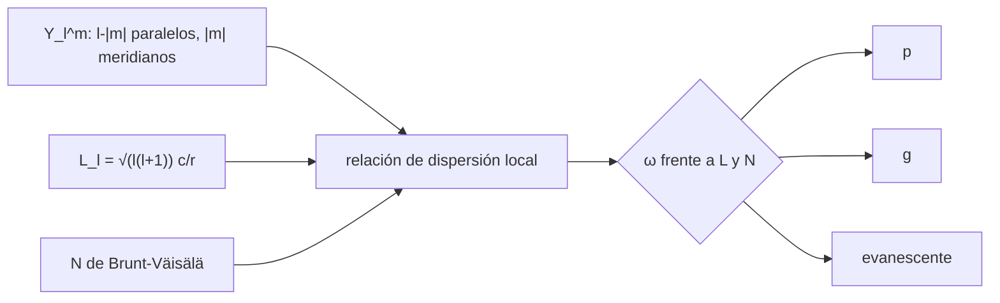

# B37-C08 — Oscilaciones no radiales: modos p, g y mixtos

<!-- nav:top -->
[🏠 Programa](../../../../README.md) · [📚 Bloque B37](../../../tronco-comun/B37-interiores-estelares-y-asterosismologia.md) · [← Anterior: B37-C07 — Oscilaciones radiales y relación período-densidad media](../B37-C07-oscilaciones-radiales-y-relacion-periodo-densidad-media/CLASE.md) · [Siguiente: B37-C09 — Frecuencias características: Δν, νmax y espaciado de períodos →](../B37-C09-frecuencias-caracteristicas-max-y-espaciado-de-periodos/CLASE.md)
<!-- /nav -->

## 1. Ubicación, nivel y alcance

Clase 8 del bloque B37. Nivel N3. Los modos **no radiales** se describen con armónicos esféricos `Y_l^m` y se clasifican en **p** (la presión restaura) y **g** (la gravedad restaura). Aquí compruebas la normalización de `Y_l^m` y su recuento de nodos, calculas la frecuencia de **Brunt–Väisälä** de una capa isoterma y trazas qué modos se propagan con las frecuencias de **Lamb**. Usas [B05](../../../tronco-comun/B05-fisica-fundamental-para-el-espacio.md). Los parámetros de la capa son ilustrativos.

## 2. Por qué esta clase existe

Los modos p y g sondean regiones distintas. La decisión central: **¿en qué cavidad se propaga un modo de frecuencia y grado dados?**

## 3. Lo que podrás hacer al terminar

1. Calcular la normalización y los nodos de `Y_l^m`.
2. Obtener `N` y la frecuencia de corte en una capa isoterma.
3. Calcular la frecuencia de Lamb `L_l`.
4. Clasificar un modo como p, g o evanescente.
5. Ver el efecto del grado `l`.
6. Nombrar los límites de la aproximación local.

La evidencia es la **ficha de modos no radiales** del ejercicio 12 (sección 20).

## 4. Con qué llegas y cómo comprobarlo

1. ¿Qué es una incertidumbre?
2. ¿Qué es una simulación Monte Carlo?
3. ¿Qué es una tabla de resultados?
4. ¿Qué es un valor ilustrativo?
5. ¿Qué es una verificación?

<details>
<summary>Ver respuestas</summary>

1. Un intervalo en que se espera el valor verdadero. 2. Repetir con números aleatorios de semilla fija. 3. Un resumen ordenado de cálculos. 4. Un valor propuesto para el ejemplo, no medido. 5. Comparar un cálculo con un caso independiente.
</details>

Con cuatro o cinco aciertos, sigue; si no, repasa los prerrequisitos.

## 5. Un caso de contexto y casos de referencia

Para `Y₅³`, el laboratorio da `∫|Y|² dΩ = 1,00000000`, `l − |m| = 2` paralelos nodales y `|m| = 3` meridianos. En una capa isoterma de `T = 6000 K`, `c = 7,997 km/s` y `H = 140,053 km`, `N = 2,797 × 10⁻² rad/s` y la frecuencia de corte acústica es `4,544 mHz`. Es el **ejemplo conductor**; la capa es **ilustrativa**.

## 6. Vocabulario

El **armónico esférico** `Y_l^m` tiene grado `l` y orden azimutal `m`. El **modo p** tiene presión como fuerza restauradora; el **g**, el empuje. La **frecuencia de Lamb** `L_l = √(l(l+1)) c/r`. La **frecuencia de Brunt–Väisälä** `N` es la de oscilación de una burbuja estable. Un modo **evanescente** decae. Un **modo mixto** se comporta como p en una zona y g en otra.

## 7. Modelo mental: un tambor y un péndulo

Es como un tambor (la tensión restaura: p) y un péndulo (el peso restaura: g). El tambor suena agudo y el péndulo lento; una estrella tiene ambos.



*Descripción textual:* la comparación de la frecuencia con `L_l` y `N` decide dónde se propaga cada modo.

Analogía: un tambor y un péndulo. Límite: aproximación local (WKB), sin rotación.

## 8. La explicación, paso a paso

### 8.1 Los armónicos

| `l` | `m` | `∫|Y|² dΩ` | Paralelos nodales | Meridianos |
|---|---|---|---|---|
| 1 | 0 | 1,00000000 | 1 | 0 |
| 1 | 1 | 1,00000000 | 0 | 1 |
| 2 | 1 | 1,00000000 | 1 | 1 |
| 3 | 2 | 1,00000000 | 1 | 2 |
| 5 | 3 | 1,00000000 | 2 | 3 |
| 10 | 4 | 1,00000000 | 6 | 4 |

El número de paralelos es `l − |m|` y el de meridianos `|m|`.

### 8.2 La capa isoterma

`c = 7,997 km/s`, `H = 140,053 km`. La frecuencia `N = g √(γ−1)/c = 2,797432 × 10⁻² rad/s` coincide con la calculada por diferencias finitas de `N² = g(dlnP/dr/γ − dlnρ/dr)`. La frecuencia de corte acústica `ν_ac = c/(4πH)` vale `4,544 mHz` y `N/(2π) = 4,452 mHz`.

### 8.3 El diagrama

Capa de juguete a `r = 6,6 × 10⁸ m` con `c = 200 km/s` y `N/(2π) = 0,1592 mHz`:

| `l` | `ν` (mHz) | `L_l/(2π)` (mHz) | Tipo |
|---|---|---|---|
| 2 | 3,000 | 0,1181 | p |
| 2 | 0,050 | 0,1181 | g |
| 2 | 0,140 | 0,1181 | evanescente |
| 100 | 3,000 | 4,8469 | evanescente |
| 100 | 0,050 | 4,8469 | g |

`L₁₀₀/L₂ = 41,028 = √(101 · 100/6)`. A grado alto, un modo de 3 mHz no se propaga: la frecuencia de Lamb sube con `l`.

### 8.4 Lectura

p y g viven en cavidades separadas por una zona evanescente; si esa zona es delgada, los modos se acoplan y se vuelven mixtos (C12). La aproximación local falla cerca de los bordes de las cavidades.

## 9. Magnitudes, símbolos y unidades

| Símbolo | Qué es | Unidad | Valor / nota |
|---|---|---|---|
| `l`, `m` | grado y orden azimutal | — | `|m| ≤ l` |
| `N` | frecuencia de Brunt–Väisälä | rad/s | 2,797 × 10⁻² |
| `L_l` | frecuencia de Lamb | rad/s | `√(l(l+1)) c/r` |
| `ν_ac` | frecuencia de corte acústica | mHz | 4,544 |
| `k_B`, `m_u` | constantes | SI | de NIST |

## 10. Convenciones y referencias

Aproximación local; capa isoterma de gas ideal con `γ = 5/3`; capa de juguete para el diagrama; constantes de NIST.

## 11. De dónde sale lo que afirmamos

| ID | Fuente | Localizador | Respalda | Estado |
|---|---|---|---|---|
| S1 | NIST, *Fundamental Physical Constants* (CODATA 2022) | https://physics.nist.gov/cuu/Constants/Table/allascii.txt | `G`, `k_B`, `m_u` | Consultada el 2026-11-09 |
| S2 | Valores y modelo del laboratorio | — | capa isoterma y capa del diagrama | Ilustrativo o sintético; no consultado |

Límites: no se calcularon modos de un modelo estelar real.

## 12. Cómo ver las cavidades

| Modo | Tipo |
|---|---|
| `l = 2`, 3 mHz | p |
| `l = 2`, 0,05 mHz | g |
| `l = 100`, 3 mHz | evanescente |

Descripción larga: la frecuencia relativa a `L_l` y `N` decide el tipo.

## 13. Ejemplo trabajado: la clasificación de un modo

**Paso 1 · Lamb.** `L₂/(2π) = √6 × 2 × 10⁵/(6,6 × 10⁸)/(2π) = 0,1181 mHz`.

**Paso 2 · `N`.** `0,1592 mHz`.

**Paso 3 · Comparación.** `3 mHz > L, N`: p.

**Paso 4 · Contraste.** `0,05 mHz < L, N`: g.

## 14. Distintas formas de describir un modo

**Por geometría:** `Y_l^m`. **Por cavidad:** diagrama de propagación. **Por fuerza:** presión o gravedad. **Por acoplamiento:** modo mixto.

## 15. Práctica guiada

**Ejercicio 1 · con los pasos indicados.** Nodos de `Y₁₀⁴`. *Pasos:* `l − |m|` y `|m|`.

<details><summary>Solución comentada</summary>

6 paralelos y 4 meridianos.
</details>

**Ejercicio 2 · con una pista.** `L₁₀₀/L₂`.

<details><summary>Solución comentada</summary>

`√(10100/6) = 41,03`.
</details>

**Ejercicio 3 · casi autónomo.** ¿Es p, g o evanescente un modo de `l = 2` y 0,14 mHz?

<details><summary>Solución comentada</summary>

Evanescente: queda entre `L` y `N`.
</details>

## 16. Práctica autónoma, transferencia e integrador

**Ejercicio 4.** `N/(2π)` de la capa isoterma.

<details><summary>Solución comentada</summary>

`4,452 mHz`.
</details>

**Ejercicio 5.** ¿Se propaga a `l = 100` un modo de 3 mHz?

<details><summary>Solución comentada</summary>

No: `L/(2π) = 4,8469 mHz` es mayor.
</details>

**Ejercicio 6.** Número total de nodos de `Y₃²`.

<details><summary>Solución comentada</summary>

`1 + 2 = 3` líneas nodales.
</details>

**Ejercicio 7.** `ν_ac − N/(2π)`.

<details><summary>Solución comentada</summary>

`0,092 mHz`.
</details>

**Ejercicio 8.** ¿Qué ocurre con `L_l` al subir `l`?

<details><summary>Solución comentada</summary>

Crece como `√(l(l+1))`.
</details>

**Ejercicio 9 · transferencia.** **Transferencia.** Un compañero dice que las cifras del diagrama son del Sol. Responde.

<details><summary>Solución comentada</summary>

Son de una capa de juguete.
</details>

**Ejercicio 10 · transferencia.** **Transferencia.** ¿Por qué los modos g no llegan a la superficie?

<details><summary>Solución comentada</summary>

Porque en la envoltura convectiva `N² < 0` y allí el modo es evanescente.
</details>

**Ejercicio 11 · transferencia.** **Transferencia.** ¿Qué cambia con la rotación?

<details><summary>Solución comentada</summary>

Se desdobla `m` y la clasificación se modifica (C11).
</details>

**Ejercicio 12.** **Integrador.** Elabora tu *ficha de modos no radiales*: nodos, `N`, `L_l` y tipo de modo.

<details><summary>Solución comentada</summary>

Secciones 8.1–8.4.
</details>

**Ejercicio 12 · integrador.** **Integrador.** Elabora tu *ficha de modos no radiales*: nodos, `N`, `L_l` y tipo de modo.

<details><summary>Solución modelo</summary>

Secciones 8.1–8.4.
</details>

## 17. Laboratorio: armónicos y diagrama de propagación

El script [no_radiales.py](no_radiales.py) comprueba la normalización de `Y_l^m`, calcula `N` y clasifica modos (**comprueba** `N` a 1e-6).

**Datos:** `k_B`, `m_u` de NIST; parámetros **ilustrativos**. **Predice antes de ejecutar:** ¿qué tipo será un modo de baja frecuencia? (g.) **Ejecución del 2026-11-09 (Python 3.12.9):**

```text
Python 3.12.9 (biblioteca estandar)
  l   m    Int |Y|^2  paralelos nodales  meridianos
  1   0   1.00000000                  1           0
  1   1   1.00000000                  0           1
  2   1   1.00000000                  1           1
  3   2   1.00000000                  1           2
  5   3   1.00000000                  2           3
 10   4   1.00000000                  6           4
isoterma: c = 7.997 km/s ; H = 140.053 km ; N analitico = 2.797432e-02 rad/s ; N numerico = 2.797432e-02 rad/s
frecuencia de corte acustica nu_ac = c/(4 pi H) = 4.544 mHz ; N/(2 pi) = 4.452 mHz
  l  nu [mHz]  L_l/(2pi) [mHz]  N/(2pi) [mHz]        k_r^2         tipo
  2     3.000           0.1181         0.1592    8.844e-15            p
  2     0.050           0.1181         0.1592    1.033e-16            g
100     3.000           4.8469         0.1592   -1.426e-14  evanescente
100     0.050           4.8469         0.1592    2.117e-13            g
  2     0.140           0.1181         0.1592   -1.629e-18  evanescente
L_100/L_2 = 41.028 (esperado sqrt(101*100/6) = 41.028)
Pruebas superadas.
```

```bash
python programa/clases/B37/B37-C08-oscilaciones-no-radiales-modos-p-g-y-mixtos/no_radiales.py
```

**Límites:** aproximación local.

## 18. Errores frecuentes y cómo corregirlos

**Confundir `l` y `m`.** Se corrige con 8.1.

**Creer que todo modo llega a la superficie.** Se corrige con 8.3.

**Olvidar que `L` crece con `l`.** Se corrige con 8.3.

**Presentar la capa como el Sol.** Se corrige en la sección 10.

## 19. Cómo sabrás que vas bien

Tras la sección 8: ¿qué resultado esperabas y cuál obtuviste? Si dudas, repasa el ejemplo 13. Tras el laboratorio: ¿qué comprueba? (ver la sección 17).

## 20. Qué entregas y cómo se evalúa

El producto es tu **ficha de modos no radiales** (ejercicio 12).

| Criterio | Inicial | En desarrollo | Logrado | Destacado |
|---|---|---|---|---|
| Conceptos | Los confunde | Parciales | conceptos de la clase | Explica los límites |
| Cálculo | Sin unidades | Con errores | Tablas completas | Calcula casos nuevos |
| Numérico | Sin comprobar | Un caso | Contraste con el análisis | Interpreta las diferencias |
| Fuentes | Sin fuente | Sin fecha | fuentes con fecha | Declara lo ilustrativo |
| Límites | No los nombra | Uno | Tres | Discute qué falta del modelo |

**Condiciones críticas (no se compensan con promedio):** rotular la capa como ilustrativa; no presentar el diagrama como solar; citar solo lo consultado.

## 21. Ética, seguridad y límites

Clase educativa: los modelos son simplificados. Accesibilidad: tablas equivalentes a las gráficas, fórmulas en texto, ejercicios sin conexión.

## 22. Para cerrar y seguir

Los modos p y g ocupan cavidades distintas según `L_l` y `N`. Queda una pregunta: ¿qué observables globales se extraen de las frecuencias?

**Glosario español–inglés.** armónico esférico · *spherical harmonic*; frecuencia de Lamb · *Lamb frequency*; Brunt–Väisälä · *Brunt–Väisälä*; modo evanescente · *evanescent mode*; modo mixto · *mixed mode*.

**Continuidad.** [B37-C09](../B37-C09-frecuencias-caracteristicas-max-y-espaciado-de-periodos/CLASE.md) estudia Δν y νmax.

**Referencias:** ver sección 11.

<!-- nav:bottom -->
---

[← Anterior: B37-C07 — Oscilaciones radiales y relación período-densidad media](../B37-C07-oscilaciones-radiales-y-relacion-periodo-densidad-media/CLASE.md) · [📚 Bloque B37](../../../tronco-comun/B37-interiores-estelares-y-asterosismologia.md) · [Siguiente: B37-C09 — Frecuencias características: Δν, νmax y espaciado de períodos →](../B37-C09-frecuencias-caracteristicas-max-y-espaciado-de-periodos/CLASE.md)
<!-- /nav -->
