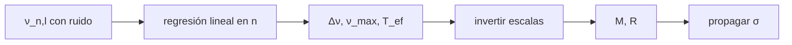

# B37-C09 — Frecuencias características: Δν, νmax y espaciado de períodos

<!-- nav:top -->
[🏠 Programa](../../../../README.md) · [📚 Bloque B37](../../../tronco-comun/B37-interiores-estelares-y-asterosismologia.md) · [← Anterior: B37-C08 — Oscilaciones no radiales: modos p, g y mixtos](../B37-C08-oscilaciones-no-radiales-modos-p-g-y-mixtos/CLASE.md) · [Siguiente: B37-C10 — Inversión asterosísmica de perfiles internos →](../../../tronco-comun/B37-interiores-estelares-y-asterosismologia.md#b37-c10)
<!-- /nav -->

## 1. Ubicación, nivel y alcance

Clase 9 del bloque B37. Nivel N3. Dos números globales —la **separación grande** `Δν` y la **frecuencia de máxima potencia** `ν_max`— dan masa y radio por **relaciones de escala**. Aquí inviertes las relaciones para cuatro estrellas sintéticas, extraes `Δν` de frecuencias asintóticas con ruido, propagas la incertidumbre y calculas el espaciado de períodos de los modos g. Usas [B12](../../../tronco-comun/B12-probabilidad-estadistica-e-incertidumbre.md) y [B05](../../../tronco-comun/B05-fisica-fundamental-para-el-espacio.md). Los valores solares de referencia están adoptados, no consultados.

## 2. Por qué esta clase existe

Sin Δν y νmax habría que ajustar modelos para saber masa y radio. La decisión central: **¿qué precisión en masa y radio se obtiene con estos observables y qué supuestos exige?**

## 3. Lo que podrás hacer al terminar

1. Aplicar las relaciones de escala de `Δν` y `ν_max`.
2. Invertirlas a `M` y `R`.
3. Comprobar `Δν ∝ √(GM/R³)`.
4. Extraer `Δν` por regresión con ruido.
5. Propagar errores a `M` y `R`.
6. Calcular el espaciado de períodos `ΔΠ_l`.

La evidencia es la **ficha de observables sísmicos** del ejercicio 12 (sección 20).

## 4. Con qué llegas y cómo comprobarlo

1. ¿Qué es una incertidumbre?
2. ¿Qué es una simulación Monte Carlo?
3. ¿Qué es una tabla de resultados?
4. ¿Qué es un valor ilustrativo?
5. ¿Qué es una verificación?

<details>
<summary>Ver respuestas</summary>

1. Un intervalo en que se espera el valor verdadero. 2. Repetir con números aleatorios de semilla fija. 3. Un resumen ordenado de cálculos. 4. Un valor propuesto para el ejemplo, no medido. 5. Comparar un cálculo con un caso independiente.
</details>

Con cuatro o cinco aciertos, sigue; si no, repasa los prerrequisitos.

## 5. Un caso de contexto y casos de referencia

Con `Δν_☉ = 135,1 μHz` y `ν_max,☉ = 3090 μHz` (valores **adoptados**), una estrella sintética de `1,2 M_☉`, `1,5 R_☉` y `6200 K` tiene `Δν = 80,558 μHz` y `ν_max = 1590,10 μHz`, y la inversión recupera `1,200` y `1,500`. El `Δν` extraído de 9 frecuencias con ruido es `80,5542 ± 0,0129 μHz`. Es el **ejemplo conductor**.

## 6. Vocabulario

La **separación grande** `Δν` es la distancia entre modos consecutivos del mismo grado. La **frecuencia `ν_max`** es la de máxima potencia. Una **relación de escala** da `Δν ∝ M¹ᐟ² R⁻³ᐟ²` y `ν_max ∝ M R⁻² T_ef⁻¹ᐟ²`. El **espaciado de períodos** `ΔΠ_l = Π₀/√(l(l+1))` es el de los modos g. La **asintótica** `ν_{n,l} = Δν(n + l/2 + ε) − l(l+1)D₀`.

## 7. Modelo mental: la separación de los trastes

Es como los trastes de una guitarra: su separación depende del tamaño del instrumento. Medir la separación de las frecuencias da el tamaño y la masa de la estrella, igual que un luthier mide el diapasón.



*Descripción textual:* las relaciones de escala convierten dos observables sísmicos globales en masa y radio.

Analogía: la separación de los trastes. Límite: relaciones válidas para estrellas de tipo solar.

## 8. La explicación, paso a paso

### 8.1 La inversión

| `M` | `R` | `T_ef` (K) | `Δν` (μHz) | `ν_max` (μHz) | `M` inv. | `R` inv. |
|---|---|---|---|---|---|---|
| 1,00 | 1,00 | 5772 | 135,100 | 3090,00 | 1,000 | 1,000 |
| 1,20 | 1,50 | 6200 | 80,558 | 1590,10 | 1,200 | 1,500 |
| 0,90 | 0,85 | 5300 | 163,549 | 4016,88 | 0,900 | 0,850 |
| 1,30 | 3,00 | 5000 | 29,645 | 479,55 | 1,300 | 3,000 |

La inversión es exacta (error menor que `10⁻¹²`), como corresponde a invertir una fórmula algebraica; lo que **no** es exacto es la fórmula.

### 8.2 Coherencia dimensional

El cociente `Δν/√(GM/R³)/(2π)` vale `1,3521` para las cuatro estrellas. Con los valores nominales, `√(GM/R³)/(2π) = 99,92 μHz` para el Sol; la escala `Δν ∝ √ρ̄` queda comprobada con `G` de NIST.

### 8.3 Extracción desde frecuencias

Con modos radiales `n = 15, …, 23` y ruido de `0,10 μHz`, la pendiente da `Δν = 80,5542 ± 0,0129 μHz` frente a los `80,5581` impuestos: `−0,30 σ`.

### 8.4 Propagación

Con 2 % en `ν_max` y 0,5 % en `Δν` (sin `T_ef`): `σ(M)/M = 6,32 %` y `σ(R)/R = 2,24 %`. El exponente 3 de `ν_max` en la masa amplifica el error.

### 8.5 Modos g

`ΔΠ₁ = 80,000 s`, `ΔΠ₂ = 46,188 s`, cociente `1,7321 = √3`. La regresión de 20 períodos da `ΔΠ₁ = 80,005 ± 0,008 s`.

### 8.6 Lectura

`ν_max` se asocia con la frecuencia de corte acústica (resumen de Belkacem et al., 2011), pero la relación sigue siendo empírica: sus supuestos limitan la precisión.

## 9. Magnitudes, símbolos y unidades

| Símbolo | Qué es | Unidad | Valor / nota |
|---|---|---|---|
| `Δν` | separación grande | μHz | 135,1 (Sol, adoptado) |
| `ν_max` | frecuencia de máxima potencia | μHz | 3090 (Sol, adoptado) |
| `ΔΠ_l` | espaciado de períodos | s | 80 (sintético) |
| `ε`, `D₀` | fase y desplazamiento pequeño | —, μHz | 1,4; 0,8 (sintéticos) |
| `G` | constante de gravitación | m³ kg⁻¹ s⁻² | 6,67430 × 10⁻¹¹ |

## 10. Convenciones y referencias

Relaciones de escala de tipo solar; valores solares de referencia adoptados, sin consultar fuente; frecuencias y ruido sintéticos; semilla `20261109`.

## 11. De dónde sale lo que afirmamos

| ID | Fuente | Localizador | Respalda | Estado |
|---|---|---|---|---|
| S1 | NIST, *Fundamental Physical Constants* (CODATA 2022) | https://physics.nist.gov/cuu/Constants/Table/allascii.txt | `G` | Consultada el 2026-11-09 |
| S2 | UAI, Resolución B3 de 2015 (arXiv:1510.07674) | https://arxiv.org/abs/1510.07674 | valores nominales solares (GM, R, T_ef) | Solo resumen, consultado el 2026-11-09 |
| S3 | Belkacem et al., *The underlying physical meaning of the ν_max–ν_c relation* (arXiv:1104.0630) | https://arxiv.org/abs/1104.0630 | que ν_max se relaciona con la frecuencia de corte acústica | Solo resumen, consultado el 2026-11-09 |
| S4 | Chaplin y Miglio, *Asteroseismology of Solar-Type and Red-Giant Stars* (ARA&A 51, 353) | https://arxiv.org/abs/1303.1957 | existencia de una revisión de referencia | Solo ficha bibliográfica, no leída; consultada el 2026-11-09 |
| S5 | Valores y modelo del laboratorio | — | valores solares de referencia y estrellas sintéticas | Ilustrativo o sintético; no consultado |

Límites: no se analizó ninguna estrella real y los valores solares de referencia no se consultaron.

## 12. Cómo ver los observables

| Estrella | `Δν` (μHz) | `ν_max` (μHz) |
|---|---|---|
| 1,0 / 1,0 | 135,100 | 3090,00 |
| 1,2 / 1,5 | 80,558 | 1590,10 |
| 0,9 / 0,85 | 163,549 | 4016,88 |
| 1,3 / 3,0 | 29,645 | 479,55 |

Descripción larga: `Δν` y `ν_max` bajan al crecer el radio.

## 13. Ejemplo trabajado: la inversión de las escalas

**Paso 1 · Cocientes.** `x = ν_max/ν_max,☉ = 1590,10/3090 = 0,5146`; `y = Δν/Δν_☉ = 80,558/135,1 = 0,5963`.

**Paso 2 · Radio.** `R = x y⁻² (T/T_☉)¹ᐟ² = 0,5146/0,3556 × 1,0364 = 1,500`.

**Paso 3 · Masa.** `M = x³ y⁻⁴ (T/T_☉)³ᐟ² = 1,078 × 1,113 = 1,200`.

## 14. Distintas formas de describir una estrella

**Por escalas:** `Δν`, `ν_max`. **Por regresión:** pendiente en `n`. **Por propagación:** `σ(M)`, `σ(R)`. **Por modos g:** `ΔΠ_l`.

## 15. Práctica guiada

**Ejercicio 1 · con los pasos indicados.** `R` desde `x = 0,5146`, `y = 0,5963` y `(T/T_☉)¹ᐟ² = 1,0364`.

<details><summary>Solución comentada</summary>

`1,500`.
</details>

**Ejercicio 2 · con una pista.** `Δν` de una estrella de `M = 1`, `R = 2`. *Pasos:* `135,1 × 2⁻³ᐟ²`.

<details><summary>Solución comentada</summary>

`47,76 μHz`.
</details>

**Ejercicio 3 · casi autónomo.** `σ(M)/M` con 1 % en `ν_max` y 1 % en `Δν`.

<details><summary>Solución comentada</summary>

`√((3 × 0,01)² + (4 × 0,01)²) = 5 %`.
</details>

## 16. Práctica autónoma, transferencia e integrador

**Ejercicio 4.** `ΔΠ₂` si `ΔΠ₁ = 80 s`.

<details><summary>Solución comentada</summary>

`80/√3 = 46,19 s`.
</details>

**Ejercicio 5.** Desviación en σ del `Δν` extraído.

<details><summary>Solución comentada</summary>

`−0,30 σ`.
</details>

**Ejercicio 6.** `Δν` del Sol desde `ν_dinámica = 99,92 μHz` y la razón 1,3521.

<details><summary>Solución comentada</summary>

`99,92 × 1,3521 = 135,1 μHz`.
</details>

**Ejercicio 7.** ¿Cuál baja más, `Δν` o `ν_max`, al duplicar `R`?

<details><summary>Solución comentada</summary>

`ν_max` (÷4) más que `Δν` (÷2,83).
</details>

**Ejercicio 8.** `σ(R)/R` con 2 % y 0,5 %.

<details><summary>Solución comentada</summary>

`2,24 %`.
</details>

**Ejercicio 9 · transferencia.** **Transferencia.** Un compañero deduce la masa de una estrella real con estos valores. Responde.

<details><summary>Solución comentada</summary>

Los valores de referencia están adoptados y las estrellas son sintéticas.
</details>

**Ejercicio 10 · transferencia.** **Transferencia.** ¿Por qué la inversión es exacta pero no la masa real?

<details><summary>Solución comentada</summary>

Porque la fórmula es empírica.
</details>

**Ejercicio 11 · transferencia.** **Transferencia.** ¿Qué cambia si se conoce `T_ef` con 100 K de error?

<details><summary>Solución comentada</summary>

Entra en `M` y `R` con exponentes 3/2 y 1/2.
</details>

**Ejercicio 12.** **Integrador.** Elabora tu *ficha de observables sísmicos*: escalas, inversión y errores.

<details><summary>Solución comentada</summary>

Secciones 8.1–8.6.
</details>

**Ejercicio 12 · integrador.** **Integrador.** Elabora tu *ficha de observables sísmicos*: escalas, inversión y errores.

<details><summary>Solución modelo</summary>

Secciones 8.1–8.6.
</details>

## 17. Laboratorio: relaciones de escala y espaciados

El script [observables_sismicos.py](observables_sismicos.py) invierte las escalas, extrae `Δν` por regresión y propaga errores (**comprueba** 3 σ).

**Datos:** `G` de NIST; valores solares **adoptados**; datos **sintéticos**. **Predice antes de ejecutar:** ¿qué estrella tendrá `Δν` menor? (la de mayor radio.) **Ejecución del 2026-11-09 (Python 3.12.9):**

```text
Python 3.12.9 (biblioteca estandar)
    M     R   T_ef  dnu [uHz]  numax [uHz]   M inv   R inv  dnu/nu_din
 1.00  1.00   5772    135.100      3090.00   1.000   1.000      1.3521
 1.20  1.50   6200     80.558      1590.10   1.200   1.500      1.3521
 0.90  0.85   5300    163.549      4016.88   0.900   0.850      1.3521
 1.30  3.00   5000     29.645       479.55   1.300   3.000      1.3521
nu_dinamica sol = sqrt(GM/R^3)/(2 pi) = 99.92 uHz ; razon dnu/nu_din = 1.3521 (constante por la escala)
radiales n = 15..23: Delta nu extraido = 80.5542 +/- 0.0129 uHz ; impuesto = 80.5581 uHz ; desviacion = -0.30 sigma
incertidumbres relativas: sigma(M)/M = 6.32 % ; sigma(R)/R = 2.24 % (2 % en numax y 0,5 % en dnu, sin T_ef)
Delta Pi_1 = 80.000 s ; Delta Pi_2 = 46.188 s ; cociente = 1.7321 (sqrt 3 = 1.7321)
regresion de 20 periodos: Delta Pi_1 = 80.005 +/- 0.008 s (impuesto 80,000)
Pruebas superadas.
```

```bash
python programa/clases/B37/B37-C09-frecuencias-caracteristicas-max-y-espaciado-de-periodos/observables_sismicos.py
```

**Límites:** tipo solar.

## 18. Errores frecuentes y cómo corregirlos

**Creer que la inversión es una medida exacta.** Se corrige con 8.1.

**Ignorar `T_ef`.** Se corrige con 8.4.

**Usar escalas fuera de su rango.** Se corrige en la sección 10.

**Confundir `Δν` con `ΔΠ`.** Se corrige con 8.5.

## 19. Cómo sabrás que vas bien

Tras la sección 8: ¿qué resultado esperabas y cuál obtuviste? Si dudas, repasa el ejemplo 13. Tras el laboratorio: ¿qué comprueba? (ver la sección 17).

## 20. Qué entregas y cómo se evalúa

El producto es tu **ficha de observables sísmicos** (ejercicio 12).

| Criterio | Inicial | En desarrollo | Logrado | Destacado |
|---|---|---|---|---|
| Conceptos | Los confunde | Parciales | conceptos de la clase | Explica los límites |
| Cálculo | Sin unidades | Con errores | Tablas completas | Calcula casos nuevos |
| Numérico | Sin comprobar | Un caso | Contraste con el análisis | Interpreta las diferencias |
| Fuentes | Sin fuente | Sin fecha | fuentes con fecha | Declara lo ilustrativo |
| Límites | No los nombra | Uno | Tres | Discute qué falta del modelo |

**Condiciones críticas (no se compensan con promedio):** rotular los valores solares como adoptados y las estrellas como sintéticas; no presentar masas de estrellas reales; citar solo lo consultado.

## 21. Ética, seguridad y límites

Clase educativa: los modelos son simplificados. Accesibilidad: tablas equivalentes a las gráficas, fórmulas en texto, ejercicios sin conexión.

## 22. Para cerrar y seguir

Dos observables globales dan masa y radio con un error del 6 % y 2 %. Queda una pregunta: ¿cómo se recupera el perfil interno desde las frecuencias?

**Glosario español–inglés.** separación grande · *large separation*; relación de escala · *scaling relation*; espaciado de períodos · *period spacing*; regresión · *regression*; propagación de errores · *error propagation*.

**Continuidad.** [B37-C10](../B37-C10-inversion-asterosismica-de-perfiles-internos/CLASE.md) estudia las inversiones.

**Referencias:** ver sección 11.

<!-- nav:bottom -->
---

[← Anterior: B37-C08 — Oscilaciones no radiales: modos p, g y mixtos](../B37-C08-oscilaciones-no-radiales-modos-p-g-y-mixtos/CLASE.md) · [📚 Bloque B37](../../../tronco-comun/B37-interiores-estelares-y-asterosismologia.md) · [Siguiente: B37-C10 — Inversión asterosísmica de perfiles internos →](../../../tronco-comun/B37-interiores-estelares-y-asterosismologia.md#b37-c10)
<!-- /nav -->
