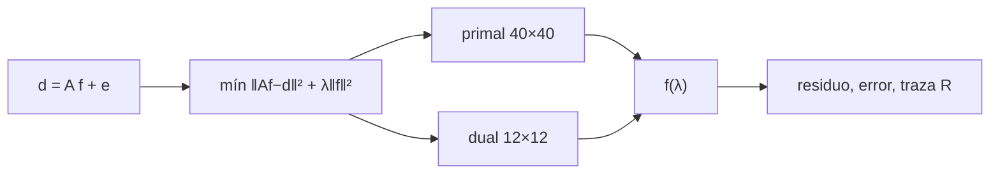

# B37-C10 — Inversión asterosísmica de perfiles internos

<!-- nav:top -->
[🏠 Programa](../../../../README.md) · [📚 Bloque B37](../../../tronco-comun/B37-interiores-estelares-y-asterosismologia.md) · [← Anterior: B37-C09 — Frecuencias características: Δν, νmax y espaciado de períodos](../B37-C09-frecuencias-caracteristicas-max-y-espaciado-de-periodos/CLASE.md) · [Siguiente: B37-C11 — Rotación interna a partir del desdoblamiento de frecuencias →](../B37-C11-rotacion-interna-a-partir-del-desdoblamiento-de-frecuencias/CLASE.md)
<!-- /nav -->

## 1. Ubicación, nivel y alcance

Clase 10 del bloque B37. Nivel N3. Una **inversión** recupera una función interna a partir de pocos datos integrados. Aquí resuelves un problema lineal con 12 datos y 40 incógnitas por **Tikhonov**, por dos vías algebraicamente equivalentes (primal y dual), y estudias el compromiso entre ajuste y regularización con la **matriz de resolución**. Usas [B12](../../../tronco-comun/B12-probabilidad-estadistica-e-incertidumbre.md). Los núcleos no son los de una estrella real.

## 2. Por qué esta clase existe

Los datos son pocos y ruidosos y las incógnitas muchas. La decisión central: **¿cuánta regularización aplicar para no ajustar el ruido ni borrar la señal?**

## 3. Lo que podrás hacer al terminar

1. Plantear `d = A f + e`.
2. Resolver la solución de Tikhonov en forma primal y dual.
3. Medir el residuo y el error frente a `λ`.
4. Calcular la traza de la matriz de resolución.
5. Aplicar el principio de discrepancia.
6. Reconocer el sesgo y la varianza.

La evidencia es la **ficha de la inversión** del ejercicio 12 (sección 20).

## 4. Con qué llegas y cómo comprobarlo

1. ¿Qué es una incertidumbre?
2. ¿Qué es una simulación Monte Carlo?
3. ¿Qué es una tabla de resultados?
4. ¿Qué es un valor ilustrativo?
5. ¿Qué es una verificación?

<details>
<summary>Ver respuestas</summary>

1. Un intervalo en que se espera el valor verdadero. 2. Repetir con números aleatorios de semilla fija. 3. Un resumen ordenado de cálculos. 4. Un valor propuesto para el ejemplo, no medido. 5. Comparar un cálculo con un caso independiente.
</details>

Con cuatro o cinco aciertos, sigue; si no, repasa los prerrequisitos.

## 5. Un caso de contexto y casos de referencia

Con 12 datos de ruido `σ = 0,01` y 40 incógnitas (**sintéticos**), un `λ = 10⁻⁸` ajusta los datos (residuo `0,00134`) pero da un error en `f` de `10,868`; con `λ = 10⁻³` el error baja a `0,09767` y la traza de la resolución es `6,956`. Es el **ejemplo conductor**.

## 6. Vocabulario

Un **problema inverso** recupera la causa desde el efecto. Un **problema mal planteado** amplifica el ruido. La **regularización de Tikhonov** minimiza `‖A f − d‖² + λ‖f‖²`. La **matriz de resolución** `R = A(AᵀA + λI)⁻¹Aᵀ` dice cuánta información hay por dato. El **principio de discrepancia** elige `λ` con residuo igual al ruido.

## 7. Modelo mental: enfocar una imagen borrosa

Es como enfocar una foto borrosa: si ajustas demasiado, ves el ruido del sensor como si fueran detalles; si ajustas poco, queda borrosa. La regularización es el botón de enfoque.



*Descripción textual:* se resuelve un problema lineal regularizado por dos vías equivalentes y se explora el parámetro `λ`.

Analogía: enfocar una imagen borrosa. Límite: problema lineal, ruido gaussiano independiente.

## 8. La explicación, paso a paso

### 8.1 El compromiso

| `λ` | Residuo rms | Error rms de `f` | Traza de `R` |
|---|---|---|---|
| 10⁻⁸ | 0,00134 | 10,86796 | 11,651 |
| 10⁻⁵ | 0,00544 | 0,26891 | 9,273 |
| 10⁻⁴ | 0,00588 | 0,12268 | 8,207 |
| 10⁻³ | 0,00650 | 0,09767 | 6,956 |
| 10⁻² | 0,01574 | 0,10507 | 5,412 |
| 10⁻¹ | 0,07912 | 0,15766 | 3,349 |

El residuo crece con `λ`, pero el error frente a la verdad tiene un mínimo interior en `λ = 10⁻³`. Con `λ = 10⁻⁸` los datos casi se reproducen (`0,00134 < σ = 0,01`: sobreajuste) y el error de `f` es 111 veces mayor.

### 8.2 Las dos vías

La forma primal (40 × 40) y la dual `f = Aᵀ(AAᵀ + λI)⁻¹d` (12 × 12) coinciden en cada `λ` (diferencia máxima menor que `10⁻⁶`). La segunda es mucho más barata cuando hay pocos datos.

### 8.3 Sin ruido

Con datos sin ruido y `λ = 10⁻⁸`, el residuo es `1,23 × 10⁻⁶`: el ajuste es casi exacto, por lo que el error del caso con ruido viene del ruido amplificado.

### 8.4 Discrepancia

El principio de discrepancia pide residuo `≈ σ = 0,01`; en la malla de `λ` el más cercano es `10⁻³` (residuo `0,00650`), que coincide con el mínimo del error.

### 8.5 Lectura

La traza de `R` (de 11,65 a 3,35) mide los grados de libertad que los datos determinan: a mayor `λ`, menos. La función recuperada es un **promedio** de la verdadera con la resolución `R`, no la verdad.

## 9. Magnitudes, símbolos y unidades

| Símbolo | Qué es | Unidad | Valor / nota |
|---|---|---|---|
| `A` | matriz de núcleos (12 × 40) | — | gaussianas de ancho 0,12 |
| `λ` | parámetro de regularización | — | 10⁻⁸ a 10⁻¹ |
| `σ` | ruido de los datos | — | 0,01 (sintético) |
| `R` | matriz de resolución | — | traza de 3,35 a 11,65 |

## 10. Convenciones y referencias

Problema lineal discretizado en 40 puntos; ruido gaussiano independiente; regularización de orden cero; semilla `20261109`.

## 11. De dónde sale lo que afirmamos

| ID | Fuente | Localizador | Respalda | Estado |
|---|---|---|---|---|
| — | Sin fuente externa | — | relaciones estándar que verifica el laboratorio | No se consultó una fuente para esta clase |

Límites: los núcleos no son de una estrella real y no se invirtió ningún perfil interno.

## 12. Cómo ver el compromiso

| `λ` | Error de `f` |
|---|---|
| 10⁻⁸ | 10,86796 |
| 10⁻³ | 0,09767 |
| 10⁻¹ | 0,15766 |

Descripción larga: el error tiene un mínimo interior en `λ = 10⁻³`.

## 13. Ejemplo trabajado: el cociente de errores

**Paso 1 · Error pequeño.** `λ = 10⁻³`: `0,09767`.

**Paso 2 · Error grande.** `λ = 10⁻⁸`: `10,86796`.

**Paso 3 · Cociente.** `10,86796/0,09767 = 111,3`.

## 14. Distintas formas de describir un problema inverso

**Por formulación:** primal y dual. **Por parámetro:** `λ`. **Por criterio:** discrepancia. **Por información:** traza de `R`.

## 15. Práctica guiada

**Ejercicio 1 · con los pasos indicados.** Cociente de errores entre `λ = 10⁻⁸` y `10⁻³`. *Pasos:* división.

<details><summary>Solución comentada</summary>

`111,3`.
</details>

**Ejercicio 2 · con una pista.** Residuo de `λ = 10⁻¹` frente a `σ`.

<details><summary>Solución comentada</summary>

`0,07912/0,01 = 7,9`: subajuste.
</details>

**Ejercicio 3 · casi autónomo.** Grados de libertad suprimidos con `λ = 10⁻³`.

<details><summary>Solución comentada</summary>

`12 − 6,956 = 5,04`.
</details>

## 16. Práctica autónoma, transferencia e integrador

**Ejercicio 4.** ¿Con qué `λ` es mínimo el error?

<details><summary>Solución comentada</summary>

`10⁻³`.
</details>

**Ejercicio 5.** ¿Cuántas ecuaciones resuelve la forma dual?

<details><summary>Solución comentada</summary>

12.
</details>

**Ejercicio 6.** Diferencia de error entre `λ = 10⁻³` y `10⁻²`.

<details><summary>Solución comentada</summary>

`0,10507 − 0,09767 = 0,0074`.
</details>

**Ejercicio 7.** ¿Qué indica el residuo `0,00134` de `λ = 10⁻⁸`?

<details><summary>Solución comentada</summary>

Sobreajuste: es menor que el ruido.
</details>

**Ejercicio 8.** Traza de `R` si `λ → 0`.

<details><summary>Solución comentada</summary>

Tiende a 12, el número de datos.
</details>

**Ejercicio 9 · transferencia.** **Transferencia.** Un compañero dice que invirtió el interior del Sol. Responde.

<details><summary>Solución comentada</summary>

El laboratorio usa núcleos y datos sintéticos.
</details>

**Ejercicio 10 · transferencia.** **Transferencia.** ¿Por qué un ajuste perfecto es sospechoso?

<details><summary>Solución comentada</summary>

Ajusta el ruido.
</details>

**Ejercicio 11 · transferencia.** **Transferencia.** ¿Qué es la resolución?

<details><summary>Solución comentada</summary>

El promedio local con el que la solución aproxima a la verdad.
</details>

**Ejercicio 12.** **Integrador.** Elabora tu *ficha de la inversión*: `λ`, residuo, error y resolución.

<details><summary>Solución comentada</summary>

Secciones 8.1–8.5.
</details>

**Ejercicio 12 · integrador.** **Integrador.** Elabora tu *ficha de la inversión*: `λ`, residuo, error y resolución.

<details><summary>Solución modelo</summary>

Secciones 8.1–8.5.
</details>

## 17. Laboratorio: inversión de Tikhonov

El script [inversion.py](inversion.py) resuelve la inversión por dos vías y explora `λ` (**comprueba** que primal y dual coinciden y que el error tiene un mínimo interior).

**Datos:** ninguna constante; datos y núcleos **sintéticos**; semilla `20261109`. **Predice antes de ejecutar:** ¿qué `λ` dará el menor error? (uno intermedio.) **Ejecución del 2026-11-09 (Python 3.12.9):**

```text
Python 3.12.9 (biblioteca estandar)
12 datos, 40 incognitas; max dato = 0.7335; sigma = 0.01
   lambda  residuo rms  error rms de f  traza R
    1e-08      0.00134        10.86796   11.651
    1e-05      0.00544         0.26891    9.273
    1e-04      0.00588         0.12268    8.207
    1e-03      0.00650         0.09767    6.956
    1e-02      0.01574         0.10507    5.412
    1e-01      0.07912         0.15766    3.349
sin ruido, lambda = 1e-8: residuo rms = 1.23e-06
lambda de minimo error: 1e-03 (error 0.09767); el discrepancy principle pide residuo rms = sigma = 0.01
lambda por discrepancia: 1e-03 (residuo rms 0.00650, error de f 0.09767)
Pruebas superadas.
```

```bash
python programa/clases/B37/B37-C10-inversion-asterosismica-de-perfiles-internos/inversion.py
```

**Límites:** lineal, ruido independiente.

## 18. Errores frecuentes y cómo corregirlos

**Minimizar solo el residuo.** Se corrige con 8.1.

**Tomar la solución como la verdad.** Se corrige con 8.5.

**Usar la forma primal con muchos datos.** Se corrige con 8.2.

**Presentar el resultado como un perfil estelar.** Se corrige en la sección 10.

## 19. Cómo sabrás que vas bien

Tras la sección 8: ¿qué resultado esperabas y cuál obtuviste? Si dudas, repasa el ejemplo 13. Tras el laboratorio: ¿qué comprueba? (ver la sección 17).

## 20. Qué entregas y cómo se evalúa

El producto es tu **ficha de la inversión** (ejercicio 12).

| Criterio | Inicial | En desarrollo | Logrado | Destacado |
|---|---|---|---|---|
| Conceptos | Los confunde | Parciales | conceptos de la clase | Explica los límites |
| Cálculo | Sin unidades | Con errores | Tablas completas | Calcula casos nuevos |
| Numérico | Sin comprobar | Un caso | Contraste con el análisis | Interpreta las diferencias |
| Fuentes | Sin fuente | Sin fecha | fuentes con fecha | Declara lo ilustrativo |
| Límites | No los nombra | Uno | Tres | Discute qué falta del modelo |

**Condiciones críticas (no se compensan con promedio):** rotular los datos como sintéticos; no presentar la inversión como un perfil real; citar solo lo consultado.

## 21. Ética, seguridad y límites

Clase educativa: los modelos son simplificados. Accesibilidad: tablas equivalentes a las gráficas, fórmulas en texto, ejercicios sin conexión.

## 22. Para cerrar y seguir

La regularización equilibra ajuste y ruido, y la resolución dice qué se aprende. Queda una pregunta: ¿cómo se mide con qué velocidad gira el interior?

**Glosario español–inglés.** inversión · *inversion*; regularización · *regularization*; resolución · *resolution*; núcleo · *kernel*; principio de discrepancia · *discrepancy principle*.

**Continuidad.** [B37-C11](../B37-C11-rotacion-interna-a-partir-del-desdoblamiento-de-frecuencias/CLASE.md) estudia la rotación interna.

**Referencias:** ver sección 11.

<!-- nav:bottom -->
---

[← Anterior: B37-C09 — Frecuencias características: Δν, νmax y espaciado de períodos](../B37-C09-frecuencias-caracteristicas-max-y-espaciado-de-periodos/CLASE.md) · [📚 Bloque B37](../../../tronco-comun/B37-interiores-estelares-y-asterosismologia.md) · [Siguiente: B37-C11 — Rotación interna a partir del desdoblamiento de frecuencias →](../B37-C11-rotacion-interna-a-partir-del-desdoblamiento-de-frecuencias/CLASE.md)
<!-- /nav -->
