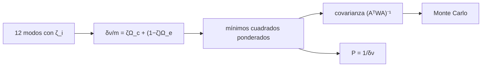

# B37-C11 — Rotación interna a partir del desdoblamiento de frecuencias

<!-- nav:top -->
[🏠 Programa](../../../../README.md) · [📚 Bloque B37](../../../tronco-comun/B37-interiores-estelares-y-asterosismologia.md) · [← Anterior: B37-C10 — Inversión asterosísmica de perfiles internos](../B37-C10-inversion-asterosismica-de-perfiles-internos/CLASE.md) · [Siguiente: B37-C12 — Gigantes rojas oscilantes y modos mixtos →](../B37-C12-gigantes-rojas-oscilantes-y-modos-mixtos/CLASE.md)
<!-- /nav -->

## 1. Ubicación, nivel y alcance

Clase 11 del bloque B37. Nivel N3. La rotación desdobla los modos en sus componentes `m`: `δν = m Ω_eff/2π`. Aquí ajustas por **mínimos cuadrados ponderados** las rotaciones de **núcleo y envoltura** a partir del desdoblamiento de 12 modos dipolares con distinta fracción de inercia en el núcleo, comparas la covarianza analítica con **Monte Carlo** y conviertes a períodos. Usas [B12](../../../tronco-comun/B12-probabilidad-estadistica-e-incertidumbre.md). Todo es sintético.

## 2. Por qué esta clase existe

El desdoblamiento promedia la rotación de las regiones que el modo explora. La decisión central: **¿cuánto giran el núcleo y la envoltura y con qué incertidumbre y correlación?**

## 3. Lo que podrás hacer al terminar

1. Plantear `δν/m = ζ Ω_c + (1 − ζ) Ω_e` en unidades de frecuencia.
2. Ajustar `Ω_c` y `Ω_e` con pesos.
3. Calcular su covarianza analítica.
4. Contrastarla con Monte Carlo.
5. Convertir a períodos de rotación.
6. Reconocer el límite de la rotación rígida.

La evidencia es la **ficha de la rotación interna** del ejercicio 12 (sección 20).

## 4. Con qué llegas y cómo comprobarlo

1. ¿Qué es una incertidumbre?
2. ¿Qué es una simulación Monte Carlo?
3. ¿Qué es una tabla de resultados?
4. ¿Qué es un valor ilustrativo?
5. ¿Qué es una verificación?

<details>
<summary>Ver respuestas</summary>

1. Un intervalo en que se espera el valor verdadero. 2. Repetir con números aleatorios de semilla fija. 3. Un resumen ordenado de cálculos. 4. Un valor propuesto para el ejemplo, no medido. 5. Comparar un cálculo con un caso independiente.
</details>

Con cuatro o cinco aciertos, sigue; si no, repasa los prerrequisitos.

## 5. Un caso de contexto y casos de referencia

Con `Ω_c/2π = 0,60 μHz`, `Ω_e/2π = 0,06 μHz` y ruido de `0,01 μHz` (**sintéticos**), el ajuste da `0,6023 ± 0,0064` y `0,0645 ± 0,0064 μHz`, con correlación `−0,597`; el núcleo gira con un período de `19,22 d` y la envoltura con `179,3 d`. Es el **ejemplo conductor**.

## 6. Vocabulario

El **desdoblamiento rotacional** separa las frecuencias de `m = −l, …, +l`. La **fracción de inercia** `ζ` pesa cada región. La **rotación diferencial** es que las zonas giran distinto. El **coeficiente de Ledoux** `C_nl` corrige por la fuerza de Coriolis; para modos g de dipolo vale `1/(l(l+1)) = 1/2`. Un **cuerpo rígido** tiene un único `Ω`.

## 7. Modelo mental: dos discos en un eje

Es como medir la velocidad de dos discos que giran a distinto ritmo con una luz que ilumina más uno u otro: cada modo es una luz distinta, y combinando varias se separan las dos velocidades.



*Descripción textual:* cada modo promedia la rotación según su fracción de inercia y varios modos permiten separar las dos zonas.

Analogía: dos discos en un eje. Límite: rotación lenta (primer orden), dos zonas.

## 8. La explicación, paso a paso

### 8.1 Los datos

| `ζ` | `δν/m` (μHz) |
|---|---|
| 0,100 | 0,1187 |
| 0,318 | 0,2247 |
| 0,536 | 0,3724 |
| 0,755 | 0,4741 |

### 8.2 El ajuste

`Ω_c/2π = 0,6023 ± 0,0064 μHz` (verdadero 0,60) y `Ω_e/2π = 0,0645 ± 0,0064 μHz` (verdadero 0,06): ambos dentro de 3 σ. La correlación es `−0,597` y el cociente núcleo/envoltura `9,33` (verdadero `10,00`).

### 8.3 Monte Carlo

Con 2000 realizaciones: `σ(Ω_c) = 0,0064` y `σ(Ω_e) = 0,0063 μHz`, iguales a las analíticas dentro del 10 %.

### 8.4 Casos límite

Un cuerpo rígido (`0,25 μHz` en todos los modos) recupera `Ω_c = Ω_e = 0,250000`. Los períodos de rotación son `19,22 d` (núcleo) y `179,3 d` (envoltura). Para dipolo `C = 1/2` y para `l = 2`, `C = 1/6 = 0,1667`.

### 8.5 Lectura

La incertidumbre de la envoltura es la misma que la del núcleo aunque la envoltura gira diez veces más lento: pesa más en términos relativos (`10 %` frente a `1 %`). Dos zonas son un modelo grueso: la rotación real puede variar de forma continua.

## 9. Magnitudes, símbolos y unidades

| Símbolo | Qué es | Unidad | Valor / nota |
|---|---|---|---|
| `Ω_c/2π` | rotación del núcleo | μHz | 0,6023 ± 0,0064 |
| `Ω_e/2π` | rotación de la envoltura | μHz | 0,0645 ± 0,0064 |
| `ζ` | fracción de inercia en el núcleo | — | 0,1 a 0,9 |
| `C` | coeficiente de Ledoux | — | 1/2 para dipolo g |
| `P` | período de rotación | d | 19,22; 179,3 |

## 10. Convenciones y referencias

Primer orden en la rotación; dos zonas; ruido gaussiano independiente de 0,01 μHz; semilla `20261109`; la relación de dos zonas es un modelo de juguete sin fuente consultada.

## 11. De dónde sale lo que afirmamos

| ID | Fuente | Localizador | Respalda | Estado |
|---|---|---|---|---|
| — | Sin fuente externa | — | relaciones estándar que verifica el laboratorio | No se consultó una fuente para esta clase |

Límites: ninguna estrella real se analizó y la relación de dos zonas es una forma simplificada.

## 12. Cómo ver el ajuste

| Parámetro | Ajuste (μHz) | Verdadero (μHz) |
|---|---|---|
| `Ω_c/2π` | 0,6023 ± 0,0064 | 0,60 |
| `Ω_e/2π` | 0,0645 ± 0,0064 | 0,06 |

Descripción larga: ambos parámetros se recuperan dentro de 3 σ.

## 13. Ejemplo trabajado: el período de rotación

**Paso 1 · Frecuencia.** `Ω_c/2π = 0,6023 × 10⁻⁶ Hz`.

**Paso 2 · Período.** `P = 1/(0,6023 × 10⁻⁶) = 1,660 × 10⁶ s`.

**Paso 3 · Días.** `1,660 × 10⁶/86400 = 19,22 d`.

## 14. Distintas formas de describir la rotación del interior

**Por modo:** `ζ`. **Por ajuste:** mínimos cuadrados. **Por incertidumbre:** covarianza y Monte Carlo. **Por caso límite:** cuerpo rígido.

## 15. Práctica guiada

**Ejercicio 1 · con los pasos indicados.** `δν/m` sin ruido para `ζ = 0,5`. *Pasos:* `0,5 × 0,60 + 0,5 × 0,06`.

<details><summary>Solución comentada</summary>

`0,33 μHz`.
</details>

**Ejercicio 2 · con una pista.** Período de la envoltura con `0,0645 μHz`.

<details><summary>Solución comentada</summary>

`179,4 d`.
</details>

**Ejercicio 3 · casi autónomo.** Cociente núcleo/envoltura ajustado y verdadero.

<details><summary>Solución comentada</summary>

`9,33` y `10,00`.
</details>

## 16. Práctica autónoma, transferencia e integrador

**Ejercicio 4.** ¿Qué modo es más sensible al núcleo?

<details><summary>Solución comentada</summary>

El de mayor `ζ`.
</details>

**Ejercicio 5.** Error relativo de `Ω_e`.

<details><summary>Solución comentada</summary>

`0,0064/0,0645 = 9,9 %`.
</details>

**Ejercicio 6.** Error relativo de `Ω_c`.

<details><summary>Solución comentada</summary>

`0,0064/0,6023 = 1,1 %`.
</details>

**Ejercicio 7.** `C` para `l = 2`.

<details><summary>Solución comentada</summary>

`1/6 = 0,1667`.
</details>

**Ejercicio 8.** Valor ajustado si todos los modos dan `0,25`.

<details><summary>Solución comentada</summary>

`Ω_c = Ω_e = 0,25`.
</details>

**Ejercicio 9 · transferencia.** **Transferencia.** Un compañero afirma haber medido la rotación de una gigante roja. Responde.

<details><summary>Solución comentada</summary>

Los datos son sintéticos.
</details>

**Ejercicio 10 · transferencia.** **Transferencia.** ¿Por qué hace falta variedad de `ζ`?

<details><summary>Solución comentada</summary>

Con un solo `ζ` las dos rotaciones no se separan.
</details>

**Ejercicio 11 · transferencia.** **Transferencia.** ¿Qué pasa con la rotación rápida?

<details><summary>Solución comentada</summary>

Hay que ir más allá del primer orden.
</details>

**Ejercicio 12.** **Integrador.** Elabora tu *ficha de la rotación interna*: ajuste, covarianza y períodos.

<details><summary>Solución comentada</summary>

Secciones 8.1–8.5.
</details>

**Ejercicio 12 · integrador.** **Integrador.** Elabora tu *ficha de la rotación interna*: ajuste, covarianza y períodos.

<details><summary>Solución modelo</summary>

Secciones 8.1–8.5.
</details>

## 17. Laboratorio: rotación de núcleo y envoltura

El script [rotacion_interna.py](rotacion_interna.py) ajusta dos rotaciones y contrasta la covarianza con Monte Carlo (**comprueba** 3 σ y 10 %).

**Datos:** ninguna constante; datos **sintéticos**; semilla `20261109`. **Predice antes de ejecutar:** ¿qué zona tendrá el mayor error relativo? (la envoltura.) **Ejecución del 2026-11-09 (Python 3.12.9):**

```text
Python 3.12.9 (biblioteca estandar)
  zeta  delta nu/m [uHz]
 0.100            0.1187
 0.318            0.2247
 0.536            0.3724
 0.755            0.4741
ajuste: Omega_c/2pi = 0.6023 +/- 0.0064 uHz (verdadero 0.6) ; Omega_e/2pi = 0.0645 +/- 0.0064 uHz (verdadero 0.06) ; correlacion = -0.597
cociente de rotacion nucleo/envoltura = 9.33 (verdadero 10.00)
Monte Carlo (2000): sigma(Omega_c) = 0.0064 ; sigma(Omega_e) = 0.0063 uHz
cuerpo rigido (0,25 uHz en todos los modos): Omega_c = 0.250000 ; Omega_e = 0.250000
periodo de rotacion: nucleo = 19.22 d ; envoltura = 179.3 d
C = 1/(l(l+1)) para l = 1: 0.500 ; para l = 2: 0.1667
Pruebas superadas.
```

```bash
python programa/clases/B37/B37-C11-rotacion-interna-a-partir-del-desdoblamiento-de-frecuencias/rotacion_interna.py
```

**Límites:** primer orden, dos zonas.

## 18. Errores frecuentes y cómo corregirlos

**Tomar el desdoblamiento como la rotación superficial.** Se corrige con 8.2.

**Ignorar la correlación.** Se corrige con 8.2.

**Confundir `δν` con `Ω`.** Se corrige con 8.4.

**Presentar los datos como de una estrella real.** Se corrige en la sección 10.

## 19. Cómo sabrás que vas bien

Tras la sección 8: ¿qué resultado esperabas y cuál obtuviste? Si dudas, repasa el ejemplo 13. Tras el laboratorio: ¿qué comprueba? (ver la sección 17).

## 20. Qué entregas y cómo se evalúa

El producto es tu **ficha de la rotación interna** (ejercicio 12).

| Criterio | Inicial | En desarrollo | Logrado | Destacado |
|---|---|---|---|---|
| Conceptos | Los confunde | Parciales | conceptos de la clase | Explica los límites |
| Cálculo | Sin unidades | Con errores | Tablas completas | Calcula casos nuevos |
| Numérico | Sin comprobar | Un caso | Contraste con el análisis | Interpreta las diferencias |
| Fuentes | Sin fuente | Sin fecha | fuentes con fecha | Declara lo ilustrativo |
| Límites | No los nombra | Uno | Tres | Discute qué falta del modelo |

**Condiciones críticas (no se compensan con promedio):** rotular los datos como sintéticos; no presentar rotaciones de estrellas reales; citar solo lo consultado.

## 21. Ética, seguridad y límites

Clase educativa: los modelos son simplificados. Accesibilidad: tablas equivalentes a las gráficas, fórmulas en texto, ejercicios sin conexión.

## 22. Para cerrar y seguir

El desdoblamiento separa la rotación del núcleo y de la envoltura. Queda una pregunta: ¿cómo son los espectros de las gigantes rojas, donde los modos p y g se acoplan?

**Glosario español–inglés.** desdoblamiento · *splitting*; rotación diferencial · *differential rotation*; núcleo · *core*; envoltura · *envelope*; mínimos cuadrados · *least squares*.

**Continuidad.** [B37-C12](../B37-C12-gigantes-rojas-oscilantes-y-modos-mixtos/CLASE.md) estudia las gigantes rojas.

**Referencias:** ver sección 11.

<!-- nav:bottom -->
---

[← Anterior: B37-C10 — Inversión asterosísmica de perfiles internos](../B37-C10-inversion-asterosismica-de-perfiles-internos/CLASE.md) · [📚 Bloque B37](../../../tronco-comun/B37-interiores-estelares-y-asterosismologia.md) · [Siguiente: B37-C12 — Gigantes rojas oscilantes y modos mixtos →](../B37-C12-gigantes-rojas-oscilantes-y-modos-mixtos/CLASE.md)
<!-- /nav -->
