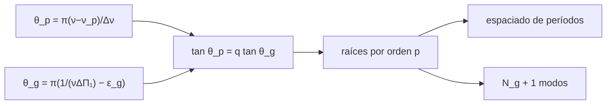

# B37-C12 — Gigantes rojas oscilantes y modos mixtos

<!-- nav:top -->
[🏠 Programa](../../../../README.md) · [📚 Bloque B37](../../../tronco-comun/B37-interiores-estelares-y-asterosismologia.md) · [← Anterior: B37-C11 — Rotación interna a partir del desdoblamiento de frecuencias](../B37-C11-rotacion-interna-a-partir-del-desdoblamiento-de-frecuencias/CLASE.md) · [Siguiente: B37-C13 — Series fotométricas de Kepler, TESS y PLATO para asterosismología →](../B37-C13-series-fotometricas-de-kepler-tess-y-plato-para-asterosismologia/CLASE.md)
<!-- /nav -->

## 1. Ubicación, nivel y alcance

Clase 12 del bloque B37. Nivel N3. En una gigante roja los modos de presión de la envoltura y los de gravedad del núcleo se **acoplan** y forman modos **mixtos**. Aquí resuelves numéricamente la **relación asintótica** `tan θ_p = q tan θ_g` para una gigante sintética, contrastas el número de raíces con la cuenta de modos g puros y estudias el **espaciado de períodos** para dos valores de `ΔΠ₁`. Usas [B12](../../../tronco-comun/B12-probabilidad-estadistica-e-incertidumbre.md). Todo es sintético.

## 2. Por qué esta clase existe

El espaciado de los períodos mixtos revela el núcleo. La decisión central: **¿cuántos modos mixtos hay por orden p y cómo distingue `ΔΠ₁` la rama de gigantes del núcleo de helio?**

## 3. Lo que podrás hacer al terminar

1. Plantear la relación de acoplamiento.
2. Hallar las raíces por orden p.
3. Contrastar con el recuento de modos g.
4. Verificar el límite `q → 0`.
5. Calcular el espaciado de períodos mínimo y máximo.
6. Interpretar `ΔΠ₁` de 80 y 300 s.

La evidencia es la **ficha de modos mixtos** del ejercicio 12 (sección 20).

## 4. Con qué llegas y cómo comprobarlo

1. ¿Qué es una incertidumbre?
2. ¿Qué es una simulación Monte Carlo?
3. ¿Qué es una tabla de resultados?
4. ¿Qué es un valor ilustrativo?
5. ¿Qué es una verificación?

<details>
<summary>Ver respuestas</summary>

1. Un intervalo en que se espera el valor verdadero. 2. Repetir con números aleatorios de semilla fija. 3. Un resumen ordenado de cálculos. 4. Un valor propuesto para el ejemplo, no medido. 5. Comparar un cálculo con un caso independiente.
</details>

Con cuatro o cinco aciertos, sigue; si no, repasa los prerrequisitos.

## 5. Un caso de contexto y casos de referencia

Con `Δν = 9,0 μHz`, `ν_p = 100 μHz`, `q = 0,15` y `ΔΠ₁ = 80 s` (**sintéticos**) hay `13` raíces en una ventana de un orden p, frente a `11,27` modos g puros más el modo p; el espaciado de períodos va de `53,28` a `79,00 s`. Con `ΔΠ₁ = 300 s` hay `4` raíces y el espaciado va de `157,55` a `277,29 s`. Es el **ejemplo conductor**.

## 6. Vocabulario

Un **modo mixto** tiene carácter p en la envoltura y g en el núcleo. El **acoplamiento** `q` mide cuánto se filtran. La **relación asintótica** `tan[π(ν − ν_p)/Δν] = q tan[π(1/(νΔΠ₁) − ε_g)]`. El **espaciado de períodos** `ΔΠ₁` es la constante de los modos g de dipolo. El número de modos g por ventana es `N_g = (1/ΔΠ₁)(1/ν_min − 1/ν_max)`.

## 7. Modelo mental: dos péndulos acoplados

Es como dos péndulos unidos por un resorte: sus frecuencias se repelen y cada modo comparte movimiento de ambos. Cerca de la resonancia el intercambio es máximo.



*Descripción textual:* la relación de acoplamiento se resuelve por raíces en cada orden p y se contrasta con el recuento de modos g.

Analogía: dos péndulos acoplados. Límite: forma asintótica con acoplamiento constante.

## 8. La explicación, paso a paso

### 8.1 Recuento

| `ΔΠ₁` (s) | `N_g` en la ventana | Raíces | Espaciado mín. / máx. (s) |
|---|---|---|---|
| 80 | 11,27 | 13 | 53,28 / 79,00 |
| 300 | 3,01 | 4 | 157,55 / 277,29 |

Las raíces son `N_g + 1` (los modos g más el modo p), con una diferencia de ±1,5 por los bordes de la ventana.

### 8.2 El límite sin acoplamiento

Con `q = 10⁻⁴` las `13` raíces caen todas a menos de `0,02 μHz` de un modo puro: los de presión en `ν_p + kΔν` o los de gravedad, donde `1/(νΔΠ₁) = k + 1/2 + ε_g`.

### 8.3 El espaciado

El espaciado mínimo de períodos (`53,3 s`) ocurre en `ν = 100,14 μHz`, a `0,14 μHz` de `ν_p`: los modos se **apiñan** en el modo p. Lejos de él, el espaciado tiende al valor g puro, siempre menor que `ΔΠ₁`.

### 8.4 El núcleo

El máximo espaciado observable vale casi `ΔΠ₁` (79,00 de 80; 277,29 de 300): medirlo da `ΔΠ₁` y ese número diferencia las gigantes con capa de hidrógeno de las de núcleo de helio (valores del orden de 50 s y de 100 a 300 s según el resumen de Bedding et al., 2011; no se leyó el artículo).

### 8.5 Lectura

La relación asintótica es una forma estándar con `q` constante; los espectros reales exigen ajustar también `q`, `ε_g` y el efecto de la rotación (C11).

## 9. Magnitudes, símbolos y unidades

| Símbolo | Qué es | Unidad | Valor / nota |
|---|---|---|---|
| `Δν` | separación grande | μHz | 9,0 (sintético) |
| `q` | acoplamiento p-g | — | 0,15 (sintético) |
| `ΔΠ₁` | espaciado de períodos g | s | 80 y 300 (sintéticos) |
| `N_g` | modos g por ventana | — | 11,27; 3,01 |
| `ε_g` | fase g | — | 0,25 (sintético) |

## 10. Convenciones y referencias

Relación asintótica con acoplamiento constante; sin rotación; parámetros sintéticos; semilla no usada (determinista).

## 11. De dónde sale lo que afirmamos

| ID | Fuente | Localizador | Respalda | Estado |
|---|---|---|---|---|
| S1 | Bedding et al., *Gravity modes as a way to distinguish between hydrogen- and helium-burning red giant stars* (Nature 471, 608; arXiv:1103.5805) | https://arxiv.org/abs/1103.5805 | que los espaciados de períodos de gigantes con capa de hidrógeno son menores que los de gigantes con núcleo de helio | Solo resumen obtenido por búsqueda, consultado el 2026-11-09; no se leyó el artículo |
| S2 | Valores y modelo del laboratorio | — | `Δν`, `ν_p`, `q`, `ε_g`, `ΔΠ₁` | Ilustrativo o sintético; no consultado |

Límites: no se analizó ninguna gigante real y el resumen consultado no valida las cifras del laboratorio.

## 12. Cómo ver los modos mixtos

| `ΔΠ₁` (s) | Raíces |
|---|---|
| 80 | 13 |
| 300 | 4 |

Descripción larga: cuanto mayor es `ΔΠ₁`, menos modos mixtos hay por orden p.

## 13. Ejemplo trabajado: el número de modos g

**Paso 1 · Frecuencias.** `ν_min = 95,5` y `ν_max = 104,5 μHz`.

**Paso 2 · Inversas.** `1/95,5 − 1/104,5 = 9,018 × 10⁻⁴ μHz⁻¹`.

**Paso 3 · Cuenta.** `10⁶/80 × 9,018 × 10⁻⁴ = 11,27`.

## 14. Distintas formas de describir un espectro mixto

**Por ecuación:** acoplamiento. **Por recuento:** `N_g + 1`. **Por límite:** `q → 0`. **Por espaciado:** `ΔΠ₁`.

## 15. Práctica guiada

**Ejercicio 1 · con los pasos indicados.** `N_g` para `ΔΠ₁ = 300 s`. *Pasos:* `(10⁶/300) × 9,018 × 10⁻⁴`.

<details><summary>Solución comentada</summary>

`3,01`.
</details>

**Ejercicio 2 · con una pista.** Raíces esperadas con `ΔΠ₁ = 80`.

<details><summary>Solución comentada</summary>

`N_g + 1 = 12,27`; se hallan 13.
</details>

**Ejercicio 3 · casi autónomo.** Cociente de raíces 80 s frente a 300 s.

<details><summary>Solución comentada</summary>

`13/4 = 3,25`.
</details>

## 16. Práctica autónoma, transferencia e integrador

**Ejercicio 4.** Espaciado máximo relativo a `ΔΠ₁` (80 s).

<details><summary>Solución comentada</summary>

`79,00/80 = 0,988`.
</details>

**Ejercicio 5.** Espaciado máximo relativo a `ΔΠ₁` (300 s).

<details><summary>Solución comentada</summary>

`277,29/300 = 0,924`.
</details>

**Ejercicio 6.** ¿Dónde se apiñan los modos?

<details><summary>Solución comentada</summary>

Cerca de `ν_p`: `100,14 μHz`.
</details>

**Ejercicio 7.** ¿Qué pasa con las raíces si `q → 0`?

<details><summary>Solución comentada</summary>

Caen sobre los modos puros.
</details>

**Ejercicio 8.** Reducción del espaciado mínimo respecto de `ΔΠ₁ = 80`.

<details><summary>Solución comentada</summary>

`53,28/80 = 0,666`.
</details>

**Ejercicio 9 · transferencia.** **Transferencia.** Un compañero clasifica una estrella real con `ΔΠ₁ = 80 s`. Responde.

<details><summary>Solución comentada</summary>

El laboratorio es sintético.
</details>

**Ejercicio 10 · transferencia.** **Transferencia.** ¿Por qué `ΔΠ₁` mayor da menos modos?

<details><summary>Solución comentada</summary>

Porque `N_g ∝ 1/ΔΠ₁`.
</details>

**Ejercicio 11 · transferencia.** **Transferencia.** ¿Qué hace la rotación a un mixto?

<details><summary>Solución comentada</summary>

Lo desdobla en `m` con `ζ` distinta.
</details>

**Ejercicio 12.** **Integrador.** Elabora tu *ficha de modos mixtos*: raíces, espaciados y límite.

<details><summary>Solución comentada</summary>

Secciones 8.1–8.5.
</details>

**Ejercicio 12 · integrador.** **Integrador.** Elabora tu *ficha de modos mixtos*: raíces, espaciados y límite.

<details><summary>Solución modelo</summary>

Secciones 8.1–8.5.
</details>

## 17. Laboratorio: modos mixtos de una gigante

El script [modos_mixtos.py](modos_mixtos.py) halla las raíces de la relación de acoplamiento (**comprueba** que son `N_g + 1` y que `q → 0` recupera los modos puros).

**Datos:** ninguna constante; parámetros **sintéticos**. **Predice antes de ejecutar:** ¿cuántas raíces habrá con `ΔΠ₁ = 300`? (unas 4.) **Ejecución del 2026-11-09 (Python 3.12.9):**

```text
Python 3.12.9 (biblioteca estandar)
DeltaPi1 [s]  N_g en la ventana  raices    espaciado de periodos min / max [s]
          80              11.27      13             53.28 / 79.00
         300               3.01       4            157.55 / 277.29
q = 1e-4: 13 raices, 13 a menos de 0,02 uHz de un modo puro p o g
espaciado minimo = 53.3 s en el periodo 9986 s (nu = 100.14 uHz, nu_p = 100.0)
Pruebas superadas.
```

```bash
python programa/clases/B37/B37-C12-gigantes-rojas-oscilantes-y-modos-mixtos/modos_mixtos.py
```

**Límites:** acoplamiento constante.

## 18. Errores frecuentes y cómo corregirlos

**Creer que el espaciado es constante.** Se corrige con 8.3.

**Olvidar el modo p.** Se corrige con 8.1.

**Tomar las cifras como reales.** Se corrige en la sección 10.

**Ignorar la rotación.** Se corrige con 8.5.

## 19. Cómo sabrás que vas bien

Tras la sección 8: ¿qué resultado esperabas y cuál obtuviste? Si dudas, repasa el ejemplo 13. Tras el laboratorio: ¿qué comprueba? (ver la sección 17).

## 20. Qué entregas y cómo se evalúa

El producto es tu **ficha de modos mixtos** (ejercicio 12).

| Criterio | Inicial | En desarrollo | Logrado | Destacado |
|---|---|---|---|---|
| Conceptos | Los confunde | Parciales | conceptos de la clase | Explica los límites |
| Cálculo | Sin unidades | Con errores | Tablas completas | Calcula casos nuevos |
| Numérico | Sin comprobar | Un caso | Contraste con el análisis | Interpreta las diferencias |
| Fuentes | Sin fuente | Sin fecha | fuentes con fecha | Declara lo ilustrativo |
| Límites | No los nombra | Uno | Tres | Discute qué falta del modelo |

**Condiciones críticas (no se compensan con promedio):** rotular los parámetros como sintéticos; no clasificar estrellas reales; citar solo lo consultado.

## 21. Ética, seguridad y límites

Clase educativa: los modelos son simplificados. Accesibilidad: tablas equivalentes a las gráficas, fórmulas en texto, ejercicios sin conexión.

## 22. Para cerrar y seguir

Los modos mixtos permiten leer `ΔΠ₁` en el núcleo. Queda una pregunta: ¿cómo se obtienen estos espectros de una serie fotométrica?

**Glosario español–inglés.** modo mixto · *mixed mode*; acoplamiento · *coupling*; gigante roja · *red giant*; espaciado de períodos · *period spacing*; raíz · *root*.

**Continuidad.** [B37-C13](../B37-C13-series-fotometricas-de-kepler-tess-y-plato-para-asterosismologia/CLASE.md) estudia las series fotométricas.

**Referencias:** ver sección 11.

<!-- nav:bottom -->
---

[← Anterior: B37-C11 — Rotación interna a partir del desdoblamiento de frecuencias](../B37-C11-rotacion-interna-a-partir-del-desdoblamiento-de-frecuencias/CLASE.md) · [📚 Bloque B37](../../../tronco-comun/B37-interiores-estelares-y-asterosismologia.md) · [Siguiente: B37-C13 — Series fotométricas de Kepler, TESS y PLATO para asterosismología →](../B37-C13-series-fotometricas-de-kepler-tess-y-plato-para-asterosismologia/CLASE.md)
<!-- /nav -->
