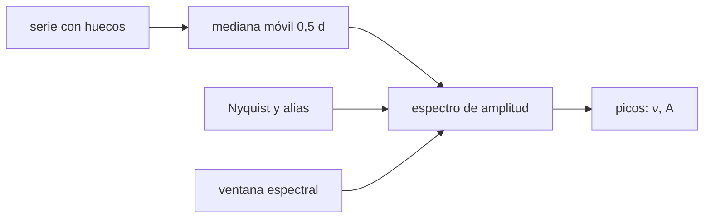

# B37-C13 — Series fotométricas de Kepler, TESS y PLATO para asterosismología

<!-- nav:top -->
[🏠 Programa](../../../../README.md) · [📚 Bloque B37](../../../tronco-comun/B37-interiores-estelares-y-asterosismologia.md) · [← Anterior: B37-C12 — Gigantes rojas oscilantes y modos mixtos](../B37-C12-gigantes-rojas-oscilantes-y-modos-mixtos/CLASE.md) · [Siguiente: B37-C14 — Ajuste de modelos estelares a frecuencias sísmicas →](../B37-C14-ajuste-de-modelos-estelares-a-frecuencias-sismicas/CLASE.md)
<!-- /nav -->

## 1. Ubicación, nivel y alcance

Clase 13 del bloque B37. Nivel N3. Para ver oscilaciones de decenas de partes por millón hace falta una serie larga, filtrada y con la ventana espectral conocida. Aquí construyes una serie **sintética** de 10 días con cadencia de 120 s, un hueco de 1 día, una tendencia lenta y ruido, la **filtras**, calculas su **espectro de amplitud** y mides la amplitud y la precisión en frecuencia de las oscilaciones inyectadas. Usas [B12](../../../tronco-comun/B12-probabilidad-estadistica-e-incertidumbre.md). Las cadencias reales de misiones no se usan como dato.

## 2. Por qué esta clase existe

El análisis sísmico depende de cómo se prepara la serie. La decisión central: **¿qué hace el muestreo, los huecos y el filtro con las frecuencias y amplitudes recuperadas?**

## 3. Lo que podrás hacer al terminar

1. Calcular la frecuencia de Nyquist y el alias.
2. Filtrar una tendencia con una mediana móvil.
3. Calcular el espectro de amplitud con huecos.
4. Medir amplitud y frecuencia recuperadas.
5. Comparar la precisión con la expresión teórica.
6. Medir los lóbulos de la ventana con y sin hueco.

La evidencia es la **ficha de la serie fotométrica** del ejercicio 12 (sección 20).

## 4. Con qué llegas y cómo comprobarlo

1. ¿Qué es una incertidumbre?
2. ¿Qué es una simulación Monte Carlo?
3. ¿Qué es una tabla de resultados?
4. ¿Qué es un valor ilustrativo?
5. ¿Qué es una verificación?

<details>
<summary>Ver respuestas</summary>

1. Un intervalo en que se espera el valor verdadero. 2. Repetir con números aleatorios de semilla fija. 3. Un resumen ordenado de cálculos. 4. Un valor propuesto para el ejemplo, no medido. 5. Comparar un cálculo con un caso independiente.
</details>

Con cuatro o cinco aciertos, sigue; si no, repasa los prerrequisitos.

## 5. Un caso de contexto y casos de referencia

Con cadencia de `120 s` la frecuencia de Nyquist es `4166,67 μHz` y la resolución `1/T = 1,1574 μHz`; una señal de `4500 μHz` reaparece en `3833,33 μHz` con el signo cambiado (diferencia máxima `1,42 × 10⁻¹²`). El filtro reduce la amplitud a baja frecuencia de `216,3` a `6,73 ppm` (factor `32`). Es el **ejemplo conductor**; todo es **sintético**.

## 6. Vocabulario

La **cadencia** `Δt` fija la **frecuencia de Nyquist** `1/(2Δt)`. Un **alias** es una frecuencia por encima de Nyquist que aparece reflejada. El **ciclo de trabajo** es la fracción de muestras válidas. Un **filtro pasa-altos** quita las variaciones lentas. La **ventana espectral** es la respuesta a una sinusoide pura. `ppm` es partes por millón.

## 7. Modelo mental: fotografiar una rueda que gira

Es como filmar la rueda de un coche: si gira más rápido de lo que filma la cámara, parece girar al revés (alias). Los huecos de la película hacen que el patrón aparente tenga ecos.



*Descripción textual:* una serie muestreada, filtrada y con huecos se transforma a un espectro de amplitud cuya ventana conocida explica los lóbulos.

Analogía: fotografiar una rueda que gira. Límite: ruido blanco y sinusoides coherentes.

## 8. La explicación, paso a paso

### 8.1 Muestreo

`Δt = 120 s`, `N = 7200` puntos, `T = 10 d`. Nyquist `4166,67 μHz`; resolución `1,1574 μHz`. Un modo de `4500 μHz` reaparece en `1/Δt − 4500 = 3833,33 μHz`; la identidad `sin(2πνnΔt) = −sin(2π(1/Δt − ν)nΔt)` se cumple con diferencia máxima `1,42 × 10⁻¹²`.

### 8.2 Filtro

La mediana móvil de `0,5 d` reduce la amplitud media entre 1 y 4 μHz de `216,3` a `6,73 ppm`, un factor `32`, y deja las oscilaciones cerca de `1000 μHz`.

### 8.3 Picos recuperados

Con ciclo de trabajo `0,900` y `σ(A) = 1,76 ppm`:

| `ν` real (μHz) | `ν` recuperada (μHz) | `A` (ppm) |
|---|---|---|
| 980,00 | 979,972 | 49,80 |
| 1010,00 | 1010,010 | 45,23 |
| 1043,00 | 1042,997 | 48,41 |
| 1075,00 | 1074,964 | 47,17 |
| 1105,00 | 1104,996 | 48,77 |

Las amplitudes recuperadas quedan entre 45 y 50 ppm, unos 2 ppm por debajo de los 50 inyectados en promedio; el filtro y las fugas de la ventana son candidatos, pero **no se aisló la causa**.

### 8.4 Precisión en frecuencia

Con 30 realizaciones de ruido, la dispersión de la frecuencia es `18,14 nHz` frente a `22,42 nHz` de la expresión `√6 σ/(π√N A T)`: el cociente es `0,81`.

### 8.5 La ventana

Una sinusoide pura sin hueco tiene lóbulos laterales de `0,216` de la altura del pico (el primer lóbulo de una ventana rectangular); con el hueco de 1 día suben a `0,339`.

### 8.6 Lectura

Los huecos generan lóbulos que pueden confundirse con modos; por eso se estudia la ventana antes de interpretar picos. Los modos reales son estocásticos y tienen anchura, que este modelo no incluye.

## 9. Magnitudes, símbolos y unidades

| Símbolo | Qué es | Unidad | Valor / nota |
|---|---|---|---|
| `Δt` | cadencia | s | 120 (sintético) |
| `ν_Nyq` | frecuencia de Nyquist | μHz | 4166,67 |
| `A` | amplitud | ppm | 50 (inyectada) |
| `T` | duración | d | 10 |
| ciclo de trabajo | fracción de muestras válidas | — | 0,900 |

## 10. Convenciones y referencias

Ruido blanco gaussiano de 100 ppm; sinusoides coherentes; mediana móvil de 0,5 d; semilla `20261109`; la expresión de la precisión en frecuencia es la estándar de mínimos cuadrados, no consultada en esta clase.

## 11. De dónde sale lo que afirmamos

| ID | Fuente | Localizador | Respalda | Estado |
|---|---|---|---|---|
| — | Sin fuente externa | — | relaciones estándar que verifica el laboratorio | No se consultó una fuente para esta clase |

Límites: no se usaron cadencias ni datos de misiones reales.

## 12. Cómo ver el espectro

| Magnitud | Valor |
|---|---|
| Nyquist | 4166,67 μHz |
| resolución | 1,1574 μHz |
| factor del filtro | 32 |
| lóbulos con hueco | 0,339 |

Descripción larga: el hueco eleva los lóbulos laterales de la ventana de 0,216 a 0,339.

## 13. Ejemplo trabajado: el alias

**Paso 1 · Frecuencia de muestreo.** `1/Δt = 1/120 s = 8333,33 μHz`.

**Paso 2 · Reflejo.** `8333,33 − 4500 = 3833,33 μHz`.

**Paso 3 · Comprobación.** Nyquist `4166,67`: `3833,33` está por debajo y por eso se ve.

## 14. Distintas formas de describir una serie fotométrica

**Por muestreo:** Nyquist. **Por filtro:** pasa-altos. **Por ventana:** lóbulos. **Por precisión:** `σ_ν`.

## 15. Práctica guiada

**Ejercicio 1 · con los pasos indicados.** Nyquist para `Δt = 120 s`. *Pasos:* `1/(2 × 120)`.

<details><summary>Solución comentada</summary>

`4166,67 μHz`.
</details>

**Ejercicio 2 · con una pista.** Resolución para `T = 10 d`.

<details><summary>Solución comentada</summary>

`1/(10 × 86400) = 1,157 μHz`.
</details>

**Ejercicio 3 · casi autónomo.** Alias de `4000 μHz` con `Δt = 120 s`: está por debajo de Nyquist.

<details><summary>Solución comentada</summary>

No hay alias: `4000 < 4166,67`.
</details>

## 16. Práctica autónoma, transferencia e integrador

**Ejercicio 4.** Cociente del filtro.

<details><summary>Solución comentada</summary>

`216,3/6,73 = 32`.
</details>

**Ejercicio 5.** Cociente Monte Carlo/teórico.

<details><summary>Solución comentada</summary>

`18,14/22,42 = 0,81`.
</details>

**Ejercicio 6.** Ciclo de trabajo de un hueco de 1 d en 10 d.

<details><summary>Solución comentada</summary>

`0,900`.
</details>

**Ejercicio 7.** Aumento de los lóbulos por el hueco.

<details><summary>Solución comentada</summary>

`0,339/0,216 = 1,57`.
</details>

**Ejercicio 8.** `σ(A)` para `σ = 100 ppm` y 6480 muestras.

<details><summary>Solución comentada</summary>

`100√(2/6480) = 1,76 ppm`.
</details>

**Ejercicio 9 · transferencia.** **Transferencia.** Un compañero usa esta cadencia como la de una misión real. Responde.

<details><summary>Solución comentada</summary>

La cadencia es del laboratorio, no de una misión.
</details>

**Ejercicio 10 · transferencia.** **Transferencia.** ¿Por qué un hueco periódico es peor que uno único?

<details><summary>Solución comentada</summary>

Genera lóbulos regulares a su frecuencia.
</details>

**Ejercicio 11 · transferencia.** **Transferencia.** ¿Qué haría con un modo cerca de Nyquist?

<details><summary>Solución comentada</summary>

Comprobar si es un alias con otra cadencia.
</details>

**Ejercicio 12.** **Integrador.** Elabora tu *ficha de la serie fotométrica*: muestreo, filtro, picos y ventana.

<details><summary>Solución comentada</summary>

Secciones 8.1–8.6.
</details>

**Ejercicio 12 · integrador.** **Integrador.** Elabora tu *ficha de la serie fotométrica*: muestreo, filtro, picos y ventana.

<details><summary>Solución modelo</summary>

Secciones 8.1–8.6.
</details>

## 17. Laboratorio: preparación de una serie fotométrica

El script [serie_fotometrica.py](serie_fotometrica.py) genera, filtra y analiza la serie (**comprueba** el alias, el filtro y la precisión).

**Datos:** ninguna constante; serie **sintética**; semilla `20261109`. **Predice antes de ejecutar:** ¿dónde reaparece un modo de 4500 μHz? (3833 μHz.) **Ejecución del 2026-11-09 (Python 3.12.9):**

```text
Python 3.12.9 (biblioteca estandar)
dt = 120 s ; N = 7200 ; T = 10 d ; Nyquist = 4166.67 uHz ; resolucion 1/T = 1.1574 uHz
alias: 4500.0 uHz sobre Nyquist reaparece en 3833.33 uHz ; max |s(nu) + s(alias)| = 1.42e-12
amplitud media 1-4 uHz: antes = 216.3 ppm ; despues = 6.73 ppm ; factor = 32
duty cycle = 0.900 ; sigma(amplitud) esperada = 1.76 ppm
 nu real [uHz]  nu recuperada   A [ppm]
        980.00        979.972     49.80
       1010.00       1010.010     45.23
       1043.00       1042.997     48.41
       1075.00       1074.964     47.17
       1105.00       1104.996     48.77
precision en frecuencia: Monte Carlo = 18.14 nHz ; expresion teorica = 22.42 nHz ; cociente = 0.81
sidelobes (a mas de 1,3/T del pico): sin hueco = 0.216 ; con hueco de 1 d = 0.339
Pruebas superadas.
```

```bash
python programa/clases/B37/B37-C13-series-fotometricas-de-kepler-tess-y-plato-para-asterosismologia/serie_fotometrica.py
```

**Límites:** ruido blanco, sinusoides coherentes.

## 18. Errores frecuentes y cómo corregirlos

**Interpretar un lóbulo de la ventana como un modo.** Se corrige con 8.5.

**Ignorar el alias.** Se corrige con 8.1.

**Filtrar sin comprobar la señal.** Se corrige con 8.2.

**Tomar la cadencia como real.** Se corrige en la sección 10.

## 19. Cómo sabrás que vas bien

Tras la sección 8: ¿qué resultado esperabas y cuál obtuviste? Si dudas, repasa el ejemplo 13. Tras el laboratorio: ¿qué comprueba? (ver la sección 17).

## 20. Qué entregas y cómo se evalúa

El producto es tu **ficha de la serie fotométrica** (ejercicio 12).

| Criterio | Inicial | En desarrollo | Logrado | Destacado |
|---|---|---|---|---|
| Conceptos | Los confunde | Parciales | conceptos de la clase | Explica los límites |
| Cálculo | Sin unidades | Con errores | Tablas completas | Calcula casos nuevos |
| Numérico | Sin comprobar | Un caso | Contraste con el análisis | Interpreta las diferencias |
| Fuentes | Sin fuente | Sin fecha | fuentes con fecha | Declara lo ilustrativo |
| Límites | No los nombra | Uno | Tres | Discute qué falta del modelo |

**Condiciones críticas (no se compensan con promedio):** rotular la serie y la cadencia como sintéticas; no presentarlas como datos de misiones; citar solo lo consultado.

## 21. Ética, seguridad y límites

Clase educativa: los modelos son simplificados. Accesibilidad: tablas equivalentes a las gráficas, fórmulas en texto, ejercicios sin conexión.

## 22. Para cerrar y seguir

La serie bien preparada y su ventana permiten medir frecuencias con la precisión esperada. Queda una pregunta: ¿cómo se compara un conjunto de frecuencias con una rejilla de modelos?

**Glosario español–inglés.** cadencia · *cadence*; Nyquist · *Nyquist*; alias · *alias*; ventana espectral · *spectral window*; ciclo de trabajo · *duty cycle*.

**Continuidad.** [B37-C14](../B37-C14-ajuste-de-modelos-estelares-a-frecuencias-sismicas/CLASE.md) estudia el ajuste a frecuencias.

**Referencias:** ver sección 11.

<!-- nav:bottom -->
---

[← Anterior: B37-C12 — Gigantes rojas oscilantes y modos mixtos](../B37-C12-gigantes-rojas-oscilantes-y-modos-mixtos/CLASE.md) · [📚 Bloque B37](../../../tronco-comun/B37-interiores-estelares-y-asterosismologia.md) · [Siguiente: B37-C14 — Ajuste de modelos estelares a frecuencias sísmicas →](../B37-C14-ajuste-de-modelos-estelares-a-frecuencias-sismicas/CLASE.md)
<!-- /nav -->
