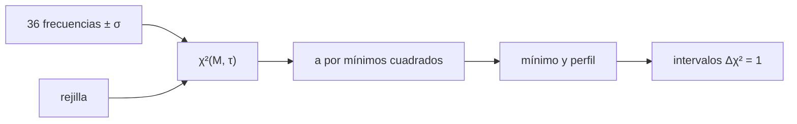

# B37-C14 — Ajuste de modelos estelares a frecuencias sísmicas

<!-- nav:top -->
[🏠 Programa](../../../../README.md) · [📚 Bloque B37](../../../tronco-comun/B37-interiores-estelares-y-asterosismologia.md) · [← Anterior: B37-C13 — Series fotométricas de Kepler, TESS y PLATO para asterosismología](../B37-C13-series-fotometricas-de-kepler-tess-y-plato-para-asterosismologia/CLASE.md) · [Siguiente: B38-C01 — Funciones de luminosidad estelar →](../../B38/B38-C01-funciones-de-luminosidad-estelar/CLASE.md)
<!-- /nav -->

## 1. Ubicación, nivel y alcance

Clase 14 del bloque B37. Nivel N3. El ajuste final compara frecuencias observadas con las de una **rejilla de modelos** y busca el mínimo de `χ²`. Aquí lo haces con una rejilla sintética de masa y edad, con y sin la **corrección del efecto de superficie**, y mides el sesgo que produce ignorarla. Usas [B12](../../../tronco-comun/B12-probabilidad-estadistica-e-incertidumbre.md). La rejilla y la «estrella» son sintéticas; no se ajusta ninguna estrella real.

## 2. Por qué esta clase existe

Las capas superficiales cambian las frecuencias de modo sistemático. La decisión central: **¿se corrige el efecto de superficie y qué parámetros se recuperan con qué incertidumbre?**

## 3. Lo que podrás hacer al terminar

1. Calcular `χ²` en una rejilla `(M, τ)`.
2. Resolver el término de superficie por mínimos cuadrados lineales.
3. Estimar incertidumbres por el perfil de `χ²`.
4. Interpretar el `χ²` reducido.
5. Comparar el ajuste con y sin corrección.
6. Medir el sesgo por Monte Carlo.

La evidencia es la **ficha del ajuste sísmico** del ejercicio 12 (sección 20).

## 4. Con qué llegas y cómo comprobarlo

1. ¿Qué es una incertidumbre?
2. ¿Qué es una simulación Monte Carlo?
3. ¿Qué es una tabla de resultados?
4. ¿Qué es un valor ilustrativo?
5. ¿Qué es una verificación?

<details>
<summary>Ver respuestas</summary>

1. Un intervalo en que se espera el valor verdadero. 2. Repetir con números aleatorios de semilla fija. 3. Un resumen ordenado de cálculos. 4. Un valor propuesto para el ejemplo, no medido. 5. Comparar un cálculo con un caso independiente.
</details>

Con cuatro o cinco aciertos, sigue; si no, repasa los prerrequisitos.

## 5. Un caso de contexto y casos de referencia

Con 36 frecuencias sintéticas (`σ = 0,3 μHz`) de un modelo con `M = 1,05` y `τ = 0,45` más un desplazamiento de superficie `a = −2,0 μHz`, el ajuste con corrección da `M = 1,044 [1,040; 1,056]`, `τ = 0,46 [0,44; 0,47]` y `χ²` reducido `1,59`; sin corrección da `M = 1,070`, `τ = 0,42` y `χ²` reducido `20,0`. Es el **ejemplo conductor**; todo es **sintético**.

## 6. Vocabulario

Una **rejilla de modelos** es un conjunto de modelos en un espacio de parámetros. El **`χ²`** es `Σ((obs − mod)/σ)²`. El **`χ²` reducido** divide por los grados de libertad. El **efecto de superficie** es un desplazamiento de frecuencias por las capas externas, aquí modelado como `a(ν/ν_max)^b`. Un **perfil de `χ²`** minimiza sobre el otro parámetro; `Δχ² = 1` da el intervalo de 1 σ.

## 7. Modelo mental: ajustar una llave a una cerradura

Es como probar llaves en una cerradura: la que mejor encaja da el modelo, pero si la cerradura tiene una pequeña deformación sistemática (la superficie), ninguna llave encaja bien hasta que se corrige.



*Descripción textual:* se evalúa `χ²` sobre una rejilla con el término de superficie resuelto analíticamente y se toma el mínimo y su perfil.

Analogía: ajustar una llave a una cerradura. Límite: σ conocida, exponente de superficie conocido.

## 8. La explicación, paso a paso

### 8.1 El mejor ajuste

| Ajuste | `M` | `τ` | `a` (μHz) | `χ²` | `χ²` reducido |
|---|---|---|---|---|---|
| con superficie | 1,044 [1,040; 1,056] | 0,46 [0,44; 0,47] | −1,962 | 52,4 | 1,59 |
| sin superficie | 1,070 | 0,42 | — | 681,1 | 20,0 |
| verdadero | 1,05 | 0,45 | −2,0 | — | — |

Con corrección, los parámetros verdaderos caen dentro de los intervalos y `a = −1,962 ± 0,028 μHz` (a 1,4 σ del verdadero `−2,0`). Sin ella, el `χ²` reducido es 20: el modelo no describe los datos.

### 8.2 El sesgo

En 30 realizaciones de ruido, el sesgo medio en `M` es `+0,0010` con corrección y `−0,0121` sin ella: ignorar la superficie desplaza la masa unas 12 milésimas de masa solar en este modelo.

### 8.3 Lectura del `χ²`

Un `χ²` reducido de `1,59` con 33 grados de libertad está unos 2,4 σ por encima de 1: es aceptable pero algo alto, lo que recuerda que el exponente de superficie `b = 4` se fijó igual al verdadero y que el ajuste aplica `ν_max` del modelo ajustado.

### 8.4 Lectura

La rejilla discreta puede dar intervalos degenerados (de una sola celda) si es más gruesa que la incertidumbre; por eso el perfil se evalúa sobre una rejilla refinada. En un ajuste real intervienen además modos mixtos, composición y errores sistemáticos del modelo.

## 9. Magnitudes, símbolos y unidades

| Símbolo | Qué es | Unidad | Valor / nota |
|---|---|---|---|
| `M` | masa del modelo | masas solares | 1,044 |
| `τ` | edad relativa (juguete) | — | 0,46 |
| `a` | desplazamiento de superficie | μHz | −1,962 ± 0,028 |
| `χ²` | estadístico de ajuste | — | 52,4 |
| `σ` | error de las frecuencias | μHz | 0,3 (sintético) |

## 10. Convenciones y referencias

σ conocida e independiente; exponente `b = 4` conocido; modelos asintóticos sin modos mixtos; semilla `20261109`; la forma de ley de potencias de la superficie es de uso habitual y no se consultó para esta clase.

## 11. De dónde sale lo que afirmamos

| ID | Fuente | Localizador | Respalda | Estado |
|---|---|---|---|---|
| — | Sin fuente externa | — | relaciones estándar que verifica el laboratorio | No se consultó una fuente para esta clase |

Límites: la rejilla y la estrella son sintéticas y no se ajustó ninguna frecuencia real.

## 12. Cómo ver el ajuste

| Ajuste | `χ²` reducido |
|---|---|
| con superficie | 1,59 |
| sin superficie | 20,0 |

Descripción larga: la corrección de superficie baja el `χ²` reducido de 20,0 a 1,59.

## 13. Ejemplo trabajado: el `χ²` reducido

**Paso 1 · Grados de libertad.** `36 − 3 = 33`.

**Paso 2 · Cociente.** `52,4/33 = 1,59`.

**Paso 3 · Sin superficie.** `681,1/(36 − 2) = 20,0`.

## 14. Distintas formas de describir el ajuste de un modelo

**Por rejilla:** `(M, τ)`. **Por superficie:** `a`. **Por intervalo:** `Δχ² = 1`. **Por sesgo:** Monte Carlo.

## 15. Práctica guiada

**Ejercicio 1 · con los pasos indicados.** `χ²` reducido con `χ² = 52,4` y 33 grados de libertad. *Pasos:* división.

<details><summary>Solución comentada</summary>

`1,59`.
</details>

**Ejercicio 2 · con una pista.** `χ²` reducido sin superficie: `681,1` y 34 grados.

<details><summary>Solución comentada</summary>

`20,0`.
</details>

**Ejercicio 3 · casi autónomo.** Desviación en σ de `a`.

<details><summary>Solución comentada</summary>

`(−1,962 + 2,0)/0,028 = 1,4`.
</details>

## 16. Práctica autónoma, transferencia e integrador

**Ejercicio 4.** Diferencia `M` ajustada sin superficie respecto del verdadero.

<details><summary>Solución comentada</summary>

`1,070 − 1,05 = +0,020`.
</details>

**Ejercicio 5.** Sesgo medio sin superficie frente a con superficie.

<details><summary>Solución comentada</summary>

`−0,0121` y `+0,0010`.
</details>

**Ejercicio 6.** Semianchura del intervalo de `M`.

<details><summary>Solución comentada</summary>

`(1,056 − 1,040)/2 = 0,008`.
</details>

**Ejercicio 7.** ¿Por qué el `χ²` reducido pasa de 20 a 1,59?

<details><summary>Solución comentada</summary>

Porque el término de superficie explica el desplazamiento sistemático.
</details>

**Ejercicio 8.** Grados de libertad con 36 datos y 3 parámetros.

<details><summary>Solución comentada</summary>

33.
</details>

**Ejercicio 9 · transferencia.** **Transferencia.** Un compañero dice que ajustó la masa de una estrella real. Responde.

<details><summary>Solución comentada</summary>

Las frecuencias son sintéticas.
</details>

**Ejercicio 10 · transferencia.** **Transferencia.** ¿Por qué se resuelve `a` analíticamente?

<details><summary>Solución comentada</summary>

Porque es lineal en los datos.
</details>

**Ejercicio 11 · transferencia.** **Transferencia.** ¿Qué haría si el exponente `b` fuese desconocido?

<details><summary>Solución comentada</summary>

Añadirlo al ajuste y propagar su incertidumbre.
</details>

**Ejercicio 12.** **Integrador.** Elabora tu *ficha del ajuste sísmico*: mejor ajuste, intervalos y sesgo.

<details><summary>Solución comentada</summary>

Secciones 8.1–8.4.
</details>

**Ejercicio 12 · integrador.** **Integrador.** Elabora tu *ficha del ajuste sísmico*: mejor ajuste, intervalos y sesgo.

<details><summary>Solución modelo</summary>

Secciones 8.1–8.4.
</details>

## 17. Laboratorio: ajuste de una rejilla

El script [ajuste_frecuencias.py](ajuste_frecuencias.py) ajusta la rejilla con y sin superficie (**comprueba** la recuperación dentro de 3 σ y el `χ²` reducido).

**Datos:** ninguna constante; frecuencias y rejilla **sintéticas**; semilla `20261109`. **Predice antes de ejecutar:** ¿qué ajuste sesgará la masa? (el que ignora la superficie.) **Ejecución del 2026-11-09 (Python 3.12.9):**

```text
Python 3.12.9 (biblioteca estandar)
36 frecuencias (l = 0, 1, 2; n = 16..27); numax del modelo verdadero = 2329.4 uHz
con superficie: M = 1.044 [1.040, 1.056] ; tau = 0.46 [0.44, 0.47] ; a = -1.962 uHz ; chi2 = 52.4 ; chi2 reducido = 1.59
sin superficie: M = 1.070 ; tau = 0.42 ; chi2 = 681.1 ; chi2 reducido = 20.0
verdadero: M = 1.05 ; tau = 0.45 ; a = -2.0
a = -1.962 +/- 0.028 uHz (verdadero -2.0)
sesgo medio en M (30 realizaciones): con superficie = +0.0010 ; sin superficie = -0.0121
Pruebas superadas.
```

```bash
python programa/clases/B37/B37-C14-ajuste-de-modelos-estelares-a-frecuencias-sismicas/ajuste_frecuencias.py
```

**Límites:** σ conocida, `b` conocido.

## 18. Errores frecuentes y cómo corregirlos

**Ajustar sin superficie.** Se corrige con 8.1.

**Dar intervalos de una sola celda.** Se corrige con 8.4.

**Ignorar el `χ²` reducido.** Se corrige con 8.3.

**Presentar la «estrella» como real.** Se corrige en la sección 10.

## 19. Cómo sabrás que vas bien

Tras la sección 8: ¿qué resultado esperabas y cuál obtuviste? Si dudas, repasa el ejemplo 13. Tras el laboratorio: ¿qué comprueba? (ver la sección 17).

## 20. Qué entregas y cómo se evalúa

El producto es tu **ficha del ajuste sísmico** (ejercicio 12).

| Criterio | Inicial | En desarrollo | Logrado | Destacado |
|---|---|---|---|---|
| Conceptos | Los confunde | Parciales | conceptos de la clase | Explica los límites |
| Cálculo | Sin unidades | Con errores | Tablas completas | Calcula casos nuevos |
| Numérico | Sin comprobar | Un caso | Contraste con el análisis | Interpreta las diferencias |
| Fuentes | Sin fuente | Sin fecha | fuentes con fecha | Declara lo ilustrativo |
| Límites | No los nombra | Uno | Tres | Discute qué falta del modelo |

**Condiciones críticas (no se compensan con promedio):** rotular la rejilla y las frecuencias como sintéticas; no presentar masas de estrellas reales; citar solo lo consultado.

## 21. Ética, seguridad y límites

Clase educativa: los modelos son simplificados. Accesibilidad: tablas equivalentes a las gráficas, fórmulas en texto, ejercicios sin conexión.

## 22. Para cerrar y seguir

El ajuste con corrección de superficie recupera masa y edad del modelo sintético, y sin ella se sesga. Con esto se cierra el bloque: de la física del interior a las frecuencias y de ellas a los parámetros.

**Glosario español–inglés.** ajuste · *fit*; rejilla de modelos · *model grid*; ji cuadrado · *chi-squared*; efecto de superficie · *surface effect*; perfil · *profile*.

**Continuidad.** continúa con los demás bloques del área.

**Referencias:** ver sección 11.

<!-- nav:bottom -->
---

[← Anterior: B37-C13 — Series fotométricas de Kepler, TESS y PLATO para asterosismología](../B37-C13-series-fotometricas-de-kepler-tess-y-plato-para-asterosismologia/CLASE.md) · [📚 Bloque B37](../../../tronco-comun/B37-interiores-estelares-y-asterosismologia.md) · [Siguiente: B38-C01 — Funciones de luminosidad estelar →](../../B38/B38-C01-funciones-de-luminosidad-estelar/CLASE.md)
<!-- /nav -->
