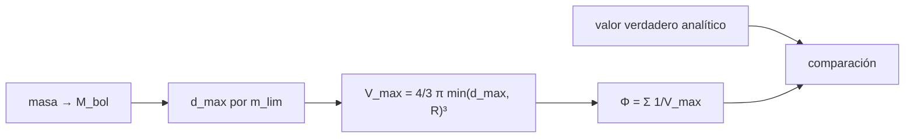

# B38-C01 — Funciones de luminosidad estelar

<!-- nav:top -->
[🏠 Programa](../../../../README.md) · [📚 Bloque B38](../../../tronco-comun/B38-poblaciones-estelares-y-simulacion-de-galaxias.md) · [← Anterior: B37-C14 — Ajuste de modelos estelares a frecuencias sísmicas](../../B37/B37-C14-ajuste-de-modelos-estelares-a-frecuencias-sismicas/CLASE.md) · [Siguiente: B38-C02 — Función inicial de masa y su universalidad →](../B38-C02-funcion-inicial-de-masa-y-su-universalidad/CLASE.md)
<!-- /nav -->

## 1. Ubicación, nivel y alcance

Clase 1 del bloque B38. Nivel N3. Una función de luminosidad dice cuántas estrellas hay por unidad de volumen y por intervalo de magnitud. Aquí generas **400 000 estrellas sintéticas** con densidad uniforme en una esfera de 1000 pc, aplicas un límite de magnitud aparente `m = 10`, y comparas el recuento **crudo** con el estimador **1/V_max** y con el valor verdadero analítico. Usas [B12](../../../tronco-comun/B12-probabilidad-estadistica-e-incertidumbre.md) y [B05](../../../tronco-comun/B05-fisica-fundamental-para-el-espacio.md). No se usa ningún catálogo ni se estima la función de luminosidad de la Vía Láctea.

## 2. Por qué esta clase existe

Contar las estrellas que se ven no es contar las que hay: las brillantes se ven desde lejos y las débiles solo de cerca. La decisión central: **¿cómo corrijo la selección para recuperar la densidad real por intervalo de luminosidad?**

## 3. Lo que podrás hacer al terminar

1. Convertir masa en magnitud bolométrica con `M_bol = 4,74 − 8,75 log₁₀(M/M☉)`.
2. Calcular la distancia máxima `d_max` y el volumen `V_max` de una estrella.
3. Aplicar el estimador `Φ = Σ 1/V_max`.
4. Reconocer el sesgo del recuento crudo.
5. Comparar con el valor verdadero analítico.
6. Nombrar los límites del estimador.

La evidencia es la **ficha de la función de luminosidad** del ejercicio 12 (sección 20).

## 4. Con qué llegas y cómo comprobarlo

1. ¿Qué es una incertidumbre?
2. ¿Qué es una simulación Monte Carlo?
3. ¿Qué es una tabla de resultados?
4. ¿Qué es un valor ilustrativo?
5. ¿Qué es una verificación?

<details>
<summary>Ver respuestas</summary>

1. Un intervalo en que se espera el valor verdadero. 2. Repetir con números aleatorios de semilla fija. 3. Un resumen ordenado de cálculos. 4. Un valor propuesto para el ejemplo, no medido. 5. Comparar un cálculo con un caso independiente.
</details>

Con cuatro o cinco aciertos, sigue; si no, repasa los prerrequisitos.

## 5. Un caso de contexto y casos de referencia

Con una IMF de Salpeter (índice 2,35) entre 0,5 y 20 M☉ y `L ∝ M^3,5` (**ilustrativos**), 36 763 de las 400 000 estrellas (9,19 %) son más brillantes que `m = 10`. El recuento crudo da 0,72 de lo verdadero en el intervalo `M_bol` de −0,6 a 0,9 y 0,12 en el siguiente, mientras que `1/V_max` da 0,99 y 1,04. Es el **ejemplo conductor**. Todo es **sintético**.

## 6. Vocabulario

La **función de luminosidad** `Φ(M)` es la densidad numérica por intervalo de magnitud. La **magnitud absoluta bolométrica** `M_bol`. La **magnitud aparente** `m = M + 5 log₁₀(d/10 pc)`. El **límite de magnitud** `m_lim`. El **volumen máximo** `V_max` es el volumen en que la estrella seguiría siendo visible. El **sesgo de Malmquist** es el exceso de estrellas brillantes en una muestra limitada en magnitud.

## 7. Modelo mental: la linterna lejana

Como contar linternas de noche: las potentes se ven a gran distancia, las débiles solo a pocos pasos; para saber cuántas linternas de cada potencia hay, cada una cuenta con el peso del volumen en que podrías haberla visto.



*Descripción textual:* cada estrella observada suma un peso igual al inverso del volumen en que sería visible, y la suma se compara con el valor analítico.

Analogía: la linterna lejana. Límite: densidad uniforme, sin extinción.

## 8. La explicación, paso a paso

### 8.1 Magnitudes

Con `M_bol = 4,74 − 8,75 log₁₀(M/M☉)` (porque `2,5 × 3,5 = 8,75`), una estrella de 10 M☉ tiene `M_bol = −4,01`, una de 0,5 M☉ tiene `7,37` y una de 20 M☉ tiene `−6,65`.

### 8.2 Selección

De 400 000 estrellas, 36 763 (9,19 %) cumplen `m ≤ 10`. La densidad media es `9,549 × 10⁻⁵ pc⁻³`.

### 8.3 Recuento crudo y estimador

| `M_bol` | observadas | crudo / verdadero | `1/V_max` / verdadero |
|---|---|---|---|
| −6,6 a −5,1 | 2004 | 1,0284 | 1,0284 |
| −5,1 a −3,6 | 3370 | 1,0150 | 1,0150 |
| −3,6 a −2,1 | 5602 | 0,9902 | 0,9902 |
| −2,1 a −0,6 | 9678 | 1,0040 | 1,0040 |
| −0,6 a 0,9 | 11 849 | 0,7215 | 0,9891 |
| 0,9 a 2,4 | 3365 | 0,1203 | 1,0393 |
| 2,4 a 3,9 | 687 | 0,0144 | 0,9584 |
| 3,9 a 5,4 | 168 | 0,0021 | 1,0594 |
| 5,4 a 6,9 | 37 | 0,0003 | 1,1804 |

### 8.4 Lectura

Hasta `M_bol ≈ −0,6` toda la esfera de 1000 pc es visible: el crudo es correcto y `1/V_max` coincide con él. Más débil, el crudo se desploma (0,0003 en el último intervalo) y `1/V_max` lo corrige. En el último intervalo solo hay 37 estrellas, el error de Poisson es del 16 % y `1,18` es compatible con 1 a 1,1 σ.

## 9. Magnitudes, símbolos y unidades

| Símbolo | Qué es | Unidad | Valor / nota |
|---|---|---|---|
| `M_bol` | magnitud absoluta bolométrica | mag | 4,74 para 1 M☉ (convención) |
| `d_max` | distancia máxima de detección | pc | 112,7 (1 M☉, m = 10) |
| `V_max` | volumen máximo | pc³ | 6,00 × 10⁶ (1 M☉) |
| `Φ` | densidad por intervalo de magnitud | pc⁻³ mag⁻¹ | `Σ 1/V_max` |

## 10. Convenciones y referencias

Estrellas **sintéticas**; `M_bol,☉ = 4,74` es una convención; IMF, relación masa–luminosidad, radio de 1000 pc y límite `m = 10` **ilustrativos**; semilla `20261109`. Coma decimal en el texto y punto en las salidas del laboratorio.

## 11. De dónde sale lo que afirmamos

| ID | Fuente | Localizador | Respalda | Estado |
|---|---|---|---|---|
| S1 | Convención de uso común | — | `M_bol,☉ = 4,74` y la relación `L ∝ M^3,5` como modelo de juguete | No se consultó una fuente para esta clase |

Límites: no se consultó ningún catálogo ni función de luminosidad real; la relación `L ∝ M^3,5` es un modelo de juguete.

## 12. Cómo ver los recuentos corregidos

| `M_bol` | crudo / verdadero | `1/V_max` / verdadero |
|---|---|---|
| −2,1 a −0,6 | 1,004 | 1,004 |
| −0,6 a 0,9 | 0,722 | 0,989 |
| 0,9 a 2,4 | 0,120 | 1,039 |
| 3,9 a 5,4 | 0,002 | 1,059 |

Descripción larga: el crudo cae de 1 a casi 0 hacia las débiles; el estimador queda cerca de 1.

## 13. Ejemplo trabajado: el peso de una estrella

**Paso 1 · Magnitud.** Una estrella de 1 M☉ tiene `M_bol = 4,74`.

**Paso 2 · Distancia máxima.** `d_max = 10^((10 − 4,74 + 5)/5) = 10^2,052 = 112,7 pc`.

**Paso 3 · Volumen.** `V_max = 4/3 π (112,7)³ = 6,00 × 10⁶ pc³`.

**Paso 4 · Peso.** `1/V_max = 1,67 × 10⁻⁷ pc⁻³`: esta estrella cuenta como `1,67 × 10⁻⁷` pc⁻³ en la densidad.

## 14. Distintas formas de describir una función de luminosidad

**Por magnitud:** `Φ(M_bol)`. **Por volumen:** `Σ 1/V_max`. **Por selección:** crudo frente a corregido. **Por tabla:** los cocientes de 8.3.

## 15. Práctica guiada

**Ejercicio 1 · con los pasos indicados.** `M_bol` de una estrella de 10 M☉. *Pasos:* `log₁₀ 10 = 1`; `8,75 × 1`; `4,74 − 8,75`.

<details><summary>Solución comentada</summary>

`−4,01`.
</details>

**Ejercicio 2 · con una pista.** `d_max` de una estrella de 1 M☉ con `m = 10`.

<details><summary>Solución comentada</summary>

`10^2,052 = 112,7 pc`.
</details>

**Ejercicio 3 · casi autónomo.** `V_max` de esa estrella.

<details><summary>Solución comentada</summary>

`4/3 π (112,7)³ = 6,00 × 10⁶ pc³`.
</details>

## 16. Práctica autónoma, transferencia e integrador

**Ejercicio 4.** Peso de una estrella con `d_max = 300 pc`.

<details><summary>Solución comentada</summary>

`1/(4/3 π 300³) = 8,84 × 10⁻⁹ pc⁻³`.
</details>

**Ejercicio 5.** Fracción de estrellas observadas.

<details><summary>Solución comentada</summary>

`36 763/400 000 = 0,0919`.
</details>

**Ejercicio 6.** ¿Qué fracción de estrellas falta en el intervalo −0,6 a 0,9 del crudo?

<details><summary>Solución comentada</summary>

`1 − 0,7215 = 28 %`.
</details>

**Ejercicio 7.** Error de Poisson del último intervalo (37 estrellas).

<details><summary>Solución comentada</summary>

`1/√37 = 16 %`; `1,18` está a 1,1 σ de 1.
</details>

**Ejercicio 8.** Densidad media de las 400 000 estrellas en 1000 pc.

<details><summary>Solución comentada</summary>

`4 × 10⁵/(4/3 π 10⁹) = 9,55 × 10⁻⁵ pc⁻³`.
</details>

**Ejercicio 9 · transferencia.** **Transferencia.** Un compañero dice que la curva de recuento crudo es la función de luminosidad. Responde.

<details><summary>Solución comentada</summary>

No: está sesgada hacia las estrellas brillantes; solo es válida donde `d_max > R` (aquí `M_bol < −0,6`).
</details>

**Ejercicio 10 · transferencia.** **Transferencia.** ¿Por qué `1/V_max` da el mismo resultado que el crudo en los intervalos brillantes?

<details><summary>Solución comentada</summary>

Porque allí `V_max` es todo el volumen de la esfera y el peso es constante.
</details>

**Ejercicio 11 · transferencia.** **Transferencia.** ¿Qué omite el modelo respecto a una galaxia real?

<details><summary>Solución comentada</summary>

La extinción, la variación de la densidad con la altura sobre el disco, las binarias y la incompletitud en color.
</details>

**Ejercicio 12.** **Integrador.** Elabora tu *ficha de la función de luminosidad*: magnitudes, selección, tabla corregida y límites.

<details><summary>Solución comentada</summary>

Secciones 8.1–8.4.
</details>

**Ejercicio 12 · integrador.** **Integrador.** Elabora tu *ficha de la función de luminosidad*: magnitudes, selección, tabla corregida y límites.

<details><summary>Solución modelo</summary>

Secciones 8.1–8.4.
</details>

## 17. Laboratorio: función de luminosidad corregida

El script [luminosidad.py](luminosidad.py) genera la muestra, aplica el límite de magnitud y compara el recuento crudo con `1/V_max` y con el valor verdadero (**comprueba** `0,9 < cociente < 1,1` en los intervalos con más de 200 estrellas).

**Datos:** sin constantes medidas; `M_bol,☉ = 4,74` como convención; **sintético**; semilla `20261109`. **Predice antes de ejecutar:** ¿en qué intervalos coincidirá el crudo con lo verdadero? (en los más brillantes.) **Ejecución del 2026-11-09 (Python 3.12.9):**

```text
Python 3.12.9 (biblioteca estandar)
estrellas generadas 400000, observadas 36763 (0.0919)
       M_bol   n_obs  crudo/verd  1/Vmax/verd
 -6.6.. -5.1    2004      1.0284       1.0284
 -5.1.. -3.6    3370      1.0150       1.0150
 -3.6.. -2.1    5602      0.9902       0.9902
 -2.1.. -0.6    9678      1.0040       1.0040
 -0.6..  0.9   11849      0.7215       0.9891
  0.9..  2.4    3365      0.1203       1.0393
  2.4..  3.9     687      0.0144       0.9584
  3.9..  5.4     168      0.0021       1.0594
  5.4..  6.9      37      0.0003       1.1804
fraccion observada: brillante 1.0284, debil 0.0003
densidad media 95492.9659 estrellas por kpc^3 (n = 9.549e-05 pc^-3)
Pruebas superadas.
```

```bash
python programa/clases/B38/B38-C01-funciones-de-luminosidad-estelar/luminosidad.py
```

**Límites:** densidad uniforme y sin extinción.

## 18. Errores frecuentes y cómo corregirlos

**Usar el recuento crudo como función de luminosidad.** Se corrige con 8.3.

**Olvidar el corte `min(d_max, R)`.** Se corrige con el ejemplo 13.

**Confiar en intervalos de pocas estrellas.** Se corrige con 8.4.

**Presentar el resultado como la función de luminosidad de la Galaxia.** Se corrige con la sección 10.

## 19. Cómo sabrás que vas bien

Tras la sección 8: ¿qué resultado esperabas y cuál obtuviste? Si dudas, repasa el ejemplo 13. Tras el laboratorio: ¿qué comprueba? (ver la sección 17).

## 20. Qué entregas y cómo se evalúa

El producto es tu **ficha de la función de luminosidad** (ejercicio 12).

| Criterio | Inicial | En desarrollo | Logrado | Destacado |
|---|---|---|---|---|
| Conceptos | Los confunde | Parciales | conceptos de la clase | Explica los límites |
| Cálculo | Sin unidades | Con errores | Tablas completas | Calcula casos nuevos |
| Numérico | Sin comprobar | Un caso | Contraste con el análisis | Interpreta las diferencias |
| Fuentes | Sin fuente | Sin fecha | fuentes con fecha | Declara lo ilustrativo |
| Límites | No los nombra | Uno | Tres | Discute qué falta del modelo |

**Condiciones críticas (no se compensan con promedio):** rotular la muestra como sintética; no presentarla como función de luminosidad real; citar solo lo consultado.

## 21. Ética, seguridad y límites

Clase educativa: los modelos son simplificados. Accesibilidad: tablas equivalentes a las gráficas, fórmulas en texto, ejercicios sin conexión.

## 22. Para cerrar y seguir

El recuento crudo da 0,72 de lo verdadero en `M_bol` de −0,6 a 0,9 y 0,12 en el siguiente; `1/V_max` da 0,99 y 1,04. Queda una pregunta: ¿cuántas estrellas nacen de cada masa?

**Glosario español–inglés.** función de luminosidad · *luminosity function*; magnitud absoluta · *absolute magnitude*; volumen máximo · *maximum volume*; sesgo de Malmquist · *Malmquist bias*; límite de magnitud · *magnitude limit*.

**Continuidad.** [B38-C02](../B38-C02-funcion-inicial-de-masa-y-su-universalidad/CLASE.md) estudia la función inicial de masa.

**Referencias:** ver sección 11.

<!-- nav:bottom -->
---

[← Anterior: B37-C14 — Ajuste de modelos estelares a frecuencias sísmicas](../../B37/B37-C14-ajuste-de-modelos-estelares-a-frecuencias-sismicas/CLASE.md) · [📚 Bloque B38](../../../tronco-comun/B38-poblaciones-estelares-y-simulacion-de-galaxias.md) · [Siguiente: B38-C02 — Función inicial de masa y su universalidad →](../B38-C02-funcion-inicial-de-masa-y-su-universalidad/CLASE.md)
<!-- /nav -->
