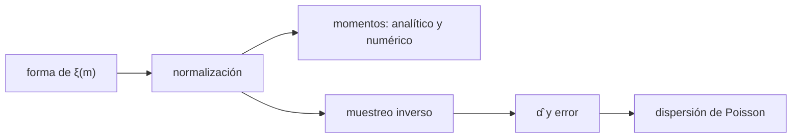

# B38-C02 — Función inicial de masa y su universalidad

<!-- nav:top -->
[🏠 Programa](../../../../README.md) · [📚 Bloque B38](../../../tronco-comun/B38-poblaciones-estelares-y-simulacion-de-galaxias.md) · [← Anterior: B38-C01 — Funciones de luminosidad estelar](../B38-C01-funciones-de-luminosidad-estelar/CLASE.md) · [Siguiente: B38-C03 — Cinemática estelar con Gaia: movimientos propios y espacio de fase →](../B38-C03-cinematica-estelar-con-gaia-movimientos-propios-y-espacio-de-fase/CLASE.md)
<!-- /nav -->

## 1. Ubicación, nivel y alcance

Clase 2 del bloque B38. Nivel N3. La función inicial de masa (IMF) dice cuántas estrellas nacen en cada intervalo de masa. Aquí defines tres formas (Salpeter, Kroupa por tramos y Chabrier), calculas sus **momentos** por dos vías (fórmula cerrada e integración numérica), obtienes la **fracción de estrellas masivas** y estimas la pendiente de la cola por **máxima verosimilitud** con su dispersión de Poisson. Usas [B12](../../../tronco-comun/B12-probabilidad-estadistica-e-incertidumbre.md) y [B38-C01](../B38-C01-funciones-de-luminosidad-estelar/CLASE.md). Los resúmenes de Kroupa y Chabrier son contexto; las formas funcionales son convenciones estándar **no verificadas en el texto**.

## 2. Por qué esta clase existe

Casi todo lo que se infiere de una población (luminosidad, supernovas, masa) depende de la IMF. La decisión central: **¿cuándo una diferencia de pendiente entre dos muestras es real y cuándo es ruido de Poisson?**

## 3. Lo que podrás hacer al terminar

1. Normalizar una IMF por tramos.
2. Calcular el número y la masa por encima de 8 M☉.
3. Verificar un momento por dos vías.
4. Muestrear por transformada inversa.
5. Estimar la pendiente con su error.
6. Distinguir variación real de dispersión de Poisson.

La evidencia es la **ficha de la función inicial de masa** del ejercicio 12 (sección 20).

## 4. Con qué llegas y cómo comprobarlo

1. ¿Qué es una incertidumbre?
2. ¿Qué es una simulación Monte Carlo?
3. ¿Qué es una tabla de resultados?
4. ¿Qué es un valor ilustrativo?
5. ¿Qué es una verificación?

<details>
<summary>Ver respuestas</summary>

1. Un intervalo en que se espera el valor verdadero. 2. Repetir con números aleatorios de semilla fija. 3. Un resumen ordenado de cálculos. 4. Un valor propuesto para el ejemplo, no medido. 5. Comparar un cálculo con un caso independiente.
</details>

Con cuatro o cinco aciertos, sigue; si no, repasa los prerrequisitos.

## 5. Un caso de contexto y casos de referencia

Con la IMF de Kroupa entre 0,08 y 100 M☉ (índices 0,3, 1,3 y 2,3, cortes en 0,08 y 0,5 M☉), la masa media es `0,5739 M☉`, el 0,627 % de las estrellas supera 8 M☉ y contienen el 20,9 % de la masa; hay `0,010930` estrellas de más de 8 M☉ por M☉ formada (una por 91,5 M☉). Es el **ejemplo conductor**. Las pendientes y cortes son convenciones; el muestreo es **sintético**.

## 6. Vocabulario

La **IMF** `ξ(m) = dN/dm`. El **índice** `α` de una ley de potencias `m^−α`. Un **corte** es la masa donde cambia el índice. La **máxima verosimilitud** da `α̂ = 1 + n/Σ ln(m_i/m_min)` con error `(α̂ − 1)/√n`. El **ruido de Poisson** es la fluctuación de contar `n` objetos. Una **IMF universal** es la misma en todos los entornos.

## 7. Modelo mental: una receta de panadería

Como una receta que fija cuántas estrellas pequeñas, medianas y grandes salen de cada hornada de gas: aunque la receta sea la misma, hornadas pequeñas dan proporciones distintas por azar.



*Descripción textual:* una forma funcional se normaliza, se integra por dos vías y se muestrea para estimar la pendiente y su dispersión.

Analogía: una receta de panadería. Límite: la misma IMF para todas las muestras y estrellas independientes.

## 8. La explicación, paso a paso

### 8.1 Tres formas

| IMF | número total (u. arb.) | masa media (M☉) | fracción en número > 8 M☉ | fracción en masa > 8 M☉ |
|---|---|---|---|---|
| Salpeter | 22,4113 | 0,2832 | 0,00193 | 0,12762 |
| Kroupa | 7,9072 | 0,5739 | 0,00627 | 0,20914 |
| Chabrier | 0,1362 | 0,6073 | 0,00706 | 0,22248 |

Las tres se integran entre 0,08 y 100 M☉ con Simpson en `ln m`. La de Salpeter, que sigue una sola ley de potencias hasta 0,08 M☉, tiene mucho más número y menos masa media.

### 8.2 Dos vías

Para Kroupa, la integral analítica por tramos y la numérica coinciden a menos de `10⁻⁶` en cinco momentos (número y masa totales, número y masa sobre 8 M☉, masa entre 0,08 y 0,5 M☉). Hay `0,010930` estrellas de más de 8 M☉ por M☉ formada, es decir, una por `91,5 M☉`.

### 8.3 Pendiente y dispersión

Con índice de entrada `α = 2,3` para `m > 1 M☉`:

| estrellas | `α̂` | error | (`α̂ − α`)/error |
|---|---|---|---|
| 30 | 2,1192 | 0,2043 | −0,88 |
| 100 | 2,2037 | 0,1204 | −0,80 |
| 1000 | 2,2690 | 0,0401 | −0,77 |
| 10 000 | 2,3142 | 0,0131 | 1,08 |

Con 400 cúmulos de 50 estrellas, la dispersión de las pendientes es `0,196` y la esperada por Poisson `1,3/√50 = 0,184`.

### 8.4 Lectura

Un cúmulo de 50 estrellas por encima de 1 M☉ da una pendiente con ±0,18 solo por azar: diferencias de ese tamaño entre cúmulos no prueban una IMF distinta. El resumen de Kroupa (2001) plantea justamente que la dispersión de Poisson y la dinámica de los cúmulos fijan el límite por debajo del cual no se detecta variación real.

## 9. Magnitudes, símbolos y unidades

| Símbolo | Qué es | Unidad | Valor / nota |
|---|---|---|---|
| `ξ(m)` | IMF (número por masa) | M☉⁻¹ | forma por tramos |
| `α` | índice de la cola | — | 2,3 (entrada) |
| `f_N(>8)` | fracción en número sobre 8 M☉ | — | 0,00627 (Kroupa) |
| `σ_α` | error de la pendiente | — | `(α̂ − 1)/√n` |

## 10. Convenciones y referencias

Formas, índices y cortes **convencionales** (estándar no verificado; solo resúmenes); rango 0,08–100 M☉ y muestras **ilustrativas**; semilla `20261109`.

## 11. De dónde sale lo que afirmamos

| ID | Fuente | Localizador | Respalda | Estado |
|---|---|---|---|---|
| S1 | Kroupa (2001), *On the variation of the Initial Mass Function* | https://arxiv.org/abs/astro-ph/0009005 | resumen: la IMF de campo cambia de pendiente en torno a 0,5 y 0,08 M☉; la dispersión de Poisson y la dinámica de los cúmulos explican la dispersión de pendientes observadas; las binarias sesgan las pendientes | Solo resumen, consultado el 2026-11-09 |
| S2 | Chabrier (2003), *Galactic Stellar and Substellar Initial Mass Function* | https://arxiv.org/abs/astro-ph/0304382 | resumen: ley de potencias por encima de ~1 M☉ y forma lognormal por debajo | Solo resumen, consultado el 2026-11-09 |

Límites: solo se leyeron los resúmenes; las pendientes y cortes no se verificaron en el texto de los artículos y ninguna cifra de la clase se les atribuye.

## 12. Cómo ver las IMF

| IMF | masa media (M☉) | fracción en masa > 8 M☉ |
|---|---|---|
| Salpeter | 0,2832 | 0,128 |
| Kroupa | 0,5739 | 0,209 |
| Chabrier | 0,6073 | 0,222 |

Descripción larga: la IMF de Salpeter tiene la masa media más baja y menos masa en estrellas masivas.

## 13. Ejemplo trabajado: las estrellas masivas por masa formada

**Paso 1 · Número masivo.** `∫₈¹⁰⁰ ξ dm`.

**Paso 2 · Masa total.** `∫₀,₀₈¹⁰⁰ m ξ dm = 7,9072 × 0,5739 = 4,538` (unidades arbitrarias).

**Paso 3 · Cociente.** Número masivo / masa total = `0,010930` por M☉.

**Paso 4 · Inverso.** `1/0,010930 = 91,5 M☉` por estrella de más de 8 M☉.

## 14. Distintas formas de describir una IMF

**Por tramos:** índices 0,3; 1,3; 2,3. **Por momentos:** número, masa. **Por muestreo:** transformada inversa. **Por estimador:** máxima verosimilitud.

## 15. Práctica guiada

**Ejercicio 1 · con los pasos indicados.** Masa media de Kroupa a partir de número y masa totales. *Pasos:* masa / número.

<details><summary>Solución comentada</summary>

`0,5739 M☉`.
</details>

**Ejercicio 2 · con una pista.** Estrellas de más de 8 M☉ por M☉ formada.

<details><summary>Solución comentada</summary>

`0,010930`.
</details>

**Ejercicio 3 · casi autónomo.** M☉ formadas por estrella de más de 8 M☉.

<details><summary>Solución comentada</summary>

`91,5`.
</details>

## 16. Práctica autónoma, transferencia e integrador

**Ejercicio 4.** Error de la pendiente con 100 estrellas y `α = 2,3`.

<details><summary>Solución comentada</summary>

`1,3/√100 = 0,13` (el laboratorio estimó 0,1204 con `α̂ = 2,2037`).
</details>

**Ejercicio 5.** Estrellas para un error de 0,05.

<details><summary>Solución comentada</summary>

`(1,3/0,05)² = 676`.
</details>

**Ejercicio 6.** Razón de masas medias Kroupa/Salpeter.

<details><summary>Solución comentada</summary>

`0,5739/0,2832 = 2,03`.
</details>

**Ejercicio 7.** Dispersión esperada con 50 estrellas.

<details><summary>Solución comentada</summary>

`1,3/√50 = 0,184`.
</details>

**Ejercicio 8.** ¿Qué IMF tiene más masa en estrellas masivas?

<details><summary>Solución comentada</summary>

Chabrier: 0,222.
</details>

**Ejercicio 9 · transferencia.** **Transferencia.** Dos cúmulos de 50 estrellas dan pendientes 2,1 y 2,5. ¿Es una IMF distinta? Responde.

<details><summary>Solución comentada</summary>

La diferencia de 0,4 es de unos 1,5 σ combinados (σ ≈ 0,26): no es evidencia.
</details>

**Ejercicio 10 · transferencia.** **Transferencia.** ¿Por qué las binarias sin resolver sesgan la pendiente?

<details><summary>Solución comentada</summary>

Porque el sistema se cuenta como una estrella de masa mayor (resumen de Kroupa, 2001).
</details>

**Ejercicio 11 · transferencia.** **Transferencia.** ¿Qué omite el laboratorio?

<details><summary>Solución comentada</summary>

Evolución dinámica, binarias, mezcla de poblaciones y errores de masa.
</details>

**Ejercicio 12.** **Integrador.** Elabora tu *ficha de la función inicial de masa*: momentos, fracción masiva y dispersión de la pendiente.

<details><summary>Solución comentada</summary>

Secciones 8.1–8.4.
</details>

**Ejercicio 12 · integrador.** **Integrador.** Elabora tu *ficha de la función inicial de masa*: momentos, fracción masiva y dispersión de la pendiente.

<details><summary>Solución modelo</summary>

Secciones 8.1–8.4.
</details>

## 17. Laboratorio: momentos y pendiente de la IMF

El script [imf.py](imf.py) integra tres IMF por dos vías, calcula la fracción masiva y estima la pendiente en muestras de distinto tamaño (**comprueba** `10⁻⁶` en los momentos y `|z| < 3` en las pendientes).

**Datos:** sin constantes; formas **convencionales** (no verificadas); muestras **sintéticas**; semilla `20261109`. **Predice antes de ejecutar:** ¿cuánto valdrá el error con 100 estrellas? (≈ 0,12–0,13.) **Ejecución del 2026-11-09 (Python 3.12.9):**

```text
Python 3.12.9 (biblioteca estandar)
       IMF   N total      <m>   f(N,m>8)   f(M,m>8)
  Salpeter   22.4113   0.2832    0.00193    0.12762
    Kroupa    7.9072   0.5739    0.00627    0.20914
  Chabrier    0.1362   0.6073    0.00706    0.22248
Kroupa: estrellas > 8 Msol por Msol formada = 0.010930  (una por 91.5 Msol)
Kroupa: masa en m > 8 Msol / masa total = 0.20914
  n(m>1)  alpha_est    error  desv/sigma
      30     2.1192   0.2043       -0.88
     100     2.2037   0.1204       -0.80
    1000     2.2690   0.0401       -0.77
   10000     2.3142   0.0131        1.08
400 cumulos de 50 estrellas: pendiente media 2.340, dispersion 0.196, esperada por Poisson 0.184
Pruebas superadas.
```

```bash
python programa/clases/B38/B38-C02-funcion-inicial-de-masa-y-su-universalidad/imf.py
```

**Límites:** una IMF única e independiente.

## 18. Errores frecuentes y cómo corregirlos

**Medir la pendiente con pocas estrellas y llamarla variación real.** Se corrige con 8.3.

**Normalizar con un rango de masas distinto al de la comparación.** Se corrige con 8.1.

**Atribuir a un artículo cifras no leídas.** Se corrige con la sección 11.

**Confundir fracción en número y en masa.** Se corrige con 8.1.

## 19. Cómo sabrás que vas bien

Tras la sección 8: ¿qué resultado esperabas y cuál obtuviste? Si dudas, repasa el ejemplo 13. Tras el laboratorio: ¿qué comprueba? (ver la sección 17).

## 20. Qué entregas y cómo se evalúa

El producto es tu **ficha de la función inicial de masa** (ejercicio 12).

| Criterio | Inicial | En desarrollo | Logrado | Destacado |
|---|---|---|---|---|
| Conceptos | Los confunde | Parciales | conceptos de la clase | Explica los límites |
| Cálculo | Sin unidades | Con errores | Tablas completas | Calcula casos nuevos |
| Numérico | Sin comprobar | Un caso | Contraste con el análisis | Interpreta las diferencias |
| Fuentes | Sin fuente | Sin fecha | fuentes con fecha | Declara lo ilustrativo |
| Límites | No los nombra | Uno | Tres | Discute qué falta del modelo |

**Condiciones críticas (no se compensan con promedio):** rotular las formas como convencionales; no atribuir pendientes a los artículos; citar solo lo consultado.

## 21. Ética, seguridad y límites

Clase educativa: los modelos son simplificados. Accesibilidad: tablas equivalentes a las gráficas, fórmulas en texto, ejercicios sin conexión.

## 22. Para cerrar y seguir

La IMF de Kroupa tiene masa media 0,574 M☉ y una estrella de más de 8 M☉ por cada 91,5 M☉ formadas; con 50 estrellas la pendiente fluctúa ±0,18. Queda una pregunta: ¿cómo se mueven las estrellas que sí se miden?

**Glosario español–inglés.** función inicial de masa · *initial mass function*; máxima verosimilitud · *maximum likelihood*; ruido de Poisson · *Poisson noise*; universalidad · *universality*; cola · *tail*.

**Continuidad.** [B38-C03](../B38-C03-cinematica-estelar-con-gaia-movimientos-propios-y-espacio-de-fase/CLASE.md) estudia la cinemática estelar.

**Referencias:** ver sección 11.

<!-- nav:bottom -->
---

[← Anterior: B38-C01 — Funciones de luminosidad estelar](../B38-C01-funciones-de-luminosidad-estelar/CLASE.md) · [📚 Bloque B38](../../../tronco-comun/B38-poblaciones-estelares-y-simulacion-de-galaxias.md) · [Siguiente: B38-C03 — Cinemática estelar con Gaia: movimientos propios y espacio de fase →](../B38-C03-cinematica-estelar-con-gaia-movimientos-propios-y-espacio-de-fase/CLASE.md)
<!-- /nav -->
