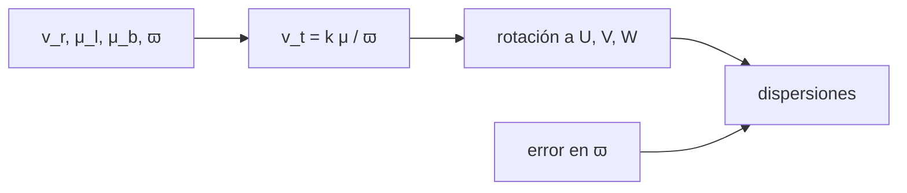

# B38-C03 — Cinemática estelar con Gaia: movimientos propios y espacio de fase

<!-- nav:top -->
[🏠 Programa](../../../../README.md) · [📚 Bloque B38](../../../tronco-comun/B38-poblaciones-estelares-y-simulacion-de-galaxias.md) · [← Anterior: B38-C02 — Función inicial de masa y su universalidad](../B38-C02-funcion-inicial-de-masa-y-su-universalidad/CLASE.md) · [Siguiente: B38-C04 — Historia de formación estelar a partir de poblaciones resueltas →](../B38-C04-historia-de-formacion-estelar-a-partir-de-poblaciones-resueltas/CLASE.md)
<!-- /nav -->

## 1. Ubicación, nivel y alcance

Clase 3 del bloque B38. Nivel N3. Los movimientos propios, las paralajes y las velocidades radiales se convierten en velocidades espaciales `(U, V, W)`. Aquí implementas la conversión con coordenadas galácticas, compruebas la **ida y vuelta** con 1000 estrellas aleatorias, recuperas el **elipsoide de velocidades** de 6000 estrellas sintéticas y mides el efecto del error de paralaje, incluido el sesgo de `1/ϖ`. Usas [B12](../../../tronco-comun/B12-probabilidad-estadistica-e-incertidumbre.md) y [B05](../../../tronco-comun/B05-fisica-fundamental-para-el-espacio.md). De Gaia DR3 solo se consultó el resumen del contenido; no se usa ningún dato de Gaia.

## 2. Por qué esta clase existe

El error de distancia se propaga a todas las velocidades tangenciales. La decisión central: **¿cuánto error de paralaje tolera la medida de una dispersión de velocidades?**

## 3. Lo que podrás hacer al terminar

1. Calcular `k = au/año` en km/s por (mas/año × kpc).
2. Convertir `(v_r, μ_l, μ_b, ϖ)` en `(U, V, W)` y volver.
3. Medir las dispersiones del elipsoide.
4. Propagar errores de paralaje por Monte Carlo.
5. Reconocer el sesgo de `1/ϖ`.
6. Nombrar los límites del modelo.

La evidencia es la **ficha de la cinemática estelar** del ejercicio 12 (sección 20).

## 4. Con qué llegas y cómo comprobarlo

1. ¿Qué es una incertidumbre?
2. ¿Qué es una simulación Monte Carlo?
3. ¿Qué es una tabla de resultados?
4. ¿Qué es un valor ilustrativo?
5. ¿Qué es una verificación?

<details>
<summary>Ver respuestas</summary>

1. Un intervalo en que se espera el valor verdadero. 2. Repetir con números aleatorios de semilla fija. 3. Un resumen ordenado de cálculos. 4. Un valor propuesto para el ejemplo, no medido. 5. Comparar un cálculo con un caso independiente.
</details>

Con cuatro o cinco aciertos, sigue; si no, repasa los prerrequisitos.

## 5. Un caso de contexto y casos de referencia

La constante es `k = 4,74047 km/s` por (mas/año × kpc). La ida y vuelta tiene error máximo de `5,7 × 10⁻¹⁴ km/s`. Con dispersiones de entrada de 35, 25 y 20 km/s (**ilustrativas**) y 6000 estrellas, se miden `34,81`, `25,12` y `19,80 km/s` sin error de paralaje, y `36,46`, `26,59` y `20,99` con un error del 20 %. Es el **ejemplo conductor**. Todo es **sintético**.

## 6. Vocabulario

El **movimiento propio** `μ` en mas/año. La **paralaje** `ϖ` en mas; `d = 1/ϖ`. La **velocidad tangencial** `v_t = k μ d`. La **velocidad radial** `v_r`. Las componentes `U` (hacia el centro galáctico), `V` (rotación) y `W` (hacia el polo norte). El **elipsoide de velocidades** son las dispersiones `(σ_U, σ_V, σ_W)`. El **espacio de fase** son posición más velocidad.

## 7. Modelo mental: la sombra que avanza

Como medir la velocidad de un coche por cuánto se desplaza su sombra en el suelo: a la misma sombra, un coche lejano va más rápido; por eso el error en la distancia entra de lleno en la velocidad.



*Descripción textual:* las magnitudes observadas se rotan al sistema galáctico y sus dispersiones se comparan con las de entrada con y sin error de paralaje.

Analogía: la sombra que avanza. Límite: sin extinción, sin correlaciones, `d = 1/ϖ`.

## 8. La explicación, paso a paso

### 8.1 Constante

`k = au/año = 149 597 870 700 m / (365,25 × 86 400 s) = 4740,47 m/s`, es decir `4,74047 km/s` por (mas/año × kpc). Un movimiento propio de 100 mas/año a 200 pc (`ϖ = 5 mas`) es `94,81 km/s`.

### 8.2 Ida y vuelta

Para 1000 estrellas aleatorias, pasar de `(U, V, W)` a observables y volver da un error máximo de `5,7 × 10⁻¹⁴ km/s`.

### 8.3 Elipsoide

| error de paralaje | `σ_U` (km/s) | `σ_V` (km/s) | `σ_W` (km/s) |
|---|---|---|---|
| 0 % | 34,81 | 25,12 | 19,80 |
| 1 % | 34,81 | 25,12 | 19,81 |
| 20 % | 36,46 | 26,59 | 20,99 |

Las dispersiones de entrada son 35, 25 y 20 km/s. Con un 20 % de error, las dispersiones suben un 4,7 %, 5,9 % y 6,0 %.

### 8.4 Sesgo de la distancia

Para `ϖ = 5 mas` (200 pc) con error del 20 %, la distancia media es `208,7 pc`: la media de `1/ϖ` está sesgada hacia valores altos (≈ `1 + σ²` = 1,04 en primer orden).

### 8.5 Lectura

Un error de paralaje del 1 % es irrelevante para el elipsoide; del 20 % lo ensancha un 5 % y sesga la distancia. En datos reales los errores dependen de la magnitud y están correlacionados.

## 9. Magnitudes, símbolos y unidades

| Símbolo | Qué es | Unidad | Valor / nota |
|---|---|---|---|
| `k` | constante de conversión | km/s por (mas/año × kpc) | 4,74047 |
| `μ` | movimiento propio | mas/año | 100 (ejemplo) |
| `ϖ` | paralaje | mas | 5 (200 pc) |
| `σ_U, σ_V, σ_W` | dispersiones | km/s | 34,81; 25,12; 19,80 |

## 10. Convenciones y referencias

Estrellas **sintéticas** en coordenadas galácticas `(l, b)`; dispersiones (35, 25, 20 km/s), movimiento solar (11, 12, 7 km/s) y errores **ilustrativos**; semilla `20261109`. El movimiento solar no se usa como medida real.

## 11. De dónde sale lo que afirmamos

| ID | Fuente | Localizador | Respalda | Estado |
|---|---|---|---|---|
| S1 | Gaia Collaboration, Vallenari et al., *Gaia Data Release 3: Summary of the content and survey properties* | https://arxiv.org/abs/2208.00211 | resumen: velocidades radiales medias de más de 33 millones de estrellas, con movimientos propios y paralajes heredados de EDR3 | Solo resumen, consultado el 2026-11-09 |
| S2 | Definición de la unidad astronómica (UAI, 2012) y año juliano de 365,25 d | — | `k = au/año = 4,74047 km/s` por (mas/año × kpc), calculado en el laboratorio | Estándar no consultado |

Límites: de Gaia DR3 solo se leyó el resumen y no respalda ninguna cifra de la clase; la definición de la au y el año juliano no se consultaron.

## 12. Cómo ver las dispersiones

| error de paralaje | `σ_U` | `σ_V` | `σ_W` |
|---|---|---|---|
| 0 % | 34,81 | 25,12 | 19,80 |
| 20 % | 36,46 | 26,59 | 20,99 |

Descripción larga: el error del 20 % ensancha las tres dispersiones en torno al 5 %.

## 13. Ejemplo trabajado: una velocidad tangencial

**Paso 1 · Distancia.** `ϖ = 10 mas`, `d = 0,1 kpc`.

**Paso 2 · Producto.** `k μ d = 4,74047 × 20 × 0,1`.

**Paso 3 · Resultado.** `v_t = 9,481 km/s`.

**Paso 4 · Lectura.** Un movimiento propio de 20 mas/año a 100 pc es solo 9,5 km/s.

## 14. Distintas formas de describir una estrella

**Por observables:** `(v_r, μ_l, μ_b, ϖ)`. **Por velocidades:** `(U, V, W)`. **Por dispersión:** `(σ_U, σ_V, σ_W)`. **Por error:** Monte Carlo.

## 15. Práctica guiada

**Ejercicio 1 · con los pasos indicados.** `v_t` para `μ = 20 mas/año` y `ϖ = 10 mas`. *Pasos:* `d = 0,1 kpc`; `k μ d`.

<details><summary>Solución comentada</summary>

`9,481 km/s`.
</details>

**Ejercicio 2 · con una pista.** `v_t` para `μ = 100 mas/año` y `ϖ = 5 mas`.

<details><summary>Solución comentada</summary>

`94,81 km/s`.
</details>

**Ejercicio 3 · casi autónomo.** `μ` que da 100 km/s a 1 kpc.

<details><summary>Solución comentada</summary>

`100/4,74047 = 21,1 mas/año`.
</details>

## 16. Práctica autónoma, transferencia e integrador

**Ejercicio 4.** Aumento relativo de `σ_U` con 20 % de error.

<details><summary>Solución comentada</summary>

`36,46/34,81 − 1 = 4,7 %`.
</details>

**Ejercicio 5.** Aumento relativo de `σ_W`.

<details><summary>Solución comentada</summary>

`20,99/19,80 − 1 = 6,0 %`.
</details>

**Ejercicio 6.** Sesgo de la distancia media con `ϖ = 5 mas` y 20 % de error.

<details><summary>Solución comentada</summary>

`208,7 − 200 = 8,7 pc`, 4,4 %.
</details>

**Ejercicio 7.** ¿Cuántos km/s son 1 mas/año a 1 kpc?

<details><summary>Solución comentada</summary>

`4,74047 km/s`.
</details>

**Ejercicio 8.** ¿Por qué `σ_U` medida es 34,81 y no 35?

<details><summary>Solución comentada</summary>

Es una muestra finita de 6000 estrellas: el error de la desviación es ≈ `35/√(2 × 6000) = 0,3 km/s`.
</details>

**Ejercicio 9 · transferencia.** **Transferencia.** Un compañero dice que con este laboratorio ya midió la cinemática de Gaia. Responde.

<details><summary>Solución comentada</summary>

No: las estrellas son sintéticas y no se usó ningún dato de Gaia.
</details>

**Ejercicio 10 · transferencia.** **Transferencia.** ¿Por qué es mejor no invertir la paralaje cuando el error es grande?

<details><summary>Solución comentada</summary>

Porque `1/ϖ` está sesgada; conviene inferir la distancia con un modelo a priori.
</details>

**Ejercicio 11 · transferencia.** **Transferencia.** ¿Qué omite el laboratorio?

<details><summary>Solución comentada</summary>

Correlaciones entre parámetros, errores dependientes de la magnitud, extinción y la transformación a coordenadas ecuatoriales.
</details>

**Ejercicio 12.** **Integrador.** Elabora tu *ficha de la cinemática estelar*: constante, ida y vuelta, elipsoide y sesgo.

<details><summary>Solución comentada</summary>

Secciones 8.1–8.5.
</details>

**Ejercicio 12 · integrador.** **Integrador.** Elabora tu *ficha de la cinemática estelar*: constante, ida y vuelta, elipsoide y sesgo.

<details><summary>Solución modelo</summary>

Secciones 8.1–8.5.
</details>

## 17. Laboratorio: de movimientos propios a velocidades

El script [cinematica.py](cinematica.py) convierte observables en velocidades, comprueba la ida y vuelta y mide dispersiones con tres errores de paralaje (**comprueba** `10⁻⁹` en la ida y vuelta y el 5 % en las dispersiones con error ≤ 1 %).

**Datos:** `k` calculada con la au y el año juliano; estrellas **sintéticas**; semilla `20261109`. **Predice antes de ejecutar:** ¿cuánto valdrá `k`? (4,74047.) **Ejecución del 2026-11-09 (Python 3.12.9):**

```text
Python 3.12.9 (biblioteca estandar)
k = 4.74047 km/s por (mas/ano x kpc)
ida y vuelta: error maximo 5.68e-14 km/s
 error de paralaje  sigma_U  sigma_V  sigma_W
                0 %    34.81    25.12    19.80
                1 %    34.81    25.12    19.81
               20 %    36.46    26.59    20.99
distancia media con paralaje de 5 mas y error de 20 %: 208.7 pc (verdadera 200,0 pc)
Pruebas superadas.
```

```bash
python programa/clases/B38/B38-C03-cinematica-estelar-con-gaia-movimientos-propios-y-espacio-de-fase/cinematica.py
```

**Límites:** sin correlaciones y con `d = 1/ϖ`.

## 18. Errores frecuentes y cómo corregirlos

**Invertir la paralaje con errores grandes sin discutir el sesgo.** Se corrige con 8.4.

**Mezclar mas/año con arcsec/año.** Se corrige con 8.1.

**Olvidar restar el movimiento solar.** Se corrige con el laboratorio.

**Decir que se usaron datos de Gaia.** Se corrige con la sección 10.

## 19. Cómo sabrás que vas bien

Tras la sección 8: ¿qué resultado esperabas y cuál obtuviste? Si dudas, repasa el ejemplo 13. Tras el laboratorio: ¿qué comprueba? (ver la sección 17).

## 20. Qué entregas y cómo se evalúa

El producto es tu **ficha de la cinemática estelar** (ejercicio 12).

| Criterio | Inicial | En desarrollo | Logrado | Destacado |
|---|---|---|---|---|
| Conceptos | Los confunde | Parciales | conceptos de la clase | Explica los límites |
| Cálculo | Sin unidades | Con errores | Tablas completas | Calcula casos nuevos |
| Numérico | Sin comprobar | Un caso | Contraste con el análisis | Interpreta las diferencias |
| Fuentes | Sin fuente | Sin fecha | fuentes con fecha | Declara lo ilustrativo |
| Límites | No los nombra | Uno | Tres | Discute qué falta del modelo |

**Condiciones críticas (no se compensan con promedio):** rotular las estrellas como sintéticas; no usar datos de Gaia sin citarlos; citar solo lo consultado.

## 21. Ética, seguridad y límites

Clase educativa: los modelos son simplificados. Accesibilidad: tablas equivalentes a las gráficas, fórmulas en texto, ejercicios sin conexión.

## 22. Para cerrar y seguir

`k = 4,74047`, la ida y vuelta es exacta a 10⁻¹⁴ y un error de paralaje del 20 % ensancha el elipsoide un 5 %. Queda una pregunta: ¿qué dicen los conteos de estrellas sobre cuándo se formaron?

**Glosario español–inglés.** movimiento propio · *proper motion*; paralaje · *parallax*; elipsoide de velocidades · *velocity ellipsoid*; espacio de fase · *phase space*; velocidad radial · *radial velocity*.

**Continuidad.** [B38-C04](../B38-C04-historia-de-formacion-estelar-a-partir-de-poblaciones-resueltas/CLASE.md) estudia la historia de formación estelar.

**Referencias:** ver sección 11.

<!-- nav:bottom -->
---

[← Anterior: B38-C02 — Función inicial de masa y su universalidad](../B38-C02-funcion-inicial-de-masa-y-su-universalidad/CLASE.md) · [📚 Bloque B38](../../../tronco-comun/B38-poblaciones-estelares-y-simulacion-de-galaxias.md) · [Siguiente: B38-C04 — Historia de formación estelar a partir de poblaciones resueltas →](../B38-C04-historia-de-formacion-estelar-a-partir-de-poblaciones-resueltas/CLASE.md)
<!-- /nav -->
