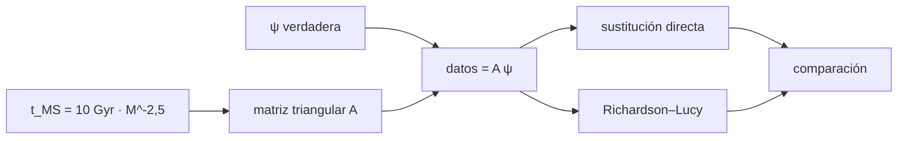

# B38-C04 — Historia de formación estelar a partir de poblaciones resueltas

<!-- nav:top -->
[🏠 Programa](../../../../README.md) · [📚 Bloque B38](../../../tronco-comun/B38-poblaciones-estelares-y-simulacion-de-galaxias.md) · [← Anterior: B38-C03 — Cinemática estelar con Gaia: movimientos propios y espacio de fase](../B38-C03-cinematica-estelar-con-gaia-movimientos-propios-y-espacio-de-fase/CLASE.md) · [Siguiente: B38-C05 — Potenciales galácticos: Plummer, Miyamoto-Nagai y NFW →](../B38-C05-potenciales-galacticos-plummer-miyamoto-nagai-y-nfw/CLASE.md)
<!-- /nav -->

## 1. Ubicación, nivel y alcance

Clase 4 del bloque B38. Nivel N3. La historia de formación estelar se infiere de cuántas estrellas hay en cada intervalo de masa de salida de la secuencia principal. Aquí construyes una **matriz triangular** con la vida `t = 10 Gyr (M/M☉)⁻²,⁵` y una IMF de Salpeter, resuelves la historia por **dos vías independientes** (sustitución directa y Richardson–Lucy) y mides cómo crece la incertidumbre cuando hay pocas estrellas. Usas [B12](../../../tronco-comun/B12-probabilidad-estadistica-e-incertidumbre.md) y [B38-C02](../B38-C02-funcion-inicial-de-masa-y-su-universalidad/CLASE.md). No se ajusta ningún diagrama color–magnitud real.

## 2. Por qué esta clase existe

Los conteos de estrellas son una suma sobre edades y la inversión amplifica el ruido. La decisión central: **¿con qué resolución en edad se puede recuperar la historia con un número dado de estrellas?**

## 3. Lo que podrás hacer al terminar

1. Calcular la masa de salida para una edad con `t = 10 Gyr (M/M☉)⁻²,⁵`.
2. Construir la matriz triangular de conteos.
3. Resolver por sustitución directa.
4. Resolver por Richardson–Lucy.
5. Medir la dispersión con ruido de Poisson.
6. Nombrar los límites del modelo.

La evidencia es la **ficha de la historia de formación estelar** del ejercicio 12 (sección 20).

## 4. Con qué llegas y cómo comprobarlo

1. ¿Qué es una incertidumbre?
2. ¿Qué es una simulación Monte Carlo?
3. ¿Qué es una tabla de resultados?
4. ¿Qué es un valor ilustrativo?
5. ¿Qué es una verificación?

<details>
<summary>Ver respuestas</summary>

1. Un intervalo en que se espera el valor verdadero. 2. Repetir con números aleatorios de semilla fija. 3. Un resumen ordenado de cálculos. 4. Un valor propuesto para el ejemplo, no medido. 5. Comparar un cálculo con un caso independiente.
</details>

Con cuatro o cinco aciertos, sigue; si no, repasa los prerrequisitos.

## 5. Un caso de contexto y casos de referencia

Con 13 intervalos de 1 Gyr y una historia verdadera de tasa 1 salvo un episodio de tasa 4 entre 3 y 5 Gyr (**ilustrativa**; masa formada total 19,00 en unidades de tasa × Gyr), ambas vías la recuperan sin ruido a `1,8 × 10⁻¹⁵`. Con unas 2018 estrellas la masa total tiene dispersión del 5,8 % y el intervalo 3–4 Gyr del 18,2 %; con 202 estrellas, 16,6 % y 56,3 %. Es el **ejemplo conductor**. Todo es **sintético**.

## 6. Vocabulario

La **historia de formación estelar** `ψ(t)` es la tasa de formación en función de la edad. La **vida en la secuencia principal** `t_MS`. Una **población resuelta** es aquella cuyas estrellas se miden individualmente. La **inversión** es hallar `ψ` a partir de los conteos. **Richardson–Lucy** es una iteración multiplicativa de máxima verosimilitud de Poisson. La **matriz triangular** aparece porque una estrella viva con edad `a` pertenece a un intervalo de masa de vida mayor que `a`.

## 7. Modelo mental: el reloj de arena inverso

Como deducir cuándo se echó cada capa de arena mirando solo las capas que quedan: las más antiguas ya se han perdido salvo las que duran mucho, y el ruido se amplifica al restar.



*Descripción textual:* la tasa de formación genera conteos por masa; se invierten por sustitución y por una iteración de máxima verosimilitud.

Analogía: el reloj de arena inverso. Límite: IMF conocida, sin metalicidad, binarias ni errores fotométricos.

## 8. La explicación, paso a paso

### 8.1 Masas de salida

La masa cuya vida es `t` Gyr es `M = (10/t)^0,4` M☉: 2,512 M☉ para 1 Gyr, 1,320 M☉ para 5 Gyr, 1 M☉ para 10 Gyr y 0,900 M☉ para 13 Gyr.

### 8.2 Recuperación sin ruido

Con 13 intervalos de edad (1 Gyr), tasa verdadera 1 (y 4 entre 3 y 5 Gyr), la sustitución directa recupera la historia con error relativo máximo `1,78 × 10⁻¹⁵` y Richardson–Lucy con 20 000 iteraciones con error menor que 0,001. La masa total formada es `19,00` (en tasa × Gyr).

### 8.3 Efecto del ruido

| estrellas esperadas | masa total recuperada | dispersión relativa total | dispersión relativa 3–4 Gyr |
|---|---|---|---|
| 201 771 | 19,00 | 0,0077 | 0,0204 |
| 2018 | 19,12 | 0,0581 | 0,1824 |
| 202 | 20,84 | 0,1663 | 0,5631 |

### 8.4 Lectura

La masa total se recupera mejor que el detalle: con 202 estrellas el total tiene un 17 % de dispersión (y un sesgo de +9,7 %), pero el episodio de 3–4 Gyr tiene un 56 %. Más resolución en edad exige más estrellas.

## 9. Magnitudes, símbolos y unidades

| Símbolo | Qué es | Unidad | Valor / nota |
|---|---|---|---|
| `ψ` | tasa de formación | tasa × Gyr de masa (unid. arb.) | 1; 4 entre 3 y 5 Gyr |
| `t_MS` | vida en secuencia principal | Gyr | `10 (M/M☉)⁻²,⁵` |
| `A` | matriz de conteos | estrellas por unidad de tasa | triangular |
| `σ/μ` | dispersión relativa | — | 0,0204; 0,1824; 0,5631 |

## 10. Convenciones y referencias

Historia, vida en secuencia principal, IMF de Salpeter y 13 intervalos **ilustrativos**; sin constantes; semilla `20261109`.

## 11. De dónde sale lo que afirmamos

| ID | Fuente | Localizador | Respalda | Estado |
|---|---|---|---|---|
| — | Sin fuente externa | — | relaciones estándar que verifica el laboratorio | No se consultó una fuente para esta clase |

Límites: no se ajustó ningún diagrama color–magnitud; la relación de vida es un modelo de juguete.

## 12. Cómo ver la recuperación de la historia

| edad (Gyr) | verdadera | directa | RL |
|---|---|---|---|
| 0–1 | 1,000 | 1,000 | 1,000 |
| 3–4 | 4,000 | 4,000 | 4,000 |
| 4–5 | 4,000 | 4,000 | 4,000 |
| 12–13 | 1,000 | 1,000 | 1,000 |

Descripción larga: ambas vías devuelven la historia verdadera sin ruido.

## 13. Ejemplo trabajado: la masa de salida

**Paso 1 · Cociente.** Para 5 Gyr, `10/5 = 2`.

**Paso 2 · Potencia.** `2^(1/2,5) = 2^0,4 = 1,3195`.

**Paso 3 · Masa.** `M = 1,320 M☉`.

**Paso 4 · Lectura.** Los 5 Gyr de edad se leen en estrellas de 1,32 M☉ que acaban de salir de la secuencia principal.

## 14. Distintas formas de describir una historia

**Por tasa:** `ψ(t)`. **Por conteos:** `A ψ`. **Por inversión:** sustitución y RL. **Por incertidumbre:** dispersión relativa.

## 15. Práctica guiada

**Ejercicio 1 · con los pasos indicados.** Masa de salida a 5 Gyr. *Pasos:* `10/5`; `^0,4`.

<details><summary>Solución comentada</summary>

`1,320 M☉`.
</details>

**Ejercicio 2 · con una pista.** Masa de salida a 1 Gyr.

<details><summary>Solución comentada</summary>

`10^0,4 = 2,512 M☉`.
</details>

**Ejercicio 3 · casi autónomo.** Masa de salida a 13 Gyr.

<details><summary>Solución comentada</summary>

`(10/13)^0,4 = 0,900 M☉`.
</details>

## 16. Práctica autónoma, transferencia e integrador

**Ejercicio 4.** Masa total formada con tasa 1 en 13 Gyr más el episodio de tasa 4 entre 3 y 5 Gyr.

<details><summary>Solución comentada</summary>

`13 + 2 × 3 = 19`.
</details>

**Ejercicio 5.** Fracción formada en el episodio.

<details><summary>Solución comentada</summary>

`8/19 = 42 %`.
</details>

**Ejercicio 6.** Sesgo de la masa total con 202 estrellas.

<details><summary>Solución comentada</summary>

`(20,84 − 19)/19 = +9,7 %`.
</details>

**Ejercicio 7.** Cociente de dispersiones 3–4 Gyr entre 202 y 2018 estrellas.

<details><summary>Solución comentada</summary>

`0,5631/0,1824 = 3,1 ≈ √10`.
</details>

**Ejercicio 8.** ¿Por qué la matriz es triangular?

<details><summary>Solución comentada</summary>

Porque una estrella de edad central `i + 0,5` solo está viva en los intervalos de vida central `j + 1,5` con `i ≤ j`.
</details>

**Ejercicio 9 · transferencia.** **Transferencia.** Un compañero dice que el laboratorio muestra la historia de la Vía Láctea. Responde.

<details><summary>Solución comentada</summary>

No: la historia es sintética y no se usó ningún dato.
</details>

**Ejercicio 10 · transferencia.** **Transferencia.** ¿Por qué se recupera mejor la masa total que el episodio?

<details><summary>Solución comentada</summary>

Porque el total suma conteos y el ruido relativo de una suma es menor que el del detalle.
</details>

**Ejercicio 11 · transferencia.** **Transferencia.** ¿Qué omite el modelo?

<details><summary>Solución comentada</summary>

Metalicidad, binarias, errores fotométricos, diagramas color–magnitud y degeneraciones edad–metalicidad.
</details>

**Ejercicio 12.** **Integrador.** Elabora tu *ficha de la historia de formación estelar*: masas de salida, recuperación sin ruido y efecto del ruido.

<details><summary>Solución comentada</summary>

Secciones 8.1–8.4.
</details>

**Ejercicio 12 · integrador.** **Integrador.** Elabora tu *ficha de la historia de formación estelar*: masas de salida, recuperación sin ruido y efecto del ruido.

<details><summary>Solución modelo</summary>

Secciones 8.1–8.4.
</details>

## 17. Laboratorio: inversión de conteos por edad

El script [sfh.py](sfh.py) recupera una historia sintética por dos vías y mide la dispersión con tres números de estrellas (**comprueba** `10⁻⁹` de la vía directa, 1 % de RL y que la dispersión crece al bajar el conteo).

**Datos:** sin constantes; historia y vida en secuencia principal **ilustrativas**; semilla `20261109`. **Predice antes de ejecutar:** ¿cuál tendrá más dispersión, el total o el intervalo 3–4 Gyr? (el intervalo.) **Ejecución del 2026-11-09 (Python 3.12.9):**

```text
Python 3.12.9 (biblioteca estandar)
edad [Gyr]  verdadera   directa       RL
   0-1          1.000     1.000    1.000
   1-2          1.000     1.000    1.000
   2-3          1.000     1.000    1.000
   3-4          4.000     4.000    4.000
   4-5          4.000     4.000    4.000
   5-6          1.000     1.000    1.000
   6-7          1.000     1.000    1.000
   7-8          1.000     1.000    1.000
   8-9          1.000     1.000    1.000
   9-10         1.000     1.000    1.000
  10-11         1.000     1.000    1.000
  11-12         1.000     1.000    1.000
  12-13         1.000     1.000    1.000
error relativo maximo sin ruido: directa 1.78e-15, RL 0.000
 estrellas  total RL  dispersion total  dispersion bin 3-4
    201771     19.00            0.0077              0.0204
      2018     19.12            0.0581              0.1824
       202     20.84            0.1663              0.5631
masa total formada verdadera 19.00 (SFR x Gyr)
Pruebas superadas.
```

```bash
python programa/clases/B38/B38-C04-historia-de-formacion-estelar-a-partir-de-poblaciones-resueltas/sfh.py
```

**Límites:** IMF conocida y sin errores fotométricos.

## 18. Errores frecuentes y cómo corregirlos

**Invertir sin discutir el ruido.** Se corrige con 8.3.

**Confundir edad con edad de salida.** Se corrige con 8.1.

**Pedir más resolución de la que permiten los datos.** Se corrige con 8.4.

**Presentar la historia sintética como real.** Se corrige con la sección 10.

## 19. Cómo sabrás que vas bien

Tras la sección 8: ¿qué resultado esperabas y cuál obtuviste? Si dudas, repasa el ejemplo 13. Tras el laboratorio: ¿qué comprueba? (ver la sección 17).

## 20. Qué entregas y cómo se evalúa

El producto es tu **ficha de la historia de formación estelar** (ejercicio 12).

| Criterio | Inicial | En desarrollo | Logrado | Destacado |
|---|---|---|---|---|
| Conceptos | Los confunde | Parciales | conceptos de la clase | Explica los límites |
| Cálculo | Sin unidades | Con errores | Tablas completas | Calcula casos nuevos |
| Numérico | Sin comprobar | Un caso | Contraste con el análisis | Interpreta las diferencias |
| Fuentes | Sin fuente | Sin fecha | fuentes con fecha | Declara lo ilustrativo |
| Límites | No los nombra | Uno | Tres | Discute qué falta del modelo |

**Condiciones críticas (no se compensan con promedio):** rotular la historia como sintética; no presentarla como datos; citar solo lo consultado.

## 21. Ética, seguridad y límites

Clase educativa: los modelos son simplificados. Accesibilidad: tablas equivalentes a las gráficas, fórmulas en texto, ejercicios sin conexión.

## 22. Para cerrar y seguir

Sin ruido, dos vías recuperan la historia a 10⁻¹⁵; con 202 estrellas, el episodio de 3–4 Gyr tiene un 56 % de dispersión. Queda una pregunta: ¿cómo se modela el potencial en que se mueven esas estrellas?

**Glosario español–inglés.** historia de formación estelar · *star formation history*; secuencia principal · *main sequence*; población resuelta · *resolved population*; inversión · *inversion*; vida · *lifetime*.

**Continuidad.** [B38-C05](../B38-C05-potenciales-galacticos-plummer-miyamoto-nagai-y-nfw/CLASE.md) estudia los potenciales galácticos.

**Referencias:** ver sección 11.

<!-- nav:bottom -->
---

[← Anterior: B38-C03 — Cinemática estelar con Gaia: movimientos propios y espacio de fase](../B38-C03-cinematica-estelar-con-gaia-movimientos-propios-y-espacio-de-fase/CLASE.md) · [📚 Bloque B38](../../../tronco-comun/B38-poblaciones-estelares-y-simulacion-de-galaxias.md) · [Siguiente: B38-C05 — Potenciales galácticos: Plummer, Miyamoto-Nagai y NFW →](../B38-C05-potenciales-galacticos-plummer-miyamoto-nagai-y-nfw/CLASE.md)
<!-- /nav -->
