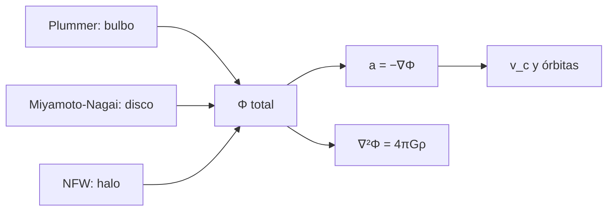

# B38-C05 — Potenciales galácticos: Plummer, Miyamoto-Nagai y NFW

<!-- nav:top -->
[🏠 Programa](../../../../README.md) · [📚 Bloque B38](../../../tronco-comun/B38-poblaciones-estelares-y-simulacion-de-galaxias.md) · [← Anterior: B38-C04 — Historia de formación estelar a partir de poblaciones resueltas](../B38-C04-historia-de-formacion-estelar-a-partir-de-poblaciones-resueltas/CLASE.md) · [Siguiente: B38-C06 — Hidrodinámica en simulaciones: SPH y métodos de malla →](../B38-C06-hidrodinamica-en-simulaciones-sph-y-metodos-de-malla/CLASE.md)
<!-- /nav -->

## 1. Ubicación, nivel y alcance

Clase 5 del bloque B38. Nivel N3. Un potencial galáctico es una función `Φ(R, z)` cuyo gradiente da la fuerza. Aquí sumas un bulbo de **Plummer**, un disco de **Miyamoto–Nagai** y un halo **NFW**, calculas la **velocidad circular** y sus contribuciones, verificas la aceleración analítica contra el gradiente numérico, la **ecuación de Poisson** contra la densidad analítica, la masa encerrada contra una integral numérica y una **órbita** con leapfrog. Usas [B05](../../../tronco-comun/B05-fisica-fundamental-para-el-espacio.md) y [B12](../../../tronco-comun/B12-probabilidad-estadistica-e-incertidumbre.md). Los parámetros son **ilustrativos** y no son un ajuste a la Vía Láctea.

## 2. Por qué esta clase existe

Toda simulación de estrellas necesita una fuerza. La decisión central: **¿qué potencial simple reproduce una curva de rotación plana y cuánto aporta cada componente?**

## 3. Lo que podrás hacer al terminar

1. Calcular `G` en kpc (km/s)² por M☉.
2. Evaluar tres potenciales y sus aceleraciones.
3. Sumar las contribuciones a la velocidad circular.
4. Verificar con el gradiente numérico y con Poisson.
5. Integrar una órbita y vigilar la energía.
6. Nombrar los límites de un potencial estático.

La evidencia es la **ficha de los potenciales galácticos** del ejercicio 12 (sección 20).

## 4. Con qué llegas y cómo comprobarlo

1. ¿Qué es una incertidumbre?
2. ¿Qué es una simulación Monte Carlo?
3. ¿Qué es una tabla de resultados?
4. ¿Qué es un valor ilustrativo?
5. ¿Qué es una verificación?

<details>
<summary>Ver respuestas</summary>

1. Un intervalo en que se espera el valor verdadero. 2. Repetir con números aleatorios de semilla fija. 3. Un resumen ordenado de cálculos. 4. Un valor propuesto para el ejemplo, no medido. 5. Comparar un cálculo con un caso independiente.
</details>

Con cuatro o cinco aciertos, sigue; si no, repasa los prerrequisitos.

## 5. Un caso de contexto y casos de referencia

Con `G = 4,30092 × 10⁻⁶ kpc (km/s)²/M☉`, un disco de `6 × 10¹⁰ M☉`, un bulbo de `10¹⁰ M☉` y un halo NFW con `ρ₀ = 8,5 × 10⁶ M☉/kpc³` y `r_s = 16 kpc` (**ilustrativos**), la velocidad circular a 8 kpc es `218,71 km/s` (disco 159,8; bulbo 72,9; halo 130,3). Es el **ejemplo conductor**. Todo es **sintético**.

## 6. Vocabulario

El **potencial** `Φ`. La **velocidad circular** `v_c² = R ∂Φ/∂R`. El **bulbo de Plummer** `Φ = −GM/√(r² + b²)`. El **disco de Miyamoto–Nagai** `Φ = −GM/√(R² + (a + √(z² + b²))²)`. El **halo NFW** `Φ = −4πGρ₀ r_s³ ln(1 + r/r_s)/r`. La **masa encerrada** `M(<r)`. El **integrador leapfrog** es simpléctico de segundo orden.

## 7. Modelo mental: un valle con tres colinas

Como un paisaje con tres relieves superpuestos: lo que siente una estrella es la pendiente total, la suma de las pendientes de cada relieve.



*Descripción textual:* tres potenciales se suman; su gradiente da la fuerza, de la que salen la velocidad circular y las órbitas, y su laplaciano da la densidad.

Analogía: un valle con tres colinas. Límite: estático, axisimétrico y sin gas.

## 8. La explicación, paso a paso

### 8.1 Constante

`G = GM_☉/kpc = 1,3271244 × 10²⁰ / 3,0856775814913673 × 10¹⁹ / 10⁶ = 4,30092 × 10⁻⁶ kpc (km/s)²/M☉`.

### 8.2 Velocidad circular

| `R` (kpc) | `v_c` (km/s) | disco | bulbo | halo |
|---|---|---|---|---|
| 2 | 206,31 | 134,9 | 134,5 | 79,2 |
| 4 | 225,82 | 172,7 | 101,4 | 104,3 |
| 8 | 218,71 | 159,8 | 72,9 | 130,3 |
| 12 | 208,37 | 138,9 | 59,7 | 143,3 |
| 20 | 196,40 | 111,4 | 46,3 | 155,0 |
| 40 | 181,09 | 79,9 | 32,8 | 159,2 |

Las velocidades cuadradas se suman: `159,8² + 72,9² + 130,3² = 47 828 = 218,7²` a 8 kpc. A 2 kpc el bulbo y el disco aportan casi lo mismo y el halo supera al disco a partir de ~11 kpc; la curva no es plana en este modelo (cae de 226 a 181 km/s).

### 8.3 Verificaciones

| comprobación | resultado |
|---|---|
| aceleración analítica frente a gradiente numérico | diferencia relativa máxima `6,3 × 10⁻¹⁰` |
| ecuación de Poisson, Plummer | `6,7 × 10⁻⁷` |
| ecuación de Poisson, NFW | `1,0 × 10⁻⁸` |
| masa encerrada NFW frente a integral | mejor que `10⁻⁵` |

### 8.4 Órbita

Una órbita inicial en `R = 8 kpc`, `z = 0,5 kpc` con `v_φ = 0,9 v_c` se integra 1 Gyr con 1999 pasos de 0,5 Myr: el error de la energía es `6,3 × 10⁻⁶`, el de `L_z` `2,3 × 10⁻¹⁵` y `|z|_max = 0,54 kpc`. La energía oscila y no deriva (leapfrog); `L_z` se conserva a precisión de máquina por la simetría.

### 8.5 Lectura

Cada potencial es una función cerrada, su fuerza se puede verificar de dos maneras y la órbita conserva lo que debe. Un potencial así no incluye el gas ni los brazos espirales.

## 9. Magnitudes, símbolos y unidades

| Símbolo | Qué es | Unidad | Valor / nota |
|---|---|---|---|
| `G` | constante de gravitación | kpc (km/s)² / M☉ | 4,30092 × 10⁻⁶ |
| `v_c` | velocidad circular | km/s | 218,71 (a 8 kpc) |
| `ρ₀, r_s` | parámetros del halo NFW | M☉/kpc³; kpc | 8,5 × 10⁶; 16 (ilustrativos) |
| `M(<r_s)` | masa NFW dentro de `r_s` | M☉ | 8,45 × 10¹⁰ |

## 10. Convenciones y referencias

Unidades: kpc, km/s y M☉; tiempo en kpc/(km/s) = 977,8 Myr. Parámetros **ilustrativos**, sin ajuste a datos; potencial estático.

## 11. De dónde sale lo que afirmamos

| ID | Fuente | Localizador | Respalda | Estado |
|---|---|---|---|---|
| S1 | UAI, Resolución B3 de 2015 | https://arxiv.org/abs/1510.07674 | `GM_☉ = 1,3271244 × 10²⁰ m³/s²` | Consultada el 2026-11-09 |
| S2 | Definición de la unidad astronómica y del kiloparsec (UAI) | — | `1 kpc = 3,0856775814913673 × 10¹⁹ m` | Estándar no consultado |
| S3 | Navarro, Frenk y White (1996), *The Structure of Cold Dark Matter Halos* | https://arxiv.org/abs/astro-ph/9508025 | resumen: perfil universal de halos de materia oscura fría, más plano que `r⁻²` en el centro y más empinado cerca del radio virial | Solo resumen, consultado el 2026-11-09 |

Límites: de Navarro, Frenk y White solo se leyó el resumen y no respalda ningún parámetro de la clase; el kiloparsec y la unidad astronómica no se consultaron.

## 12. Cómo ver la velocidad circular

| `R` (kpc) | `v_c` (km/s) |
|---|---|
| 2 | 206,31 |
| 4 | 225,82 |
| 8 | 218,71 |
| 20 | 196,40 |
| 40 | 181,09 |

Descripción larga: la velocidad sube hasta 4 kpc y desciende lentamente.

## 13. Ejemplo trabajado: la velocidad circular a 8 kpc

**Paso 1 · Disco.** `v_d² = G M R²/(R² + (a + b)²)^1,5 = 25 550` (km/s)² con `a + b = 3,28 kpc`; `v_d = 159,8 km/s`.

**Paso 2 · Bulbo.** `v_b = 72,9 km/s`.

**Paso 3 · Halo.** `v_h = 130,3 km/s`.

**Paso 4 · Suma.** `v_c = √(159,8² + 72,9² + 130,3²) = 218,7 km/s`.

## 14. Distintas formas de describir un potencial

**Por fórmula:** `Φ`. **Por gradiente:** `a = −∇Φ`. **Por Poisson:** `∇²Φ = 4πGρ`. **Por órbita:** leapfrog.

## 15. Práctica guiada

**Ejercicio 1 · con los pasos indicados.** `v_c` a 8 kpc a partir de las tres contribuciones. *Pasos:* sumar cuadrados; raíz.

<details><summary>Solución comentada</summary>

`218,7 km/s`.
</details>

**Ejercicio 2 · con una pista.** Masa NFW dentro de `r_s`: `4π ρ₀ r_s³ (ln 2 − 1/2)`.

<details><summary>Solución comentada</summary>

`8,45 × 10¹⁰ M☉`.
</details>

**Ejercicio 3 · casi autónomo.** Densidad NFW en `r = r_s`.

<details><summary>Solución comentada</summary>

`ρ₀/4 = 2,125 × 10⁶ M☉/kpc³`.
</details>

## 16. Práctica autónoma, transferencia e integrador

**Ejercicio 4.** Potencial central de Plummer, `−GM/b`.

<details><summary>Solución comentada</summary>

`−6,14 × 10⁴ (km/s)²`.
</details>

**Ejercicio 5.** Velocidad de escape central del bulbo (solo bulbo).

<details><summary>Solución comentada</summary>

`√(2 × 6,14 × 10⁴) = 350,5 km/s`.
</details>

**Ejercicio 6.** Periodo circular a 8 kpc.

<details><summary>Solución comentada</summary>

`2π × 8/218,7 = 0,2299` kpc/(km/s) `= 224,7 Myr`.
</details>

**Ejercicio 7.** Densidad central de Plummer, `3M/(4π b³)`.

<details><summary>Solución comentada</summary>

`6,96 × 10⁹ M☉/kpc³`.
</details>

**Ejercicio 8.** ¿Qué componente domina a 40 kpc?

<details><summary>Solución comentada</summary>

El halo: 159,2 de 181,1 km/s.
</details>

**Ejercicio 9 · transferencia.** **Transferencia.** Un compañero dice que estos parámetros son los de la Vía Láctea. Responde.

<details><summary>Solución comentada</summary>

No: son ilustrativos y no se ajustaron a ningún dato.
</details>

**Ejercicio 10 · transferencia.** **Transferencia.** ¿Por qué `L_z` se conserva a precisión de máquina y la energía solo a 10⁻⁶?

<details><summary>Solución comentada</summary>

Porque el potencial es axisimétrico (conserva `L_z`) y el leapfrog conserva la energía solo de forma aproximada.
</details>

**Ejercicio 11 · transferencia.** **Transferencia.** ¿Qué omite un potencial estático?

<details><summary>Solución comentada</summary>

El gas, los brazos, la barra, la evolución en el tiempo y los satélites.
</details>

**Ejercicio 12.** **Integrador.** Elabora tu *ficha de los potenciales galácticos*: constante, curva de rotación, verificaciones y órbita.

<details><summary>Solución comentada</summary>

Secciones 8.1–8.5.
</details>

**Ejercicio 12 · integrador.** **Integrador.** Elabora tu *ficha de los potenciales galácticos*: constante, curva de rotación, verificaciones y órbita.

<details><summary>Solución modelo</summary>

Secciones 8.1–8.5.
</details>

## 17. Laboratorio: potenciales y órbita

El script [potenciales.py](potenciales.py) evalúa tres potenciales, verifica por gradiente y Poisson e integra una órbita (**comprueba** gradiente `10⁻⁶`, Poisson `10⁻⁴`, energía `10⁻⁴` y `L_z` `10⁻⁹`).

**Datos:** `GM_☉` de la UAI (2015) y `kpc`; parámetros **ilustrativos**; sin aleatoriedad. **Predice antes de ejecutar:** ¿se conserva `L_z` mejor que la energía? (sí.) **Ejecución del 2026-11-09 (Python 3.12.9):**

```text
Python 3.12.9 (biblioteca estandar)
G = 4.30092e-06 kpc (km/s)^2 / Msol
 R [kpc]  v_c [km/s]   disco   bulbo    halo
       2      206.31   134.9   134.5    79.2
       4      225.82   172.7   101.4   104.3
       8      218.71   159.8    72.9   130.3
      12      208.37   138.9    59.7   143.3
      20      196.40   111.4    46.3   155.0
      40      181.09    79.9    32.8   159.2
aceleracion analitica frente a gradiente numerico: diferencia relativa maxima 6.30e-10
ecuacion de Poisson, Plummer: error relativo maximo 6.67e-07
ecuacion de Poisson, NFW: error relativo maximo 1.03e-08
masa encerrada NFW: formula frente a integral numerica, acuerdo mejor que 1e-5
orbita de 1 Gyr con 1999 pasos: error de energia 6.29e-06, de L_z 2.31e-15, |z|max 0.54 kpc
Pruebas superadas.
```

```bash
python programa/clases/B38/B38-C05-potenciales-galacticos-plummer-miyamoto-nagai-y-nfw/potenciales.py
```

**Límites:** estático y axisimétrico.

## 18. Errores frecuentes y cómo corregirlos

**Sumar velocidades en lugar de sus cuadrados.** Se corrige con 8.2.

**Usar unidades mezcladas (pc con km/s).** Se corrige con la sección 9.

**Creer que la curva es plana por construcción.** Se corrige con 8.2.

**Presentar los parámetros como ajuste real.** Se corrige con la sección 10.

## 19. Cómo sabrás que vas bien

Tras la sección 8: ¿qué resultado esperabas y cuál obtuviste? Si dudas, repasa el ejemplo 13. Tras el laboratorio: ¿qué comprueba? (ver la sección 17).

## 20. Qué entregas y cómo se evalúa

El producto es tu **ficha de los potenciales galácticos** (ejercicio 12).

| Criterio | Inicial | En desarrollo | Logrado | Destacado |
|---|---|---|---|---|
| Conceptos | Los confunde | Parciales | conceptos de la clase | Explica los límites |
| Cálculo | Sin unidades | Con errores | Tablas completas | Calcula casos nuevos |
| Numérico | Sin comprobar | Un caso | Contraste con el análisis | Interpreta las diferencias |
| Fuentes | Sin fuente | Sin fecha | fuentes con fecha | Declara lo ilustrativo |
| Límites | No los nombra | Uno | Tres | Discute qué falta del modelo |

**Condiciones críticas (no se compensan con promedio):** rotular los parámetros como ilustrativos; no presentarlos como la Vía Láctea; citar solo lo consultado.

## 21. Ética, seguridad y límites

Clase educativa: los modelos son simplificados. Accesibilidad: tablas equivalentes a las gráficas, fórmulas en texto, ejercicios sin conexión.

## 22. Para cerrar y seguir

A 8 kpc, `v_c = 218,7 km/s` suma disco, bulbo y halo ilustrativos; las verificaciones de gradiente y Poisson llegan a 10⁻⁷ o mejor. Queda una pregunta: ¿cómo evoluciona el gas bajo esa fuerza?

**Glosario español–inglés.** potencial · *potential*; velocidad circular · *circular velocity*; masa encerrada · *enclosed mass*; halo · *halo*; bulbo · *bulge*.

**Continuidad.** [B38-C06](../B38-C06-hidrodinamica-en-simulaciones-sph-y-metodos-de-malla/CLASE.md) estudia la hidrodinámica en simulaciones.

**Referencias:** ver sección 11.

<!-- nav:bottom -->
---

[← Anterior: B38-C04 — Historia de formación estelar a partir de poblaciones resueltas](../B38-C04-historia-de-formacion-estelar-a-partir-de-poblaciones-resueltas/CLASE.md) · [📚 Bloque B38](../../../tronco-comun/B38-poblaciones-estelares-y-simulacion-de-galaxias.md) · [Siguiente: B38-C06 — Hidrodinámica en simulaciones: SPH y métodos de malla →](../B38-C06-hidrodinamica-en-simulaciones-sph-y-metodos-de-malla/CLASE.md)
<!-- /nav -->
