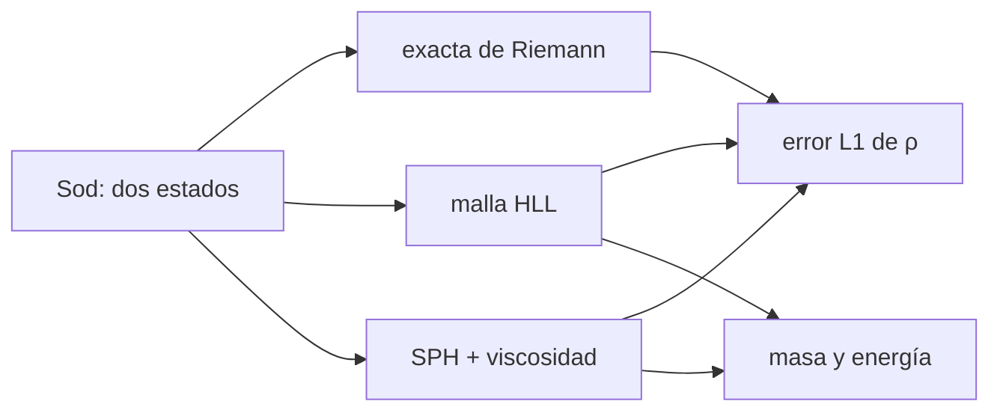

# B38-C06 — Hidrodinámica en simulaciones: SPH y métodos de malla

<!-- nav:top -->
[🏠 Programa](../../../../README.md) · [📚 Bloque B38](../../../tronco-comun/B38-poblaciones-estelares-y-simulacion-de-galaxias.md) · [← Anterior: B38-C05 — Potenciales galácticos: Plummer, Miyamoto-Nagai y NFW](../B38-C05-potenciales-galacticos-plummer-miyamoto-nagai-y-nfw/CLASE.md) · [Siguiente: B38-C07 — Modelos submalla de formación estelar y retroalimentación →](../B38-C07-modelos-submalla-de-formacion-estelar-y-retroalimentacion/CLASE.md)
<!-- /nav -->

## 1. Ubicación, nivel y alcance

Clase 6 del bloque B38. Nivel N3. Una simulación de galaxia resuelve el gas con partículas (SPH) o con una malla. Aquí resuelves el **tubo de choque de Sod** en 1D con tres métodos: la **solución exacta de Riemann**, una **malla fija de Godunov con flujo HLL** y un **SPH** con kernel spline cúbico y viscosidad artificial de Monaghan; comparas el error de la densidad, la masa y la energía. Usas [B05](../../../tronco-comun/B05-fisica-fundamental-para-el-espacio.md) y [B12](../../../tronco-comun/B12-probabilidad-estadistica-e-incertidumbre.md). Del método de malla móvil de Springel solo se leyó el resumen y no se implementa.

## 2. Por qué esta clase existe

Cada método tiene errores distintos en choques y discontinuidades de contacto. La decisión central: **¿qué error comete cada método frente a una solución exacta y cómo cambia con la resolución?**

## 3. Lo que podrás hacer al terminar

1. Calcular la solución exacta de Sod.
2. Aplicar un esquema de Godunov con flujo HLL.
3. Aplicar SPH con viscosidad artificial.
4. Medir el error L1 de la densidad.
5. Comprobar la conservación de masa y energía.
6. Comparar métodos sin generalizar de más.

La evidencia es la **ficha de la hidrodinámica numérica** del ejercicio 12 (sección 20).

## 4. Con qué llegas y cómo comprobarlo

1. ¿Qué es una incertidumbre?
2. ¿Qué es una simulación Monte Carlo?
3. ¿Qué es una tabla de resultados?
4. ¿Qué es un valor ilustrativo?
5. ¿Qué es una verificación?

<details>
<summary>Ver respuestas</summary>

1. Un intervalo en que se espera el valor verdadero. 2. Repetir con números aleatorios de semilla fija. 3. Un resumen ordenado de cálculos. 4. Un valor propuesto para el ejemplo, no medido. 5. Comparar un cálculo con un caso independiente.
</details>

Con cuatro o cinco aciertos, sigue; si no, repasa los prerrequisitos.

## 5. Un caso de contexto y casos de referencia

Con `ρ = 1, p = 1` a la izquierda y `ρ = 0,125, p = 0,1` a la derecha, `γ = 1,4` y `t = 0,2`, la región central tiene `p* = 0,3031` y `u* = 0,9275`; el error L1 de la densidad de la malla es `0,01940`, `0,01234` y `0,00781` con 100, 200 y 400 celdas, y el del SPH `0,0535` (180 partículas) y `0,0519` (360). Es el **ejemplo conductor**. Es un caso de prueba, no una galaxia.

## 6. Vocabulario

El **problema de Riemann** es el choque entre dos estados constantes. La **onda de rarefacción**, la **discontinuidad de contacto** y el **choque** son las tres ondas del tubo de Sod. **SPH** es un método de partículas con kernel de suavizado `W` y longitud `h`. Un **método de malla** divide el espacio en celdas. El **flujo HLL** es un solucionador aproximado de Riemann. La **viscosidad artificial** reparte los choques sobre varias partículas. El **error L1** es la media del valor absoluto del error.

## 7. Modelo mental: la fila de coches

Como una fila de coches que frena de golpe: un método sigue cada coche (partículas), el otro mide el tráfico en cada tramo de carretera (malla); ambos ven la onda de frenado, pero la marcan con errores distintos.



*Descripción textual:* los tres métodos parten del mismo estado inicial y se comparan con la solución exacta por el error de la densidad y las cantidades conservadas.

Analogía: la fila de coches. Límite: gas ideal, 1D, sin gravedad.

## 8. La explicación, paso a paso

### 8.1 Solución exacta

A `t = 0,2` hay cuatro zonas: izquierda sin perturbar; una rarefacción de `x = −0,2366` (`−c_l t`, con `c_l = 1,1832`) a `x = −0,0140`; una zona central con `ρ* = 0,4263`, `u* = 0,9275`, `p* = 0,3031` hasta el contacto en `x = 0,1855`; una zona `ρ* = 0,2656` hasta el choque en `x = 0,3504` (velocidad 1,7522); y la derecha sin perturbar. Valores: `ρ(−0,3) = 1,0000`, `ρ(0,2) = 0,2656`, `ρ(0,4) = 0,1250`.

### 8.2 Malla

| celdas | error L1 de `ρ` |
|---|---|
| 100 | 0,01940 |
| 200 | 0,01234 |
| 400 | 0,00781 |

El error baja a razón de 1,57–1,58 al duplicar las celdas (orden ≈ 0,65, típico en discontinuidades). Con 400 celdas, la masa es `0,562500` (exacta) y la energía `1,37500` (inicial `1,37500`).

### 8.3 SPH

| partículas | error L1 de `ρ` | masa | energía (inicial 1,37500) |
|---|---|---|---|
| 180 | 0,05350 | 0,562500 | 1,37832 |
| 360 | 0,05188 | 0,562500 | 1,37711 |

El error L1 del SPH se pondera por el volumen de cada partícula y se mide en `|x| < 0,45`. La malla de 400 celdas, en la misma ventana, da `0,00868`.

### 8.4 Lectura

El SPH conserva la masa por construcción y la energía a 0,2 %. Su error baja muy poco al duplicar las partículas porque lo dominan la suavización del contacto y el ruido de la densidad. La malla es más precisa en este problema 1D con este esquema de primer orden; esa conclusión **no** se extiende a 3D, a esquemas de orden superior ni a la malla móvil.

## 9. Magnitudes, símbolos y unidades

| Símbolo | Qué es | Unidad | Valor / nota |
|---|---|---|---|
| `γ` | índice adiabático | — | 1,4 |
| `p*, u*` | presión y velocidad centrales | unid. adim. | 0,3031; 0,9275 |
| `h` | longitud de suavizado | unid. adim. | `1,2 m/ρ` |
| `ε_L1` | error L1 de la densidad | unid. adim. | 0,00781; 0,0519 |

## 10. Convenciones y referencias

Unidades adimensionales; condiciones de Sod; resoluciones y coeficientes de viscosidad (`α = 1`, `β = 2`) **elecciones del laboratorio**; sin aleatoriedad.

## 11. De dónde sale lo que afirmamos

| ID | Fuente | Localizador | Respalda | Estado |
|---|---|---|---|---|
| S1 | Springel (2010), *Hydrodynamic simulations on a moving Voronoi mesh* | https://arxiv.org/abs/1109.2218 | resumen: método de malla de Voronoi móvil con volúmenes finitos de segundo orden y solucionador de Riemann exacto, invariante galileano | Solo resumen, consultado el 2026-11-09 |

Límites: del método de malla móvil de Springel solo se leyó el resumen y no se implementa; los errores de esta clase no se atribuyen a ese artículo.

## 12. Cómo ver los errores

| método | resolución | error L1 de `ρ` |
|---|---|---|
| malla | 100 celdas | 0,01940 |
| malla | 400 celdas | 0,00781 |
| SPH | 180 partículas | 0,05350 |
| SPH | 360 partículas | 0,05188 |

Descripción larga: la malla supera al SPH en este problema y mejora más con la resolución.

## 13. Ejemplo trabajado: las ondas del tubo de Sod

**Paso 1 · Contacto.** `x_c = u* t = 0,9275 × 0,2 = 0,1855`.

**Paso 2 · Choque.** `s = u* ρ*_R/(ρ*_R − ρ_R) = 0,9275 × 0,2656/(0,2656 − 0,125) = 1,752`.

**Paso 3 · Posición.** `x_s = 1,752 × 0,2 = 0,3504`.

**Paso 4 · Lectura.** El choque va por delante del contacto; entre ambos la densidad es 0,2656.

## 14. Distintas formas de describir un tubo de choque

**Por ondas:** rarefacción, contacto, choque. **Por método:** exacta, malla, SPH. **Por error:** L1. **Por conservación:** masa y energía.

## 15. Práctica guiada

**Ejercicio 1 · con los pasos indicados.** Velocidad del sonido de la izquierda. *Pasos:* `√(γ p/ρ)`.

<details><summary>Solución comentada</summary>

`√1,4 = 1,1832`.
</details>

**Ejercicio 2 · con una pista.** Velocidad del sonido de la derecha.

<details><summary>Solución comentada</summary>

`√(1,4 × 0,1/0,125) = 1,0583`.
</details>

**Ejercicio 3 · casi autónomo.** Posición de la cabeza de la rarefacción a `t = 0,2`.

<details><summary>Solución comentada</summary>

`−1,1832 × 0,2 = −0,2366`.
</details>

## 16. Práctica autónoma, transferencia e integrador

**Ejercicio 4.** Posición del contacto.

<details><summary>Solución comentada</summary>

`0,9275 × 0,2 = 0,1855`.
</details>

**Ejercicio 5.** Masa total.

<details><summary>Solución comentada</summary>

`0,5 × 1 + 0,5 × 0,125 = 0,5625`.
</details>

**Ejercicio 6.** Energía total inicial.

<details><summary>Solución comentada</summary>

`0,5/0,4 + 0,05/0,4 = 1,375`.
</details>

**Ejercicio 7.** Cociente de errores de la malla al pasar de 100 a 400 celdas.

<details><summary>Solución comentada</summary>

`0,01940/0,00781 = 2,48`.
</details>

**Ejercicio 8.** Error relativo de energía del SPH con 180 partículas.

<details><summary>Solución comentada</summary>

`(1,37832 − 1,375)/1,375 = 0,24 %`.
</details>

**Ejercicio 9 · transferencia.** **Transferencia.** Un compañero dice que, como la malla gana en Sod, es mejor en toda simulación de galaxias. Responde.

<details><summary>Solución comentada</summary>

No: es un caso 1D con un esquema de primer orden; en 3D con gravedad y rotación pesan otros criterios.
</details>

**Ejercicio 10 · transferencia.** **Transferencia.** ¿Por qué las mallas fijas no son invariantes galileanas y el resumen de Springel lo destaca?

<details><summary>Solución comentada</summary>

Porque el error numérico depende de la velocidad relativa entre el fluido y la malla; una malla que se mueve con el flujo lo evita.
</details>

**Ejercicio 11 · transferencia.** **Transferencia.** ¿Qué omite el laboratorio?

<details><summary>Solución comentada</summary>

Gravedad, enfriamiento, 3D, conducción, limitadores de segundo orden y variación de `h` autoconsistente.
</details>

**Ejercicio 12.** **Integrador.** Elabora tu *ficha de la hidrodinámica numérica*: ondas exactas, errores de los métodos y conservación.

<details><summary>Solución comentada</summary>

Secciones 8.1–8.4.
</details>

**Ejercicio 12 · integrador.** **Integrador.** Elabora tu *ficha de la hidrodinámica numérica*: ondas exactas, errores de los métodos y conservación.

<details><summary>Solución modelo</summary>

Secciones 8.1–8.4.
</details>

## 17. Laboratorio: tubo de choque con tres métodos

El script [tubo.py](tubo.py) resuelve Sod con la solución exacta, una malla HLL y SPH, y compara errores y conservación (**comprueba** masa a `10⁻¹²`, energía al 1 % y el orden de los errores).

**Datos:** sin constantes; caso de prueba **clásico** con parámetros **ilustrativos**; sin aleatoriedad. **Predice antes de ejecutar:** ¿qué método tendrá menor error? (la malla.) **Ejecución del 2026-11-09 (Python 3.12.9):**

```text
Python 3.12.9 (biblioteca estandar)
solucion exacta en x = 0,1, t = 0,2: rho = 0.4263, u = 0.9275, p = 0.3031
exacta: rho en x = -0,3: 1.0000; x = 0,2: 0.2656; x = 0,4: 0.1250
malla N =  100: error L1 de rho = 0.01940
malla N =  200: error L1 de rho = 0.01234
malla N =  400: error L1 de rho = 0.00781
malla N = 400: masa 0.562500 (esperada 0.562500), energia 1.37500 (inicial 1.37500)
SPH (180 particulas, m = 0.003125): error L1 de rho = 0.05350; masa total 0.562500; energia 1.37832 (inicial 1.37500)
SPH (360 particulas, m = 0.001563): error L1 de rho = 0.05188; masa total 0.562500; energia 1.37711 (inicial 1.37500)
malla N = 400 (misma ventana): error L1 de rho = 0.00868
Pruebas superadas.
```

```bash
python programa/clases/B38/B38-C06-hidrodinamica-en-simulaciones-sph-y-metodos-de-malla/tubo.py
```

**Límites:** gas ideal 1D sin gravedad.

## 18. Errores frecuentes y cómo corregirlos

**Generalizar un caso 1D a toda la astrofísica.** Se corrige con 8.4.

**Medir el error en los bordes no perturbados.** Se corrige con 8.3.

**Olvidar la viscosidad artificial.** Se corrige con el modelo del laboratorio.

**Atribuir los errores al artículo de Springel.** Se corrige con la sección 11.

## 19. Cómo sabrás que vas bien

Tras la sección 8: ¿qué resultado esperabas y cuál obtuviste? Si dudas, repasa el ejemplo 13. Tras el laboratorio: ¿qué comprueba? (ver la sección 17).

## 20. Qué entregas y cómo se evalúa

El producto es tu **ficha de la hidrodinámica numérica** (ejercicio 12).

| Criterio | Inicial | En desarrollo | Logrado | Destacado |
|---|---|---|---|---|
| Conceptos | Los confunde | Parciales | conceptos de la clase | Explica los límites |
| Cálculo | Sin unidades | Con errores | Tablas completas | Calcula casos nuevos |
| Numérico | Sin comprobar | Un caso | Contraste con el análisis | Interpreta las diferencias |
| Fuentes | Sin fuente | Sin fecha | fuentes con fecha | Declara lo ilustrativo |
| Límites | No los nombra | Uno | Tres | Discute qué falta del modelo |

**Condiciones críticas (no se compensan con promedio):** rotular el caso como de prueba; no generalizar la comparación; citar solo lo consultado.

## 21. Ética, seguridad y límites

Clase educativa: los modelos son simplificados. Accesibilidad: tablas equivalentes a las gráficas, fórmulas en texto, ejercicios sin conexión.

## 22. Para cerrar y seguir

La malla de 400 celdas da un error L1 de 0,0078 y el SPH de 360 partículas de 0,052, con masa exacta y energía al 0,2–0,3 %; la comparación vale solo para este caso. Queda una pregunta: ¿qué pasa con la formación estelar que ninguna malla resuelve?

**Glosario español–inglés.** tubo de choque · *shock tube*; problema de Riemann · *Riemann problem*; viscosidad artificial · *artificial viscosity*; longitud de suavizado · *smoothing length*; malla · *mesh*.

**Continuidad.** [B38-C07](../B38-C07-modelos-submalla-de-formacion-estelar-y-retroalimentacion/CLASE.md) estudia los modelos submalla.

**Referencias:** ver sección 11.

<!-- nav:bottom -->
---

[← Anterior: B38-C05 — Potenciales galácticos: Plummer, Miyamoto-Nagai y NFW](../B38-C05-potenciales-galacticos-plummer-miyamoto-nagai-y-nfw/CLASE.md) · [📚 Bloque B38](../../../tronco-comun/B38-poblaciones-estelares-y-simulacion-de-galaxias.md) · [Siguiente: B38-C07 — Modelos submalla de formación estelar y retroalimentación →](../B38-C07-modelos-submalla-de-formacion-estelar-y-retroalimentacion/CLASE.md)
<!-- /nav -->
