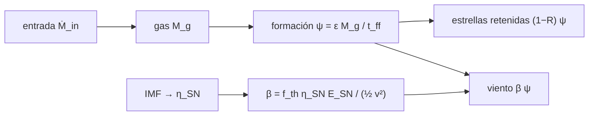

# B38-C07 — Modelos submalla de formación estelar y retroalimentación

<!-- nav:top -->
[🏠 Programa](../../../../README.md) · [📚 Bloque B38](../../../tronco-comun/B38-poblaciones-estelares-y-simulacion-de-galaxias.md) · [← Anterior: B38-C06 — Hidrodinámica en simulaciones: SPH y métodos de malla](../B38-C06-hidrodinamica-en-simulaciones-sph-y-metodos-de-malla/CLASE.md) · [Siguiente: B38-C08 — Observaciones sintéticas de galaxias simuladas →](../B38-C08-observaciones-sinteticas-de-galaxias-simuladas/CLASE.md)
<!-- /nav -->

## 1. Ubicación, nivel y alcance

Clase 7 del bloque B38. Nivel N3. Lo que una simulación no resuelve se modela con reglas submalla. Aquí construyes un modelo de **una zona**: formación estelar con una eficiencia por tiempo de caída libre (tipo Schmidt), un **número de supernovas por masa formada** integrado de la IMF de Kroupa, una **carga de masa** `β` obtenida de un balance de energía y el **equilibrio** del gas, que verificas por dos vías (RK4 y solución cerrada) y por balance de masa. Usas [B05](../../../tronco-comun/B05-fisica-fundamental-para-el-espacio.md) y [B38-C02](../B38-C02-funcion-inicial-de-masa-y-su-universalidad/CLASE.md). Los parámetros son **ilustrativos**.

## 2. Por qué esta clase existe

El gas denso forma estrellas por debajo de la resolución de la simulación y las supernovas devuelven energía. La decisión central: **¿cuánto gas expulsa la retroalimentación y a qué equilibrio llega la zona?**

## 3. Lo que podrás hacer al terminar

1. Obtener el número de supernovas por masa estelar de una IMF.
2. Plantear `dM_g/dt` con formación, retorno y viento.
3. Calcular la carga de masa `β` por balance de energía.
4. Resolver el equilibrio por dos vías.
5. Comprobar el balance de masa.
6. Nombrar los límites de un modelo submalla.

La evidencia es la **ficha de los modelos submalla** del ejercicio 12 (sección 20).

## 4. Con qué llegas y cómo comprobarlo

1. ¿Qué es una incertidumbre?
2. ¿Qué es una simulación Monte Carlo?
3. ¿Qué es una tabla de resultados?
4. ¿Qué es un valor ilustrativo?
5. ¿Qué es una verificación?

<details>
<summary>Ver respuestas</summary>

1. Un intervalo en que se espera el valor verdadero. 2. Repetir con números aleatorios de semilla fija. 3. Un resumen ordenado de cálculos. 4. Un valor propuesto para el ejemplo, no medido. 5. Comparar un cálculo con un caso independiente.
</details>

Con cuatro o cinco aciertos, sigue; si no, repasa los prerrequisitos.

## 5. Un caso de contexto y casos de referencia

Con la IMF de Kroupa entre 0,01 y 100 M☉, hay `0,01048` supernovas por M☉ formada (una por 95 M☉), es decir `1,048 × 10⁴⁹ erg` por M☉. Con `ε = 0,01`, `t_ff = 100 Myr`, `Ṁ_in = 1 M☉/año`, `R = 0,3` y viento de 100 km/s (**ilustrativos**), el gas de equilibrio baja de `14,29 × 10⁹ M☉` sin retroalimentación a `0,89 × 10⁹ M☉` con `f_th = 0,1`. Es el **ejemplo conductor**. Todo es **sintético**.

## 6. Vocabulario

El **modelo submalla** es una regla para procesos no resueltos. La **ley de Schmidt** `ψ = ε M_g/t_ff`. La **eficiencia** `ε` por tiempo de caída libre. El **número de supernovas por masa** `η_SN`. La **fracción térmica** `f_th` de la energía que calienta el gas. La **carga de masa** `β = f_th η_SN E_SN/(½ v_w²)`. El **equilibrio** es el estado donde la entrada compensa las pérdidas. El **sobreenfriamiento** es la pérdida radiativa de la energía inyectada antes de empujar el gas.

## 7. Modelo mental: una bañera con dos desagües

Como una bañera con un grifo (entrada), un desagüe pequeño (estrellas) y otro grande cuando hay supernovas (viento): el nivel de equilibrio baja al abrir más el segundo.



*Descripción textual:* la formación estelar produce supernovas cuya energía expulsa gas con una carga de masa, y el gas se estabiliza donde la entrada iguala a las pérdidas.

Analogía: una bañera con dos desagües. Límite: una zona, `R` constante, sin enfriamiento detallado.

## 8. La explicación, paso a paso

### 8.1 Supernovas por masa

De la IMF de Kroupa entre 0,01 y 100 M☉: `η_SN = 0,01048` supernovas por M☉ (una cada 95 M☉). Con `E_SN = 10⁵¹ erg`, son `1,048 × 10⁴⁹ erg` por M☉ formada. Un viento de 100 km/s cuesta `½ v² = 9,94 × 10⁴⁶ erg` por M☉ de gas. Si la energía de las supernovas de una partícula estelar de `10⁶ M☉` (10 480 supernovas) se deposita en una partícula de gas de la misma masa, la calienta `2,535 × 10⁷ K` (con `μ = 0,6`).

### 8.2 Equilibrio

El gas cumple `dM_g/dt = Ṁ_in − (1 − R + β) ε M_g/t_ff`; su equilibrio es `M_g* = Ṁ_in t_ff/(ε (1 − R + β))` y su escala de tiempo `τ = t_ff/(ε (1 − R + β))`.

| `f_th` | `β` | `M_g*` (10⁹ M☉) | SFR* (M☉/año) | pérdida por viento (M☉/año) |
|---|---|---|---|---|
| 0 | 0 | 14,286 | 1,4286 | 0 |
| 0,01 | 1,054 | 5,701 | 0,5701 | 0,6009 |
| 0,03 | 3,162 | 2,589 | 0,2589 | 0,8188 |
| 0,10 | 10,541 | 0,890 | 0,0890 | 0,9377 |

La integración RK4 concuerda con la solución cerrada a menos de `10⁻⁸` y alcanza el equilibrio en 5 τ con error menor del 1 %.

### 8.3 Balance de masa

Con `f_th = 0,03` a `3τ`: entrada `7,7689 × 10⁹ M☉`, gas `2,4604 × 10⁹`, estrellas retenidas `0,9622 × 10⁹` y viento `4,3464 × 10⁹`; el residuo relativo es `6,6 × 10⁻⁹`.

### 8.4 Lectura

Con tan solo un 1 % de la energía acoplada, el gas de equilibrio cae a 0,40 de su valor sin retroalimentación y la tasa de formación a 0,40. La salida depende de `ε`, `f_th` y `v_w`, que son parámetros ajustables, no medidos. El proyecto EAGLE, en su resumen, calibra su retroalimentación a la función de masa estelar; el laboratorio no reproduce ese modelo.

## 9. Magnitudes, símbolos y unidades

| Símbolo | Qué es | Unidad | Valor / nota |
|---|---|---|---|
| `ε` | eficiencia por tiempo de caída libre | — | 0,01 (ilustrativo) |
| `η_SN` | supernovas por M☉ formada | M☉⁻¹ | 0,01048 |
| `β` | carga de masa | — | 1,054 (f_th = 0,01) |
| `M_g*` | gas de equilibrio | M☉ | 5,701 × 10⁹ (f_th = 0,01) |

## 10. Convenciones y referencias

Unidades: M☉, años, km/s y erg. `m_u`, `k_B` y `G` de NIST; `GM_☉` de la UAI; `E_SN = 10⁵¹ erg` y la IMF de Kroupa son **convenciones no verificadas**; `ε`, `f_th`, `t_ff`, `Ṁ_in`, `v_w` y `R` **ilustrativos**.

## 11. De dónde sale lo que afirmamos

| ID | Fuente | Localizador | Respalda | Estado |
|---|---|---|---|---|
| S1 | NIST, *Fundamental Physical Constants* (CODATA 2022) | https://physics.nist.gov/cuu/Constants/Table/allascii.txt | `m_u`, `k_B` y `G` | Consultada el 2026-11-09 |
| S2 | Schaye et al. (2015), *The EAGLE project* | https://arxiv.org/abs/1407.7040 | resumen: retroalimentación térmica de estrellas masivas y de núcleos activos sin apagar el enfriamiento; calibración a la función de masa estelar a z ≈ 0, con acuerdo dentro de ~0,2 dex entre 10⁸ y 10¹¹ M☉ | Solo resumen, consultado el 2026-11-09 |
| S3 | UAI, Resolución B3 de 2015 | https://arxiv.org/abs/1510.07674 | `GM_☉`, con `G` de NIST para obtener `M_☉` | Consultada el 2026-11-09 |
| S4 | Convención de uso común | — | energía de una supernova de 10⁵¹ erg; IMF de Kroupa con índices 0,3, 1,3 y 2,3 | No verificada en el texto |

Límites: de EAGLE solo se leyó el resumen y no respalda ningún número de la clase; la convención de 10⁵¹ erg y los índices de Kroupa no se verificaron.

## 12. Cómo ver el equilibrio

| `f_th` | `β` | `M_g*` (10⁹ M☉) | SFR* (M☉/año) |
|---|---|---|---|
| 0 | 0 | 14,286 | 1,4286 |
| 0,01 | 1,054 | 5,701 | 0,5701 |
| 0,03 | 3,162 | 2,589 | 0,2589 |
| 0,10 | 10,541 | 0,890 | 0,0890 |

Descripción larga: al aumentar la fracción térmica el gas y la formación de equilibrio bajan.

## 13. Ejemplo trabajado: el gas de equilibrio

**Paso 1 · Tasa.** `ε (1 − R + β)/t_ff = 0,01 × 1,754/10⁸ = 1,754 × 10⁻¹⁰ año⁻¹` para `β = 1,054`.

**Paso 2 · Equilibrio.** `M_g* = 1/1,754 × 10⁻¹⁰ = 5,70 × 10⁹ M☉`.

**Paso 3 · Formación.** `ψ* = 0,01 × 5,70 × 10⁹/10⁸ = 0,570 M☉/año`.

**Paso 4 · Viento.** `β ψ* = 1,054 × 0,570 = 0,601 M☉/año`.

## 14. Distintas formas de describir una zona

**Por ecuación:** `dM_g/dt`. **Por equilibrio:** `M_g*`. **Por energía:** `β`. **Por tabla:** `f_th`.

## 15. Práctica guiada

**Ejercicio 1 · con los pasos indicados.** Energía por M☉ formada. *Pasos:* `η_SN × 10⁵¹ erg`.

<details><summary>Solución comentada</summary>

`1,048 × 10⁴⁹ erg`.
</details>

**Ejercicio 2 · con una pista.** `½ v²` por M☉ a 100 km/s.

<details><summary>Solución comentada</summary>

`½ (10⁵ m/s)² × 1,988 × 10³⁰ kg = 9,94 × 10³⁹ J = 9,94 × 10⁴⁶ erg`.
</details>

**Ejercicio 3 · casi autónomo.** `β` con `f_th = 0,01`.

<details><summary>Solución comentada</summary>

`0,01 × 1,048 × 10⁴⁹/9,94 × 10⁴⁶ = 1,054`.
</details>

## 16. Práctica autónoma, transferencia e integrador

**Ejercicio 4.** `M_g*` sin retroalimentación.

<details><summary>Solución comentada</summary>

`10⁸/(0,01 × 0,7) = 1,4286 × 10¹⁰ M☉`.
</details>

**Ejercicio 5.** SFR* con `f_th = 0,01`.

<details><summary>Solución comentada</summary>

`0,5701 M☉/año`.
</details>

**Ejercicio 6.** Pérdida por viento con `f_th = 0,01`.

<details><summary>Solución comentada</summary>

`1,054 × 0,5701 = 0,6009 M☉/año`.
</details>

**Ejercicio 7.** Cociente `M_g*(0)/M_g*(0,1)`.

<details><summary>Solución comentada</summary>

`14,286/0,890 = 16,1`.
</details>

**Ejercicio 8.** Escala `τ` con `f_th = 0,03`.

<details><summary>Solución comentada</summary>

`10¹⁰/(0,7 + 3,162) = 2,59 × 10⁹ años`.
</details>

**Ejercicio 9 · transferencia.** **Transferencia.** Un compañero dice que `ε = 0,01` y `f_th = 0,03` son valores medidos. Responde.

<details><summary>Solución comentada</summary>

No: son parámetros ilustrativos; en las simulaciones se calibran.
</details>

**Ejercicio 10 · transferencia.** **Transferencia.** ¿Por qué inyectar la energía en una sola partícula puede fallar?

<details><summary>Solución comentada</summary>

Porque el gas calentado puede enfriarse antes de empujar el entorno (sobreenfriamiento); por eso se concentra la energía y se fija un salto de temperatura.
</details>

**Ejercicio 11 · transferencia.** **Transferencia.** ¿Qué omite el modelo?

<details><summary>Solución comentada</summary>

El enfriamiento detallado, la metalicidad, los núcleos activos, el retraso de las supernovas y la estructura espacial.
</details>

**Ejercicio 12.** **Integrador.** Elabora tu *ficha de los modelos submalla*: `η_SN`, `β`, equilibrio y balance de masa.

<details><summary>Solución comentada</summary>

Secciones 8.1–8.4.
</details>

**Ejercicio 12 · integrador.** **Integrador.** Elabora tu *ficha de los modelos submalla*: `η_SN`, `β`, equilibrio y balance de masa.

<details><summary>Solución modelo</summary>

Secciones 8.1–8.4.
</details>

## 17. Laboratorio: modelo de una zona

El script [submalla.py](submalla.py) integra la zona con RK4, la compara con la solución cerrada y comprueba el balance de masa (**comprueba** `10⁻⁸` frente a la cerrada, 1 % a 5 τ y `10⁻⁷` en el balance).

**Datos:** `m_u`, `k_B` y `G` de NIST (2022); `GM_☉` de la UAI; parámetros **ilustrativos**. **Predice antes de ejecutar:** ¿qué pasará con el gas al aumentar `f_th`? (baja.) **Ejecución del 2026-11-09 (Python 3.12.9):**

```text
Python 3.12.9 (biblioteca estandar)
supernovas por Msol formada (IMF de Kroupa 0,01-100, m > 8): 0.01048  (una cada 95 Msol)
energia por Msol estelar formada: 1.048e+49 erg; depositar la energia de 10480 SN (una particula estelar de 1e6 Msol) en una particula de gas de igual masa la calienta 2.535e+07 K
  f_th     beta  Mg* [1e9 Msol]  SFR* [Msol/yr]  perdida [Msol/yr]
  0.00    0.000          14.286          1.4286             0.0000
  0.01    1.054           5.701          0.5701             0.6009
  0.03    3.162           2.589          0.2589             0.8188
  0.10   10.541           0.890          0.0890             0.9377
balance de masa a 3 tau (f_th = 0,03): entrada 7.7689e+09, gas 2.4604e+09, estrellas 9.6215e+08, viento 4.3464e+09, residuo relativo 6.6e-09
Pruebas superadas.
```

```bash
python programa/clases/B38/B38-C07-modelos-submalla-de-formacion-estelar-y-retroalimentacion/submalla.py
```

**Límites:** una zona y `R` constante.

## 18. Errores frecuentes y cómo corregirlos

**Confundir energía por M☉ estelar con energía por M☉ de gas.** Se corrige con 8.1.

**Tomar los parámetros por medidos.** Se corrige con la sección 10.

**Olvidar la fracción devuelta `R`.** Se corrige con 8.2.

**Atribuir cifras a EAGLE.** Se corrige con la sección 11.

## 19. Cómo sabrás que vas bien

Tras la sección 8: ¿qué resultado esperabas y cuál obtuviste? Si dudas, repasa el ejemplo 13. Tras el laboratorio: ¿qué comprueba? (ver la sección 17).

## 20. Qué entregas y cómo se evalúa

El producto es tu **ficha de los modelos submalla** (ejercicio 12).

| Criterio | Inicial | En desarrollo | Logrado | Destacado |
|---|---|---|---|---|
| Conceptos | Los confunde | Parciales | conceptos de la clase | Explica los límites |
| Cálculo | Sin unidades | Con errores | Tablas completas | Calcula casos nuevos |
| Numérico | Sin comprobar | Un caso | Contraste con el análisis | Interpreta las diferencias |
| Fuentes | Sin fuente | Sin fecha | fuentes con fecha | Declara lo ilustrativo |
| Límites | No los nombra | Uno | Tres | Discute qué falta del modelo |

**Condiciones críticas (no se compensan con promedio):** rotular los parámetros como ilustrativos; no atribuir cifras a EAGLE; citar solo lo consultado.

## 21. Ética, seguridad y límites

Clase educativa: los modelos son simplificados. Accesibilidad: tablas equivalentes a las gráficas, fórmulas en texto, ejercicios sin conexión.

## 22. Para cerrar y seguir

Con una IMF de Kroupa hay una supernova por 95 M☉ formadas; con `f_th = 0,01` el gas de equilibrio baja a 0,40 del valor sin retroalimentación y el balance de masa cierra a 10⁻⁹. Queda una pregunta: ¿cómo se observa la galaxia simulada?

**Glosario español–inglés.** modelo submalla · *subgrid model*; retroalimentación · *feedback*; carga de masa · *mass loading*; sobreenfriamiento · *overcooling*; ley de Schmidt · *Schmidt law*.

**Continuidad.** [B38-C08](../B38-C08-observaciones-sinteticas-de-galaxias-simuladas/CLASE.md) estudia las observaciones sintéticas.

**Referencias:** ver sección 11.

<!-- nav:bottom -->
---

[← Anterior: B38-C06 — Hidrodinámica en simulaciones: SPH y métodos de malla](../B38-C06-hidrodinamica-en-simulaciones-sph-y-metodos-de-malla/CLASE.md) · [📚 Bloque B38](../../../tronco-comun/B38-poblaciones-estelares-y-simulacion-de-galaxias.md) · [Siguiente: B38-C08 — Observaciones sintéticas de galaxias simuladas →](../B38-C08-observaciones-sinteticas-de-galaxias-simuladas/CLASE.md)
<!-- /nav -->
