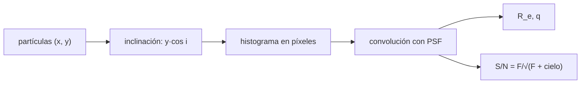

# B38-C08 — Observaciones sintéticas de galaxias simuladas

<!-- nav:top -->
[🏠 Programa](../../../../README.md) · [📚 Bloque B38](../../../tronco-comun/B38-poblaciones-estelares-y-simulacion-de-galaxias.md) · [← Anterior: B38-C07 — Modelos submalla de formación estelar y retroalimentación](../B38-C07-modelos-submalla-de-formacion-estelar-y-retroalimentacion/CLASE.md) · [Siguiente: B38-C09 — Validación de galaxias simuladas frente a observaciones →](../B38-C09-validacion-de-galaxias-simuladas-frente-a-observaciones/CLASE.md)
<!-- /nav -->

## 1. Ubicación, nivel y alcance

Clase 8 del bloque B38. Nivel N3. Una observación sintética convierte las partículas de una simulación en una imagen comparable con una observación. Aquí generas **60 000 partículas** con perfil exponencial, las proyectas con una inclinación, las asignas a píxeles, las convolucionas con una **PSF gaussiana** y mides el **radio efectivo**, el **cociente de ejes** y la **señal a ruido**. Usas [B05](../../../tronco-comun/B05-fisica-fundamental-para-el-espacio.md) y [B12](../../../tronco-comun/B12-probabilidad-estadistica-e-incertidumbre.md). No se usa ningún código de transferencia radiativa ni ninguna galaxia simulada real.

## 2. Por qué esta clase existe

La imagen que se compara con el telescopio no es la simulación, sino la simulación vista a través de un instrumento. La decisión central: **¿cuánto cambian la PSF, la inclinación y el ruido lo que mides?**

## 3. Lo que podrás hacer al terminar

1. Calcular el radio efectivo analítico de un disco exponencial.
2. Proyectar partículas con una inclinación.
3. Formar una imagen y convolucionarla con una PSF.
4. Medir `R_e` y el cociente de ejes en la imagen.
5. Estimar la señal a ruido por píxel.
6. Nombrar los límites de una observación sintética sin polvo.

La evidencia es la **ficha de la observación sintética** del ejercicio 12 (sección 20).

## 4. Con qué llegas y cómo comprobarlo

1. ¿Qué es una incertidumbre?
2. ¿Qué es una simulación Monte Carlo?
3. ¿Qué es una tabla de resultados?
4. ¿Qué es un valor ilustrativo?
5. ¿Qué es una verificación?

<details>
<summary>Ver respuestas</summary>

1. Un intervalo en que se espera el valor verdadero. 2. Repetir con números aleatorios de semilla fija. 3. Un resumen ordenado de cálculos. 4. Un valor propuesto para el ejemplo, no medido. 5. Comparar un cálculo con un caso independiente.
</details>

Con cuatro o cinco aciertos, sigue; si no, repasa los prerrequisitos.

## 5. Un caso de contexto y casos de referencia

El disco exponencial con `R_d = 3 kpc` tiene `R_e = 1,67835 R_d = 5,0350 kpc`; en la imagen cara-on se mide `4,912 kpc` (error del 2,45 %, por el recorte del campo, que deja 58 816 de las 60 000 partículas) y con la PSF `5,062 kpc` (+3,1 %). El cociente de ejes a 60° es `0,4989` frente a `cos 60° = 0,5`. Es el **ejemplo conductor**. Todo es **sintético**.

## 6. Vocabulario

La **observación sintética** es la imagen simulada con los efectos del instrumento. La **PSF** es la respuesta del instrumento a una fuente puntual. La **convolución** mezcla cada píxel con sus vecinos. El **radio efectivo** `R_e` contiene la mitad de la luz. El **cociente de ejes** `q = cos i` para un disco delgado. La **señal a ruido** `S/N = F/√(F + cielo)`. El **FWHM** es la anchura a media altura.

## 7. Modelo mental: la foto desenfocada

Como fotografiar un cuadro desde lejos con una cámara que desenfoca: ves el cuadro, pero más grande y más borroso, y si lo miras de costado se ve achatado.



*Descripción textual:* las partículas se proyectan, se agrupan en píxeles, se convolucionan con la PSF y la imagen se mide con las mismas definiciones que una observación.

Analogía: la foto desenfocada. Límite: sin polvo, sin extinción y centro conocido.

## 8. La explicación, paso a paso

### 8.1 Radio efectivo analítico

Para una densidad superficial exponencial, la fracción encerrada es `1 − (1 + x) e^−x` con `x = R/R_d`; vale 1/2 en `x = 1,67835`. Con `R_d = 3 kpc`, `R_e = 5,0350 kpc`.

### 8.2 Imagen cara-on

En un campo de 64 × 64 píxeles de 0,5 kpc (±16 kpc) caben 58 816 de las 60 000 partículas (98,0 %). El radio efectivo medido es `4,912 kpc`, un 2,45 % menor que el analítico (el recorte quita luz de los bordes).

### 8.3 PSF

Con una gaussiana de FWHM 2 kpc (`σ = 0,849 kpc = 1,70 px`), en un campo ampliado de 128 × 128 el flujo pasa de `59 993` a `59 991,58` (diferencia relativa `2,4 × 10⁻⁵`, la que escapa por el borde). En el campo de 64 × 64, `R_e` pasa de 4,912 a `5,062 kpc` (+3,1 %).

### 8.4 Inclinación

| inclinación (°) | `q` medido | `cos i` |
|---|---|---|
| 0 | 0,9925 | 1,0000 |
| 30 | 0,8623 | 0,8660 |
| 60 | 0,4989 | 0,5000 |
| 75 | 0,2593 | 0,2588 |

### 8.5 Señal a ruido

Con un flujo total de `2 × 10⁵` y cielo 20 por píxel: en el centro `618,1` de flujo y `S/N = 24,5`; a 9 kpc `41,7` y `S/N = 5,31`.

### 8.6 Lectura

Cada paso del instrumento cambia la medida: el recorte del campo la reduce un 2,5 %, la PSF la aumenta un 3 % y la inclinación aplasta el cociente de ejes. Sin esos pasos, comparar con una observación es comparar cosas distintas.

## 9. Magnitudes, símbolos y unidades

| Símbolo | Qué es | Unidad | Valor / nota |
|---|---|---|---|
| `R_d` | longitud de escala | kpc | 3 (ilustrativa) |
| `R_e` | radio efectivo | kpc | 5,0350 (analítico) |
| `q` | cociente de ejes | — | 0,4989 (60°) |
| `S/N` | señal a ruido | — | 24,5; 5,31 |

## 10. Convenciones y referencias

Partículas **sintéticas**; escala de 0,5 kpc por píxel, PSF de FWHM 2 kpc, flujo total y cielo **ilustrativos**; semilla `20261109`.

## 11. De dónde sale lo que afirmamos

| ID | Fuente | Localizador | Respalda | Estado |
|---|---|---|---|---|
| — | Sin fuente externa | — | relaciones estándar que verifica el laboratorio | No se consultó una fuente para esta clase |

Límites: no se consultó ningún código de transferencia radiativa ni observación; no hay polvo, ni lente, ni cielo variable.

## 12. Cómo ver las medidas

| paso | `R_e` (kpc) |
|---|---|
| analítico | 5,0350 |
| imagen 64 × 64 | 4,912 |
| con PSF | 5,062 |

Descripción larga: el recorte reduce el radio y la PSF lo aumenta.

## 13. Ejemplo trabajado: el radio efectivo

**Paso 1 · Ecuación.** `1 − (1 + x) e^−x = 0,5`.

**Paso 2 · Solución.** `x = 1,67835`: `(1 + x) e^−x = 2,67835 × 0,18665 = 0,49993`.

**Paso 3 · Escala.** `R_e = 1,67835 × 3 kpc = 5,035 kpc`.

**Paso 4 · Lectura.** La mitad de la luz está dentro de 5,0 kpc; el disco llega mucho más lejos.

## 14. Distintas formas de describir un disco

**Por fórmula:** `R_e`. **Por imagen:** píxeles. **Por instrumento:** PSF. **Por ruido:** `S/N`.

## 15. Práctica guiada

**Ejercicio 1 · con los pasos indicados.** `R_e` de un disco con `R_d = 3 kpc`. *Pasos:* `1,67835 × 3`.

<details><summary>Solución comentada</summary>

`5,035 kpc`.
</details>

**Ejercicio 2 · con una pista.** Fracción de partículas dentro del campo de 64 × 64.

<details><summary>Solución comentada</summary>

`58 816/60 000 = 98,0 %`.
</details>

**Ejercicio 3 · casi autónomo.** Error relativo del `R_e` medido sin PSF.

<details><summary>Solución comentada</summary>

`(5,035 − 4,912)/5,035 = 2,45 %`.
</details>

## 16. Práctica autónoma, transferencia e integrador

**Ejercicio 4.** `σ` de la PSF en kpc y píxeles.

<details><summary>Solución comentada</summary>

`2/2,3548 = 0,849 kpc = 1,70 px`.
</details>

**Ejercicio 5.** Aumento relativo de `R_e` por la PSF.

<details><summary>Solución comentada</summary>

`5,062/4,912 − 1 = 3,1 %`.
</details>

**Ejercicio 6.** Inclinación que da `q = 0,2593`.

<details><summary>Solución comentada</summary>

`arccos 0,2593 = 75,0°`.
</details>

**Ejercicio 7.** `S/N` en el centro con flujo 618,1 y cielo 20.

<details><summary>Solución comentada</summary>

`618,1/√638,1 = 24,5`.
</details>

**Ejercicio 8.** Cociente de `S/N` centro/borde.

<details><summary>Solución comentada</summary>

`24,5/5,31 = 4,6`.
</details>

**Ejercicio 9 · transferencia.** **Transferencia.** Un compañero dice que su `R_e` simulado es el real de la galaxia. Responde.

<details><summary>Solución comentada</summary>

No: es el de una galaxia sintética medida en una imagen con recorte y PSF.
</details>

**Ejercicio 10 · transferencia.** **Transferencia.** ¿Por qué `q` se mide mejor en un campo más grande?

<details><summary>Solución comentada</summary>

Porque el recorte afecta más al eje mayor y sesga `q` hacia 1.
</details>

**Ejercicio 11 · transferencia.** **Transferencia.** ¿Qué omite el laboratorio?

<details><summary>Solución comentada</summary>

Polvo, extinción, distribución espectral, lentes, un cielo real y el centro desconocido.
</details>

**Ejercicio 12.** **Integrador.** Elabora tu *ficha de la observación sintética*: `R_e` analítico y medido, PSF, inclinación y `S/N`.

<details><summary>Solución comentada</summary>

Secciones 8.1–8.6.
</details>

**Ejercicio 12 · integrador.** **Integrador.** Elabora tu *ficha de la observación sintética*: `R_e` analítico y medido, PSF, inclinación y `S/N`.

<details><summary>Solución modelo</summary>

Secciones 8.1–8.6.
</details>

## 17. Laboratorio: imagen sintética de un disco

El script [imagen.py](imagen.py) forma la imagen, la convoluciona y mide `R_e`, `q` y la `S/N` (**comprueba** `R_e` al 3 %, el flujo a `10⁻⁴`, que la PSF agranda `R_e` y `q` al 5 %).

**Datos:** sin constantes; partículas **sintéticas**; semilla `20261109`. **Predice antes de ejecutar:** ¿la PSF agrandará o reducirá `R_e`? (lo agrandará.) **Ejecución del 2026-11-09 (Python 3.12.9):**

```text
Python 3.12.9 (biblioteca estandar)
R_e analitico = 5.0350 kpc = 1.67835 R_d
cara-on sin PSF: flujo en imagen 58816 de 60000; R_e medido 4.912 kpc (error 2.45 %)
PSF gaussiana FWHM 2 kpc (campo 128 x 128): flujo antes 59993, despues 59991.579138, diferencia relativa 2.4e-05
cara-on con PSF: R_e medido 5.062 kpc (+3.1 % sobre 4.912)
inc [grados]  q medido    cos i
           0    0.9925   1.0000
          30    0.8623   0.8660
          60    0.4989   0.5000
          75    0.2593   0.2588
flujo por pixel: centro 618.1, a 9 kpc 41.7 (cielo 20); S/N centro 24.5, borde 5.31
Pruebas superadas.
```

```bash
python programa/clases/B38/B38-C08-observaciones-sinteticas-de-galaxias-simuladas/imagen.py
```

**Límites:** sin polvo y con centro conocido.

## 18. Errores frecuentes y cómo corregirlos

**Medir `R_e` sin considerar el recorte del campo.** Se corrige con 8.2.

**Olvidar la PSF al comparar tamaños.** Se corrige con 8.3.

**Medir `q` en un campo demasiado pequeño.** Se corrige con 8.4.

**Presentar la imagen como observación.** Se corrige con la sección 10.

## 19. Cómo sabrás que vas bien

Tras la sección 8: ¿qué resultado esperabas y cuál obtuviste? Si dudas, repasa el ejemplo 13. Tras el laboratorio: ¿qué comprueba? (ver la sección 17).

## 20. Qué entregas y cómo se evalúa

El producto es tu **ficha de la observación sintética** (ejercicio 12).

| Criterio | Inicial | En desarrollo | Logrado | Destacado |
|---|---|---|---|---|
| Conceptos | Los confunde | Parciales | conceptos de la clase | Explica los límites |
| Cálculo | Sin unidades | Con errores | Tablas completas | Calcula casos nuevos |
| Numérico | Sin comprobar | Un caso | Contraste con el análisis | Interpreta las diferencias |
| Fuentes | Sin fuente | Sin fecha | fuentes con fecha | Declara lo ilustrativo |
| Límites | No los nombra | Uno | Tres | Discute qué falta del modelo |

**Condiciones críticas (no se compensan con promedio):** rotular las partículas e imágenes como sintéticas; no presentarlas como observaciones; citar solo lo consultado.

## 21. Ética, seguridad y límites

Clase educativa: los modelos son simplificados. Accesibilidad: tablas equivalentes a las gráficas, fórmulas en texto, ejercicios sin conexión.

## 22. Para cerrar y seguir

El disco sintético tiene `R_e = 5,035 kpc`; la imagen da 4,912 sin PSF y 5,062 con PSF, y `q = 0,499` a 60°. Queda una pregunta: ¿cuándo una galaxia simulada es compatible con las observaciones?

**Glosario español–inglés.** observación sintética · *synthetic observation*; PSF · *point spread function*; radio efectivo · *effective radius*; señal a ruido · *signal-to-noise*; inclinación · *inclination*.

**Continuidad.** [B38-C09](../B38-C09-validacion-de-galaxias-simuladas-frente-a-observaciones/CLASE.md) estudia la validación frente a observaciones.

**Referencias:** ver sección 11.

<!-- nav:bottom -->
---

[← Anterior: B38-C07 — Modelos submalla de formación estelar y retroalimentación](../B38-C07-modelos-submalla-de-formacion-estelar-y-retroalimentacion/CLASE.md) · [📚 Bloque B38](../../../tronco-comun/B38-poblaciones-estelares-y-simulacion-de-galaxias.md) · [Siguiente: B38-C09 — Validación de galaxias simuladas frente a observaciones →](../B38-C09-validacion-de-galaxias-simuladas-frente-a-observaciones/CLASE.md)
<!-- /nav -->
