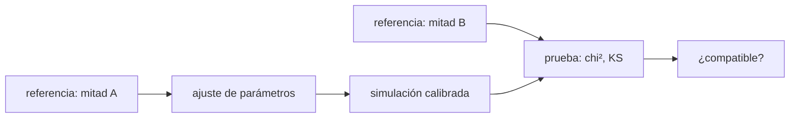

# B38-C09 — Validación de galaxias simuladas frente a observaciones

<!-- nav:top -->
[🏠 Programa](../../../../README.md) · [📚 Bloque B38](../../../tronco-comun/B38-poblaciones-estelares-y-simulacion-de-galaxias.md) · [← Anterior: B38-C08 — Observaciones sintéticas de galaxias simuladas](../B38-C08-observaciones-sinteticas-de-galaxias-simuladas/CLASE.md) · [Siguiente: B39-C01 — Variedades, tensor métrico y geometría diferencial →](../../B39/B39-C01-variedades-tensor-metrico-y-geometria-diferencial/CLASE.md)
<!-- /nav -->

## 1. Ubicación, nivel y alcance

Clase 9 del bloque B38. Nivel N3. Validar una galaxia simulada es compararla con una referencia con una regla que se fija antes de mirar. Aquí comparas dos funciones de masa estelar de Schechter **sintéticas** (una de "simulación" y otra de "referencia") con **residuos en dex**, una prueba **KS de dos muestras** y un **chi cuadrado de Poisson**; ajustas los parámetros en una mitad de la referencia y pruebas en la otra. Usas [B12](../../../tronco-comun/B12-probabilidad-estadistica-e-incertidumbre.md) y [B38-C08](../B38-C08-observaciones-sinteticas-de-galaxias-simuladas/CLASE.md). Ni la "simulación" ni la "referencia" son datos reales.

## 2. Por qué esta clase existe

Una simulación calibrada para coincidir con los datos no queda validada por coincidir con ellos. La decisión central: **¿qué parte del acuerdo es una predicción y qué parte es un ajuste?**

## 3. Lo que podrás hacer al terminar

1. Calcular residuos en dex por intervalo de masa.
2. Aplicar la prueba KS de dos muestras.
3. Calcular un chi cuadrado reducido de Poisson.
4. Separar calibración y prueba.
5. Distinguir ajustar un parámetro de ajustar dos.
6. Nombrar los límites de una validación con un solo observable.

La evidencia es la **ficha de la validación de galaxias simuladas** del ejercicio 12 (sección 20).

## 4. Con qué llegas y cómo comprobarlo

1. ¿Qué es una incertidumbre?
2. ¿Qué es una simulación Monte Carlo?
3. ¿Qué es una tabla de resultados?
4. ¿Qué es un valor ilustrativo?
5. ¿Qué es una verificación?

<details>
<summary>Ver respuestas</summary>

1. Un intervalo en que se espera el valor verdadero. 2. Repetir con números aleatorios de semilla fija. 3. Un resumen ordenado de cálculos. 4. Un valor propuesto para el ejemplo, no medido. 5. Comparar un cálculo con un caso independiente.
</details>

Con cuatro o cinco aciertos, sigue; si no, repasa los prerrequisitos.

## 5. Un caso de contexto y casos de referencia

Con 20 000 galaxias por muestra, la "simulación" (`log M* = 10,95`, `α = −1,45`) se aparta de la "referencia" (`10,66`, `−1,25`) hasta `0,219 dex` (KS: `D = 0,1140`, `p ≈ 10⁻¹¹³`); ajustar solo `M*` deja un chi cuadrado reducido de prueba de 90,4, y ajustar `M*` y `α` lo baja a 2,58 (calibrada: `D = 0,0119`, `p = 0,300`). Es el **ejemplo conductor**. Todo es **sintético**.

## 6. Vocabulario

El **residuo en dex** `log₁₀(N_sim/N_ref)`. La **función de Schechter**. La **prueba KS** compara dos distribuciones acumuladas con `D = max|F₁ − F₂|`. El **chi cuadrado de Poisson** `Σ (O − E)²/E`. La **calibración** ajusta parámetros del modelo. La **validación** compara con datos no usados. El **sobreajuste** es acertar la calibración sin predecir.

## 7. Modelo mental: el examen con las respuestas

Como estudiar con las respuestas del examen: aprobar ese mismo examen no prueba que sepas; hay que probar con preguntas que no viste.



*Descripción textual:* se ajusta el modelo en una mitad de la referencia y se prueba en la otra con residuos, chi cuadrado y KS.

Analogía: el examen con las respuestas. Límite: muestras independientes, sin errores de masa ni incompletitud.

## 8. La explicación, paso a paso

### 8.1 Residuos sin ajustar

| `log M*` | N ref | N sim | residuo (dex) |
|---|---|---|---|
| 8,0–8,5 | 6763 | 8752 | 0,112 |
| 8,5–9,0 | 5001 | 5198 | 0,017 |
| 9,0–9,5 | 3649 | 3051 | −0,078 |
| 9,5–10,0 | 2600 | 1739 | −0,175 |
| 10,0–10,5 | 1428 | 863 | −0,219 |
| 10,5–11,0 | 513 | 341 | −0,177 |
| 11,0–11,5 | 46 | 56 | 0,085 |

El residuo máximo es `0,219 dex`, mayor que el umbral de ejemplo de 0,2 dex (el resumen de EAGLE habla de ~0,2 dex entre 10⁸ y 10¹¹ M☉ tras calibrar). La prueba KS da `D = 0,1140` y `p ≈ 1,1 × 10⁻¹¹³`: se rechaza. La autocomparación de dos muestras de la referencia da `D = 0,0088` y `p = 0,419`: no se rechaza.

### 8.2 Calibración y prueba

La referencia se divide en dos mitades de 10 000.

| ajuste | `log M*` | `α` | chi² de calibración | chi² reducido de prueba |
|---|---|---|---|---|
| ninguno (`10,95`; `−1,45`) | 10,95 | −1,45 | — | 91,3 (7 gl) |
| solo `M*` | 11,36 | −1,45 | 663,0 | 90,4 (6 gl) |
| `M*` y `α` | 10,62 | −1,23 | 6,9 | 2,58 (5 gl) |

Ajustar solo `M*` no corrige la forma y deja la discrepancia; ajustar los dos recupera valores cercanos a los de la referencia (`10,66`; `−1,25`).

### 8.3 Simulación calibrada

Una muestra de 20 000 galaxias con los parámetros ajustados frente a la mitad de prueba da `D = 0,0119` y `p = 0,300`. El valor crítico al 5 % para `n = m = 20 000` es `1,36 √(2/20 000) = 0,0136`: `0,0119` no se rechaza.

### 8.4 Lectura

El acuerdo de la simulación calibrada es una consecuencia del ajuste con la mitad A; la mitad B lo confirma solo para ese observable. Una validación seria necesita observables que no se usaron en la calibración. Aquí además la "simulación" es una función de Schechter, no una simulación.

## 9. Magnitudes, símbolos y unidades

| Símbolo | Qué es | Unidad | Valor / nota |
|---|---|---|---|
| `dex` | logaritmo decimal de un cociente (1 dex = factor 10) | dex | `log₁₀(N_sim/N_ref)` |
| `D` | estadístico KS | — | 0,1140; 0,0119 |
| `χ²_red` | chi cuadrado reducido | — | 91,3; 90,4; 2,58 |
| `p` | valor p de KS | — | ≈ 10⁻¹¹³; 0,300 |

## 10. Convenciones y referencias

Funciones de Schechter, normalización, rango 10⁸–10¹¹,⁵ M☉ y tamaños **ilustrativos**; la "referencia" no es medida; semilla `20261109`.

## 11. De dónde sale lo que afirmamos

| ID | Fuente | Localizador | Respalda | Estado |
|---|---|---|---|---|
| S2 | Schaye et al. (2015), *The EAGLE project* | https://arxiv.org/abs/1407.7040 | resumen: retroalimentación térmica de estrellas masivas y de núcleos activos sin apagar el enfriamiento; calibración a la función de masa estelar a z ≈ 0, con acuerdo dentro de ~0,2 dex entre 10⁸ y 10¹¹ M☉ | Solo resumen, consultado el 2026-11-09 |

Límites: de EAGLE solo se leyó el resumen; la cifra de ~0,2 dex es contexto y el umbral del laboratorio es un valor de ejemplo; ninguna cifra de la clase le pertenece.

## 12. Cómo ver los residuos

| `log M*` | residuo (dex) |
|---|---|
| 9,5–10,0 | −0,175 |
| 10,0–10,5 | −0,219 |
| 10,5–11,0 | −0,177 |

Descripción larga: la simulación sin ajustar tiene un déficit de hasta 0,22 dex en la zona de la rodilla.

## 13. Ejemplo trabajado: un residuo en dex

**Paso 1 · Cociente.** `863/1428 = 0,6043`.

**Paso 2 · Logaritmo.** `log₁₀ 0,6043 = −0,2187`.

**Paso 3 · Umbral.** `|−0,219| > 0,2`: fuera del umbral de ejemplo.

**Paso 4 · Lectura.** La simulación tiene un 40 % menos de galaxias en ese intervalo.

## 14. Distintas formas de describir una validación

**Por residuo:** dex. **Por distribución:** KS. **Por recuento:** `χ²`. **Por protocolo:** calibración y prueba.

## 15. Práctica guiada

**Ejercicio 1 · con los pasos indicados.** Residuo del intervalo 10,0–10,5. *Pasos:* cociente; logaritmo.

<details><summary>Solución comentada</summary>

`−0,219 dex`.
</details>

**Ejercicio 2 · con una pista.** Residuo del intervalo 8,0–8,5.

<details><summary>Solución comentada</summary>

`log₁₀(8752/6763) = 0,112 dex`.
</details>

**Ejercicio 3 · casi autónomo.** Déficit relativo en 9,5–10,0.

<details><summary>Solución comentada</summary>

`1 − 1739/2600 = 33 %`.
</details>

## 16. Práctica autónoma, transferencia e integrador

**Ejercicio 4.** Valor crítico de KS al 5 % para 20 000 y 20 000.

<details><summary>Solución comentada</summary>

`1,36 √(2/20 000) = 0,0136`.
</details>

**Ejercicio 5.** ¿Se rechaza `D = 0,0119`?

<details><summary>Solución comentada</summary>

No, `0,0119 < 0,0136`.
</details>

**Ejercicio 6.** ¿Se rechaza `D = 0,1140`?

<details><summary>Solución comentada</summary>

Sí, es 8 veces mayor que el crítico.
</details>

**Ejercicio 7.** Chi² de prueba antes del ajuste.

<details><summary>Solución comentada</summary>

`91,3 × 7 = 639`.
</details>

**Ejercicio 8.** ¿Por qué ajustar solo `M*` no basta?

<details><summary>Solución comentada</summary>

Porque la pendiente sigue distinta (`−1,45` frente a `−1,25`).
</details>

**Ejercicio 9 · transferencia.** **Transferencia.** Un compañero dice que su simulación reproduce la función de masa y por eso está validada. Responde.

<details><summary>Solución comentada</summary>

Si la calibró con ella, es un ajuste; hay que probar con otros observables.
</details>

**Ejercicio 10 · transferencia.** **Transferencia.** ¿Por qué se parte la referencia en dos mitades?

<details><summary>Solución comentada</summary>

Para no ajustar y probar con los mismos datos.
</details>

**Ejercicio 11 · transferencia.** **Transferencia.** ¿Qué omite el laboratorio?

<details><summary>Solución comentada</summary>

Errores de masa, incompletitud, varianza cósmica, otros observables y que no hay simulación real.
</details>

**Ejercicio 12.** **Integrador.** Elabora tu *ficha de la validación de galaxias simuladas*: residuos, KS, calibración y prueba.

<details><summary>Solución comentada</summary>

Secciones 8.1–8.4.
</details>

**Ejercicio 12 · integrador.** **Integrador.** Elabora tu *ficha de la validación de galaxias simuladas*: residuos, KS, calibración y prueba.

<details><summary>Solución modelo</summary>

Secciones 8.1–8.4.
</details>

## 17. Laboratorio: residuos, KS y calibración

El script [validacion.py](validacion.py) compara dos funciones de masa sintéticas, ajusta en una mitad y prueba en la otra (**comprueba** que lo no ajustado se rechaza, la autocomparación no, y que el chi² reducido baja de 3 solo al ajustar dos parámetros).

**Datos:** sin constantes; muestras **sintéticas**; semilla `20261109`. **Predice antes de ejecutar:** ¿se rechazará la simulación sin ajustar? (sí.) **Ejecución del 2026-11-09 (Python 3.12.9):**

```text
Python 3.12.9 (biblioteca estandar)
     log M*   N ref   N sim  residuo [dex]
 8.0- 8.5    6763    8752          0.112
 8.5- 9.0    5001    5198          0.017
 9.0- 9.5    3649    3051         -0.078
 9.5-10.0    2600    1739         -0.175
10.0-10.5    1428     863         -0.219
10.5-11.0     513     341         -0.177
11.0-11.5      46      56          0.085
sim sin ajustar: residuo maximo 0.219 dex, KS D = 0.1140, p = 1.11e-113
autocomparacion de dos muestras de la referencia: KS D = 0.0088, p = 0.419
ajuste solo de M* (alfa = -1,45): log M* = 11.36, chi2 de calibracion 663.0
ajuste de M* y alfa: log M* = 10.62, alfa = -1.23, chi2 de calibracion 6.9
chi2 reducido en la muestra de prueba: sin ajustar 91.3; solo M* 90.4; M* y alfa 2.58
simulacion calibrada frente a la mitad de prueba: KS D = 0.0119, p = 0.300
Pruebas superadas.
```

```bash
python programa/clases/B38/B38-C09-validacion-de-galaxias-simuladas-frente-a-observaciones/validacion.py
```

**Límites:** muestras independientes y sin errores de masa.

## 18. Errores frecuentes y cómo corregirlos

**Validar con los mismos datos que se usaron para calibrar.** Se corrige con 8.2.

**Comparar sin un umbral fijado de antemano.** Se corrige con 8.1.

**Confiar en un solo observable.** Se corrige con 8.4.

**Presentar la muestra sintética como real.** Se corrige con la sección 10.

## 19. Cómo sabrás que vas bien

Tras la sección 8: ¿qué resultado esperabas y cuál obtuviste? Si dudas, repasa el ejemplo 13. Tras el laboratorio: ¿qué comprueba? (ver la sección 17).

## 20. Qué entregas y cómo se evalúa

El producto es tu **ficha de la validación de galaxias simuladas** (ejercicio 12).

| Criterio | Inicial | En desarrollo | Logrado | Destacado |
|---|---|---|---|---|
| Conceptos | Los confunde | Parciales | conceptos de la clase | Explica los límites |
| Cálculo | Sin unidades | Con errores | Tablas completas | Calcula casos nuevos |
| Numérico | Sin comprobar | Un caso | Contraste con el análisis | Interpreta las diferencias |
| Fuentes | Sin fuente | Sin fecha | fuentes con fecha | Declara lo ilustrativo |
| Límites | No los nombra | Uno | Tres | Discute qué falta del modelo |

**Condiciones críticas (no se compensan con promedio):** rotular las muestras como sintéticas; no presentar un ajuste como validación; citar solo lo consultado.

## 21. Ética, seguridad y límites

Clase educativa: los modelos son simplificados. Accesibilidad: tablas equivalentes a las gráficas, fórmulas en texto, ejercicios sin conexión.

## 22. Para cerrar y seguir

La simulación sin ajustar se rechaza (residuo hasta 0,22 dex, KS `p ≈ 10⁻¹¹³`) y la calibrada no se rechaza en la mitad de prueba (`p = 0,30`), pero ese acuerdo es un ajuste, no una validación independiente. Con esto se cierra el bloque.

**Glosario español–inglés.** validación · *validation*; calibración · *calibration*; residuo · *residual*; prueba de Kolmogórov–Smirnov · *Kolmogorov–Smirnov test*; sobreajuste · *overfitting*.

**Continuidad.** es la última clase del bloque; el siguiente paso es comparar con varios observables.

**Referencias:** ver sección 11.

<!-- nav:bottom -->
---

[← Anterior: B38-C08 — Observaciones sintéticas de galaxias simuladas](../B38-C08-observaciones-sinteticas-de-galaxias-simuladas/CLASE.md) · [📚 Bloque B38](../../../tronco-comun/B38-poblaciones-estelares-y-simulacion-de-galaxias.md) · [Siguiente: B39-C01 — Variedades, tensor métrico y geometría diferencial →](../../B39/B39-C01-variedades-tensor-metrico-y-geometria-diferencial/CLASE.md)
<!-- /nav -->
