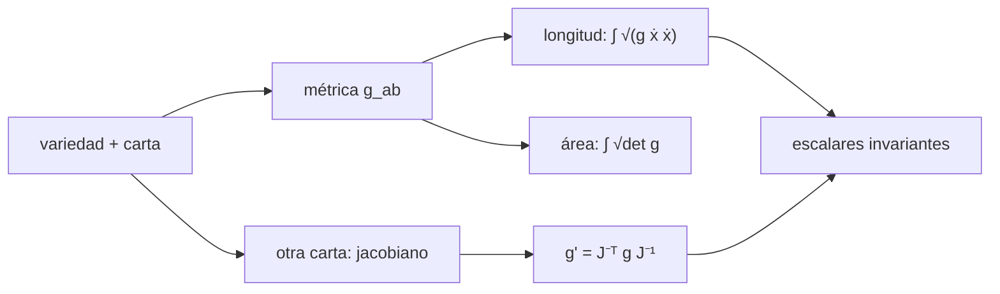

# B39-C01 — Variedades, tensor métrico y geometría diferencial

<!-- nav:top -->
[🏠 Programa](../../../../README.md) · [📚 Bloque B39](../../../tronco-comun/B39-relatividad-general-avanzada.md) · [← Anterior: B38-C09 — Validación de galaxias simuladas frente a observaciones](../../B38/B38-C09-validacion-de-galaxias-simuladas-frente-a-observaciones/CLASE.md) · [Siguiente: B39-C02 — Conexión afín y símbolos de Christoffel →](../B39-C02-conexion-afin-y-simbolos-de-christoffel/CLASE.md)
<!-- /nav -->

## 1. Ubicación, nivel y alcance

Clase 1 del bloque B39. Nivel N3. Una métrica asigna longitudes y ángulos en cada punto de una variedad. Aquí calculas, para la **2-esfera de radio 2**, la longitud de un paralelo y de un meridiano, el área de un casquete y un ángulo, y compruebas que la métrica se transforma como un tensor al pasar a coordenadas estereográficas. Usas [B26](../../../tronco-comun/B26-relatividad-y-cosmologia.md) (curvatura y métricas, sin el aparato general) y [B11](../../../tronco-comun/B11-ecuaciones-diferenciales-y-simulacion-numerica.md) (integración numérica). Los resultados se comparan con fórmulas cerradas de geometría.

## 2. Por qué esta clase existe

Sin métrica no hay distancias ni tiempo propio. La decisión central: **¿qué representa la métrica y qué cantidades no cambian al cambiar de coordenadas?**

## 3. Lo que podrás hacer al terminar

1. Calcular longitudes con `∫√(g_ab ẋ^a ẋ^b) dt`.
2. Calcular áreas con `√det g`.
3. Calcular ángulos entre vectores con la métrica.
4. Transformar la métrica con el jacobiano.
5. Comprobar la invariancia de la longitud.
6. Reconocer los límites de una carta coordenada.

La evidencia es la **ficha de la métrica** del ejercicio 12 (sección 20).

## 4. Con qué llegas y cómo comprobarlo

1. ¿Qué es una incertidumbre?
2. ¿Qué es una simulación Monte Carlo?
3. ¿Qué es una tabla de resultados?
4. ¿Qué es un valor ilustrativo?
5. ¿Qué es una verificación?

<details>
<summary>Ver respuestas</summary>

1. Un intervalo en que se espera el valor verdadero. 2. Repetir con números aleatorios de semilla fija. 3. Un resumen ordenado de cálculos. 4. Un valor propuesto para el ejemplo, no medido. 5. Comparar un cálculo con un caso independiente.
</details>

Con cuatro o cinco aciertos, sigue; si no, repasa los prerrequisitos.

## 5. Un caso de contexto y casos de referencia

En la 2-esfera `ds² = a²(dθ² + sin²θ dφ²)` con `a = 2`, el paralelo `θ = 1 rad` mide `10,5742` y el casquete que encierra tiene área `11,5535`. En coordenadas estereográficas la métrica es `4a²/(1 + r²)² · δ`, que vale `9,4901` en el punto de prueba. Es el **ejemplo conductor**. Todo es una geometría de ejemplo.

## 6. Vocabulario

Una **variedad** es un espacio que localmente se parece a `ℝⁿ`. Una **carta** son coordenadas locales. La **métrica** `g_ab` es un tensor simétrico que da el producto interno. La **longitud de una curva** es la integral de su rapidez métrica. El **jacobiano** relaciona dos cartas. Un **escalar** es una cantidad independiente de las coordenadas.

## 7. Modelo mental: un mapa y la Tierra

Como un mapa de la Tierra: las coordenadas del mapa distorsionan, pero la longitud de un camino medida con la métrica correcta no depende del mapa.



*Descripción textual:* la métrica da longitudes y áreas; al cambiar de carta se transforma con el jacobiano y los escalares no cambian.

Analogía: un mapa y la Tierra. Límite: solo cubre una carta sin el polo y no distingue la topología global.

## 8. La explicación, paso a paso

### 8.1 Longitudes, área y ángulo

| Magnitud | Numérico | Cerrado |
|---|---|---|
| paralelo `θ = 1` | 10,574236256 | `2π a sin 1` = 10,574236256 |
| meridiano de 0 a 1 | 2,000000000 | `a θ₀` = 2 |
| área del casquete | 11,553463190 | `2π a²(1 − cos 1)` = 11,553463190 |
| ángulo entre `u = (1, 0)` y `v = (1, 1)` | 40,079638° | `arctan(sin 1)` = 40,079638° |

### 8.2 Cambio de coordenadas

Con la carta `x = tan(θ/2) cos φ`, `y = tan(θ/2) sin φ`, la métrica transformada por diferencias finitas da `9,4901248` en la diagonal y `3,7 × 10⁻¹⁰` fuera de ella; la fórmula `4a²/(1 + r²)²` da `9,4901248`. La longitud del paralelo en la nueva carta es `10,574236256`, igual que antes.

### 8.3 Lectura

La métrica es un campo tensorial: sus componentes cambian con la carta, pero longitudes, áreas y ángulos no. La carta estereográfica deja fuera el punto del polo.

## 9. Magnitudes, símbolos y unidades

| Símbolo | Qué es | Unidad | Valor / nota |
|---|---|---|---|
| `g_ab` | métrica | depende de la carta | diag(4, 4 sin²θ) |
| `J` | jacobiano de las cartas | — | calculado numéricamente |
| `L` | longitud de una curva | unidad de longitud | 10,5742 |
| `A` | área | unidad de longitud² | 11,5535 |

## 10. Convenciones y referencias

Esfera de radio 2 en unidades arbitrarias; sin constantes físicas. Integrales con la regla de Simpson (4000 intervalos).

## 11. De dónde sale lo que afirmamos

| ID | Fuente | Localizador | Respalda | Estado |
|---|---|---|---|---|
| S1 | Carroll, *Lecture Notes on General Relativity* (arXiv:gr-qc/9712019) | https://arxiv.org/abs/gr-qc/9712019 | contexto: variedades, geometría de Riemann y ecuaciones de Einstein | Solo resumen, consultado el 2026-11-09 |

Límites: S1 solo resumen y no respalda ninguna cifra de la clase.

## 12. Cómo ver las magnitudes geométricas

| Magnitud | Valor |
|---|---|
| paralelo `θ = 1` | 10,5742 |
| área del casquete | 11,5535 |
| ángulo | 40,0796° |
| `g'` diagonal | 9,4901 |

Descripción larga: las magnitudes geométricas coinciden con las fórmulas cerradas y la métrica transformada con la fórmula estereográfica.

## 13. Ejemplo trabajado: longitud del paralelo

**Paso 1 · Rapidez.** Sobre el paralelo `ẋ = (0, 2π)`, así que `√(g_φφ)·2π`.

**Paso 2 · Métrica.** `g_φφ = a² sin²θ = 4 sin²1`.

**Paso 3 · Raíz.** `√g_φφ = 2 sin 1 = 1,6829`.

**Paso 4 · Producto.** `L = 2π × 1,6829 = 10,5742`.

## 14. Distintas formas de describir una curva

**Por curva:** `L`. **Por región:** `A`. **Por vectores:** ángulo. **Por carta:** jacobiano.

## 15. Práctica guiada

**Ejercicio 1 · con los pasos indicados.** Longitud del paralelo `θ = 1`, `a = 2`. *Pasos:* `2π a sin θ`.

<details><summary>Solución comentada</summary>

`10,5742`.
</details>

**Ejercicio 2 · con una pista.** Longitud del meridiano de 0 a 1.

<details><summary>Solución comentada</summary>

`2`.
</details>

**Ejercicio 3 · casi autónomo.** Área del casquete `θ ≤ 1`. *Pasos:* `2π a²(1 − cos 1)`.

<details><summary>Solución comentada</summary>

`11,5535`.
</details>

## 16. Práctica autónoma, transferencia e integrador

**Ejercicio 4.** Coseno del ángulo entre `u` y `v`.

<details><summary>Solución comentada</summary>

`1/√(1 + sin²1) = 0,7651`.
</details>

**Ejercicio 5.** Valor de `4a²/(1 + r²)²` con `r = tan 0,5`.

<details><summary>Solución comentada</summary>

`9,4901`.
</details>

**Ejercicio 6.** ¿Cuál es la longitud del paralelo en la carta estereográfica?

<details><summary>Solución comentada</summary>

`10,5742`, igual.
</details>

**Ejercicio 7.** ¿Qué componentes tiene `g'` fuera de la diagonal?

<details><summary>Solución comentada</summary>

Prácticamente cero (`3,7 × 10⁻¹⁰`).
</details>

**Ejercicio 8.** Longitud del ecuador (`θ = π/2`).

<details><summary>Solución comentada</summary>

`2π a = 12,5664`.
</details>

**Ejercicio 9 · transferencia.** **Transferencia.** Un compañero dice que las componentes de la métrica son invariantes. Responde.

<details><summary>Solución comentada</summary>

No: cambian con la carta; son invariantes longitudes y áreas.
</details>

**Ejercicio 10 · transferencia.** **Transferencia.** ¿Por qué la carta estereográfica no sirve en el polo de proyección?

<details><summary>Solución comentada</summary>

Porque `r → ∞`.
</details>

**Ejercicio 11 · transferencia.** **Transferencia.** ¿Qué distingue una métrica riemanniana de una lorentziana?

<details><summary>Solución comentada</summary>

La signatura.
</details>

**Ejercicio 12.** **Integrador.** Elabora tu *ficha de la métrica*: longitud, área, ángulo y transformación.

<details><summary>Solución comentada</summary>

Secciones 8.1–8.3.
</details>

**Ejercicio 12 · integrador.** **Integrador.** Elabora tu *ficha de la métrica*: longitud, área, ángulo y transformación.

<details><summary>Solución modelo</summary>

Secciones 8.1–8.3.
</details>

## 17. Laboratorio: métrica, longitudes y cambio de carta

El script [metrica.py](metrica.py) calcula longitudes, área y ángulo y transforma la métrica (**comprueba** a `10⁻⁹` las longitudes y a `10⁻⁷` la métrica).

**Datos:** sin constantes; esfera de radio 2 **ilustrativa**. **Predice antes de ejecutar:** ¿qué longitud medirá el paralelo en la otra carta? (la misma.) **Ejecución del 2026-11-09 (Python 3.12.9):**

```text
Python 3.12.9 (biblioteca estandar)
longitud del paralelo   numerica 10.574236256  cerrada 10.574236256
longitud del meridiano  numerica 2.000000000  cerrada 2.000000000
area del casquete       numerica 11.553463190  cerrada 11.553463190
angulo entre u y v      40.079638 grados  cerrado 40.079638 grados
g' numerica  [9.4901248 3.69e-10; 3.69e-10 9.4901248]  formula 9.4901248 delta
longitud en carta estereografica 10.574236256
Pruebas superadas.
```

```bash
python programa/clases/B39/B39-C01-variedades-tensor-metrico-y-geometria-diferencial/metrica.py
```

**Límites:** una carta sin el polo.

## 18. Errores frecuentes y cómo corregirlos

**Creer que la métrica es una matriz fija.** Se corrige con 8.2.

**Olvidar `√det g` al integrar áreas.** Se corrige con 8.1.

**Usar la carta en el polo.** Se corrige con 8.3.

**Presentar la esfera como un sistema físico.** Se corrige con la sección 10.

## 19. Cómo sabrás que vas bien

Tras la sección 8: ¿qué resultado esperabas y cuál obtuviste? Si dudas, repasa el ejemplo 13. Tras el laboratorio: ¿qué comprueba? (ver la sección 17).

## 20. Qué entregas y cómo se evalúa

El producto es tu **ficha de la métrica** (ejercicio 12).

| Criterio | Inicial | En desarrollo | Logrado | Destacado |
|---|---|---|---|---|
| Conceptos | Los confunde | Parciales | conceptos de la clase | Explica los límites |
| Cálculo | Sin unidades | Con errores | Tablas completas | Calcula casos nuevos |
| Numérico | Sin comprobar | Un caso | Contraste con el análisis | Interpreta las diferencias |
| Fuentes | Sin fuente | Sin fecha | fuentes con fecha | Declara lo ilustrativo |
| Límites | No los nombra | Uno | Tres | Discute qué falta del modelo |

**Condiciones críticas (no se compensan con promedio):** rotular la esfera como geometría de ejemplo; no extrapolar a un espacio-tiempo real; citar solo lo consultado.

## 21. Ética, seguridad y límites

Clase educativa: los modelos son simplificados. Accesibilidad: tablas equivalentes a las gráficas, fórmulas en texto, ejercicios sin conexión.

## 22. Para cerrar y seguir

El paralelo de la 2-esfera mide 10,574, el casquete 11,553 y la métrica se transforma como un tensor sin cambiar las longitudes. Queda una pregunta: ¿cómo se compara un vector entre puntos distintos?

**Glosario español–inglés.** variedad · *manifold*; carta · *chart*; métrica · *metric*; jacobiano · *Jacobian*; tensor métrico · *metric tensor*.

**Continuidad.** [B39-C02](../B39-C02-conexion-afin-y-simbolos-de-christoffel/CLASE.md) define la conexión que permite derivar vectores.

**Referencias:** ver sección 11.

<!-- nav:bottom -->
---

[← Anterior: B38-C09 — Validación de galaxias simuladas frente a observaciones](../../B38/B38-C09-validacion-de-galaxias-simuladas-frente-a-observaciones/CLASE.md) · [📚 Bloque B39](../../../tronco-comun/B39-relatividad-general-avanzada.md) · [Siguiente: B39-C02 — Conexión afín y símbolos de Christoffel →](../B39-C02-conexion-afin-y-simbolos-de-christoffel/CLASE.md)
<!-- /nav -->
