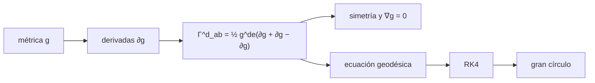

# B39-C02 — Conexión afín y símbolos de Christoffel

<!-- nav:top -->
[🏠 Programa](../../../../README.md) · [📚 Bloque B39](../../../tronco-comun/B39-relatividad-general-avanzada.md) · [← Anterior: B39-C01 — Variedades, tensor métrico y geometría diferencial](../B39-C01-variedades-tensor-metrico-y-geometria-diferencial/CLASE.md) · [Siguiente: B39-C03 — Tensor de Riemann, Ricci y curvatura escalar →](../B39-C03-tensor-de-riemann-ricci-y-curvatura-escalar/CLASE.md)
<!-- /nav -->

## 1. Ubicación, nivel y alcance

Clase 2 del bloque B39. Nivel N3. La derivada ordinaria no sirve para comparar vectores en puntos distintos de un espacio curvo. Aquí calculas por **diferencias finitas** los **símbolos de Christoffel** de la 2-esfera unitaria y de Schwarzschild (`M = 1`, unidades geométricas), compruebas su simetría y la **compatibilidad métrica** `∇g = 0`, y recorres una **geodésica** con Runge-Kutta para verificar que traza un gran círculo. Usas [B11](../../../tronco-comun/B11-ecuaciones-diferenciales-y-simulacion-numerica.md). Ningún sistema astrofísico real se modela.

## 2. Por qué esta clase existe

Sin conexión no hay aceleración ni geodésicas. La decisión central: **¿qué símbolos produce una métrica y qué propiedades garantizan que sea la conexión correcta?**

## 3. Lo que podrás hacer al terminar

1. Calcular `Γ^d_ab` desde la métrica.
2. Comprobar la simetría en los índices inferiores.
3. Comprobar `∇_c g_ab = 0`.
4. Integrar la ecuación geodésica.
5. Comparar con la solución de gran círculo.
6. Reconocer que los `Γ` no son un tensor.

La evidencia es la **ficha de la conexión** del ejercicio 12 (sección 20).

## 4. Con qué llegas y cómo comprobarlo

1. ¿Qué es una incertidumbre?
2. ¿Qué es una simulación Monte Carlo?
3. ¿Qué es una tabla de resultados?
4. ¿Qué es un valor ilustrativo?
5. ¿Qué es una verificación?

<details>
<summary>Ver respuestas</summary>

1. Un intervalo en que se espera el valor verdadero. 2. Repetir con números aleatorios de semilla fija. 3. Un resumen ordenado de cálculos. 4. Un valor propuesto para el ejemplo, no medido. 5. Comparar un cálculo con un caso independiente.
</details>

Con cuatro o cinco aciertos, sigue; si no, repasa los prerrequisitos.

## 5. Un caso de contexto y casos de referencia

En la 2-esfera, `Γ^θ_φφ = −sin θ cos θ` y `Γ^φ_θφ = cot θ`; a `θ = 0,9` valen `−0,486924` y `0,793551`. En Schwarzschild a `r = 6M`, `Γ^r_tt = 0,018519`. Es el **ejemplo conductor**.

## 6. Vocabulario

La **conexión de Levi-Civita** es la única sin torsión y compatible con la métrica. Los **símbolos de Christoffel** son sus componentes. La **derivada covariante** corrige la derivada por la curvatura de las coordenadas. Una **geodésica** satisface `ẍ^a + Γ^a_bc ẋ^b ẋ^c = 0`. La **compatibilidad métrica** es `∇g = 0`.

## 7. Modelo mental: caminar recto en un mapa

Como caminar siempre recto sobre la Tierra: en el mapa el camino se curva, y los Christoffel miden esa curvatura de las coordenadas.



*Descripción textual:* los símbolos salen de las derivadas de la métrica y alimentan la ecuación geodésica.

Analogía: caminar recto en un mapa. Límite: los símbolos no son un tensor: cambian con la carta.

## 8. La explicación, paso a paso

### 8.1 Christoffel de la 2-esfera (`θ = 0,9`)

| Símbolo | Numérico | Cerrado |
|---|---|---|
| `Γ^θ_φφ` | −0,486923815 | `−sin θ cos θ` = −0,486923815 |
| `Γ^φ_θφ` | 0,793551148 | `cot θ` = 0,793551148 |

La asimetría máxima en los índices inferiores es `0` y la violación máxima de la compatibilidad métrica `0`. Ambas se cumplen por construcción de la fórmula; el laboratorio comprueba que la implementación la respeta.

### 8.2 Schwarzschild (`r = 6M`)

| Símbolo | Numérico | Cerrado |
|---|---|---|
| `Γ^r_tt` | 0,018518519 | `(M/r²)(1 − 2M/r)` |
| `Γ^t_tr` | 0,041666667 | `M/(r² (1 − 2M/r))` |
| `Γ^r_rr` | −0,041666667 | `−M/(r² (1 − 2M/r))` |
| `Γ^r_θθ` | −4,000000000 | `−r(1 − 2M/r)` |
| `Γ^θ_rθ` | 0,166666667 | `1/r` |

### 8.3 Geodésica

Una geodésica de longitud 2 que parte de `θ₀ = π/2 − 0,3` con ángulo de 35° se integra con 400 pasos de RK4. Su posición difiere `4,26 × 10⁻¹¹` de la solución exacta de gran círculo en `ℝ³` y la norma de la velocidad queda en `1,0000000001`.

## 9. Magnitudes, símbolos y unidades

| Símbolo | Qué es | Unidad | Valor / nota |
|---|---|---|---|
| `Γ^d_ab` | símbolos de Christoffel | 1/longitud (coordenadas) | −0,4869; 0,7936 |
| `M` | masa en unidades geométricas | — | 1 (ilustrativo) |
| `s` | parámetro afín | unidad de longitud | 2 |

## 10. Convenciones y referencias

2-esfera unitaria y Schwarzschild con `M = 1` en `G = c = 1`; derivadas centrales de paso `10⁻⁵`.

## 11. De dónde sale lo que afirmamos

| ID | Fuente | Localizador | Respalda | Estado |
|---|---|---|---|---|
| S1 | Carroll, *Lecture Notes on General Relativity* (arXiv:gr-qc/9712019) | https://arxiv.org/abs/gr-qc/9712019 | contexto: variedades, geometría de Riemann y ecuaciones de Einstein | Solo resumen, consultado el 2026-11-09 |

Límites: S1 solo resumen y no respalda ninguna cifra de la clase.

## 12. Cómo ver los símbolos calculados

| Magnitud | Valor |
|---|---|
| `Γ^θ_φφ` (θ = 0,9) | −0,4869 |
| `Γ^φ_θφ` (θ = 0,9) | 0,7936 |
| `Γ^r_tt` (r = 6M) | 0,018519 |
| error de la geodésica | 4,26 × 10⁻¹¹ |

Descripción larga: los símbolos numéricos coinciden con las fórmulas cerradas y la geodésica recupera el gran círculo.

## 13. Ejemplo trabajado: Γ^r_tt de Schwarzschild

**Paso 1 · Factor.** `f = 1 − 2M/r = 1 − 1/3 = 2/3`.

**Paso 2 · Cociente.** `M/r² = 1/36 = 0,027778`.

**Paso 3 · Producto.** `Γ^r_tt = 0,027778 × 2/3 = 0,018519`.

## 14. Distintas formas de describir una conexión

**Por métrica:** Christoffel. **Por propiedad:** simetría y `∇g = 0`. **Por trayectoria:** geodésica. **Por verificación:** gran círculo.

## 15. Práctica guiada

**Ejercicio 1 · con los pasos indicados.** `Γ^θ_φφ` en `θ = 0,9`. *Pasos:* `−sin cos`.

<details><summary>Solución comentada</summary>

`−0,4869`.
</details>

**Ejercicio 2 · con una pista.** `Γ^φ_θφ` en `θ = 0,9`.

<details><summary>Solución comentada</summary>

`cot 0,9 = 0,7936`.
</details>

**Ejercicio 3 · casi autónomo.** `Γ^r_tt` a `r = 6M`.

<details><summary>Solución comentada</summary>

`0,018519`.
</details>

## 16. Práctica autónoma, transferencia e integrador

**Ejercicio 4.** `Γ^t_tr` a `r = 6M`.

<details><summary>Solución comentada</summary>

`1/24 = 0,041667`.
</details>

**Ejercicio 5.** `Γ^r_θθ` a `r = 6M`.

<details><summary>Solución comentada</summary>

`−4`.
</details>

**Ejercicio 6.** `Γ^θ_rθ` a `r = 6M`.

<details><summary>Solución comentada</summary>

`1/6 = 0,1667`.
</details>

**Ejercicio 7.** ¿Qué norma conserva la geodésica?

<details><summary>Solución comentada</summary>

La de su velocidad (`1`).
</details>

**Ejercicio 8.** Error de la geodésica frente al gran círculo.

<details><summary>Solución comentada</summary>

`4,26 × 10⁻¹¹`.
</details>

**Ejercicio 9 · transferencia.** **Transferencia.** Un compañero dice que los `Γ` forman un tensor. Responde.

<details><summary>Solución comentada</summary>

No: se anulan en una carta y no en otra.
</details>

**Ejercicio 10 · transferencia.** **Transferencia.** ¿Por qué las geodésicas de la esfera son grandes círculos?

<details><summary>Solución comentada</summary>

Porque son las curvas más cortas localmente.
</details>

**Ejercicio 11 · transferencia.** **Transferencia.** ¿Qué hace falta para una conexión distinta de Levi-Civita?

<details><summary>Solución comentada</summary>

Admitir torsión o no compatibilidad.
</details>

**Ejercicio 12.** **Integrador.** Elabora tu *ficha de la conexión*: símbolos, propiedades y geodésica.

<details><summary>Solución comentada</summary>

Secciones 8.1–8.3.
</details>

**Ejercicio 12 · integrador.** **Integrador.** Elabora tu *ficha de la conexión*: símbolos, propiedades y geodésica.

<details><summary>Solución modelo</summary>

Secciones 8.1–8.3.
</details>

## 17. Laboratorio: símbolos de Christoffel y geodésica

El script [christoffel.py](christoffel.py) calcula los símbolos, comprueba propiedades e integra una geodésica (**comprueba** `10⁻⁸`).

**Datos:** sin constantes; métricas de ejemplo **ilustrativas**. **Predice antes de ejecutar:** ¿qué curva trazará la geodésica? (un gran círculo.) **Ejecución del 2026-11-09 (Python 3.12.9):**

```text
Python 3.12.9 (biblioteca estandar)
2-esfera  Gamma^th_phph numerico -0.486923815  cerrado -0.486923815
2-esfera  Gamma^ph_thph numerico 0.793551148  cerrado 0.793551148
asimetria maxima en los indices inferiores: 0.00e+00
violacion maxima de la compatibilidad metrica: 0.00e+00
simbolo (r = 6 M)          numerico        cerrado
Gamma^r_tt              0.018518519    0.018518519
Gamma^t_tr              0.041666667    0.041666667
Gamma^r_rr             -0.041666667   -0.041666667
Gamma^r_thth           -4.000000000   -4.000000000
Gamma^th_rth            0.166666667    0.166666667
geodesica (longitud 2.0): error frente al gran circulo = 4.26e-11
norma conservada de la velocidad: 1.0000000001
Pruebas superadas.
```

```bash
python programa/clases/B39/B39-C02-conexion-afin-y-simbolos-de-christoffel/christoffel.py
```

**Límites:** derivadas centrales de paso `10⁻⁵`.

## 18. Errores frecuentes y cómo corregirlos

**Tratar los `Γ` como tensor.** Se corrige con la sección 6.

**Olvidar la simetría inferior.** Se corrige con 8.1.

**Tomar la compatibilidad numérica por prueba independiente.** Se corrige con 8.1.

**Usar un paso muy pequeño.** Se corrige con la sección 10: el redondeo domina.

## 19. Cómo sabrás que vas bien

Tras la sección 8: ¿qué resultado esperabas y cuál obtuviste? Si dudas, repasa el ejemplo 13. Tras el laboratorio: ¿qué comprueba? (ver la sección 17).

## 20. Qué entregas y cómo se evalúa

El producto es tu **ficha de la conexión** (ejercicio 12).

| Criterio | Inicial | En desarrollo | Logrado | Destacado |
|---|---|---|---|---|
| Conceptos | Los confunde | Parciales | conceptos de la clase | Explica los límites |
| Cálculo | Sin unidades | Con errores | Tablas completas | Calcula casos nuevos |
| Numérico | Sin comprobar | Un caso | Contraste con el análisis | Interpreta las diferencias |
| Fuentes | Sin fuente | Sin fecha | fuentes con fecha | Declara lo ilustrativo |
| Límites | No los nombra | Uno | Tres | Discute qué falta del modelo |

**Condiciones críticas (no se compensan con promedio):** rotular las métricas como de ejemplo; no modelar una órbita real; citar solo lo consultado.

## 21. Ética, seguridad y límites

Clase educativa: los modelos son simplificados. Accesibilidad: tablas equivalentes a las gráficas, fórmulas en texto, ejercicios sin conexión.

## 22. Para cerrar y seguir

Los Christoffel numéricos coinciden con los cerrados y la geodésica de la esfera recupera el gran círculo con un error de 4 × 10⁻¹¹. Queda una pregunta: ¿cómo se mide la curvatura que los Christoffel esconden?

**Glosario español–inglés.** símbolos de Christoffel · *Christoffel symbols*; conexión · *connection*; derivada covariante · *covariant derivative*; geodésica · *geodesic*; compatibilidad métrica · *metric compatibility*.

**Continuidad.** [B39-C03](../B39-C03-tensor-de-riemann-ricci-y-curvatura-escalar/CLASE.md) construye el tensor de curvatura de Riemann.

**Referencias:** ver sección 11.

<!-- nav:bottom -->
---

[← Anterior: B39-C01 — Variedades, tensor métrico y geometría diferencial](../B39-C01-variedades-tensor-metrico-y-geometria-diferencial/CLASE.md) · [📚 Bloque B39](../../../tronco-comun/B39-relatividad-general-avanzada.md) · [Siguiente: B39-C03 — Tensor de Riemann, Ricci y curvatura escalar →](../B39-C03-tensor-de-riemann-ricci-y-curvatura-escalar/CLASE.md)
<!-- /nav -->
