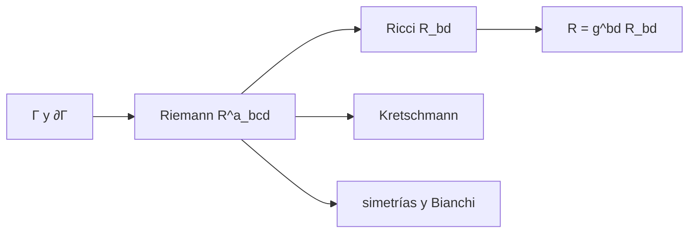

# B39-C03 — Tensor de Riemann, Ricci y curvatura escalar

<!-- nav:top -->
[🏠 Programa](../../../../README.md) · [📚 Bloque B39](../../../tronco-comun/B39-relatividad-general-avanzada.md) · [← Anterior: B39-C02 — Conexión afín y símbolos de Christoffel](../B39-C02-conexion-afin-y-simbolos-de-christoffel/CLASE.md) · [Siguiente: B39-C04 — Tensor de energía-momento y fuentes de curvatura →](../B39-C04-tensor-de-energia-momento-y-fuentes-de-curvatura/CLASE.md)
<!-- /nav -->

## 1. Ubicación, nivel y alcance

Clase 3 del bloque B39. Nivel N3. La curvatura mide cuánto cambia un vector al transportarlo por un lazo. Aquí calculas por **diferencias finitas anidadas** el **tensor de Riemann**, el de **Ricci** y la **curvatura escalar** de la 2-esfera (radio 2) y de Schwarzschild a `r = 6M`, el **escalar de Kretschmann** y las simetrías del tensor. Usas [B11](../../../tronco-comun/B11-ecuaciones-diferenciales-y-simulacion-numerica.md). Es un ejercicio de cálculo con métricas de ejemplo.

## 2. Por qué esta clase existe

Un espacio-tiempo es curvo si el Riemann no se anula. La decisión central: **¿qué mide cada contracción del Riemann y cómo se comprueba un cálculo de curvatura?**

## 3. Lo que podrás hacer al terminar

1. Calcular `R^a_bcd` desde los Christoffel.
2. Contraer a Ricci y a escalar.
3. Calcular el escalar de Kretschmann.
4. Comprobar antisimetrías e identidad de Bianchi.
5. Reconocer el vacío `R_ab = 0`.
6. Distinguir curvatura de Ricci y de Weyl.

La evidencia es la **ficha de la curvatura** del ejercicio 12 (sección 20).

## 4. Con qué llegas y cómo comprobarlo

1. ¿Qué es una incertidumbre?
2. ¿Qué es una simulación Monte Carlo?
3. ¿Qué es una tabla de resultados?
4. ¿Qué es un valor ilustrativo?
5. ¿Qué es una verificación?

<details>
<summary>Ver respuestas</summary>

1. Un intervalo en que se espera el valor verdadero. 2. Repetir con números aleatorios de semilla fija. 3. Un resumen ordenado de cálculos. 4. Un valor propuesto para el ejemplo, no medido. 5. Comparar un cálculo con un caso independiente.
</details>

Con cuatro o cinco aciertos, sigue; si no, repasa los prerrequisitos.

## 5. Un caso de contexto y casos de referencia

La 2-esfera de radio 2 tiene `R = 2/a² = 0,5`; el cálculo numérico da `0,50000006`. Schwarzschild a `r = 6M` es vacío (`R_ab ≈ 0`) pero curvo: `K = 48 M²/r⁶ = 1,0288 × 10⁻³`. Es el **ejemplo conductor**.

## 6. Vocabulario

El **tensor de Riemann** `R^a_bcd` mide la no conmutación de las derivadas covariantes. El **tensor de Ricci** es `R_bd = R^a_bad`. La **curvatura escalar** es `R = g^bd R_bd`. El **escalar de Kretschmann** `R_abcd R^abcd` es un invariante. Un espacio es **plano** si el Riemann es cero. El **vacío** cumple `R_ab = 0`.

## 7. Modelo mental: una hoja de papel y una pelota

Un cilindro de papel se desenrolla sin deformarse (plano); una pelota no (curva): el Riemann detecta esa diferencia.



*Descripción textual:* los Christoffel y sus derivadas dan el Riemann, y sus contracciones dan Ricci, escalar y Kretschmann.

Analogía: una hoja de papel y una pelota. Límite: las derivadas numéricas anidadas limitan la precisión a unos `10⁻⁶`.

## 8. La explicación, paso a paso

### 8.1 La 2-esfera (`a = 2`)

La curvatura escalar numérica es `0,50000006` frente a `2/a² = 0,50000000`. El mayor valor de `Ric − (R/2) g` es `6,22 × 10⁻⁷`.

### 8.2 Schwarzschild (`M = 1`, `r = 6`)

| Magnitud | Numérico | Cerrado |
|---|---|---|
| máximo de `R_ab` | 6,70 × 10⁻⁷ | 0 (vacío) |
| Kretschmann | 1,028806241 × 10⁻³ | `48 M²/r⁶` = 1,028806584 × 10⁻³ |
| `R_trtr` | −0,009259260 | `−2M/r³` = −0,009259259 |

### 8.3 Simetrías

La mayor componente covariante es `|R_abcd| = 12`. La antisimetría `R_abcd + R_bacd` llega a `3,60 × 10⁻⁵` (error de diferencias finitas, `3 × 10⁻⁶` de la componente máxima); la de `cd` y la primera identidad de Bianchi dan `0`.

### 8.4 Lectura

Schwarzschild tiene Ricci cero y Riemann no nulo: la curvatura de marea es la parte de Weyl. La precisión de un Riemann numérico es de `10⁻⁶` relativo, no de máquina.

## 9. Magnitudes, símbolos y unidades

| Símbolo | Qué es | Unidad | Valor / nota |
|---|---|---|---|
| `R^a_bcd` | tensor de Riemann | 1/longitud² | ver 8.2 |
| `R` | curvatura escalar | 1/longitud² | 0,50000006 |
| `K` | Kretschmann | 1/longitud⁴ | 1,0288 × 10⁻³ |

## 10. Convenciones y referencias

Esfera de radio 2 y Schwarzschild con `M = 1` en `G = c = 1`; Christoffel con paso `10⁻⁴` y su derivada con `10⁻³`.

## 11. De dónde sale lo que afirmamos

| ID | Fuente | Localizador | Respalda | Estado |
|---|---|---|---|---|
| S1 | Carroll, *Lecture Notes on General Relativity* (arXiv:gr-qc/9712019) | https://arxiv.org/abs/gr-qc/9712019 | contexto: variedades, geometría de Riemann y ecuaciones de Einstein | Solo resumen, consultado el 2026-11-09 |

Límites: S1 solo resumen y no respalda ninguna cifra de la clase.

## 12. Cómo ver la curvatura calculada

| Magnitud | Valor |
|---|---|
| `R` de la 2-esfera | 0,50000006 |
| `K` de Schwarzschild | 1,0288 × 10⁻³ |
| `R_trtr` | −0,009259 |
| máx. `R_ab` en vacío | 6,7 × 10⁻⁷ |

Descripción larga: la esfera tiene la curvatura escalar esperada y Schwarzschild es vacío con Kretschmann no nulo.

## 13. Ejemplo trabajado: Kretschmann de Schwarzschild

**Paso 1 · Potencia.** `r⁶ = 6⁶ = 46 656`.

**Paso 2 · Numerador.** `48 M² = 48`.

**Paso 3 · Cociente.** `K = 48/46 656 = 1,0288 × 10⁻³`.

## 14. Distintas formas de describir la curvatura

**Por tensor:** Riemann. **Por traza:** Ricci. **Por doble traza:** escalar. **Por invariante:** Kretschmann.

## 15. Práctica guiada

**Ejercicio 1 · con los pasos indicados.** `R` de una 2-esfera de radio 2. *Pasos:* `2/a²`.

<details><summary>Solución comentada</summary>

`0,5`.
</details>

**Ejercicio 2 · con una pista.** `R` para radio 1.

<details><summary>Solución comentada</summary>

`2`.
</details>

**Ejercicio 3 · casi autónomo.** Kretschmann a `r = 6M`.

<details><summary>Solución comentada</summary>

`1,0288 × 10⁻³`.
</details>

## 16. Práctica autónoma, transferencia e integrador

**Ejercicio 4.** Kretschmann a `r = 12M`.

<details><summary>Solución comentada</summary>

`48/12⁶ = 1,607 × 10⁻⁵`.
</details>

**Ejercicio 5.** `R_trtr` a `r = 6M`.

<details><summary>Solución comentada</summary>

`−2/216 = −0,009259`.
</details>

**Ejercicio 6.** ¿Es plana la 2-esfera?

<details><summary>Solución comentada</summary>

No: `R ≠ 0`.
</details>

**Ejercicio 7.** ¿Qué indica `R_ab = 0` con Riemann no nulo?

<details><summary>Solución comentada</summary>

Vacío curvo.
</details>

**Ejercicio 8.** Cociente de los Kretschmann de `r = 6M` y `r = 12M`.

<details><summary>Solución comentada</summary>

`2⁶ = 64`.
</details>

**Ejercicio 9 · transferencia.** **Transferencia.** Un compañero dice que vacío significa espacio plano. Responde.

<details><summary>Solución comentada</summary>

No: Schwarzschild es vacío y curvo.
</details>

**Ejercicio 10 · transferencia.** **Transferencia.** ¿Por qué el error numérico es de `10⁻⁶`?

<details><summary>Solución comentada</summary>

Por las derivadas anidadas.
</details>

**Ejercicio 11 · transferencia.** **Transferencia.** ¿Qué componente del Riemann mide la marea radial?

<details><summary>Solución comentada</summary>

`R_trtr`.
</details>

**Ejercicio 12.** **Integrador.** Elabora tu *ficha de la curvatura*: Riemann, Ricci, escalar y Kretschmann.

<details><summary>Solución comentada</summary>

Secciones 8.1–8.4.
</details>

**Ejercicio 12 · integrador.** **Integrador.** Elabora tu *ficha de la curvatura*: Riemann, Ricci, escalar y Kretschmann.

<details><summary>Solución modelo</summary>

Secciones 8.1–8.4.
</details>

## 17. Laboratorio: tensores de curvatura

El script [curvatura.py](curvatura.py) calcula Riemann, Ricci, escalar y Kretschmann (**comprueba** `10⁻⁶`).

**Datos:** sin constantes; métricas **ilustrativas**. **Predice antes de ejecutar:** ¿qué Ricci tendrá Schwarzschild? (cero.) **Ejecución del 2026-11-09 (Python 3.12.9):**

```text
Python 3.12.9 (biblioteca estandar)
2-esfera (a = 2.0): R numerica 0.50000006  cerrada 2/a^2 = 0.50000000
  Ricci - (R/2) g: maximo 6.22e-07
Schwarzschild (M = 1.0, r = 6.0): maximo |R_ab| = 6.70e-07 (vacio: debe ser 0)
Kretschmann numerico 1.028806241e-03  cerrado 48 M^2/r^6 = 1.028806584e-03
componente covariante maxima |R_abcd| = 12.0000
antisimetria (ab): 3.60e-05   antisimetria (cd): 0.00e+00   primera identidad de Bianchi: 0.00e+00
R_trtr numerico -0.009259260  cerrado -2M/r^3 = -0.009259259
Pruebas superadas.
```

```bash
python programa/clases/B39/B39-C03-tensor-de-riemann-ricci-y-curvatura-escalar/curvatura.py
```

**Límites:** diferencias finitas anidadas.

## 18. Errores frecuentes y cómo corregirlos

**Confundir Ricci cero con plano.** Se corrige con 8.4.

**Esperar precisión de máquina.** Se corrige con 8.3.

**Olvidar la contracción correcta.** Se corrige con la sección 6.

**Presentar un cálculo de prueba como una solución real.** Se corrige con la sección 10.

## 19. Cómo sabrás que vas bien

Tras la sección 8: ¿qué resultado esperabas y cuál obtuviste? Si dudas, repasa el ejemplo 13. Tras el laboratorio: ¿qué comprueba? (ver la sección 17).

## 20. Qué entregas y cómo se evalúa

El producto es tu **ficha de la curvatura** (ejercicio 12).

| Criterio | Inicial | En desarrollo | Logrado | Destacado |
|---|---|---|---|---|
| Conceptos | Los confunde | Parciales | conceptos de la clase | Explica los límites |
| Cálculo | Sin unidades | Con errores | Tablas completas | Calcula casos nuevos |
| Numérico | Sin comprobar | Un caso | Contraste con el análisis | Interpreta las diferencias |
| Fuentes | Sin fuente | Sin fecha | fuentes con fecha | Declara lo ilustrativo |
| Límites | No los nombra | Uno | Tres | Discute qué falta del modelo |

**Condiciones críticas (no se compensan con promedio):** rotular las métricas como de ejemplo; no inferir propiedades de objetos reales; citar solo lo consultado.

## 21. Ética, seguridad y límites

Clase educativa: los modelos son simplificados. Accesibilidad: tablas equivalentes a las gráficas, fórmulas en texto, ejercicios sin conexión.

## 22. Para cerrar y seguir

La esfera de radio 2 tiene R = 0,5 y Schwarzschild a 6M es vacío con Kretschmann 1,03 × 10⁻³. Queda una pregunta: ¿qué materia produce esa curvatura?

**Glosario español–inglés.** tensor de Riemann · *Riemann tensor*; tensor de Ricci · *Ricci tensor*; curvatura escalar · *scalar curvature*; escalar de Kretschmann · *Kretschmann scalar*; identidad de Bianchi · *Bianchi identity*.

**Continuidad.** [B39-C04](../B39-C04-tensor-de-energia-momento-y-fuentes-de-curvatura/CLASE.md) estudia el tensor de energía-momento.

**Referencias:** ver sección 11.

<!-- nav:bottom -->
---

[← Anterior: B39-C02 — Conexión afín y símbolos de Christoffel](../B39-C02-conexion-afin-y-simbolos-de-christoffel/CLASE.md) · [📚 Bloque B39](../../../tronco-comun/B39-relatividad-general-avanzada.md) · [Siguiente: B39-C04 — Tensor de energía-momento y fuentes de curvatura →](../B39-C04-tensor-de-energia-momento-y-fuentes-de-curvatura/CLASE.md)
<!-- /nav -->
