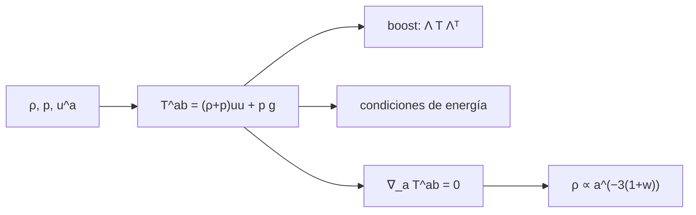

# B39-C04 — Tensor de energía-momento y fuentes de curvatura

<!-- nav:top -->
[🏠 Programa](../../../../README.md) · [📚 Bloque B39](../../../tronco-comun/B39-relatividad-general-avanzada.md) · [← Anterior: B39-C03 — Tensor de Riemann, Ricci y curvatura escalar](../B39-C03-tensor-de-riemann-ricci-y-curvatura-escalar/CLASE.md) · [Siguiente: B39-C05 — Ecuaciones de campo de Einstein y límite newtoniano →](../B39-C05-ecuaciones-de-campo-de-einstein-y-limite-newtoniano/CLASE.md)
<!-- /nav -->

## 1. Ubicación, nivel y alcance

Clase 4 del bloque B39. Nivel N3. La curvatura nace de la distribución de energía y momento. Aquí construyes el **tensor de energía-momento de un fluido perfecto**, lo transformas con una *boost*, evalúas las **condiciones de energía** de cinco ecuaciones de estado y compruebas su **conservación** `∇_a T^ab = 0` en un universo de Friedmann plano con diferencias finitas, con un control negativo. Usas [B26](../../../tronco-comun/B26-relatividad-y-cosmologia.md), [B11](../../../tronco-comun/B11-ecuaciones-diferenciales-y-simulacion-numerica.md) y el valor exacto de `c` de NIST. Los fluidos son modelos de ejemplo.

## 2. Por qué esta clase existe

La fuente de la gravedad es `T^ab`. La decisión central: **¿qué tensor describe la materia y qué condiciones debe cumplir para ser físicamente razonable?**

## 3. Lo que podrás hacer al terminar

1. Construir `T^ab` de un fluido perfecto.
2. Aplicar una *boost* de Lorentz.
3. Evaluar condiciones de energía.
4. Comprobar `∇_a T^ab = 0` en FLRW.
5. Verificar `ρ ∝ a^(−3(1+w))`.
6. Convertir una densidad de masa en energía.

La evidencia es la **ficha del tensor de energía-momento** del ejercicio 12 (sección 20).

## 4. Con qué llegas y cómo comprobarlo

1. ¿Qué es una incertidumbre?
2. ¿Qué es una simulación Monte Carlo?
3. ¿Qué es una tabla de resultados?
4. ¿Qué es un valor ilustrativo?
5. ¿Qué es una verificación?

<details>
<summary>Ver respuestas</summary>

1. Un intervalo en que se espera el valor verdadero. 2. Repetir con números aleatorios de semilla fija. 3. Un resumen ordenado de cálculos. 4. Un valor propuesto para el ejemplo, no medido. 5. Comparar un cálculo con un caso independiente.
</details>

Con cuatro o cinco aciertos, sigue; si no, repasa los prerrequisitos.

## 5. Un caso de contexto y casos de referencia

Un fluido con `ρ = 2` y `p = 0,5` tiene traza `−0,5` y, con velocidad `0,6 c`, `T⁰⁰ = 3,40625` y `T⁰¹ = 2,34375`. En un universo de polvo `a = t^(2/3)` la divergencia es `1,2 × 10⁻¹¹`. Es el **ejemplo conductor**.

## 6. Vocabulario

Un **fluido perfecto** tiene `T^ab = (ρ + p) u^a u^b + p g^ab`. La **densidad** `ρ`, la **presión** `p` y el **parámetro** `w = p/ρ`. La **condición de energía débil** pide `ρ ≥ 0` y `ρ + p ≥ 0`; la **dominante**, `ρ ≥ |p|`; la **fuerte**, `ρ + 3p ≥ 0`. La **conservación** es `∇_a T^ab = 0`.

## 7. Modelo mental: el contenido de una caja

Como el inventario de una caja: cuánta energía hay, cómo fluye y cuánta presión ejerce, expresado de modo que no dependa del observador.



*Descripción textual:* las densidades y la velocidad construyen el tensor, que se transforma, se clasifica y debe conservarse.

Analogía: el contenido de una caja. Límite: un fluido perfecto, sin viscosidad ni flujo de calor.

## 8. La explicación, paso a paso

### 8.1 Reposo y *boost*

En reposo `T = diag(2; 0,5; 0,5; 0,5)` con traza `−ρ + 3p = −0,5`. Con `v = 0,6 c` (`γ = 1,25`): `T⁰⁰ = γ²(ρ + p v²) = 3,406250` y `T⁰¹ = 2,343750`; la diferencia con `Λ T Λᵀ` es `0`.

### 8.2 Condiciones de energía (`ρ = 1`)

| Ecuación de estado | `w` | débil | dominante | fuerte |
|---|---|---|---|---|
| polvo | 0 | sí | sí | sí |
| radiación | 1/3 | sí | sí | sí |
| constante cosmológica | −1 | sí | sí | no |
| rígido | 1 | sí | sí | sí |
| fantasma | −1,5 | no | no | no |

### 8.3 Conservación en FLRW

| Universo | `n` | máx. divergencia | `T⁰⁰` |
|---|---|---|---|
| polvo | 2/3 | 1,18 × 10⁻¹¹ | 0,25 |
| radiación | 1/2 | 1,25 × 10⁻¹¹ | 0,25 |

La integración de `dρ/d ln a = −3(1 + w)ρ` da `ρ(8)/ρ(1) = 1,953125 × 10⁻³` para polvo (`8⁻³`) y `2,441406 × 10⁻⁴` para radiación (`8⁻⁴`). El control negativo (`ρ ∝ a⁻²`) da una divergencia de `0,132`, de modo que la prueba detecta lo que no se conserva.

### 8.4 Energía

Un kilogramo por metro cúbico de masa en reposo equivale a `c² = 8,987551787 × 10¹⁶ J/m³` (NIST CODATA 2022).

## 9. Magnitudes, símbolos y unidades

| Símbolo | Qué es | Unidad | Valor / nota |
|---|---|---|---|
| `ρ` | densidad de energía | J/m³ (o geométrica) | 2 (ilustrativo) |
| `p` | presión | J/m³ | 0,5 (ilustrativo) |
| `w` | p/ρ | — | 0; 1/3; −1 |
| `c` | velocidad de la luz | m/s | 299 792 458 |

## 10. Convenciones y referencias

`c = 299 792 458 m/s` exacta (NIST CODATA 2022). Densidades, presiones, velocidad de la *boost* y universos de prueba **ilustrativos**.

## 11. De dónde sale lo que afirmamos

| ID | Fuente | Localizador | Respalda | Estado |
|---|---|---|---|---|
| S1 | Carroll, *Lecture Notes on General Relativity* (arXiv:gr-qc/9712019) | https://arxiv.org/abs/gr-qc/9712019 | contexto: variedades, geometría de Riemann y ecuaciones de Einstein | Solo resumen, consultado el 2026-11-09 |
| S2 | NIST, *Fundamental Physical Constants* (CODATA 2022) | https://physics.nist.gov/cuu/Constants/Table/allascii.txt | `G` y `c` | Consultada el 2026-11-09 |

Límites: S1 solo resumen y no respalda ninguna cifra; S2 respalda `c`.

## 12. Cómo ver el tensor del fluido

| Magnitud | Valor |
|---|---|
| traza en reposo | −0,5 |
| `T⁰⁰` con v = 0,6 c | 3,40625 |
| divergencia (polvo) | 1,2 × 10⁻¹¹ |
| control negativo | 0,132 |

Descripción larga: la *boost* coincide con la transformación tensorial y la conservación se cumple solo con la ley correcta de la densidad.

## 13. Ejemplo trabajado: T⁰⁰ con boost

**Paso 1 · Factor.** `γ = 1/√(1 − 0,36) = 1,25`, `γ² = 1,5625`.

**Paso 2 · Presión.** `p v² = 0,5 × 0,36 = 0,18`.

**Paso 3 · Suma.** `ρ + p v² = 2,18`.

**Paso 4 · Producto.** `T⁰⁰ = 1,5625 × 2,18 = 3,40625`.

## 14. Distintas formas de describir una fuente

**Por tensor:** `T^ab`. **Por observador:** *boost*. **Por condiciones:** energía. **Por dinámica:** conservación.

## 15. Práctica guiada

**Ejercicio 1 · con los pasos indicados.** Traza en reposo con `ρ = 2` y `p = 0,5`. *Pasos:* `−ρ + 3p`.

<details><summary>Solución comentada</summary>

`−0,5`.
</details>

**Ejercicio 2 · con una pista.** `γ²` para `v = 0,6 c`.

<details><summary>Solución comentada</summary>

`1,5625`.
</details>

**Ejercicio 3 · casi autónomo.** `T⁰⁰` con *boost*.

<details><summary>Solución comentada</summary>

`3,40625`.
</details>

## 16. Práctica autónoma, transferencia e integrador

**Ejercicio 4.** `T⁰¹` con *boost*. *Pasos:* `γ²(ρ + p)v`.

<details><summary>Solución comentada</summary>

`2,34375`.
</details>

**Ejercicio 5.** `8⁻³`.

<details><summary>Solución comentada</summary>

`1,953125 × 10⁻³`.
</details>

**Ejercicio 6.** ¿Cumple la constante cosmológica la condición fuerte?

<details><summary>Solución comentada</summary>

No: `ρ + 3p = −2ρ`.
</details>

**Ejercicio 7.** ¿Cumple el fluido fantasma la débil?

<details><summary>Solución comentada</summary>

No: `ρ + p < 0`.
</details>

**Ejercicio 8.** Energía de 1 kg/m³ de masa en reposo.

<details><summary>Solución comentada</summary>

`8,9876 × 10¹⁶ J/m³`.
</details>

**Ejercicio 9 · transferencia.** **Transferencia.** Un compañero dice que la presión no gravita. Responde.

<details><summary>Solución comentada</summary>

Sí gravita: aparece en `T^ab` y en `ρ + 3p`.
</details>

**Ejercicio 10 · transferencia.** **Transferencia.** ¿Por qué la radiación diluye más rápido que el polvo?

<details><summary>Solución comentada</summary>

Porque además pierde energía por el corrimiento al rojo.
</details>

**Ejercicio 11 · transferencia.** **Transferencia.** ¿Qué prueba el control negativo?

<details><summary>Solución comentada</summary>

Que la divergencia detecta una ley no conservada.
</details>

**Ejercicio 12.** **Integrador.** Elabora tu *ficha del tensor de energía-momento*: construcción, condiciones y conservación.

<details><summary>Solución comentada</summary>

Secciones 8.1–8.4.
</details>

**Ejercicio 12 · integrador.** **Integrador.** Elabora tu *ficha del tensor de energía-momento*: construcción, condiciones y conservación.

<details><summary>Solución modelo</summary>

Secciones 8.1–8.4.
</details>

## 17. Laboratorio: tensor de energía-momento

El script [tensor_emt.py](tensor_emt.py) construye el tensor, aplica una *boost*, evalúa condiciones y comprueba la conservación (**comprueba** `10⁻¹²` la *boost* y `10⁻⁷` la divergencia).

**Datos:** `c` de NIST; el resto **ilustrativo**. **Predice antes de ejecutar:** ¿se conserva el polvo con `ρ ∝ a⁻²`? (no.) **Ejecución del 2026-11-09 (Python 3.12.9):**

```text
Python 3.12.9 (biblioteca estandar)
reposo: T = diag(2.0000, 0.5000, 0.5000, 0.5000)  traza = -0.5000 (cerrada -rho + 3p = -0.5000)
boost v = 0.6 c: T^00 = 3.406250 (cerrada gamma^2 (rho + p v^2) = 3.406250), T^01 = 2.343750
diferencia con Lambda T Lambda^T: 0.00e+00
ecuacion de estado   w = p/rho  debil  dominante  fuerte
polvo                   0.0000   True       True    True
radiacion               0.3333   True       True    True
constante cosmologica   -1.0000   True       True   False
rigido                  1.0000   True       True    True
fantasma               -1.5000  False      False   False
universo        n   max |div T|  escala T00
polvo      0.6667     1.183e-11     0.25000
  rho(a = 8)/rho(a = 1): integrada 1.953125000e-03  cerrada 8^-3 = 1.953125000e-03
radiacion  0.5000     1.249e-11     0.25000
  rho(a = 8)/rho(a = 1): integrada 2.441406250e-04  cerrada 8^-4 = 2.441406250e-04
control negativo (rho ~ a^-2): max |div T| = 1.323e-01
1 kg/m^3 de masa en reposo equivale a 8.987551787e+16 J/m^3 (c^2, NIST CODATA 2022)
Pruebas superadas.
```

```bash
python programa/clases/B39/B39-C04-tensor-de-energia-momento-y-fuentes-de-curvatura/tensor_emt.py
```

**Límites:** fluido perfecto en FLRW plano.

## 18. Errores frecuentes y cómo corregirlos

**Olvidar que la presión es fuente.** Se corrige con 8.2.

**Aplicar la *boost* solo a `ρ`.** Se corrige con 8.1.

**Dar por buena una prueba sin control negativo.** Se corrige con 8.3.

**Presentar el fluido como un sistema real.** Se corrige con la sección 10.

## 19. Cómo sabrás que vas bien

Tras la sección 8: ¿qué resultado esperabas y cuál obtuviste? Si dudas, repasa el ejemplo 13. Tras el laboratorio: ¿qué comprueba? (ver la sección 17).

## 20. Qué entregas y cómo se evalúa

El producto es tu **ficha del tensor de energía-momento** (ejercicio 12).

| Criterio | Inicial | En desarrollo | Logrado | Destacado |
|---|---|---|---|---|
| Conceptos | Los confunde | Parciales | conceptos de la clase | Explica los límites |
| Cálculo | Sin unidades | Con errores | Tablas completas | Calcula casos nuevos |
| Numérico | Sin comprobar | Un caso | Contraste con el análisis | Interpreta las diferencias |
| Fuentes | Sin fuente | Sin fecha | fuentes con fecha | Declara lo ilustrativo |
| Límites | No los nombra | Uno | Tres | Discute qué falta del modelo |

**Condiciones críticas (no se compensan con promedio):** rotular los fluidos como de ejemplo; no modelar una estrella real; citar solo lo consultado.

## 21. Ética, seguridad y límites

Clase educativa: los modelos son simplificados. Accesibilidad: tablas equivalentes a las gráficas, fórmulas en texto, ejercicios sin conexión.

## 22. Para cerrar y seguir

El fluido de ejemplo transforma como un tensor, las condiciones de energía separan las ecuaciones de estado y la divergencia es 10⁻¹¹ solo con la ley de densidad correcta. Queda una pregunta: ¿cómo se iguala este tensor a la curvatura?

**Glosario español–inglés.** tensor de energía-momento · *stress-energy tensor*; fluido perfecto · *perfect fluid*; condición de energía · *energy condition*; conservación · *conservation*; ecuación de estado · *equation of state*.

**Continuidad.** [B39-C05](../B39-C05-ecuaciones-de-campo-de-einstein-y-limite-newtoniano/CLASE.md) escribe las ecuaciones de campo de Einstein.

**Referencias:** ver sección 11.

<!-- nav:bottom -->
---

[← Anterior: B39-C03 — Tensor de Riemann, Ricci y curvatura escalar](../B39-C03-tensor-de-riemann-ricci-y-curvatura-escalar/CLASE.md) · [📚 Bloque B39](../../../tronco-comun/B39-relatividad-general-avanzada.md) · [Siguiente: B39-C05 — Ecuaciones de campo de Einstein y límite newtoniano →](../B39-C05-ecuaciones-de-campo-de-einstein-y-limite-newtoniano/CLASE.md)
<!-- /nav -->
