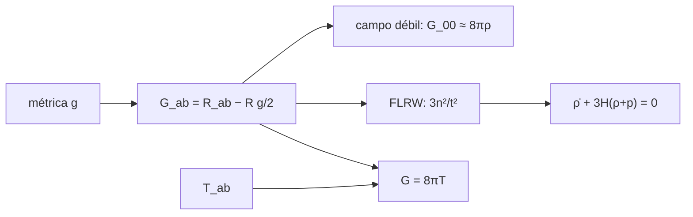

# B39-C05 — Ecuaciones de campo de Einstein y límite newtoniano

<!-- nav:top -->
[🏠 Programa](../../../../README.md) · [📚 Bloque B39](../../../tronco-comun/B39-relatividad-general-avanzada.md) · [← Anterior: B39-C04 — Tensor de energía-momento y fuentes de curvatura](../B39-C04-tensor-de-energia-momento-y-fuentes-de-curvatura/CLASE.md) · [Siguiente: B39-C06 — Introducción a la relatividad numérica: formalismo 3+1 →](../B39-C06-introduccion-a-la-relatividad-numerica-formalismo-3-1/CLASE.md)
<!-- /nav -->

## 1. Ubicación, nivel y alcance

Clase 5 del bloque B39. Nivel N3. Las ecuaciones de Einstein igualan la curvatura a la materia: `G_ab = 8π T_ab` en unidades `G = c = 1`. Aquí calculas el **tensor de Einstein** numéricamente para una métrica de campo débil de una esfera de Plummer y verificas el **límite newtoniano** (`G_00 ≈ 8πρ` con `∇²Φ = 4πρ`), calculas `G_00` y `G_11` de universos de Friedmann y comprueba la **identidad de Bianchi contraída** (`ρ̇ + 3H(ρ + p) = 0`). Usas [B26](../../../tronco-comun/B26-relatividad-y-cosmologia.md), [B11](../../../tronco-comun/B11-ecuaciones-diferenciales-y-simulacion-numerica.md) y `G` y `c` de NIST. Los modelos son de ejemplo.

## 2. Por qué esta clase existe

Las ecuaciones de campo conectan la geometría con la materia. La decisión central: **¿en qué régimen la gravedad de Einstein se reduce a la de Newton y qué garantiza la consistencia de las ecuaciones?**

## 3. Lo que podrás hacer al terminar

1. Calcular `G_ab = R_ab − R g_ab/2`.
2. Recuperar la ecuación de Poisson.
3. Medir cómo mejora el límite con `|Φ|`.
4. Calcular `G_00` y `G_11` de FLRW.
5. Comprobar la identidad de Bianchi contraída.
6. Pasar `8πG/c⁴` a unidades SI.

La evidencia es la **ficha de las ecuaciones de campo** del ejercicio 12 (sección 20).

## 4. Con qué llegas y cómo comprobarlo

1. ¿Qué es una incertidumbre?
2. ¿Qué es una simulación Monte Carlo?
3. ¿Qué es una tabla de resultados?
4. ¿Qué es un valor ilustrativo?
5. ¿Qué es una verificación?

<details>
<summary>Ver respuestas</summary>

1. Un intervalo en que se espera el valor verdadero. 2. Repetir con números aleatorios de semilla fija. 3. Un resumen ordenado de cálculos. 4. Un valor propuesto para el ejemplo, no medido. 5. Comparar un cálculo con un caso independiente.
</details>

Con cuatro o cinco aciertos, sigue; si no, repasa los prerrequisitos.

## 5. Un caso de contexto y casos de referencia

Para la esfera de Plummer con `M = 0,01` a `r² = 0,89`, `Φ = −7,27 × 10⁻³`, `G_00 = 1,1735 × 10⁻²` y `8πρ = 1,2218 × 10⁻²`. Para `a = t^(2/3)` a `t = 2`, `G_00 = 3n²/t² = 0,33333`. Es el **ejemplo conductor**.

## 6. Vocabulario

El **tensor de Einstein** es `G_ab = R_ab − R g_ab/2`. Las **ecuaciones de campo** son `G_ab = (8πG/c⁴) T_ab`. El **límite newtoniano** es `g_00 ≈ −(1 + 2Φ)` con `∇²Φ = 4πGρ`. La **identidad de Bianchi contraída** implica `∇^a G_ab = 0`. Un **universo de Friedmann plano** tiene `a(t)`.

## 7. Modelo mental: una balanza entre forma y contenido

Un lado de la ecuación es forma (geometría); el otro, contenido (materia). La identidad de Bianchi obliga a que el contenido se conserve.



*Descripción textual:* se calcula G desde la métrica y se compara con la materia en el límite newtoniano y en FLRW.

Analogía: una balanza entre forma y contenido. Límite: campo débil, estático y no relativista.

## 8. La explicación, paso a paso

### 8.1 Límite newtoniano (`G_00` frente a `8πρ`)

| `M` | `Φ` | `G_00` | `8πρ` | desviación relativa | desviación / Φ (valor absoluto) |
|---|---|---|---|---|---|
| 0,1 | −7,27 × 10⁻² | 8,1818 × 10⁻² | 1,2218 × 10⁻¹ | 0,3303 | 4,54 |
| 0,01 | −7,27 × 10⁻³ | 1,1735 × 10⁻² | 1,2218 × 10⁻² | 0,03955 | 5,44 |
| 0,001 | −7,27 × 10⁻⁴ | 1,2169 × 10⁻³ | 1,2218 × 10⁻³ | 0,004032 | 5,54 |

La desviación es proporcional a `|Φ|` (el coeficiente de los dos casos pequeños coincide a 5 %) y se cierra al bajar `M`.

### 8.2 Friedmann plano (`t = 2`)

| `n` | `G_00` | `3n²/t²` | `G_11/a²` | cerrada |
|---|---|---|---|---|
| 2/3 | 0,33333340 | 0,33333333 | 0,00000006 | 0 |
| 1/2 | 0,18750005 | 0,18750000 | 0,06250005 | 0,0625 |
| 0,8 | 0,48000008 | 0,48000000 | −0,07999993 | −0,08 |

### 8.3 Bianchi contraída

Con `ρ = G_00/8π` y `p = G_11/(8π a²)`, la diferencia relativa entre `dρ/dt` y `−3H(ρ + p)` es `2,0 × 10⁻⁴` en los tres universos.

### 8.4 Unidades SI

`8πG/c⁴ = 2,076647 × 10⁻⁴³ s² kg⁻¹ m⁻¹`, con `G = 6,674 30 × 10⁻¹¹ m³ kg⁻¹ s⁻²` y `c = 299 792 458 m/s` (NIST CODATA 2022). Es una constante diminuta: se necesita mucha energía para curvar poco.

## 9. Magnitudes, símbolos y unidades

| Símbolo | Qué es | Unidad | Valor / nota |
|---|---|---|---|
| `G_ab` | tensor de Einstein | 1/longitud² | ver 8.1 |
| `Φ` | potencial newtoniano | adimensional (`c = 1`) | −7,27 × 10⁻³ |
| `8πG/c⁴` | acoplamiento | s² kg⁻¹ m⁻¹ | 2,0766 × 10⁻⁴³ |

## 10. Convenciones y referencias

`G` y `c` de NIST CODATA 2022; masas de prueba, `b = 1` y universos **ilustrativos**.

## 11. De dónde sale lo que afirmamos

| ID | Fuente | Localizador | Respalda | Estado |
|---|---|---|---|---|
| S1 | Carroll, *Lecture Notes on General Relativity* (arXiv:gr-qc/9712019) | https://arxiv.org/abs/gr-qc/9712019 | contexto: variedades, geometría de Riemann y ecuaciones de Einstein | Solo resumen, consultado el 2026-11-09 |
| S2 | NIST, *Fundamental Physical Constants* (CODATA 2022) | https://physics.nist.gov/cuu/Constants/Table/allascii.txt | `G` y `c` | Consultada el 2026-11-09 |

Límites: S1 solo resumen y no respalda ninguna cifra; S2 respalda `G` y `c`.

## 12. Cómo ver las ecuaciones de campo

| Magnitud | Valor |
|---|---|
| `Φ` (M = 0,01) | −7,27 × 10⁻³ |
| desviación relativa (M = 0,01) | 0,0396 |
| `G_00` (n = 2/3, t = 2) | 0,33333 |
| Bianchi | 2,0 × 10⁻⁴ |

Descripción larga: la desviación newtoniana decrece con `|Φ|` y la identidad de Bianchi se cumple en los tres universos.

## 13. Ejemplo trabajado: Φ de Plummer

**Paso 1 · Radio suavizado.** `√(0,89 + 1) = 1,3748`.

**Paso 2 · Cociente.** `0,01/1,3748 = 0,007274`.

**Paso 3 · Signo.** `Φ = −7,274 × 10⁻³`.

## 14. Distintas formas de describir una ecuación de campo

**Por forma:** `G_ab`. **Por contenido:** `T_ab`. **Por límite:** Poisson. **Por consistencia:** Bianchi.

## 15. Práctica guiada

**Ejercicio 1 · con los pasos indicados.** `Φ` para `M = 0,01` y `r² = 0,89`. *Pasos:* `−M/√(r² + b²)`.

<details><summary>Solución comentada</summary>

`−7,274 × 10⁻³`.
</details>

**Ejercicio 2 · con una pista.** `8πρ` con `M = 0,01`. *Pasos:* `6M b²/(r²+b²)^(5/2)`.

<details><summary>Solución comentada</summary>

`1,2218 × 10⁻²`.
</details>

**Ejercicio 3 · casi autónomo.** `G_00 = 3n²/t²` para `n = 1/2`, `t = 2`.

<details><summary>Solución comentada</summary>

`0,1875`.
</details>

## 16. Práctica autónoma, transferencia e integrador

**Ejercicio 4.** `G_11/a²` para `n = 0,8`, `t = 2`.

<details><summary>Solución comentada</summary>

`−0,08`.
</details>

**Ejercicio 5.** Factor entre las desviaciones de `M = 0,01` y `0,001`.

<details><summary>Solución comentada</summary>

`≈ 9,8`.
</details>

**Ejercicio 6.** `p` del polvo (`n = 2/3`).

<details><summary>Solución comentada</summary>

`0`.
</details>

**Ejercicio 7.** ¿Cuánto vale `8πG/c⁴`?

<details><summary>Solución comentada</summary>

`2,0766 × 10⁻⁴³` en SI.
</details>

**Ejercicio 8.** `ρ` de FLRW con `n = 2/3`, `t = 2`.

<details><summary>Solución comentada</summary>

`0,3333/8π = 0,01326`.
</details>

**Ejercicio 9 · transferencia.** **Transferencia.** Un compañero dice que Einstein y Newton difieren siempre. Responde.

<details><summary>Solución comentada</summary>

Coinciden con error `∝ |Φ|` en campo débil.
</details>

**Ejercicio 10 · transferencia.** **Transferencia.** ¿Qué garantiza la conservación de `T_ab`?

<details><summary>Solución comentada</summary>

La identidad de Bianchi contraída.
</details>

**Ejercicio 11 · transferencia.** **Transferencia.** ¿Por qué `8πG/c⁴` es tan pequeño?

<details><summary>Solución comentada</summary>

Porque la gravedad es débil.
</details>

**Ejercicio 12.** **Integrador.** Elabora tu *ficha de las ecuaciones de campo*: límite newtoniano, FLRW y Bianchi.

<details><summary>Solución comentada</summary>

Secciones 8.1–8.4.
</details>

**Ejercicio 12 · integrador.** **Integrador.** Elabora tu *ficha de las ecuaciones de campo*: límite newtoniano, FLRW y Bianchi.

<details><summary>Solución modelo</summary>

Secciones 8.1–8.4.
</details>

## 17. Laboratorio: ecuaciones de campo

El script [einstein.py](einstein.py) calcula `G_ab` para el campo débil y FLRW y comprueba Bianchi (**comprueba** `10⁻⁶` en FLRW y la linealidad de la desviación).

**Datos:** `G` y `c` de NIST; el resto **ilustrativo**. **Predice antes de ejecutar:** ¿se acerca `G_00` a `8πρ` al bajar `M`? (sí.) **Ejecución del 2026-11-09 (Python 3.12.9):**

```text
Python 3.12.9 (biblioteca estandar)
8 pi G / c^4 = 2.076647e-43 s^2 kg^-1 m^-1 (NIST CODATA 2022)
      M         Phi   G_00 numerico      8 pi rho  desv. relativa  desv./|Phi|
  1e-01  -7.274e-02    8.181781e-02  1.221790e-01       3.303e-01        4.541
  1e-02  -7.274e-03    1.173466e-02  1.221790e-02       3.955e-02        5.437
  1e-03  -7.274e-04    1.216865e-03  1.221790e-03       4.032e-03        5.542
     n         G_00     3n^2/t^2     G_11/a^2      cerrada
0.6667   0.33333340   0.33333333   0.00000006   0.00000000
0.5000   0.18750005   0.18750000   0.06250005   0.06250000
0.8000   0.48000008   0.48000000  -0.07999993  -0.08000000
     n      d rho/dt    -3H(rho+p)  dif. relativa
0.6667 -1.326557e-02 -1.326292e-02      2.000e-04
0.5000 -7.461884e-03 -7.460391e-03      2.002e-04
0.8000 -1.910242e-02 -1.909860e-02      2.000e-04
Pruebas superadas.
```

```bash
python programa/clases/B39/B39-C05-ecuaciones-de-campo-de-einstein-y-limite-newtoniano/einstein.py
```

**Límites:** campo débil estático.

## 18. Errores frecuentes y cómo corregirlos

**Esperar igualdad exacta con Newton.** Se corrige con 8.1.

**Olvidar el factor `8π`.** Se corrige con 8.4.

**Ignorar la presión como fuente.** Se corrige con 8.2.

**Presentar la esfera de Plummer como un astro real.** Se corrige con la sección 10.

## 19. Cómo sabrás que vas bien

Tras la sección 8: ¿qué resultado esperabas y cuál obtuviste? Si dudas, repasa el ejemplo 13. Tras el laboratorio: ¿qué comprueba? (ver la sección 17).

## 20. Qué entregas y cómo se evalúa

El producto es tu **ficha de las ecuaciones de campo** (ejercicio 12).

| Criterio | Inicial | En desarrollo | Logrado | Destacado |
|---|---|---|---|---|
| Conceptos | Los confunde | Parciales | conceptos de la clase | Explica los límites |
| Cálculo | Sin unidades | Con errores | Tablas completas | Calcula casos nuevos |
| Numérico | Sin comprobar | Un caso | Contraste con el análisis | Interpreta las diferencias |
| Fuentes | Sin fuente | Sin fecha | fuentes con fecha | Declara lo ilustrativo |
| Límites | No los nombra | Uno | Tres | Discute qué falta del modelo |

**Condiciones críticas (no se compensan con promedio):** rotular los modelos como de ejemplo; no calcular un campo real; citar solo lo consultado.

## 21. Ética, seguridad y límites

Clase educativa: los modelos son simplificados. Accesibilidad: tablas equivalentes a las gráficas, fórmulas en texto, ejercicios sin conexión.

## 22. Para cerrar y seguir

El tensor de Einstein recupera la ecuación de Poisson con una desviación proporcional a |Φ| y cumple la identidad de Bianchi con 2 × 10⁻⁴. Queda una pregunta: ¿cómo se evolucionan estas ecuaciones en un computador?

**Glosario español–inglés.** ecuaciones de campo · *field equations*; tensor de Einstein · *Einstein tensor*; límite newtoniano · *Newtonian limit*; ecuación de Poisson · *Poisson equation*; Friedmann · *Friedmann*.

**Continuidad.** [B39-C06](../B39-C06-introduccion-a-la-relatividad-numerica-formalismo-3-1/CLASE.md) introduce el formalismo 3+1 para evolucionarlas.

**Referencias:** ver sección 11.

<!-- nav:bottom -->
---

[← Anterior: B39-C04 — Tensor de energía-momento y fuentes de curvatura](../B39-C04-tensor-de-energia-momento-y-fuentes-de-curvatura/CLASE.md) · [📚 Bloque B39](../../../tronco-comun/B39-relatividad-general-avanzada.md) · [Siguiente: B39-C06 — Introducción a la relatividad numérica: formalismo 3+1 →](../B39-C06-introduccion-a-la-relatividad-numerica-formalismo-3-1/CLASE.md)
<!-- /nav -->
