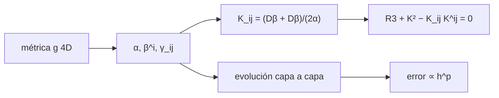

# B39-C06 — Introducción a la relatividad numérica: formalismo 3+1

<!-- nav:top -->
[🏠 Programa](../../../../README.md) · [📚 Bloque B39](../../../tronco-comun/B39-relatividad-general-avanzada.md) · [← Anterior: B39-C05 — Ecuaciones de campo de Einstein y límite newtoniano](../B39-C05-ecuaciones-de-campo-de-einstein-y-limite-newtoniano/CLASE.md) · [Siguiente: B40-C01 — Inflación cósmica: motivación y dinámica básica →](../../B40/B40-C01-inflacion-cosmica-motivacion-y-dinamica-basica/CLASE.md)
<!-- /nav -->

## 1. Ubicación, nivel y alcance

Clase 6 del bloque B39. Nivel N3. La relatividad numérica evoluciona el espacio-tiempo capa por capa. Aquí descompones la métrica de Schwarzschild en coordenadas de Painlevé–Gullstrand en **lapso**, **desplazamiento** y **métrica espacial**, calculas la **curvatura extrínseca** y la **ligadura hamiltoniana** y, como juguete de evolución hiperbólica, integras una **ecuación de onda** con segundo orden y miras su **convergencia**. Usas [B11](../../../tronco-comun/B11-ecuaciones-diferenciales-y-simulacion-numerica.md). **No** es un código de relatividad numérica ni evoluciona la ecuación de Einstein.

## 2. Por qué esta clase existe

Una simulación necesita un tiempo y un espacio. La decisión central: **¿cómo se separa el espacio-tiempo en capas y cómo se sabe que una evolución converge?**

## 3. Lo que podrás hacer al terminar

1. Extraer `α`, `β^i` y `γ_ij` de una métrica.
2. Comprobar `det g = −α² det γ`.
3. Calcular `K_ij` y su traza.
4. Comprobar la ligadura hamiltoniana.
5. Integrar una onda con RK4.
6. Medir el orden de convergencia.

La evidencia es la **ficha del formalismo 3+1** del ejercicio 12 (sección 20).

## 4. Con qué llegas y cómo comprobarlo

1. ¿Qué es una incertidumbre?
2. ¿Qué es una simulación Monte Carlo?
3. ¿Qué es una tabla de resultados?
4. ¿Qué es un valor ilustrativo?
5. ¿Qué es una verificación?

<details>
<summary>Ver respuestas</summary>

1. Un intervalo en que se espera el valor verdadero. 2. Repetir con números aleatorios de semilla fija. 3. Un resumen ordenado de cálculos. 4. Un valor propuesto para el ejemplo, no medido. 5. Comparar un cálculo con un caso independiente.
</details>

Con cuatro o cinco aciertos, sigue; si no, repasa los prerrequisitos.

## 5. Un caso de contexto y casos de referencia

En Painlevé–Gullstrand a `r = 4M`, `α = 1`, `β^r = √(2M/r) = 0,707107`, la traza de `K` vale `0,265165` y la ligadura hamiltoniana `−1,2 × 10⁻⁸`. La onda converge con orden `2,000`. Es el **ejemplo conductor**.

## 6. Vocabulario

El **lapso** `α` mide el tiempo propio entre capas. El **desplazamiento** `β^i` mueve las coordenadas entre capas. La **métrica espacial** `γ_ij` es la de cada capa. La **curvatura extrínseca** `K_ij` mide cómo se curva la capa en el espacio-tiempo. La **ligadura hamiltoniana** es `R³ + K² − K_ij K^ij = 16πρ`. La **convergencia** es la reducción del error al refinar la malla.

## 7. Modelo mental: las páginas de un libro

Como hojear un libro: cada página es una capa espacial y el lapso y el desplazamiento dicen cuánto avanza el tiempo y cómo se alinean las páginas.



*Descripción textual:* la métrica se descompone en lapso, desplazamiento y métrica espacial; las ligaduras se verifican y la evolución se valida por convergencia.

Analogía: las páginas de un libro. Límite: rebanada estacionaria y de vacío; la onda es un juguete lineal sin acoplamiento.

## 8. La explicación, paso a paso

### 8.1 Descomposición (Schwarzschild en Painlevé–Gullstrand, `M = 1`, `r = 4`)

`α = 1,000000000000` (cerrado 1), `β^r = 0,707106781187` (cerrado `√(2M/r)`), y `det g = −256,000000000` frente a `−α² det γ = −256,000000000`. La métrica espacial es plana en coordenadas esféricas.

### 8.2 Curvatura extrínseca y ligadura

| Magnitud | Valor |
|---|---|
| traza `K` | 0,265165043 (cerrada `(3/2)√(2M/r)/r` = 0,265165043) |
| `R³` | −1,23 × 10⁻⁸ |
| `K²` | 0,070312500 |
| `K_ij K^ij` | 0,070312500 |
| ligadura hamiltoniana | −1,23 × 10⁻⁸ |

### 8.3 Convergencia de la onda (`φ_tt = φ_xx`, `T = 1`)

| `N` | error `L2` | orden |
|---|---|---|
| 32 | 1,4556 × 10⁻² | — |
| 64 | 3,6403 × 10⁻³ | 1,999 |
| 128 | 9,1015 × 10⁻⁴ | 2,000 |
| 256 | 2,2754 × 10⁻⁴ | 2,000 |

### 8.4 Lectura

La rebanada de Painlevé–Gullstrand es plana pero tiene curvatura extrínseca no nula: `K² = K_ij K^ij` hace que la ligadura de vacío se cumpla. Un error que baja por 4 al duplicar `N` es la firma de un esquema de segundo orden.

## 9. Magnitudes, símbolos y unidades

| Símbolo | Qué es | Unidad | Valor / nota |
|---|---|---|---|
| `α` | lapso | adimensional | 1 |
| `β^i` | desplazamiento | adimensional (`c = 1`) | 0,7071 |
| `K` | traza de curvatura extrínseca | 1/longitud | 0,265165 |
| `p` | orden de convergencia | — | 2,000 |

## 10. Convenciones y referencias

Schwarzschild con `M = 1` en `G = c = 1` y una onda de prueba; sin constantes físicas.

## 11. De dónde sale lo que afirmamos

| ID | Fuente | Localizador | Respalda | Estado |
|---|---|---|---|---|
| S1 | Gourgoulhon, *3+1 Formalism and Bases of Numerical Relativity* (arXiv:gr-qc/0703035) | https://arxiv.org/abs/gr-qc/0703035 | contexto: foliación, descomposición de las ecuaciones de Einstein y esquemas de evolución | Solo resumen, consultado el 2026-11-09 |

Límites: S1 solo resumen y no respalda ninguna cifra de la clase.

## 12. Cómo ver la descomposición y la convergencia

| Magnitud | Valor |
|---|---|
| `β^r` | 0,707107 |
| traza `K` | 0,265165 |
| ligadura | −1,2 × 10⁻⁸ |
| orden de convergencia | 2,000 |

Descripción larga: la descomposición coincide con las fórmulas cerradas, la ligadura se cumple y el error de la onda baja por 4 al duplicar la resolución.

## 13. Ejemplo trabajado: traza de K

**Paso 1 · Desplazamiento.** `β^r = √(2M/r) = √0,5 = 0,707107`.

**Paso 2 · Cociente.** `β^r/r = 0,176777`.

**Paso 3 · Factor.** `K = (3/2)(0,176777) = 0,265165`.

## 14. Distintas formas de describir una evolución

**Por capa:** `γ_ij`. **Por tiempo:** `α`. **Por coordenadas:** `β^i`. **Por consistencia:** ligadura y convergencia.

## 15. Práctica guiada

**Ejercicio 1 · con los pasos indicados.** `β^r` a `r = 4M`. *Pasos:* `√(2M/r)`.

<details><summary>Solución comentada</summary>

`0,707107`.
</details>

**Ejercicio 2 · con una pista.** Traza de `K`.

<details><summary>Solución comentada</summary>

`0,265165`.
</details>

**Ejercicio 3 · casi autónomo.** `K²`.

<details><summary>Solución comentada</summary>

`0,0703125 = 9/128`.
</details>

## 16. Práctica autónoma, transferencia e integrador

**Ejercicio 4.** `det g` a `r = 4`, `θ = π/2`.

<details><summary>Solución comentada</summary>

`−r⁴ = −256`.
</details>

**Ejercicio 5.** Razón de errores entre `N = 32` y `64`.

<details><summary>Solución comentada</summary>

`3,998`.
</details>

**Ejercicio 6.** Orden de convergencia entre `N = 64` y `128`.

<details><summary>Solución comentada</summary>

`2,000`.
</details>

**Ejercicio 7.** Ligadura hamiltoniana de vacío.

<details><summary>Solución comentada</summary>

`≈ 0` (`−1,2 × 10⁻⁸`).
</details>

**Ejercicio 8.** ¿Cuánto vale `α`?

<details><summary>Solución comentada</summary>

`1`.
</details>

**Ejercicio 9 · transferencia.** **Transferencia.** Un compañero dice que esto simula la fusión de agujeros negros. Responde.

<details><summary>Solución comentada</summary>

No: es una descomposición y una onda de juguete.
</details>

**Ejercicio 10 · transferencia.** **Transferencia.** ¿Por qué verificar la convergencia?

<details><summary>Solución comentada</summary>

Porque un esquema puede ejecutarse sin ser correcto.
</details>

**Ejercicio 11 · transferencia.** **Transferencia.** ¿Qué papel tiene el desplazamiento?

<details><summary>Solución comentada</summary>

Elegir cómo se corresponden las coordenadas entre capas.
</details>

**Ejercicio 12.** **Integrador.** Elabora tu *ficha del formalismo 3+1*: descomposición, ligadura y convergencia.

<details><summary>Solución comentada</summary>

Secciones 8.1–8.4.
</details>

**Ejercicio 12 · integrador.** **Integrador.** Elabora tu *ficha del formalismo 3+1*: descomposición, ligadura y convergencia.

<details><summary>Solución modelo</summary>

Secciones 8.1–8.4.
</details>

## 17. Laboratorio: descomposición 3+1 y convergencia

El script [adm.py](adm.py) descompone la métrica, calcula `K` y la ligadura y mide la convergencia de una onda (**comprueba** `10⁻⁶` y orden entre 1,9 y 2,1).

**Datos:** sin constantes físicas; Schwarzschild y onda **ilustrativos**. **Predice antes de ejecutar:** ¿qué orden tendrá la convergencia? (2.) **Ejecución del 2026-11-09 (Python 3.12.9):**

```text
Python 3.12.9 (biblioteca estandar)
alpha = 1.000000000000 (cerrado 1)   beta^r = 0.707106781187 (cerrado sqrt(2M/r) = 0.707106781187)
det g = -256.000000000   -alpha^2 det gamma = -256.000000000
traza K = 0.265165043 (cerrada 3/2 sqrt(2M/r)/r = 0.265165043)
R3 = -1.23e-08   K^2 = 0.070312500   K_ij K^ij = 0.070312500   ligadura hamiltoniana = -1.23e-08
    N      error L2   orden
   32    1.4556e-02     nan
   64    3.6403e-03   1.999
  128    9.1015e-04   2.000
  256    2.2754e-04   2.000
Pruebas superadas.
```

```bash
python programa/clases/B39/B39-C06-introduccion-a-la-relatividad-numerica-formalismo-3-1/adm.py
```

**Límites:** rebanada estacionaria y onda lineal.

## 18. Errores frecuentes y cómo corregirlos

**Creer que esto es un código de relatividad numérica.** Se corrige con la sección 10.

**Olvidar el signo de `K_ij`.** Se corrige con la sección 10.

**No medir la convergencia.** Se corrige con 8.3.

**Confundir lapso y desplazamiento.** Se corrige con la sección 6.

## 19. Cómo sabrás que vas bien

Tras la sección 8: ¿qué resultado esperabas y cuál obtuviste? Si dudas, repasa el ejemplo 13. Tras el laboratorio: ¿qué comprueba? (ver la sección 17).

## 20. Qué entregas y cómo se evalúa

El producto es tu **ficha del formalismo 3+1** (ejercicio 12).

| Criterio | Inicial | En desarrollo | Logrado | Destacado |
|---|---|---|---|---|
| Conceptos | Los confunde | Parciales | conceptos de la clase | Explica los límites |
| Cálculo | Sin unidades | Con errores | Tablas completas | Calcula casos nuevos |
| Numérico | Sin comprobar | Un caso | Contraste con el análisis | Interpreta las diferencias |
| Fuentes | Sin fuente | Sin fecha | fuentes con fecha | Declara lo ilustrativo |
| Límites | No los nombra | Uno | Tres | Discute qué falta del modelo |

**Condiciones críticas (no se compensan con promedio):** rotular la onda y la métrica como de ejemplo; no simular un sistema real; citar solo lo consultado.

## 21. Ética, seguridad y límites

Clase educativa: los modelos son simplificados. Accesibilidad: tablas equivalentes a las gráficas, fórmulas en texto, ejercicios sin conexión.

## 22. Para cerrar y seguir

La métrica de Painlevé–Gullstrand tiene lapso 1, desplazamiento 0,707 y ligadura 10⁻⁸, y la onda converge con orden 2,000. Con esto cierra el bloque: de la métrica a la curvatura, a la materia y a la evolución, cada paso se calculó y se verificó.

**Glosario español–inglés.** formalismo 3+1 · *3+1 formalism*; lapso · *lapse*; desplazamiento · *shift*; curvatura extrínseca · *extrinsic curvature*; ligadura hamiltoniana · *Hamiltonian constraint*.

**Continuidad.** Es la última clase del bloque.

**Referencias:** ver sección 11.

<!-- nav:bottom -->
---

[← Anterior: B39-C05 — Ecuaciones de campo de Einstein y límite newtoniano](../B39-C05-ecuaciones-de-campo-de-einstein-y-limite-newtoniano/CLASE.md) · [📚 Bloque B39](../../../tronco-comun/B39-relatividad-general-avanzada.md) · [Siguiente: B40-C01 — Inflación cósmica: motivación y dinámica básica →](../../B40/B40-C01-inflacion-cosmica-motivacion-y-dinamica-basica/CLASE.md)
<!-- /nav -->
