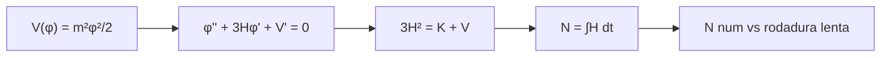

# B40-C01 — Inflación cósmica: motivación y dinámica básica

<!-- nav:top -->
[🏠 Programa](../../../../README.md) · [📚 Bloque B40](../../../tronco-comun/B40-universo-temprano-y-radiacion-cosmica-de-fondo.md) · [← Anterior: B39-C06 — Introducción a la relatividad numérica: formalismo 3+1](../../B39/B39-C06-introduccion-a-la-relatividad-numerica-formalismo-3-1/CLASE.md) · [Siguiente: B40-C02 — Recalentamiento y transición a la era de radiación →](../B40-C02-recalentamiento-y-transicion-a-la-era-de-radiacion/CLASE.md)
<!-- /nav -->

## 1. Ubicación, nivel y alcance

Clase 1 del bloque B40. Nivel N3. La inflación es una fase de expansión acelerada que precede a la era de radiación. Aquí integras las ecuaciones de fondo de un campo escalar con potencial cuadrático, cuentas los **e-pliegues** y los comparas con la aproximación de **rodadura lenta**. Usas [B26](../../../tronco-comun/B26-relatividad-y-cosmologia.md) y [B05](../../../tronco-comun/B05-fisica-fundamental-para-el-espacio.md). Es un modelo de juguete: no se ajusta a datos.

## 2. Por qué esta clase existe

Sin un mecanismo para las condiciones iniciales, el modelo FLRW deja sin explicar la planitud y la homogeneidad. La decisión central: **¿cuántos e-pliegues produce un campo que rueda lentamente y cuándo termina la inflación?**

## 3. Lo que podrás hacer al terminar

1. Escribir las ecuaciones de Friedmann y de Klein-Gordon de un campo.
2. Integrarlas con Runge-Kutta de cuarto orden.
3. Contar e-pliegues `N = ∫H dt`.
4. Comparar con la rodadura lenta `N = (φᵢ² − φₑ²)/4`.
5. Calcular `ε` y reconocer el fin de la inflación (`ε = 1`).
6. Reconocer los límites de un potencial cuadrático.

La evidencia es la **ficha de la inflación cósmica** del ejercicio 12 (sección 20).

## 4. Con qué llegas y cómo comprobarlo

1. ¿Qué es una incertidumbre?
2. ¿Qué es una simulación Monte Carlo?
3. ¿Qué es una tabla de resultados?
4. ¿Qué es un valor ilustrativo?
5. ¿Qué es una verificación?

<details>
<summary>Ver respuestas</summary>

1. Un intervalo en que se espera el valor verdadero. 2. Repetir con números aleatorios de semilla fija. 3. Un resumen ordenado de cálculos. 4. Un valor propuesto para el ejemplo, no medido. 5. Comparar un cálculo con un caso independiente.
</details>

Con cuatro o cinco aciertos, sigue; si no, repasa los prerrequisitos.

## 5. Un caso de contexto y casos de referencia

Con `V = m²φ²/2`, `φᵢ = 16 M_pl` (ilustrativo) y unidades `M_pl = 1`, la integración numérica da `N = 64,563` e-pliegues y la inflación termina en `φ = 1,006 M_pl`; la rodadura lenta da `63,5`. Es el **ejemplo conductor**. Todo es **ilustrativo**.

## 6. Vocabulario

El **campo escalar** `φ`. El **potencial** `V(φ)`. El **parámetro de Hubble** `H`. El **e-pliegue** `N = ln(a_final/a_inicial)`. La **rodadura lenta**: `φ̈` despreciable. El parámetro `ε = φ̇²/(2H²)`; hay inflación mientras `ε < 1`.

## 7. Modelo mental: una bola en una ladera suave

Como una bola que baja por una ladera muy poco inclinada con mucha fricción: avanza lento y a velocidad casi constante; la fricción es la expansión (`3Hφ̇`).



*Descripción textual:* el potencial y las ecuaciones de fondo dan la trayectoria del campo, de ella se obtiene `N` y se compara con la rodadura lenta.

Analogía: una bola en una ladera suave. Límite: universo plano y un solo campo.

## 8. La explicación, paso a paso

### 8.1 Trayectoria

| N transcurrido | φ numérico (M_pl) | t (1/m) | φ de rodadura lenta |
|---|---|---|---|
| 10 | 14,6995 | 1,595 | 14,6969 |
| 20 | 13,2730 | 3,345 | 13,2665 |
| 40 | 9,8279 | 7,575 | 9,7980 |
| 60 | 4,2081 | 14,510 | 4,0000 |

### 8.2 Fin de la inflación

La condición `ε = 1` se alcanza en `φ = 1,0062 M_pl` y `t = 18,630/m`, con `N = 64,563` frente a `63,500` de la rodadura lenta (diferencia `+1,063`). La rodadura lenta pierde exactitud al final, como muestra la fila `N = 60`.

### 8.3 Comprobación interna

La relación `Ḣ = −φ̇²/2` se cumple con error relativo máximo de `1,6 × 10⁻⁸`. Para `N = 50` y `60` la rodadura lenta da `n_s = 0,9600` y `0,9667` y `r = 0,1600` y `0,1333`.

### 8.4 Lectura

Con `V ∝ φ²` hacen falta `φᵢ ≳ 15 M_pl` para tener 60 e-pliegues: un campo con valores supraplanckianos. Eso es una propiedad de este potencial y no un resultado observado.

## 9. Magnitudes, símbolos y unidades

| Símbolo | Qué es | Unidad | Valor / nota |
|---|---|---|---|
| `φ` | campo escalar | M_pl | 16 (inicial, ilustrativo) |
| `N` | e-pliegues | — | 64,563 |
| `ε` | parámetro de rodadura | — | 1 al terminar |
| `H` | parámetro de Hubble | m | `φ/√6` en rodadura lenta |
| `M_pl` | masa de Planck reducida | — | 1 (unidades) |

## 10. Convenciones y referencias

Unidades `M_pl = 1`, tiempo en `1/m`; potencial y `φᵢ` ilustrativos; RK4 de paso 0,005.

## 11. De dónde sale lo que afirmamos

| ID | Fuente | Localizador | Respalda | Estado |
|---|---|---|---|---|
| — | Sin fuente externa | — | relaciones estándar que verifica el laboratorio | No se consultó una fuente para esta clase |

Límites: no se consultó ninguna fuente; la inflación se presenta como un modelo de libro, no como resultado verificado aquí.

## 12. Cómo ver la trayectoria

| Magnitud | Valor |
|---|---|
| `N` numérico | 64,563 |
| `N` rodadura lenta | 63,500 |
| `φ` final | 1,006 M_pl |
| `Ḣ` (error relativo) | 1,6 × 10⁻⁸ |

Descripción larga: la rodadura lenta subestima en poco más de un e-pliegue.

## 13. Ejemplo trabajado: `H` al inicio

**Paso 1 · Friedmann.** `3H² = V = φ²/2` (sin energía cinética): `H = φ/√6`.

**Paso 2 · Valor.** `H = 16/2,449 = 6,53` en unidades de `m`.

**Paso 3 · Velocidad.** `φ̇ = −φ/(3H) = −0,816`.

**Paso 4 · `ε`.** `ε = φ̇²/(2H²) = 0,0078`.

## 14. Distintas formas de describir el resultado

**Por ecuación:** Klein-Gordon. **Por tabla:** `φ(N)`. **Por fórmula:** `N = (φᵢ² − φₑ²)/4`. **Por código:** `inflacion.py`.

## 15. Práctica guiada

**Ejercicio 1 · con los pasos indicados.** `N` de rodadura lenta de `φᵢ = 16` a `φₑ = √2`. *Pasos:* `(256 − 2)/4`.

<details><summary>Solución comentada</summary>

`63,5`.
</details>

**Ejercicio 2 · con una pista.** `ε` en `φ = 16` con `ε = 2/φ²`. *Pasos:* ejemplo 13.

<details><summary>Solución comentada</summary>

`0,0078`.
</details>

**Ejercicio 3 · casi autónomo.** `H` en `φ = 16`.

<details><summary>Solución comentada</summary>

`6,53 m`.
</details>

## 16. Práctica autónoma, transferencia e integrador

**Ejercicio 4.** Cambio de `φ` en los 10 primeros e-pliegues.

<details><summary>Solución comentada</summary>

`16 − 14,6995 = 1,30 M_pl`.
</details>

**Ejercicio 5.** Diferencia numérico − rodadura lenta.

<details><summary>Solución comentada</summary>

`+1,063` e-pliegues.
</details>

**Ejercicio 6.** `n_s` con `N = 60`.

<details><summary>Solución comentada</summary>

`0,9667`.
</details>

**Ejercicio 7.** `r` con `N = 60`.

<details><summary>Solución comentada</summary>

`0,1333`.
</details>

**Ejercicio 8.** `φ` en que `ε = 1`.

<details><summary>Solución comentada</summary>

`1,006 M_pl`.
</details>

**Ejercicio 9 · transferencia.** **Transferencia.** Un compañero afirma que este laboratorio mide 64 e-pliegues del universo. Responde.

<details><summary>Solución comentada</summary>

Es un modelo de juguete con condiciones iniciales elegidas.
</details>

**Ejercicio 10 · transferencia.** **Transferencia.** ¿Por qué la rodadura lenta falla al final?

<details><summary>Solución comentada</summary>

Porque `φ̈` deja de ser despreciable cuando `ε → 1`.
</details>

**Ejercicio 11 · transferencia.** **Transferencia.** ¿Qué pasa con `N` si `φᵢ = 10`?

<details><summary>Solución comentada</summary>

`(100 − 2)/4 = 24,5`: insuficiente.
</details>

**Ejercicio 12.** **Integrador.** Elabora tu *ficha de la inflación cósmica*: ecuaciones, `N` numérico y de rodadura lenta, y límites.

<details><summary>Solución comentada</summary>

Secciones 8.1–8.4.
</details>

**Ejercicio 12 · integrador.** **Integrador.** Elabora tu *ficha de la inflación cósmica*: ecuaciones, `N` numérico y de rodadura lenta, y límites.

<details><summary>Solución modelo</summary>

Secciones 8.1–8.4.
</details>

## 17. Laboratorio: inflación con un campo cuadrático

El script [inflacion.py](inflacion.py) integra las ecuaciones de fondo y cuenta e-pliegues (**comprueba** `N` a 1,5 de la rodadura lenta y `Ḣ` a `10⁻⁶`).

**Datos:** sin constantes; potencial y condiciones **ilustrativos**. **Predice antes de ejecutar:** ¿cuántos e-pliegues saldrán? (≈ 64.) **Ejecución del 2026-11-09 (Python 3.12.9):**

```text
Python 3.12.9 (biblioteca estandar)
  N transcurrido   phi [M_pl]    t [1/m]   phi rod. lenta
              10      14.6995      1.595          14.6969
              20      13.2730      3.345          13.2665
              40       9.8279      7.575           9.7980
              60       4.2081     14.510           4.0000
fin de la inflacion (epsilon = 1): phi_e = 1.0062 M_pl, t = 18.630/m
e-pliegues numericos N = 64.563 ; rodadura lenta (phi_i^2 - 2)/4 = 63.500 ; diferencia = +1.063
N = 50: n_s = 1 - 2/N = 0.9600, r = 8/N = 0.1600
N = 60: n_s = 1 - 2/N = 0.9667, r = 8/N = 0.1333
max |Hdot_num - Hdot_teo| / |Hdot_teo| = 1.62e-08
Pruebas superadas.
```

```bash
python programa/clases/B40/B40-C01-inflacion-cosmica-motivacion-y-dinamica-basica/inflacion.py
```

**Límites:** un campo, universo plano, potencial elegido.

## 18. Errores frecuentes y cómo corregirlos

**Creer que `N` es una medición.** Se corrige con la sección 10.

**Usar rodadura lenta hasta el final.** Se corrige con 8.1.

**Olvidar las unidades de `M_pl`.** Se corrige con la sección 9.

**Confundir `ε` de rodadura con `ε = φ̇²/(2H²)`.** Se corrige con 8.2.

## 19. Cómo sabrás que vas bien

Tras la sección 8: ¿qué resultado esperabas y cuál obtuviste? Si dudas, repasa el ejemplo 13. Tras el laboratorio: ¿qué comprueba? (ver la sección 17).

## 20. Qué entregas y cómo se evalúa

El producto es tu **ficha de la inflación cósmica** (ejercicio 12).

| Criterio | Inicial | En desarrollo | Logrado | Destacado |
|---|---|---|---|---|
| Conceptos | Los confunde | Parciales | conceptos de la clase | Explica los límites |
| Cálculo | Sin unidades | Con errores | Tablas completas | Calcula casos nuevos |
| Numérico | Sin comprobar | Un caso | Contraste con el análisis | Interpreta las diferencias |
| Fuentes | Sin fuente | Sin fecha | fuentes con fecha | Declara lo ilustrativo |
| Límites | No los nombra | Uno | Tres | Discute qué falta del modelo |

**Condiciones críticas (no se compensan con promedio):** rotular el modelo como ilustrativo; no presentarlo como ajustado a datos; citar solo lo consultado.

## 21. Ética, seguridad y límites

Clase educativa: los modelos son simplificados. Accesibilidad: tablas equivalentes a las gráficas, fórmulas en texto, ejercicios sin conexión.

## 22. Para cerrar y seguir

El campo cuadrático da 64,6 e-pliegues numéricos frente a 63,5 de rodadura lenta, y la inflación termina cuando `ε = 1`. Queda una pregunta: ¿cómo se llena el universo de radiación al terminar?

**Glosario español–inglés.** inflación · *inflation*; e-pliegue · *e-fold*; rodadura lenta · *slow roll*; campo escalar · *scalar field*; potencial · *potential*.

**Continuidad.** [B40-C02](../B40-C02-recalentamiento-y-transicion-a-la-era-de-radiacion/CLASE.md) estudia el recalentamiento.

**Referencias:** ver sección 11.

<!-- nav:bottom -->
---

[← Anterior: B39-C06 — Introducción a la relatividad numérica: formalismo 3+1](../../B39/B39-C06-introduccion-a-la-relatividad-numerica-formalismo-3-1/CLASE.md) · [📚 Bloque B40](../../../tronco-comun/B40-universo-temprano-y-radiacion-cosmica-de-fondo.md) · [Siguiente: B40-C02 — Recalentamiento y transición a la era de radiación →](../B40-C02-recalentamiento-y-transicion-a-la-era-de-radiacion/CLASE.md)
<!-- /nav -->
