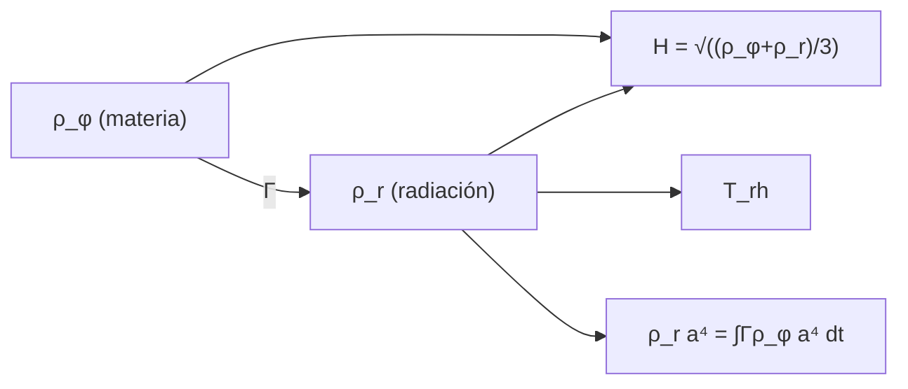

# B40-C02 — Recalentamiento y transición a la era de radiación

<!-- nav:top -->
[🏠 Programa](../../../../README.md) · [📚 Bloque B40](../../../tronco-comun/B40-universo-temprano-y-radiacion-cosmica-de-fondo.md) · [← Anterior: B40-C01 — Inflación cósmica: motivación y dinámica básica](../B40-C01-inflacion-cosmica-motivacion-y-dinamica-basica/CLASE.md) · [Siguiente: B40-C03 — Desacoplamiento de neutrinos y fondo cósmico de neutrinos →](../B40-C03-desacoplamiento-de-neutrinos-y-fondo-cosmico-de-neutrinos/CLASE.md)
<!-- /nav -->

## 1. Ubicación, nivel y alcance

Clase 2 del bloque B40. Nivel N3. Al terminar la inflación el campo oscila y se desintegra en radiación. Aquí integras un modelo **perturbativo** con tasa de decaimiento `Γ`, sigues el paso de materia a radiación y estimas la **temperatura de recalentamiento**. Usas [B26](../../../tronco-comun/B26-relatividad-y-cosmologia.md) y [B05](../../../tronco-comun/B05-fisica-fundamental-para-el-espacio.md). Los parámetros son ilustrativos.

## 2. Por qué esta clase existe

Sin recalentamiento no habría universo caliente. La decisión central: **¿cuándo domina la radiación y qué temperatura alcanza?**

## 3. Lo que podrás hacer al terminar

1. Escribir las ecuaciones de `ρ_φ` y `ρ_r`.
2. Integrarlas con Runge-Kutta.
3. Identificar `H = Γ` y la igualdad `ρ_r = ρ_φ`.
4. Estimar `T_rh` con `3Γ² = (π²/30) g* T⁴`.
5. Verificar `ρ_r a⁴` por una segunda vía.
6. Reconocer lo que omite el modelo perturbativo.

La evidencia es la **ficha del recalentamiento** del ejercicio 12 (sección 20).

## 4. Con qué llegas y cómo comprobarlo

1. ¿Qué es una incertidumbre?
2. ¿Qué es una simulación Monte Carlo?
3. ¿Qué es una tabla de resultados?
4. ¿Qué es un valor ilustrativo?
5. ¿Qué es una verificación?

<details>
<summary>Ver respuestas</summary>

1. Un intervalo en que se espera el valor verdadero. 2. Repetir con números aleatorios de semilla fija. 3. Un resumen ordenado de cálculos. 4. Un valor propuesto para el ejemplo, no medido. 5. Comparar un cálculo con un caso independiente.
</details>

Con cuatro o cinco aciertos, sigue; si no, repasa los prerrequisitos.

## 5. Un caso de contexto y casos de referencia

Con `Γ = 0,01 m`, `H₀ = 0,3 m` y `g* = 106,75` (ilustrativos), la radiación iguala al campo en `t = 103,42/m`, con densidad total `1,006 × 10⁻⁴` (`0,335` veces `3Γ²`). Es el **ejemplo conductor**.

## 6. Vocabulario

El **recalentamiento** convierte la energía del campo en radiación. La **tasa de decaimiento** `Γ`. La **temperatura de recalentamiento** `T_rh`. Un campo oscilante en potencial cuadrático se comporta como **materia** (`w = 0`). `g*` son los grados de libertad relativistas.

## 7. Modelo mental: un depósito que se vacía

Como un depósito de agua que se vacía por un grifo: al principio sale poco; cuando el tiempo es del orden de `1/Γ`, casi todo ha pasado a la radiación.



*Descripción textual:* dos fluidos acoplados por `Γ` evolucionan en un universo plano y se comprueba la radiación por una segunda vía.

Analogía: un depósito que se vacía. Límite: decaimiento perturbativo.

## 8. La explicación, paso a paso

### 8.1 Evolución

| instante | t (1/m) | ρ_φ | ρ_r | a |
|---|---|---|---|---|
| t = 10 | 10,00 | 8,164 × 10⁻³ | 5,893 × 10⁻⁴ | 3,105 |
| H = Γ | 60,87 | 2,012 × 10⁻⁴ | 9,872 × 10⁻⁵ | 9,004 |
| ρ_r = ρ_φ | 103,42 | 5,028 × 10⁻⁵ | 5,028 × 10⁻⁵ | 12,41 |
| t = 300 | 300,00 | 1,109 × 10⁻⁶ | 9,170 × 10⁻⁶ | 22,97 |
| t = 900 | 900,00 | 4,718 × 10⁻¹⁰ | 9,972 × 10⁻⁷ | 41,33 |

### 8.2 Temperatura

La estimación `T_rh = (90/(π² g*))^(1/4) √Γ = 0,0541` (unidades `M_pl`). La densidad total en la igualdad es `1,006 × 10⁻⁴`, el `0,335` de `3Γ² = 3 × 10⁻⁴`: el recalentamiento no es instantáneo en `H = Γ`.

### 8.3 Segunda vía

`ρ_r a⁴` por Runge-Kutta es `2,910963` y por cuadratura de `Γ ρ_φ a⁴ dt` es `2,910963` (error `2,2 × 10⁻⁹`). Al final la radiación es el `99,95 %` del total; el máximo de `ρ_r` fue `1,238 × 10⁻³` en `t = 1,75/m`.

### 8.4 Lectura

El paso a la radiación ocurre en torno a `t ~ 1/Γ`, con un factor de orden uno que depende de la definición de «recalentamiento». El modelo ignora resonancia paramétrica y termalización.

## 9. Magnitudes, símbolos y unidades

| Símbolo | Qué es | Unidad | Valor / nota |
|---|---|---|---|
| `Γ` | tasa de decaimiento | m | 0,01 (ilustrativo) |
| `T_rh` | temperatura de recalentamiento | M_pl | 0,0541 (solo escala adimensional) |
| `g*` | grados de libertad | — | 106,75 (ilustrativo) |
| `ρ` | densidad de energía | M_pl⁴ | ver 8.1 |

## 10. Convenciones y referencias

Unidades `M_pl = 1`, tiempo en `1/m`; `Γ`, `H₀` y `g*` ilustrativos; RK4 de paso 0,01.

## 11. De dónde sale lo que afirmamos

| ID | Fuente | Localizador | Respalda | Estado |
|---|---|---|---|---|
| — | Sin fuente externa | — | relaciones estándar que verifica el laboratorio | No se consultó una fuente para esta clase |

Límites: no se consultó ninguna fuente; el modelo perturbativo es el más sencillo y no describe un recalentamiento real.

## 12. Cómo ver la transferencia de energía

| Magnitud | Valor |
|---|---|
| t de `H = Γ` | 60,87/m |
| t de igualdad | 103,42/m |
| densidad / 3Γ² | 0,335 |
| `ρ_r a⁴` (dos vías) | 2,910963 |

Descripción larga: la igualdad llega después de `H = Γ`.

## 13. Ejemplo trabajado: `T_rh`

**Paso 1 · Densidad.** `ρ = 3Γ² = 3 × 10⁻⁴`.

**Paso 2 · Factor.** `90/(π² × 106,75) = 0,0854`.

**Paso 3 · Raíz cuarta.** `0,0854^(1/4) = 0,5406`.

**Paso 4 · Producto.** `0,5406 × √0,01 = 0,0541`.

## 14. Distintas formas de describir el resultado

**Por ecuación:** dos fluidos. **Por tabla:** instantes clave. **Por integral:** `ρ_r a⁴`. **Por código:** `recalentamiento.py`.

## 15. Práctica guiada

**Ejercicio 1 · con los pasos indicados.** `ρ` inicial con `H₀ = 0,3`. *Pasos:* `3H₀²`.

<details><summary>Solución comentada</summary>

`0,27`.
</details>

**Ejercicio 2 · con una pista.** `T_rh`. *Pasos:* ejemplo 13.

<details><summary>Solución comentada</summary>

`0,0541`.
</details>

**Ejercicio 3 · casi autónomo.** Densidad de `H = Γ`.

<details><summary>Solución comentada</summary>

`3 × 10⁻⁴`.
</details>

## 16. Práctica autónoma, transferencia e integrador

**Ejercicio 4.** Cociente de la densidad en la igualdad respecto de `3Γ²`.

<details><summary>Solución comentada</summary>

`0,335`.
</details>

**Ejercicio 5.** Fracción de radiación a `t = 900`.

<details><summary>Solución comentada</summary>

`0,99953`.
</details>

**Ejercicio 6.** Crecimiento de `a` entre la igualdad y `t = 900`.

<details><summary>Solución comentada</summary>

`41,33/12,41 = 3,33`.
</details>

**Ejercicio 7.** Tiempo de `H = Γ` en un universo de materia pura (`2/(3Γ)`).

<details><summary>Solución comentada</summary>

`66,7`, un 9 % sobre `60,87`.
</details>

**Ejercicio 8.** Máximo de `ρ_r` respecto de `ρ₀`.

<details><summary>Solución comentada</summary>

`1,238 × 10⁻³/0,27 = 0,46 %`.
</details>

**Ejercicio 9 · transferencia.** **Transferencia.** ¿Por qué el recalentamiento real puede ser más rápido?

<details><summary>Solución comentada</summary>

La resonancia paramétrica transfiere energía antes de que actúe `Γ`.
</details>

**Ejercicio 10 · transferencia.** **Transferencia.** Un compañero dice que `T_rh = 0,0541` es una temperatura en kelvin. Responde.

<details><summary>Solución comentada</summary>

Es adimensional, en unidades de `M_pl`.
</details>

**Ejercicio 11 · transferencia.** **Transferencia.** ¿Qué cambia si `g*` es 10 en lugar de 106,75?

<details><summary>Solución comentada</summary>

`T_rh` sube por `(106,75/10)^(1/4) = 1,81`.
</details>

**Ejercicio 12.** **Integrador.** Elabora tu *ficha del recalentamiento*: ecuaciones, instantes, `T_rh` y límites.

<details><summary>Solución comentada</summary>

Secciones 8.1–8.4.
</details>

**Ejercicio 12 · integrador.** **Integrador.** Elabora tu *ficha del recalentamiento*: ecuaciones, instantes, `T_rh` y límites.

<details><summary>Solución modelo</summary>

Secciones 8.1–8.4.
</details>

## 17. Laboratorio: recalentamiento perturbativo

El script [recalentamiento.py](recalentamiento.py) integra `ρ_φ`, `ρ_r` y `a`, y verifica `ρ_r a⁴` por cuadratura (**comprueba** `10⁻³` y la densidad de igualdad).

**Datos:** sin constantes; parámetros **ilustrativos**. **Predice antes de ejecutar:** ¿en qué instante iguala la radiación? (≈ 100/m.) **Ejecución del 2026-11-09 (Python 3.12.9):**

```text
Python 3.12.9 (biblioteca estandar)
        instante   t [1/m]     rho_phi       rho_r          a
            t=10     10.00   8.164e-03   5.893e-04  3.105e+00
         H=Gamma     60.87   2.012e-04   9.872e-05  9.004e+00
   rho_r=rho_phi    103.42   5.028e-05   5.028e-05  1.241e+01
           t=300    300.00   1.109e-06   9.170e-06  2.297e+01
           t=900    900.00   4.718e-10   9.972e-07  4.133e+01
densidad total en la igualdad = 1.006e-04 ; 3 Gamma^2 = 3.000e-04 ; cociente = 0.335
T_rh = (90/(pi^2 g*))^(1/4) sqrt(Gamma) = 0.0541 M_pl (con Gamma = 0,01 m; solo escala adimensional)
maximo de rho_r = 1.238e-03 en t = 1.75/m ; rho_r al final / rho_total = 0.999527
rho_r a^4: Runge-Kutta = 2.910963e+00 ; cuadratura = 2.910963e+00 ; error relativo = 2.24e-09
Pruebas superadas.
```

```bash
python programa/clases/B40/B40-C02-recalentamiento-y-transicion-a-la-era-de-radiacion/recalentamiento.py
```

**Límites:** decaimiento perturbativo, sin resonancia.

## 18. Errores frecuentes y cómo corregirlos

**Tomar `T_rh` como kelvin.** Se corrige con la sección 9.

**Creer que el recalentamiento es instantáneo.** Se corrige con 8.2.

**Olvidar el factor 3 de `3Γ²`.** Se corrige con el ejemplo 13.

**Dar `g*` como medido.** Se corrige con la sección 10.

## 19. Cómo sabrás que vas bien

Tras la sección 8: ¿qué resultado esperabas y cuál obtuviste? Si dudas, repasa el ejemplo 13. Tras el laboratorio: ¿qué comprueba? (ver la sección 17).

## 20. Qué entregas y cómo se evalúa

El producto es tu **ficha del recalentamiento** (ejercicio 12).

| Criterio | Inicial | En desarrollo | Logrado | Destacado |
|---|---|---|---|---|
| Conceptos | Los confunde | Parciales | conceptos de la clase | Explica los límites |
| Cálculo | Sin unidades | Con errores | Tablas completas | Calcula casos nuevos |
| Numérico | Sin comprobar | Un caso | Contraste con el análisis | Interpreta las diferencias |
| Fuentes | Sin fuente | Sin fecha | fuentes con fecha | Declara lo ilustrativo |
| Límites | No los nombra | Uno | Tres | Discute qué falta del modelo |

**Condiciones críticas (no se compensan con promedio):** rotular los parámetros como ilustrativos; no dar una temperatura física; citar solo lo consultado.

## 21. Ética, seguridad y límites

Clase educativa: los modelos son simplificados. Accesibilidad: tablas equivalentes a las gráficas, fórmulas en texto, ejercicios sin conexión.

## 22. Para cerrar y seguir

El campo oscilante pasa a radiación en torno a `t ~ 1/Γ` y `T_rh = 0,0541` en unidades de `M_pl`; `ρ_r a⁴` coincide por dos vías a `2 × 10⁻⁹`. Queda una pregunta: ¿qué ocurre con los neutrinos cuando el universo se enfría?

**Glosario español–inglés.** recalentamiento · *reheating*; tasa de decaimiento · *decay rate*; temperatura de recalentamiento · *reheating temperature*; grados de libertad · *degrees of freedom*.

**Continuidad.** [B40-C03](../B40-C03-desacoplamiento-de-neutrinos-y-fondo-cosmico-de-neutrinos/CLASE.md) estudia el desacoplamiento de neutrinos.

**Referencias:** ver sección 11.

<!-- nav:bottom -->
---

[← Anterior: B40-C01 — Inflación cósmica: motivación y dinámica básica](../B40-C01-inflacion-cosmica-motivacion-y-dinamica-basica/CLASE.md) · [📚 Bloque B40](../../../tronco-comun/B40-universo-temprano-y-radiacion-cosmica-de-fondo.md) · [Siguiente: B40-C03 — Desacoplamiento de neutrinos y fondo cósmico de neutrinos →](../B40-C03-desacoplamiento-de-neutrinos-y-fondo-cosmico-de-neutrinos/CLASE.md)
<!-- /nav -->
