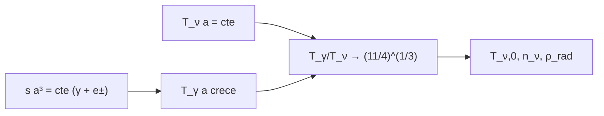

# B40-C03 — Desacoplamiento de neutrinos y fondo cósmico de neutrinos

<!-- nav:top -->
[🏠 Programa](../../../../README.md) · [📚 Bloque B40](../../../tronco-comun/B40-universo-temprano-y-radiacion-cosmica-de-fondo.md) · [← Anterior: B40-C02 — Recalentamiento y transición a la era de radiación](../B40-C02-recalentamiento-y-transicion-a-la-era-de-radiacion/CLASE.md) · [Siguiente: B40-C04 — Problemas del horizonte y de la planitud →](../B40-C04-problemas-del-horizonte-y-de-la-planitud/CLASE.md)
<!-- /nav -->

## 1. Ubicación, nivel y alcance

Clase 3 del bloque B40. Nivel N3. Los neutrinos se desacoplan del plasma cuando la temperatura baja a unos `1 MeV`, justo antes de que se aniquilen los pares electrón–positrón. Aquí calculas, conservando la **entropía comóvil**, por qué los fotones quedan más calientes que los neutrinos en un factor `(11/4)^(1/3)`, y obtienes la temperatura y la densidad numérica del fondo de neutrinos. Usas [B05](../../../tronco-comun/B05-fisica-fundamental-para-el-espacio.md), [B26](../../../tronco-comun/B26-relatividad-y-cosmologia.md) y [B31](../../../tronco-comun/B31-fisica-cuantica-nuclear-y-astroparticulas.md).

## 2. Por qué esta clase existe

Los neutrinos contribuyen a la densidad de radiación y condicionan el ritmo de expansión. La decisión central: **¿cuál es la temperatura del fondo de neutrinos y cuánta radiación añade?**

## 3. Lo que podrás hacer al terminar

1. Calcular la entropía de fotones y pares `e±` por integrales de Fermi-Dirac.
2. Aplicar la conservación de `s a³`.
3. Obtener `T_γ/T_ν → (11/4)^(1/3)`.
4. Calcular `T_ν,0`, `n_ν` y `ρ_rad/ρ_γ`.
5. Usar `N_eff` de la fuente.
6. Reconocer lo que el desacoplamiento instantáneo omite.

La evidencia es la **ficha del fondo de neutrinos** del ejercicio 12 (sección 20).

## 4. Con qué llegas y cómo comprobarlo

1. ¿Qué es una incertidumbre?
2. ¿Qué es una simulación Monte Carlo?
3. ¿Qué es una tabla de resultados?
4. ¿Qué es un valor ilustrativo?
5. ¿Qué es una verificación?

<details>
<summary>Ver respuestas</summary>

1. Un intervalo en que se espera el valor verdadero. 2. Repetir con números aleatorios de semilla fija. 3. Un resumen ordenado de cálculos. 4. Un valor propuesto para el ejemplo, no medido. 5. Comparar un cálculo con un caso independiente.
</details>

Con cuatro o cinco aciertos, sigue; si no, repasa los prerrequisitos.

## 5. Un caso de contexto y casos de referencia

Con `T₀ = 2,7255 K`, `T_ν,0 = 1,9454 K`, `n_γ = 410,73 cm⁻³` y `112,02 cm⁻³` por especie de neutrino. Con `N_eff = 3,044` la radiación total es `1,6913` veces la de fotones. Es el **ejemplo conductor**.

## 6. Vocabulario

El **desacoplamiento** deja de acoplar dos especies. La **entropía comóvil** `s a³`. La **aniquilación** `e⁺e⁻ → γγ`. Los neutrinos conservan una distribución de Fermi-Dirac con `T_ν ∝ 1/a`. `N_eff` es el número efectivo de especies relativistas.

## 7. Modelo mental: calor que pasa a un solo bando

Como calor que se queda en un recipiente: los pares aniquilados calientan solo a los fotones, no a los neutrinos que ya se habían separado.



*Descripción textual:* la conservación de la entropía del plasma calienta a los fotones respecto de los neutrinos y fija las cantidades actuales.

Analogía: calor que pasa a un solo bando. Límite: desacoplamiento instantáneo y distribuciones sin distorsión.

## 8. La explicación, paso a paso

### 8.1 Razón de temperaturas

| m/T_γ | T_γ/T_ν | (11/4)^(1/3) | diferencia |
|---|---|---|---|
| 0,1 | 1,00000 | 1,40102 | −0,40102 |
| 1,0 | 1,02212 | 1,40102 | −0,37890 |
| 3,0 | 1,16137 | 1,40102 | −0,23965 |
| 10,0 | 1,39777 | 1,40102 | −0,00325 |
| 40,0 | 1,40070 | 1,40102 | −0,00032 |

### 8.2 Valores actuales

`T_ν,0 = T₀ (4/11)^(1/3) = 1,9454 K`, `k_B T_ν,0 = 1,6764 × 10⁻⁴ eV`. `n_γ = 410,73 cm⁻³`, `n_ν = 112,02 cm⁻³` por especie y `336,0 cm⁻³` entre tres.

### 8.3 Radiación total

`ρ_rad/ρ_γ = 1 + (7/8)(4/11)^(4/3) N_eff = 1,6913` con `N_eff = 3,044` y `1,6813` con `N_eff = 3`.

### 8.4 Lectura

La razón converge a `1,40102` cuando `m/T ≫ 1`: queda `0,023 %` por debajo con `m/T = 40`. El desacoplamiento instantáneo equivale a `N_eff = 3`; la corrección a `3,044` viene de oscilaciones de neutrinos y de QED a temperatura finita (Bennett et al., solo resumen) y no se calcula aquí.

## 9. Magnitudes, símbolos y unidades

| Símbolo | Qué es | Unidad | Valor / nota |
|---|---|---|---|
| `T_ν,0` | temperatura de los neutrinos hoy | K | 1,9454 |
| `n_γ` | densidad numérica de fotones | cm⁻³ | 410,73 |
| `N_eff` | especies efectivas | — | 3,044 (fuente) |
| `m_e c²` | energía en reposo del electrón | MeV | 0,51100 (NIST) |

## 10. Convenciones y referencias

CODATA 2022 de NIST para `k_B`, `ħ`, `c`, `eV` y `m_e`; `T₀ = 2,7255 K`; integrales de Fermi-Dirac por Simpson.

## 11. De dónde sale lo que afirmamos

| ID | Fuente | Localizador | Respalda | Estado |
|---|---|---|---|---|
| S1 | NIST, *Fundamental Physical Constants* (CODATA 2022) | https://physics.nist.gov/cuu/Constants/Table/allascii.txt | constantes citadas en la sección 9 | Consultada el 2026-11-09 |
| S2 | Fixsen, *The Temperature of the Cosmic Microwave Background* | https://arxiv.org/abs/0911.1955 | T₀ = 2,72548 ± 0,00057 K (valor de la literatura citado en el resumen; el laboratorio usa 2,7255 K) | Solo resumen, consultado el 2026-11-09 |
| S3 | Bennett et al., *Towards a precision calculation of N_eff in the Standard Model II* | https://arxiv.org/abs/2012.02726 | N_eff = 3,0440 ± 0,0002 del resumen | Solo resumen, consultado el 2026-11-09 |

Límites: S2 y S3 son solo resúmenes; no se consultó el cálculo completo de `N_eff`.

## 12. Cómo ver la razón de temperaturas

| m/T_γ | T_γ/T_ν |
|---|---|
| 1,0 | 1,02212 |
| 10,0 | 1,39777 |
| 40,0 | 1,40070 |
| límite | 1,40102 |

Descripción larga: la razón sube de 1 y se acerca al límite cuando los pares desaparecen.

## 13. Ejemplo trabajado: `T_ν,0`

**Paso 1 · Entropía.** Antes: `g_s = 2 + 7/8 × 4 = 5,5`; después: `2`.

**Paso 2 · Cociente.** `(T_γ/T_ν)³ = 5,5/2 = 11/4`.

**Paso 3 · Raíz.** `1,40102`.

**Paso 4 · Hoy.** `T_ν,0 = 2,7255/1,40102 = 1,9454 K`.

## 14. Distintas formas de describir el resultado

**Por entropía:** `g_s`. **Por tabla:** razón. **Por integral:** Fermi-Dirac. **Por código:** `neutrinos.py`.

## 15. Práctica guiada

**Ejercicio 1 · con los pasos indicados.** `T_ν,0` con `T₀ = 2,7255 K`. *Pasos:* ejemplo 13.

<details><summary>Solución comentada</summary>

`1,9454 K`.
</details>

**Ejercicio 2 · con una pista.** `n_ν` por especie con `n_γ = 410,73`. *Pasos:* `3/11 n_γ`.

<details><summary>Solución comentada</summary>

`112,02 cm⁻³`.
</details>

**Ejercicio 3 · casi autónomo.** Total de tres especies.

<details><summary>Solución comentada</summary>

`336,0 cm⁻³`.
</details>

## 16. Práctica autónoma, transferencia e integrador

**Ejercicio 4.** Aumento de `ρ_rad/ρ_γ` de `N_eff = 3` a `3,044`.

<details><summary>Solución comentada</summary>

`0,0100` (0,6 %).
</details>

**Ejercicio 5.** `k_B T_ν,0` en eV.

<details><summary>Solución comentada</summary>

`1,6764 × 10⁻⁴ eV`.
</details>

**Ejercicio 6.** Desviación de la razón con `m/T = 40`.

<details><summary>Solución comentada</summary>

`−3,2 × 10⁻⁴`.
</details>

**Ejercicio 7.** Razón de entropía antes/después.

<details><summary>Solución comentada</summary>

`11/4 = 2,75`.
</details>

**Ejercicio 8.** Desviación con `m/T = 10`.

<details><summary>Solución comentada</summary>

`−0,23 %`.
</details>

**Ejercicio 9 · transferencia.** **Transferencia.** Un compañero dice que el laboratorio calcula `N_eff = 3,044`. Responde.

<details><summary>Solución comentada</summary>

No: calcula el límite instantáneo; 3,044 se toma de la fuente.
</details>

**Ejercicio 10 · transferencia.** **Transferencia.** ¿Por qué los neutrinos no se calientan con la aniquilación?

<details><summary>Solución comentada</summary>

Porque ya estaban desacoplados.
</details>

**Ejercicio 11 · transferencia.** **Transferencia.** ¿Qué cambia si hubiera una cuarta especie relativista?

<details><summary>Solución comentada</summary>

`N_eff` y `ρ_rad` aumentan.
</details>

**Ejercicio 12.** **Integrador.** Elabora tu *ficha del fondo de neutrinos*: razón, `T_ν,0`, `n_ν` y `N_eff`.

<details><summary>Solución comentada</summary>

Secciones 8.1–8.4.
</details>

**Ejercicio 12 · integrador.** **Integrador.** Elabora tu *ficha del fondo de neutrinos*: razón, `T_ν,0`, `n_ν` y `N_eff`.

<details><summary>Solución modelo</summary>

Secciones 8.1–8.4.
</details>

## 17. Laboratorio: conservación de la entropía

El script [neutrinos.py](neutrinos.py) calcula la entropía del plasma `γ + e±` y la razón de temperaturas (**comprueba** `10⁻³` en `m/T = 40` y `n_γ`).

**Datos:** `k_B`, `ħ`, `c`, `eV`, `m_e` de NIST (2026-11-09); `T₀` y `N_eff` de resúmenes; `m/T` inicial 0,1 (**ilustrativo**). **Predice antes de ejecutar:** ¿a qué converge la razón? (a 1,401.) **Ejecución del 2026-11-09 (Python 3.12.9):**

```text
Python 3.12.9 (biblioteca estandar)
 m/T_gamma  T_gamma/T_nu  (11/4)^(1/3)  diferencia
       0.1       1.00000       1.40102    -0.40102
       1.0       1.02212       1.40102    -0.37890
       3.0       1.16137       1.40102    -0.23965
      10.0       1.39777       1.40102    -0.00325
      40.0       1.40070       1.40102    -0.00032
T_nu,0 = T_0 (4/11)^(1/3) = 1.9454 K (T_0 = 2.7255 K)
n_gamma = 410.73 cm^-3 ; n_nu por especie = 112.02 cm^-3 ; total 3 especies = 336.0 cm^-3
rho_rad / rho_gamma = 1 + 7/8 (4/11)^(4/3) N_eff = 1.6913 (N_eff = 3.044) ; con N_eff = 3: 1.6813
k_B T_nu,0 = 1.6764 x 1e-4 eV ; m_e c^2 = 0.51100 MeV
Pruebas superadas.
```

```bash
python programa/clases/B40/B40-C03-desacoplamiento-de-neutrinos-y-fondo-cosmico-de-neutrinos/neutrinos.py
```

**Límites:** distribuciones de Fermi-Dirac con potencial químico nulo.

## 18. Errores frecuentes y cómo corregirlos

**Confundir `T_ν` con `T_γ`.** Se corrige con 8.1.

**Olvidar el factor 7/8 de los fermiones.** Se corrige con el ejemplo 13.

**Presentar 3,044 como cálculo propio.** Se corrige con la sección 11.

**Contar neutrinos y antineutrinos por separado.** Se corrige con 8.2.

## 19. Cómo sabrás que vas bien

Tras la sección 8: ¿qué resultado esperabas y cuál obtuviste? Si dudas, repasa el ejemplo 13. Tras el laboratorio: ¿qué comprueba? (ver la sección 17).

## 20. Qué entregas y cómo se evalúa

El producto es tu **ficha del fondo de neutrinos** (ejercicio 12).

| Criterio | Inicial | En desarrollo | Logrado | Destacado |
|---|---|---|---|---|
| Conceptos | Los confunde | Parciales | conceptos de la clase | Explica los límites |
| Cálculo | Sin unidades | Con errores | Tablas completas | Calcula casos nuevos |
| Numérico | Sin comprobar | Un caso | Contraste con el análisis | Interpreta las diferencias |
| Fuentes | Sin fuente | Sin fecha | fuentes con fecha | Declara lo ilustrativo |
| Límites | No los nombra | Uno | Tres | Discute qué falta del modelo |

**Condiciones críticas (no se compensan con promedio):** citar la fuente de `N_eff`; no atribuir al laboratorio el valor 3,044; rotular el límite instantáneo.

## 21. Ética, seguridad y límites

Clase educativa: los modelos son simplificados. Accesibilidad: tablas equivalentes a las gráficas, fórmulas en texto, ejercicios sin conexión.

## 22. Para cerrar y seguir

La conservación de la entropía da `T_γ/T_ν = 1,401`, `T_ν,0 = 1,9454 K` y `112,02 cm⁻³` por especie. Queda una pregunta: ¿qué problemas clásicos resuelve la inflación?

**Glosario español–inglés.** desacoplamiento · *decoupling*; entropía comóvil · *comoving entropy*; fondo de neutrinos · *cosmic neutrino background*; aniquilación · *annihilation*.

**Continuidad.** [B40-C04](../B40-C04-problemas-del-horizonte-y-de-la-planitud/CLASE.md) estudia los problemas del horizonte y de la planitud.

**Referencias:** ver sección 11.

<!-- nav:bottom -->
---

[← Anterior: B40-C02 — Recalentamiento y transición a la era de radiación](../B40-C02-recalentamiento-y-transicion-a-la-era-de-radiacion/CLASE.md) · [📚 Bloque B40](../../../tronco-comun/B40-universo-temprano-y-radiacion-cosmica-de-fondo.md) · [Siguiente: B40-C04 — Problemas del horizonte y de la planitud →](../B40-C04-problemas-del-horizonte-y-de-la-planitud/CLASE.md)
<!-- /nav -->
