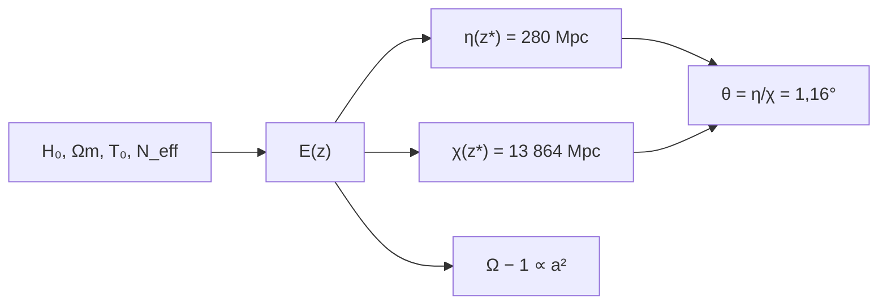

# B40-C04 — Problemas del horizonte y de la planitud

<!-- nav:top -->
[🏠 Programa](../../../../README.md) · [📚 Bloque B40](../../../tronco-comun/B40-universo-temprano-y-radiacion-cosmica-de-fondo.md) · [← Anterior: B40-C03 — Desacoplamiento de neutrinos y fondo cósmico de neutrinos](../B40-C03-desacoplamiento-de-neutrinos-y-fondo-cosmico-de-neutrinos/CLASE.md) · [Siguiente: B40-C05 — Perturbaciones primordiales y espectro escalar →](../B40-C05-perturbaciones-primordiales-y-espectro-escalar/CLASE.md)
<!-- /nav -->

## 1. Ubicación, nivel y alcance

Clase 4 del bloque B40. Nivel N3. Los problemas del horizonte y de la planitud motivan la inflación. Aquí calculas el **horizonte comóvil** y la **distancia comóvil** a la última dispersión en un modelo con radiación, materia y Λ, obtienes el **ángulo causal** y el desvanecimiento de la curvatura, y cuentas los e-pliegues necesarios. Usas [B26](../../../tronco-comun/B26-relatividad-y-cosmologia.md) y [B05](../../../tronco-comun/B05-fisica-fundamental-para-el-espacio.md). Los parámetros se leen del resumen de Planck 2018 VI.

## 2. Por qué esta clase existe

Regiones del fondo separadas más de un grado nunca se comunicaron en el modelo sin inflación, y la curvatura tendría que ser fantásticamente pequeña al principio. La decisión central: **¿qué tan grande es el problema, en números?**

## 3. Lo que podrás hacer al terminar

1. Calcular `Ω_r` desde `T₀` y `N_eff`.
2. Integrar el horizonte y la distancia comóvil con dos variables.
3. Obtener el ángulo causal en `z* = 1090`.
4. Calcular el desvanecimiento de `Ω − 1`.
5. Estimar los e-pliegues necesarios.
6. Comparar con el horizonte analítico de radiación + materia.

La evidencia es la **ficha de horizonte y planitud** del ejercicio 12 (sección 20).

## 4. Con qué llegas y cómo comprobarlo

1. ¿Qué es una incertidumbre?
2. ¿Qué es una simulación Monte Carlo?
3. ¿Qué es una tabla de resultados?
4. ¿Qué es un valor ilustrativo?
5. ¿Qué es una verificación?

<details>
<summary>Ver respuestas</summary>

1. Un intervalo en que se espera el valor verdadero. 2. Repetir con números aleatorios de semilla fija. 3. Un resumen ordenado de cálculos. 4. Un valor propuesto para el ejemplo, no medido. 5. Comparar un cálculo con un caso independiente.
</details>

Con cuatro o cinco aciertos, sigue; si no, repasa los prerrequisitos.

## 5. Un caso de contexto y casos de referencia

Con `H₀ = 67,4` y `Ω_m = 0,315` (Planck 2018 VI, resumen), el horizonte comóvil en `z* = 1090` es `280,11 Mpc` y la distancia es `13 864,3 Mpc`: el ángulo causal es `1,158°`, unos `2450` parches desconectados. Es el **ejemplo conductor**.

## 6. Vocabulario

El **horizonte de partículas** comóvil `η = ∫ c dz/H`. La **distancia comóvil** `χ`. El **ángulo causal** `η/χ`. `Ω − 1` mide la curvatura relativa. El **problema de la planitud**: `Ω − 1` crece con `a²` en la era de radiación. `z_eq` es el corrimiento de la igualdad materia–radiación.

## 7. Modelo mental: dos amigos que nunca se vieron

Como dos personas separadas por más distancia de la que la luz pudo recorrer: parecen coordinadas sin haberse comunicado.



*Descripción textual:* el modelo da el horizonte y la distancia en la recombinación, de cuyo cociente sale el ángulo; la curvatura da los e-pliegues.

Analogía: dos amigos que nunca se vieron. Límite: universo plano, neutrinos sin masa.

## 8. La explicación, paso a paso

### 8.1 Distancias

`Ω_γ = 5,4438 × 10⁻⁵`, `Ω_r = 9,2071 × 10⁻⁵`, `Ω_Λ = 0,6849` y `z_eq = 3420`.

| z | χ (Mpc) | η (Mpc) |
|---|---|---|
| 10 | 9629,3 | 4515,16 |
| 100 | 12 815,1 | 1329,28 |
| 1090 | 13 864,3 | 280,11 |

### 8.2 Ángulo causal

`η*/χ* = 0,02020 rad = 1,158°`, con `(χ*/η*)² = 2450` parches. El horizonte analítico de radiación + materia es `280,11 Mpc` (cociente `1,0000`); con materia pura sería `479,87 Mpc` y el cociente `0,5837`: la radiación no se puede ignorar. La distancia con otra variable de integración coincide (`13 864,3`).

### 8.3 Planitud

Con `Ω_k = 10⁻³` hoy (ilustrativo), el desvío de `Ω` respecto de 1 es `5,99 × 10⁻¹⁹` a `1 MeV` y `5,99 × 10⁻⁵⁷` a `10¹⁶ GeV`. El cociente entre `z` y `10 z` es `100,000`, es decir, proporcional a `a²`. Llevar el desvío de `5,99 × 10⁻⁵⁷` a 1 exige `N = ½ ln(1/d) = 64,7` e-pliegues.

### 8.4 Lectura

El resultado `~65` e-pliegues es del orden de lo que da el ejemplo de la clase 1, pero esa coincidencia depende de la escala de energía elegida (ilustrativa).

## 9. Magnitudes, símbolos y unidades

| Símbolo | Qué es | Unidad | Valor / nota |
|---|---|---|---|
| `η` | horizonte comóvil | Mpc | 280,11 (z = 1090) |
| `χ` | distancia comóvil | Mpc | 13 864,3 |
| `z_eq` | igualdad materia–radiación | — | 3420 |
| `Ω_k` | curvatura | — | 10⁻³ (ilustrativo) |

## 10. Convenciones y referencias

NIST (`k_B`, `ħ`, `c`, `G`), `au` exacta, `Ω_m`, `H₀` de Planck 2018 VI (resumen), `T₀`, `N_eff`; `z* = 1090` adoptado.

## 11. De dónde sale lo que afirmamos

| ID | Fuente | Localizador | Respalda | Estado |
|---|---|---|---|---|
| S1 | NIST, *Fundamental Physical Constants* (CODATA 2022) | https://physics.nist.gov/cuu/Constants/Table/allascii.txt | constantes citadas en la sección 9 | Consultada el 2026-11-09 |
| S2 | Planck Collaboration, *Planck 2018 results. VI. Cosmological parameters* | https://arxiv.org/abs/1807.06209 | H₀ = 67,4 km/s/Mpc, Ωm = 0,315, Ωb h² = 0,0224, Ωc h² = 0,120, n_s = 0,965 y 100θ* = 1,0411 (solo del resumen) | Solo resumen, consultado el 2026-11-09 |
| S3 | Fixsen, *The Temperature of the Cosmic Microwave Background* | https://arxiv.org/abs/0911.1955 | T₀ = 2,72548 ± 0,00057 K (valor de la literatura citado en el resumen; el laboratorio usa 2,7255 K) | Solo resumen, consultado el 2026-11-09 |
| S4 | Bennett et al., *Towards a precision calculation of N_eff in the Standard Model II* | https://arxiv.org/abs/2012.02726 | N_eff = 3,0440 ± 0,0002 del resumen | Solo resumen, consultado el 2026-11-09 |

Límites: S2–S4 son solo resúmenes; `z*`, `Ω_k` y las escalas de energía son ilustrativos.

## 12. Cómo ver las distancias

| z | χ (Mpc) | η (Mpc) |
|---|---|---|
| 10 | 9629,3 | 4515,16 |
| 100 | 12 815,1 | 1329,28 |
| 1090 | 13 864,3 | 280,11 |

Descripción larga: el horizonte baja con z y la distancia sube.

## 13. Ejemplo trabajado: el ángulo causal

**Paso 1 · Cociente.** `280,11/13 864,3 = 0,020203`.

**Paso 2 · Grados.** `0,020203 × 57,2958 = 1,158°`.

**Paso 3 · Parches.** `(13 864,3/280,11)² = 49,50² = 2450`.

## 14. Distintas formas de describir el resultado

**Por integral:** `η`, `χ`. **Por tabla:** distancias. **Por ángulo:** `η/χ`. **Por código:** `horizonte.py`.

## 15. Práctica guiada

**Ejercicio 1 · con los pasos indicados.** Ángulo causal. *Pasos:* ejemplo 13.

<details><summary>Solución comentada</summary>

`1,158°`.
</details>

**Ejercicio 2 · con una pista.** Parches desconectados.

<details><summary>Solución comentada</summary>

`2450`.
</details>

**Ejercicio 3 · casi autónomo.** Razón entre el horizonte de materia pura y el numérico.

<details><summary>Solución comentada</summary>

`479,87/280,11 = 1,713`.
</details>

## 16. Práctica autónoma, transferencia e integrador

**Ejercicio 4.** `z_eq` con `a_eq = Ω_r/Ω_m`.

<details><summary>Solución comentada</summary>

`1/2,923 × 10⁻⁴ − 1 = 3420`.
</details>

**Ejercicio 5.** Cociente de `Ω − 1` entre `z` y `10 z` en radiación.

<details><summary>Solución comentada</summary>

`100`.
</details>

**Ejercicio 6.** Desvío de `Ω` a 1 MeV.

<details><summary>Solución comentada</summary>

`5,99 × 10⁻¹⁹`.
</details>

**Ejercicio 7.** E-pliegues para llevar `5,99 × 10⁻⁵⁷` a 1.

<details><summary>Solución comentada</summary>

`64,7`.
</details>

**Ejercicio 8.** Diferencia de `χ` entre las dos variables.

<details><summary>Solución comentada</summary>

Nula en la precisión impresa.
</details>

**Ejercicio 9 · transferencia.** **Transferencia.** Un compañero dice que 1,16° es el tamaño del primer pico. Responde.

<details><summary>Solución comentada</summary>

Es el ángulo causal sin inflación; el pico depende del horizonte sonoro, otra magnitud.
</details>

**Ejercicio 10 · transferencia.** **Transferencia.** ¿Por qué se usa `a²` para `Ω − 1`?

<details><summary>Solución comentada</summary>

Porque en radiación `(aH)⁻² ∝ a²`.
</details>

**Ejercicio 11 · transferencia.** **Transferencia.** ¿Qué cambia si `Ω_k = 10⁻²`?

<details><summary>Solución comentada</summary>

El desvío se multiplica por 10, pero los e-pliegues solo bajan `½ ln 10 = 1,15`.
</details>

**Ejercicio 12.** **Integrador.** Elabora tu *ficha de horizonte y planitud*: distancias, ángulo causal y e-pliegues.

<details><summary>Solución comentada</summary>

Secciones 8.1–8.4.
</details>

**Ejercicio 12 · integrador.** **Integrador.** Elabora tu *ficha de horizonte y planitud*: distancias, ángulo causal y e-pliegues.

<details><summary>Solución modelo</summary>

Secciones 8.1–8.4.
</details>

## 17. Laboratorio: horizonte y curvatura

El script [horizonte.py](horizonte.py) integra `η` y `χ`, y calcula el desvío de `Ω` (**comprueba** 2 % con el horizonte analítico y 10⁻⁶ entre integrales).

**Datos:** `H₀`, `Ω_m` de un resumen; `T₀`, `N_eff`; `z*`, `Ω_k` y las escalas de energía **ilustrativos**. **Predice antes de ejecutar:** ¿cuántos parches desconectados salen? (≈ 2450.) **Ejecución del 2026-11-09 (Python 3.12.9):**

```text
Python 3.12.9 (biblioteca estandar)
Omega_gamma = 5.4438e-05 ; Omega_r = 9.2071e-05 ; Omega_L = 0.6849 ; Mpc = 3.085678e+22 m
       z    chi [Mpc]    eta [Mpc]
      10       9629.3      4515.16
     100      12815.1      1329.28
    1090      13864.3       280.11
z* = 1090: eta* = 280.11 Mpc ; chi* = 13864.3 Mpc (13864.3 con otra variable)
angulo causal eta*/chi* = 0.02020 rad = 1.158 grados ; (chi*/eta*)^2 = 2450 parches
z_eq = 1/a_eq - 1 = 3420 ; horizonte analitico radiacion + materia = 280.11 Mpc ; cociente numerico/analitico = 1.0000
horizonte de materia pura (sin radiacion) = 479.87 Mpc ; cociente numerico/materia = 0.5837
|Omega - 1| hoy = 1.00e-03 ; a T = 1 MeV (z = 4.258e+09) = 5.99e-19 ; a T = 1e16 GeV (z = 4.258e+28) = 5.99e-57
cociente |Omega-1|(z)/|Omega-1|(10 z) en radiacion = 100.000 (esperado 100: proporcional a a^2)
e-pliegues para llevar |Omega - 1| de 6.0e-57 a 1 antes de inflar: N = (1/2) ln(1/d) = 64.7
Pruebas superadas.
```

```bash
python programa/clases/B40/B40-C04-problemas-del-horizonte-y-de-la-planitud/horizonte.py
```

**Límites:** neutrinos sin masa; sin inflación.

## 18. Errores frecuentes y cómo corregirlos

**Ignorar la radiación en el horizonte.** Se corrige con 8.2.

**Confundir horizonte y distancia.** Se corrige con 8.1.

**Presentar `Ω_k` como medido.** Se corrige con la sección 10.

**Confundir problemas y soluciones.** Se corrige con 8.4.

## 19. Cómo sabrás que vas bien

Tras la sección 8: ¿qué resultado esperabas y cuál obtuviste? Si dudas, repasa el ejemplo 13. Tras el laboratorio: ¿qué comprueba? (ver la sección 17).

## 20. Qué entregas y cómo se evalúa

El producto es tu **ficha de horizonte y planitud** (ejercicio 12).

| Criterio | Inicial | En desarrollo | Logrado | Destacado |
|---|---|---|---|---|
| Conceptos | Los confunde | Parciales | conceptos de la clase | Explica los límites |
| Cálculo | Sin unidades | Con errores | Tablas completas | Calcula casos nuevos |
| Numérico | Sin comprobar | Un caso | Contraste con el análisis | Interpreta las diferencias |
| Fuentes | Sin fuente | Sin fecha | fuentes con fecha | Declara lo ilustrativo |
| Límites | No los nombra | Uno | Tres | Discute qué falta del modelo |

**Condiciones críticas (no se compensan con promedio):** rotular `z*`, `Ω_k` y las escalas como ilustrativos; citar solo lo consultado; no afirmar que la inflación está demostrada.

## 21. Ética, seguridad y límites

Clase educativa: los modelos son simplificados. Accesibilidad: tablas equivalentes a las gráficas, fórmulas en texto, ejercicios sin conexión.

## 22. Para cerrar y seguir

El horizonte comóvil de 280 Mpc frente a 13 864 Mpc deja 1,16° y unos 2450 parches desconectados; hacen falta unos 65 e-pliegues para anular la curvatura. Queda una pregunta: ¿de dónde salen las perturbaciones?

**Glosario español–inglés.** horizonte · *horizon*; planitud · *flatness*; distancia comóvil · *comoving distance*; curvatura · *curvature*; parche causal · *causal patch*.

**Continuidad.** [B40-C05](../B40-C05-perturbaciones-primordiales-y-espectro-escalar/CLASE.md) estudia las perturbaciones primordiales.

**Referencias:** ver sección 11.

<!-- nav:bottom -->
---

[← Anterior: B40-C03 — Desacoplamiento de neutrinos y fondo cósmico de neutrinos](../B40-C03-desacoplamiento-de-neutrinos-y-fondo-cosmico-de-neutrinos/CLASE.md) · [📚 Bloque B40](../../../tronco-comun/B40-universo-temprano-y-radiacion-cosmica-de-fondo.md) · [Siguiente: B40-C05 — Perturbaciones primordiales y espectro escalar →](../B40-C05-perturbaciones-primordiales-y-espectro-escalar/CLASE.md)
<!-- /nav -->
