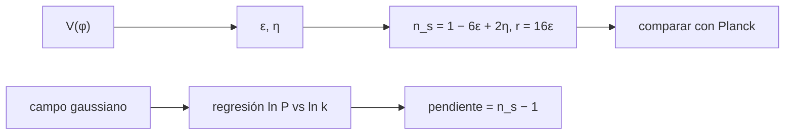

# B40-C05 — Perturbaciones primordiales y espectro escalar

<!-- nav:top -->
[🏠 Programa](../../../../README.md) · [📚 Bloque B40](../../../tronco-comun/B40-universo-temprano-y-radiacion-cosmica-de-fondo.md) · [← Anterior: B40-C04 — Problemas del horizonte y de la planitud](../B40-C04-problemas-del-horizonte-y-de-la-planitud/CLASE.md) · [Siguiente: B40-C06 — Campos escalares en cosmología: potenciales y evolución →](../B40-C06-campos-escalares-en-cosmologia-potenciales-y-evolucion/CLASE.md)
<!-- /nav -->

## 1. Ubicación, nivel y alcance

Clase 5 del bloque B40. Nivel N3. Las fluctuaciones cuánticas durante la inflación siembran un espectro de potencias casi invariante de escala. Aquí calculas `n_s`, `r` y la amplitud de un modelo de rodadura lenta, los comparas con los límites de Planck 2018 X (solo resumen) y recuperas la inclinación de un campo gaussiano sintético. Usas [B12](../../../tronco-comun/B12-probabilidad-estadistica-e-incertidumbre.md), [B26](../../../tronco-comun/B26-relatividad-y-cosmologia.md) y la clase [B40-C01](../B40-C01-inflacion-cosmica-motivacion-y-dinamica-basica/CLASE.md).

## 2. Por qué esta clase existe

El espectro es el vínculo entre la inflación y las anisotropías. La decisión central: **¿qué predice el modelo para `n_s` y `r`, y es compatible con los límites publicados?**

## 3. Lo que podrás hacer al terminar

1. Calcular `ε`, `η`, `n_s`, `r` y `A_s` de un potencial.
2. Verificar `N` por integración.
3. Comparar con los límites de la fuente.
4. Generar un campo gaussiano con espectro inclinado.
5. Recuperar la pendiente por regresión.
6. Interpretar la dispersión de la estimación.

La evidencia es la **ficha del espectro primordial** del ejercicio 12 (sección 20).

## 4. Con qué llegas y cómo comprobarlo

1. ¿Qué es una incertidumbre?
2. ¿Qué es una simulación Monte Carlo?
3. ¿Qué es una tabla de resultados?
4. ¿Qué es un valor ilustrativo?
5. ¿Qué es una verificación?

<details>
<summary>Ver respuestas</summary>

1. Un intervalo en que se espera el valor verdadero. 2. Repetir con números aleatorios de semilla fija. 3. Un resumen ordenado de cálculos. 4. Un valor propuesto para el ejemplo, no medido. 5. Comparar un cálculo con un caso independiente.
</details>

Con cuatro o cinco aciertos, sigue; si no, repasa los prerrequisitos.

## 5. Un caso de contexto y casos de referencia

Para `V = m²φ²/2` con `N = 60`, `n_s = 0,96694` y `r = 0,13223`. Planck 2018 X (resumen) da `n_s = 0,9649 ± 0,0042` y `r < 0,056` (95 %): `n_s` es compatible (`+0,49 σ`), pero `r` es 2,4 veces el límite. Es el **ejemplo conductor**.

## 6. Vocabulario

El **espectro de potencias** `P(k)`. El **índice espectral** `n_s`: `P ∝ k^(n_s − 1)`. La **razón tensor-escalar** `r`. La **amplitud** `A_s`. Los parámetros de rodadura `ε = (V'/V)²/2` y `η = V''/V` (en unidades `M_pl = 1`).

## 7. Modelo mental: una cuerda que vibra

Como una cuerda cuya amplitud de cada armónico es aleatoria pero con una varianza que depende de la frecuencia: el espectro es esa varianza.



*Descripción textual:* el potencial da `n_s` y `r`, que se contrastan con la fuente; un campo sintético recupera la inclinación.

Analogía: una cuerda que vibra. Límite: modos gaussianos independientes.

## 8. La explicación, paso a paso

### 8.1 Predicciones

| N | φ² | n_s | r | m (M_pl) | (n_s − Planck)/σ |
|---|---|---|---|---|---|
| 50 | 202,0 | 0,96040 | 0,15842 | 6,983 × 10⁻⁶ | −1,07 |
| 60 | 242,0 | 0,96694 | 0,13223 | 5,829 × 10⁻⁶ | 0,49 |

`N` por integración de `V/V' dφ` es `60,000000`, igual a `(φ² − 2)/4`. La masa `m` sale de `A_s = 2,1 × 10⁻⁹` (ilustrativa).

### 8.2 Comparación

Con `N = 60`, `r = 0,1322` supera el límite `r < 0,056`: el modelo cuadrático queda **excluido** por los datos citados (solo resumen), aunque `n_s` sea compatible.

### 8.3 Campo gaussiano

Con `139 184` modos independientes por realización y 20 realizaciones, la pendiente de entrada es `−0,03306` y la recuperada `−0,02501 ± 0,01192` (dispersión `0,05329`): compatible a `0,7 σ`.

### 8.4 Lectura

La incertidumbre de la pendiente es del 36 % de su valor: con una caja pequeña no se mide `n_s` a 0,4 %. El campo sintético ilustra el método, no reproduce el análisis de Planck.

## 9. Magnitudes, símbolos y unidades

| Símbolo | Qué es | Unidad | Valor / nota |
|---|---|---|---|
| `n_s` | índice espectral | — | 0,96694 (modelo) |
| `r` | razón tensor-escalar | — | 0,13223 (modelo) |
| `A_s` | amplitud escalar | — | 2,1 × 10⁻⁹ (ilustrativa) |
| `N` | e-pliegues restantes | — | 60 |

## 10. Convenciones y referencias

Unidades `M_pl = 1`; límites de la fuente en el resumen; `A_s` ilustrativa; campo sintético con semilla `20261109`.

## 11. De dónde sale lo que afirmamos

| ID | Fuente | Localizador | Respalda | Estado |
|---|---|---|---|---|
| S1 | Planck Collaboration, *Planck 2018 results. X. Constraints on inflation* | https://arxiv.org/abs/1807.06211 | n_s = 0,9649 ± 0,0042 y r < 0,056 (95 %) del resumen | Solo resumen, consultado el 2026-11-09 |
| S2 | Amplitud A_s | — | valor del orden de lo publicado, no leído | No consultado |

Límites: S1 es solo resumen; `A_s` no se consultó y se rotula como ilustrativa.

## 12. Cómo ver las predicciones

| N | n_s | r |
|---|---|---|
| 50 | 0,96040 | 0,15842 |
| 60 | 0,96694 | 0,13223 |
| Planck (resumen) | 0,9649 ± 0,0042 | < 0,056 |

Descripción larga: `n_s` cae dentro de 1 sigma de Planck, `r` lo excede.

## 13. Ejemplo trabajado: `n_s` y `r` con `N = 60`

**Paso 1 · `φ²`.** `4N + 2 = 242`.

**Paso 2 · `ε`.** `2/242 = 0,008264`.

**Paso 3 · `n_s`.** `1 − 8/242 = 0,96694`.

**Paso 4 · `r`.** `16 ε = 0,13223`.

## 14. Distintas formas de describir el resultado

**Por fórmula:** `ε`, `η`. **Por tabla:** `N`. **Por comparación:** sigma. **Por código:** `espectro.py`.

## 15. Práctica guiada

**Ejercicio 1 · con los pasos indicados.** `ε` con `N = 60`. *Pasos:* ejemplo 13.

<details><summary>Solución comentada</summary>

`0,008264`.
</details>

**Ejercicio 2 · con una pista.** `n_s` con `N = 60`.

<details><summary>Solución comentada</summary>

`0,96694`.
</details>

**Ejercicio 3 · casi autónomo.** `r` con `N = 60`.

<details><summary>Solución comentada</summary>

`0,13223`.
</details>

## 16. Práctica autónoma, transferencia e integrador

**Ejercicio 4.** Distancia de `n_s` a Planck en sigmas.

<details><summary>Solución comentada</summary>

`0,49`.
</details>

**Ejercicio 5.** Factor entre `r` y el límite 0,056.

<details><summary>Solución comentada</summary>

`0,13223/0,056 = 2,36`.
</details>

**Ejercicio 6.** `N` mínimo para `r < 0,056` con `r = 32/(4N + 2)`.

<details><summary>Solución comentada</summary>

`N > 142,4`.
</details>

**Ejercicio 7.** `n_s` en ese `N` (aprox. `1 − 8/571,4`).

<details><summary>Solución comentada</summary>

`0,986`, a `+5,0 σ`.
</details>

**Ejercicio 8.** Comprobar `A_s = V/(24π²ε)` con `V = 4,111 × 10⁻⁹`.

<details><summary>Solución comentada</summary>

`2,1 × 10⁻⁹`.
</details>

**Ejercicio 9 · transferencia.** **Transferencia.** Un compañero dice que Planck demostró `r = 0`. Responde.

<details><summary>Solución comentada</summary>

El resumen da solo un límite superior.
</details>

**Ejercicio 10 · transferencia.** **Transferencia.** ¿Por qué la regresión no mide `n_s` con precisión?

<details><summary>Solución comentada</summary>

Hay pocos modos en la caja: la dispersión es `0,053`.
</details>

**Ejercicio 11 · transferencia.** **Transferencia.** ¿Qué hace `A_s` en el modelo?

<details><summary>Solución comentada</summary>

Fija `m`.
</details>

**Ejercicio 12.** **Integrador.** Elabora tu *ficha del espectro primordial*: `n_s`, `r`, comparación y regresión.

<details><summary>Solución comentada</summary>

Secciones 8.1–8.4.
</details>

**Ejercicio 12 · integrador.** **Integrador.** Elabora tu *ficha del espectro primordial*: `n_s`, `r`, comparación y regresión.

<details><summary>Solución modelo</summary>

Secciones 8.1–8.4.
</details>

## 17. Laboratorio: espectro de rodadura lenta

El script [espectro.py](espectro.py) calcula `n_s`, `r` y recupera una pendiente (**comprueba** 3 errores estándar).

**Datos:** `n_s` y `r` de un resumen (2026-11-09); `A_s` y el campo **ilustrativos**. **Predice antes de ejecutar:** ¿es compatible `r`? (no: 2,4 veces el límite.) **Ejecución del 2026-11-09 (Python 3.12.9):**

```text
Python 3.12.9 (biblioteca estandar)
   N   phi^2      n_s        r    m [M_pl]  (n_s-Planck)/sigma
  50   202.0  0.96040  0.15842   6.983e-06               -1.07
  60   242.0  0.96694  0.13223   5.829e-06                0.49
N por integral de V/V' dphi = 60.000000 ; (phi^2 - 2)/4 = 60.000000
modelo con N = 60: r = 0.1322 frente al limite r < 0.056 (95 %): excluido ; n_s consistente con Planck a +0.49 sigma
modos independientes por realizacion = 139184
pendiente (n_s - 1) de entrada = -0.03306 ; recuperada (20 realizaciones) = -0.02501 +- 0.01192 (dispersion 0.05329)
Pruebas superadas.
```

```bash
python programa/clases/B40/B40-C05-perturbaciones-primordiales-y-espectro-escalar/espectro.py
```

**Límites:** modos gaussianos independientes.

## 18. Errores frecuentes y cómo corregirlos

**Concluir sobre `r` con un modelo de juguete.** Se corrige con 8.2.

**Atribuir `A_s` a Planck.** Se corrige con la sección 11.

**Esperar una pendiente precisa con pocos modos.** Se corrige con 8.3.

**Confundir `ε` y `η`.** Se corrige con la sección 6.

## 19. Cómo sabrás que vas bien

Tras la sección 8: ¿qué resultado esperabas y cuál obtuviste? Si dudas, repasa el ejemplo 13. Tras el laboratorio: ¿qué comprueba? (ver la sección 17).

## 20. Qué entregas y cómo se evalúa

El producto es tu **ficha del espectro primordial** (ejercicio 12).

| Criterio | Inicial | En desarrollo | Logrado | Destacado |
|---|---|---|---|---|
| Conceptos | Los confunde | Parciales | conceptos de la clase | Explica los límites |
| Cálculo | Sin unidades | Con errores | Tablas completas | Calcula casos nuevos |
| Numérico | Sin comprobar | Un caso | Contraste con el análisis | Interpreta las diferencias |
| Fuentes | Sin fuente | Sin fecha | fuentes con fecha | Declara lo ilustrativo |
| Límites | No los nombra | Uno | Tres | Discute qué falta del modelo |

**Condiciones críticas (no se compensan con promedio):** rotular `A_s` y el campo como ilustrativos; citar la fuente con la leyenda «solo resumen»; no emitir conclusiones cosmológicas.

## 21. Ética, seguridad y límites

Clase educativa: los modelos son simplificados. Accesibilidad: tablas equivalentes a las gráficas, fórmulas en texto, ejercicios sin conexión.

## 22. Para cerrar y seguir

El modelo cuadrático da `n_s = 0,967` y `r = 0,132`: `n_s` coincide con Planck a 0,5 σ y `r` supera el límite del resumen. Queda una pregunta: ¿cómo se describen los campos escalares en general?

**Glosario español–inglés.** espectro de potencias · *power spectrum*; índice espectral · *spectral index*; razón tensor-escalar · *tensor-to-scalar ratio*; amplitud · *amplitude*.

**Continuidad.** [B40-C06](../B40-C06-campos-escalares-en-cosmologia-potenciales-y-evolucion/CLASE.md) estudia los campos escalares en cosmología.

**Referencias:** ver sección 11.

<!-- nav:bottom -->
---

[← Anterior: B40-C04 — Problemas del horizonte y de la planitud](../B40-C04-problemas-del-horizonte-y-de-la-planitud/CLASE.md) · [📚 Bloque B40](../../../tronco-comun/B40-universo-temprano-y-radiacion-cosmica-de-fondo.md) · [Siguiente: B40-C06 — Campos escalares en cosmología: potenciales y evolución →](../B40-C06-campos-escalares-en-cosmologia-potenciales-y-evolucion/CLASE.md)
<!-- /nav -->
