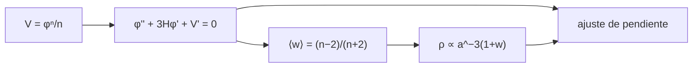

# B40-C06 — Campos escalares en cosmología: potenciales y evolución

<!-- nav:top -->
[🏠 Programa](../../../../README.md) · [📚 Bloque B40](../../../tronco-comun/B40-universo-temprano-y-radiacion-cosmica-de-fondo.md) · [← Anterior: B40-C05 — Perturbaciones primordiales y espectro escalar](../B40-C05-perturbaciones-primordiales-y-espectro-escalar/CLASE.md) · [Siguiente: B40-C07 — Espectro angular de potencias del CMB →](../B40-C07-espectro-angular-de-potencias-del-cmb/CLASE.md)
<!-- /nav -->

## 1. Ubicación, nivel y alcance

Clase 6 del bloque B40. Nivel N3. Un campo escalar puede ser el inflatón, la quintaesencia o el contenido oscilante tras la inflación. Aquí integras la ecuación de **Klein-Gordon** en potenciales `V = φⁿ/n`, mides la **ecuación de estado media** y la **dilución** con la expansión, y las comparas con el teorema del virial. Usas [B26](../../../tronco-comun/B26-relatividad-y-cosmologia.md) y [B05](../../../tronco-comun/B05-fisica-fundamental-para-el-espacio.md). Los potenciales son ilustrativos.

## 2. Por qué esta clase existe

La ecuación de estado de un campo decide cómo se diluye y qué domina el universo. La decisión central: **¿qué `w` promedio y qué ley de dilución tiene un campo que oscila en `V ∝ φⁿ`?**

## 3. Lo que podrás hacer al terminar

1. Escribir `φ'' + 3Hφ' + V' = 0` y la densidad `ρ`.
2. Integrar con Runge-Kutta.
3. Calcular `w = (K − V)/(K + V)` y su media.
4. Aplicar el virial `⟨w⟩ = (n − 2)/(n + 2)`.
5. Ajustar la pendiente de dilución `−6n/(n + 2)`.
6. Reconocer el campo congelado como constante cosmológica.

La evidencia es la **ficha de campos escalares** del ejercicio 12 (sección 20).

## 4. Con qué llegas y cómo comprobarlo

1. ¿Qué es una incertidumbre?
2. ¿Qué es una simulación Monte Carlo?
3. ¿Qué es una tabla de resultados?
4. ¿Qué es un valor ilustrativo?
5. ¿Qué es una verificación?

<details>
<summary>Ver respuestas</summary>

1. Un intervalo en que se espera el valor verdadero. 2. Repetir con números aleatorios de semilla fija. 3. Un resumen ordenado de cálculos. 4. Un valor propuesto para el ejemplo, no medido. 5. Comparar un cálculo con un caso independiente.
</details>

Con cuatro o cinco aciertos, sigue; si no, repasa los prerrequisitos.

## 5. Un caso de contexto y casos de referencia

Sin expansión, `n = 2` da `⟨w⟩ = 0,00002`, `n = 4` da `0,33335` y `n = 6` da `0,50002`. Con `H = 2/(3t)` la energía cae como `a^−2,9999`, `a^−3,9997` y `a^−4,5001`. Es el **ejemplo conductor**. Es un campo de prueba, sin gravedad propia.

## 6. Vocabulario

El **campo escalar** `φ`. La **energía cinética** `K = φ̇²/2` y la **potencial** `V`. La **ecuación de estado** `w = p/ρ = (K − V)/(K + V)`. El **teorema del virial**: `⟨K⟩ = (n/2)⟨V⟩`. La **fricción de Hubble** `3Hφ̇`.

## 7. Modelo mental: un péndulo con fricción variable

Como un péndulo cuyo rozamiento cambia con el tiempo: oscila y pierde amplitud, y la forma del pozo decide cuánto pesa la energía cinética frente a la potencial.



*Descripción textual:* el potencial y la fricción dan oscilaciones cuyo promedio fija `w` y la dilución, que se ajustan numéricamente.

Analogía: un péndulo con fricción variable. Límite: campo de prueba sin retroacción.

## 8. La explicación, paso a paso

### 8.1 Promedios y dilución

| n | ⟨w⟩ numérico | (n−2)/(n+2) | pendiente numérica | −6n/(n+2) | máximos |
|---|---|---|---|---|---|
| 2 | 0,00002 | 0,00000 | −2,9999 | −3,0000 | 948 |
| 4 | 0,33335 | 0,33333 | −3,9997 | −4,0000 | 69 |
| 6 | 0,50002 | 0,50000 | −4,5001 | −4,5000 | 23 |

### 8.2 Campo casi congelado

| K/V | w |
|---|---|
| 0,00 | −1,0000 |
| 0,01 | −0,9802 |
| 0,10 | −0,8182 |
| 1,00 | 0,0000 |

### 8.3 Lectura

`n = 2` se diluye como materia (`a⁻³`), `n = 4` como radiación (`a⁻⁴`) y `n = 6` más rápido que la radiación. Un campo con `K ≪ V` imita una constante cosmológica (`w → −1`). El promedio solo es válido si la oscilación es rápida frente a `H`.

## 9. Magnitudes, símbolos y unidades

| Símbolo | Qué es | Unidad | Valor / nota |
|---|---|---|---|
| `w` | ecuación de estado | — | ver 8.1 |
| `n` | exponente del potencial | — | 2, 4, 6 |
| `K`, `V` | energías cinética y potencial | unidades de `m` | — |
| `H` | parámetro de Hubble | 1/t | `2/(3t)` prescrito |

## 10. Convenciones y referencias

Unidades adimensionales (`m = 1`); potenciales y amplitud `φ₀ = 1` ilustrativos; RK4 con pasos 0,002 y 0,005.

## 11. De dónde sale lo que afirmamos

| ID | Fuente | Localizador | Respalda | Estado |
|---|---|---|---|---|
| — | Sin fuente externa | — | relaciones estándar que verifica el laboratorio | No se consultó una fuente para esta clase |

Límites: no se consultó ninguna fuente; el virial es una relación estándar que el laboratorio verifica.

## 12. Cómo ver las ecuaciones de estado

| n | ⟨w⟩ | exponente |
|---|---|---|
| 2 | 0 | −3 |
| 4 | 1/3 | −4 |
| 6 | 1/2 | −4,5 |

Descripción larga: el exponente de dilución sigue a la ecuación de estado.

## 13. Ejemplo trabajado: `⟨w⟩` con `n = 4`

**Paso 1 · Virial.** `⟨K⟩ = (n/2)⟨V⟩ = 2⟨V⟩`.

**Paso 2 · `w`.** `(2V − V)/(2V + V) = 1/3`.

**Paso 3 · Dilución.** `3(1 + w) = 4`.

**Paso 4 · Comparación.** Numérico: `0,33335` y pendiente `−3,9997`.

## 14. Distintas formas de describir el resultado

**Por ecuación:** Klein-Gordon. **Por teorema:** virial. **Por tabla:** pendientes. **Por código:** `klein_gordon.py`.

## 15. Práctica guiada

**Ejercicio 1 · con los pasos indicados.** `⟨w⟩` para `n = 4`. *Pasos:* ejemplo 13.

<details><summary>Solución comentada</summary>

`1/3`.
</details>

**Ejercicio 2 · con una pista.** Exponente de dilución para `n = 2`.

<details><summary>Solución comentada</summary>

`3`.
</details>

**Ejercicio 3 · casi autónomo.** `⟨w⟩` para `n = 6`.

<details><summary>Solución comentada</summary>

`1/2`.
</details>

## 16. Práctica autónoma, transferencia e integrador

**Ejercicio 4.** `w` con `K/V = 0,1`.

<details><summary>Solución comentada</summary>

`−0,8182`.
</details>

**Ejercicio 5.** `w` con `K/V = 0,01`.

<details><summary>Solución comentada</summary>

`−0,9802`.
</details>

**Ejercicio 6.** Factor de dilución para `n = 4` al duplicar `a`.

<details><summary>Solución comentada</summary>

`2⁻⁴ = 1/16`.
</details>

**Ejercicio 7.** Razón de densidades `n = 6` / `n = 2` tras `a × 10`.

<details><summary>Solución comentada</summary>

`10^−1,5 = 0,0316`.
</details>

**Ejercicio 8.** ¿Qué `K/V` da `w = 0`?

<details><summary>Solución comentada</summary>

`1`.
</details>

**Ejercicio 9 · transferencia.** **Transferencia.** ¿Por qué `n = 2` actúa como materia?

<details><summary>Solución comentada</summary>

Porque `⟨w⟩ = 0`.
</details>

**Ejercicio 10 · transferencia.** **Transferencia.** ¿Qué condición exige el promedio?

<details><summary>Solución comentada</summary>

Oscilación rápida frente a `H`.
</details>

**Ejercicio 11 · transferencia.** **Transferencia.** Un compañero dice que el campo gravita en el laboratorio. Responde.

<details><summary>Solución comentada</summary>

No: `H` es prescrito.
</details>

**Ejercicio 12.** **Integrador.** Elabora tu *ficha de campos escalares*: ecuación, `⟨w⟩`, pendientes y límites.

<details><summary>Solución comentada</summary>

Secciones 8.1–8.3.
</details>

**Ejercicio 12 · integrador.** **Integrador.** Elabora tu *ficha de campos escalares*: ecuación, `⟨w⟩`, pendientes y límites.

<details><summary>Solución modelo</summary>

Secciones 8.1–8.3.
</details>

## 17. Laboratorio: oscilaciones y dilución

El script [klein_gordon.py](klein_gordon.py) integra Klein-Gordon con y sin expansión (**comprueba** `⟨w⟩` a `2 × 10⁻³` y la pendiente al 2 %).

**Datos:** sin constantes; potenciales **ilustrativos**. **Predice antes de ejecutar:** ¿qué `w` saldrá para `n = 4`? (1/3.) **Ejecución del 2026-11-09 (Python 3.12.9):**

```text
Python 3.12.9 (biblioteca estandar)
  n  <w> numerico  (n-2)/(n+2)  pend. numerica  -6n/(n+2)  maximos
  2       0.00002      0.00000         -2.9999    -3.0000      948
  4       0.33335      0.33333         -3.9997    -4.0000       69
  6       0.50002      0.50000         -4.5001    -4.5000       23
K/V =  0.00 -> w = -1.0000
K/V =  0.01 -> w = -0.9802
K/V =  0.10 -> w = -0.8182
K/V =  1.00 -> w = +0.0000
Pruebas superadas.
```

```bash
python programa/clases/B40/B40-C06-campos-escalares-en-cosmologia-potenciales-y-evolucion/klein_gordon.py
```

**Límites:** campo de prueba, sin interacción.

## 18. Errores frecuentes y cómo corregirlos

**Usar `w` instantáneo en lugar del promedio.** Se corrige con 8.1.

**Olvidar la fricción de Hubble.** Se corrige con 8.3.

**Creer que todo campo se diluye como materia.** Se corrige con 8.1.

**Dar el campo por real.** Se corrige con la sección 10.

## 19. Cómo sabrás que vas bien

Tras la sección 8: ¿qué resultado esperabas y cuál obtuviste? Si dudas, repasa el ejemplo 13. Tras el laboratorio: ¿qué comprueba? (ver la sección 17).

## 20. Qué entregas y cómo se evalúa

El producto es tu **ficha de campos escalares** (ejercicio 12).

| Criterio | Inicial | En desarrollo | Logrado | Destacado |
|---|---|---|---|---|
| Conceptos | Los confunde | Parciales | conceptos de la clase | Explica los límites |
| Cálculo | Sin unidades | Con errores | Tablas completas | Calcula casos nuevos |
| Numérico | Sin comprobar | Un caso | Contraste con el análisis | Interpreta las diferencias |
| Fuentes | Sin fuente | Sin fecha | fuentes con fecha | Declara lo ilustrativo |
| Límites | No los nombra | Uno | Tres | Discute qué falta del modelo |

**Condiciones críticas (no se compensan con promedio):** rotular potenciales como ilustrativos; no presentar el campo de prueba como universo completo; citar solo lo consultado.

## 21. Ética, seguridad y límites

Clase educativa: los modelos son simplificados. Accesibilidad: tablas equivalentes a las gráficas, fórmulas en texto, ejercicios sin conexión.

## 22. Para cerrar y seguir

Un campo oscilante en `φⁿ` tiene `⟨w⟩ = (n − 2)/(n + 2)` y se diluye como `a^(−6n/(n+2))`; el laboratorio lo verifica a `10⁻³`. Queda una pregunta: ¿cómo se ven esas semillas en el cielo?

**Glosario español–inglés.** campo escalar · *scalar field*; ecuación de estado · *equation of state*; virial · *virial theorem*; Klein-Gordon · *Klein-Gordon*.

**Continuidad.** [B40-C07](../B40-C07-espectro-angular-de-potencias-del-cmb/CLASE.md) estudia el espectro angular de potencias del CMB.

**Referencias:** ver sección 11.

<!-- nav:bottom -->
---

[← Anterior: B40-C05 — Perturbaciones primordiales y espectro escalar](../B40-C05-perturbaciones-primordiales-y-espectro-escalar/CLASE.md) · [📚 Bloque B40](../../../tronco-comun/B40-universo-temprano-y-radiacion-cosmica-de-fondo.md) · [Siguiente: B40-C07 — Espectro angular de potencias del CMB →](../B40-C07-espectro-angular-de-potencias-del-cmb/CLASE.md)
<!-- /nav -->
