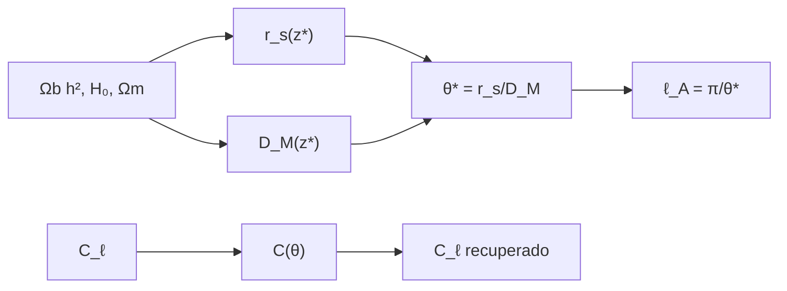

# B40-C07 — Espectro angular de potencias del CMB

<!-- nav:top -->
[🏠 Programa](../../../../README.md) · [📚 Bloque B40](../../../tronco-comun/B40-universo-temprano-y-radiacion-cosmica-de-fondo.md) · [← Anterior: B40-C06 — Campos escalares en cosmología: potenciales y evolución](../B40-C06-campos-escalares-en-cosmologia-potenciales-y-evolucion/CLASE.md) · [Siguiente: B40-C08 — Polarización E y B del fondo cósmico →](../B40-C08-polarizacion-e-y-b-del-fondo-cosmico/CLASE.md)
<!-- /nav -->

## 1. Ubicación, nivel y alcance

Clase 7 del bloque B40. Nivel N3. El espectro angular `C_ℓ` describe cuánto varía la temperatura del fondo entre direcciones. Aquí calculas la **escala acústica** `θ* = r_s/D_M` con ΛCDM y la comparas con el valor de Planck 2018 VI (solo resumen), y verificas la **transformada de Legendre** entre la correlación angular y `C_ℓ` con un espectro de juguete. Usas [B26](../../../tronco-comun/B26-relatividad-y-cosmologia.md), [B10](../../../tronco-comun/B10-algebra-lineal-y-matematicas-geometricas.md) y [B05](../../../tronco-comun/B05-fisica-fundamental-para-el-espacio.md). El espectro de juguete es ilustrativo.

## 2. Por qué esta clase existe

Los picos acústicos fijan la geometría y el contenido del universo. La decisión central: **¿dónde caen los picos (`ℓ_A = π/θ*`) y cómo se pasa del espectro a la correlación y de vuelta?**

## 3. Lo que podrás hacer al terminar

1. Integrar el horizonte sonoro `r_s` y la distancia `D_M`.
2. Calcular `θ*` y `ℓ_A`.
3. Comparar con `100θ* = 1,0411` (resumen).
4. Construir `C(θ)` desde `C_ℓ` con polinomios de Legendre.
5. Recuperar `C_ℓ` con Gauss-Legendre.
6. Ubicar picos en `nℓ_A`.

La evidencia es la **ficha del espectro angular** del ejercicio 12 (sección 20).

## 4. Con qué llegas y cómo comprobarlo

1. ¿Qué es una incertidumbre?
2. ¿Qué es una simulación Monte Carlo?
3. ¿Qué es una tabla de resultados?
4. ¿Qué es un valor ilustrativo?
5. ¿Qué es una verificación?

<details>
<summary>Ver respuestas</summary>

1. Un intervalo en que se espera el valor verdadero. 2. Repetir con números aleatorios de semilla fija. 3. Un resumen ordenado de cálculos. 4. Un valor propuesto para el ejemplo, no medido. 5. Comparar un cálculo con un caso independiente.
</details>

Con cuatro o cinco aciertos, sigue; si no, repasa los prerrequisitos.

## 5. Un caso de contexto y casos de referencia

Con `Ω_b h² = 0,0224`, `H₀ = 67,4` y `z* = 1090`, el laboratorio obtiene `100θ* = 1,0404` (Planck: `1,0411 ± 0,0003`, resumen) y `ℓ_A = 302,0`. Es el **ejemplo conductor**. El espectro de juguete tiene picos en `302` y `604`.

## 6. Vocabulario

El **espectro angular** `C_ℓ`. El **horizonte sonoro** `r_s`. La **distancia comóvil** `D_M`. La **escala acústica** `θ* = r_s/D_M`. Los **polinomios de Legendre** `P_ℓ`. La **razón bariones–fotones** `R`.

## 7. Modelo mental: un tambor

Como un tambor: los modos de vibración fijan las notas (picos), y la caja (la geometría) fija a qué ángulo se oyen.



*Descripción textual:* los parámetros dan la escala acústica y, por separado, un espectro de juguete se transforma a correlación y vuelve.

Analogía: un tambor. Límite: plasma sin retroceso, recombinación instantánea.

## 8. La explicación, paso a paso

### 8.1 Escala acústica

`Ω_b = 0,04931`, `R(z*) = 0,6227`, `D_M = 13 864,3 Mpc` y `r_s = 144,24 Mpc`. Entonces `100θ* = 1,0404`, `−0,07 %` respecto de `1,0411` (Planck, solo resumen), y `ℓ_A = 302,0`.

### 8.2 Espectro de juguete

`D_ℓ = ℓ(ℓ+1)C_ℓ/2π = 1 + 3 cos²(πℓ/ℓ_A)`.

| ℓ | C_ℓ entrada | C_ℓ recuperado | D_ℓ |
|---|---|---|---|
| 2 | 4,187430 | 4,187430 | 3,9987 |
| 10 | 0,2266314 | 0,2266314 | 3,9676 |
| 100 | 1,099733 × 10⁻³ | 1,099733 × 10⁻³ | 1,7678 |
| 302 | 2,746567 × 10⁻⁴ | 2,746567 × 10⁻⁴ | 4,0000 |
| 450 | 3,104668 × 10⁻⁵ | 3,104668 × 10⁻⁵ | 1,0028 |
| 604 | 6,877766 × 10⁻⁵ | 6,877766 × 10⁻⁵ | 4,0000 |
| 700 | 2,403692 × 10⁻⁵ | 2,403692 × 10⁻⁵ | 1,8772 |

El error relativo máximo de la ida y vuelta es `1,6 × 10⁻¹⁰` y los picos caen en `ℓ = 302` y `604`.

### 8.3 Lectura

El acuerdo del `0,07 %` con el resumen de Planck valida la cadena de cálculo de distancias, no los datos. El espectro de juguete solo muestra la ubicación de los picos: no tiene amortiguamiento ni alturas realistas.

## 9. Magnitudes, símbolos y unidades

| Símbolo | Qué es | Unidad | Valor / nota |
|---|---|---|---|
| `θ*` | escala angular acústica | rad | 0,010404 |
| `ℓ_A` | multipolo acústico | — | 302,0 |
| `r_s` | horizonte sonoro | Mpc | 144,24 |
| `D_M` | distancia comóvil | Mpc | 13 864,3 |

## 10. Convenciones y referencias

NIST (`k_B`, `ħ`, `c`, `G`), `au` exacta; `H₀`, `Ω_m`, `Ω_b h²`, `100θ*` de Planck 2018 VI (resumen); `T₀`, `N_eff`; `z* = 1090` adoptado; espectro de juguete **ilustrativo**.

## 11. De dónde sale lo que afirmamos

| ID | Fuente | Localizador | Respalda | Estado |
|---|---|---|---|---|
| S1 | NIST, *Fundamental Physical Constants* (CODATA 2022) | https://physics.nist.gov/cuu/Constants/Table/allascii.txt | constantes citadas en la sección 9 | Consultada el 2026-11-09 |
| S2 | Planck Collaboration, *Planck 2018 results. VI. Cosmological parameters* | https://arxiv.org/abs/1807.06209 | H₀ = 67,4 km/s/Mpc, Ωm = 0,315, Ωb h² = 0,0224, Ωc h² = 0,120, n_s = 0,965 y 100θ* = 1,0411 (solo del resumen) | Solo resumen, consultado el 2026-11-09 |
| S3 | Fixsen, *The Temperature of the Cosmic Microwave Background* | https://arxiv.org/abs/0911.1955 | T₀ = 2,72548 ± 0,00057 K (valor de la literatura citado en el resumen; el laboratorio usa 2,7255 K) | Solo resumen, consultado el 2026-11-09 |
| S4 | Bennett et al., *Towards a precision calculation of N_eff in the Standard Model II* | https://arxiv.org/abs/2012.02726 | N_eff = 3,0440 ± 0,0002 del resumen | Solo resumen, consultado el 2026-11-09 |

Límites: S2–S4 son solo resúmenes; no se consultó ningún `C_ℓ` real.

## 12. Cómo ver los picos

| ℓ | D_ℓ |
|---|---|
| 2 | 3,9987 |
| 100 | 1,7678 |
| 302 | 4,0000 |
| 450 | 1,0028 |
| 604 | 4,0000 |

Descripción larga: picos en 302 y 604 con un valle en 450.

## 13. Ejemplo trabajado: `θ*` y `ℓ_A`

**Paso 1 · Cociente.** `θ* = 144,24/13 864,3 = 0,010404`.

**Paso 2 · Planck.** `100θ* = 1,0404` frente a `1,0411`.

**Paso 3 · Multipolo.** `ℓ_A = π/0,010404 = 302,0`.

**Paso 4 · Picos.** `ℓ = 302` y `604`.

## 14. Distintas formas de describir el resultado

**Por integral:** `r_s`, `D_M`. **Por tabla:** `D_ℓ`. **Por transformada:** Legendre. **Por código:** `escala_acustica.py`.

## 15. Práctica guiada

**Ejercicio 1 · con los pasos indicados.** `100θ*`. *Pasos:* `144,24/13 864,3 × 100`.

<details><summary>Solución comentada</summary>

`1,0404`.
</details>

**Ejercicio 2 · con una pista.** `ℓ_A`. *Pasos:* ejemplo 13.

<details><summary>Solución comentada</summary>

`302,0`.
</details>

**Ejercicio 3 · casi autónomo.** `ℓ_A` con `100θ* = 1,0411`.

<details><summary>Solución comentada</summary>

`301,8`.
</details>

## 16. Práctica autónoma, transferencia e integrador

**Ejercicio 4.** Diferencia relativa con Planck.

<details><summary>Solución comentada</summary>

`−0,07 %`.
</details>

**Ejercicio 5.** `c_s/c` con `R = 0,6227`.

<details><summary>Solución comentada</summary>

`1/√(3 × 1,6227) = 0,4532`.
</details>

**Ejercicio 6.** `C_2` con `D_2 = 3,9987`.

<details><summary>Solución comentada</summary>

`2π × 3,9987/6 = 4,1874`.
</details>

**Ejercicio 7.** Posición del segundo pico.

<details><summary>Solución comentada</summary>

`2ℓ_A = 604`.
</details>

**Ejercicio 8.** Valor de `D_ℓ` en el valle `ℓ = 450`.

<details><summary>Solución comentada</summary>

`1,0028`.
</details>

**Ejercicio 9 · transferencia.** **Transferencia.** Un compañero dice que el laboratorio reproduce el espectro de Planck. Responde.

<details><summary>Solución comentada</summary>

Solo reproduce `θ*`; el espectro es de juguete.
</details>

**Ejercicio 10 · transferencia.** **Transferencia.** ¿Por qué se usa Gauss-Legendre?

<details><summary>Solución comentada</summary>

Integra exactamente polinomios hasta grado `2n − 1`.
</details>

**Ejercicio 11 · transferencia.** **Transferencia.** ¿Qué pasa si `Ω_b h²` sube?

<details><summary>Solución comentada</summary>

`R` sube, `c_s` baja y `r_s` disminuye.
</details>

**Ejercicio 12.** **Integrador.** Elabora tu *ficha del espectro angular*: `θ*`, `ℓ_A`, picos y ida y vuelta.

<details><summary>Solución comentada</summary>

Secciones 8.1–8.3.
</details>

**Ejercicio 12 · integrador.** **Integrador.** Elabora tu *ficha del espectro angular*: `θ*`, `ℓ_A`, picos y ida y vuelta.

<details><summary>Solución modelo</summary>

Secciones 8.1–8.3.
</details>

## 17. Laboratorio: escala acústica y transformada de Legendre

El script [escala_acustica.py](escala_acustica.py) calcula `θ*` y la ida y vuelta entre `C_ℓ` y `C(θ)` (**comprueba** 1 % con el resumen y `10⁻⁹` en la ida y vuelta).

**Datos:** constantes de NIST; parámetros de un resumen; `z*` y espectro de juguete **ilustrativos**. **Predice antes de ejecutar:** ¿dónde caerá el primer pico? (ℓ ≈ 302.) **Ejecución del 2026-11-09 (Python 3.12.9):**

```text
Python 3.12.9 (biblioteca estandar)
Omega_b = 0.04931 ; R(z*) = 0.6227 ; D_M(z*) = 13864.3 Mpc ; r_s(z*) = 144.24 Mpc
100 theta_* = 1.0404 (Planck 2018 VI: 1.0411 +- 0.0003) ; diferencia relativa = -0.07 % ; l_A = pi/theta_* = 302.0
    l   C_l entrada  C_l recuperado  D_l = l(l+1)C_l/2pi
    2  4.187430e+00    4.187430e+00               3.9987
   10  2.266314e-01    2.266314e-01               3.9676
  100  1.099733e-03    1.099733e-03               1.7678
  302  2.746567e-04    2.746567e-04               4.0000
  450  3.104668e-05    3.104668e-05               1.0028
  604  6.877766e-05    6.877766e-05               4.0000
  700  2.403692e-05    2.403692e-05               1.8772
picos del espectro de juguete en l = [302, 604] (esperado n l_A = 302, 604); maximo error relativo de la ida y vuelta = 1.58e-10
Pruebas superadas.
```

```bash
python programa/clases/B40/B40-C07-espectro-angular-de-potencias-del-cmb/escala_acustica.py
```

**Límites:** plasma sin retroceso, sin Silk.

## 18. Errores frecuentes y cómo corregirlos

**Llamar espectro real al de juguete.** Se corrige con 8.2.

**Olvidar `R` en `c_s`.** Se corrige con el ejemplo 13.

**Confundir `ℓ_A` con el pico observado.** Se corrige con la sección 6.

**Usar un `z*` sin rotularlo.** Se corrige con la sección 10.

## 19. Cómo sabrás que vas bien

Tras la sección 8: ¿qué resultado esperabas y cuál obtuviste? Si dudas, repasa el ejemplo 13. Tras el laboratorio: ¿qué comprueba? (ver la sección 17).

## 20. Qué entregas y cómo se evalúa

El producto es tu **ficha del espectro angular** (ejercicio 12).

| Criterio | Inicial | En desarrollo | Logrado | Destacado |
|---|---|---|---|---|
| Conceptos | Los confunde | Parciales | conceptos de la clase | Explica los límites |
| Cálculo | Sin unidades | Con errores | Tablas completas | Calcula casos nuevos |
| Numérico | Sin comprobar | Un caso | Contraste con el análisis | Interpreta las diferencias |
| Fuentes | Sin fuente | Sin fecha | fuentes con fecha | Declara lo ilustrativo |
| Límites | No los nombra | Uno | Tres | Discute qué falta del modelo |

**Condiciones críticas (no se compensan con promedio):** rotular el espectro como de juguete; citar los valores de Planck como solo resumen; no presentar `θ*` calculado como medición.

## 21. Ética, seguridad y límites

Clase educativa: los modelos son simplificados. Accesibilidad: tablas equivalentes a las gráficas, fórmulas en texto, ejercicios sin conexión.

## 22. Para cerrar y seguir

El cálculo da `100θ* = 1,0404`, un 0,07 % por debajo del resumen de Planck, y `ℓ_A = 302`; la transformada de Legendre recupera `C_ℓ` a `10⁻¹⁰`. Queda una pregunta: ¿cómo se descompone la polarización?

**Glosario español–inglés.** escala acústica · *acoustic scale*; horizonte sonoro · *sound horizon*; espectro angular · *angular power spectrum*; polinomio de Legendre · *Legendre polynomial*.

**Continuidad.** [B40-C08](../B40-C08-polarizacion-e-y-b-del-fondo-cosmico/CLASE.md) estudia la polarización E y B.

**Referencias:** ver sección 11.

<!-- nav:bottom -->
---

[← Anterior: B40-C06 — Campos escalares en cosmología: potenciales y evolución](../B40-C06-campos-escalares-en-cosmologia-potenciales-y-evolucion/CLASE.md) · [📚 Bloque B40](../../../tronco-comun/B40-universo-temprano-y-radiacion-cosmica-de-fondo.md) · [Siguiente: B40-C08 — Polarización E y B del fondo cósmico →](../B40-C08-polarizacion-e-y-b-del-fondo-cosmico/CLASE.md)
<!-- /nav -->
