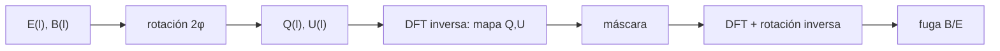

# B40-C08 — Polarización E y B del fondo cósmico

<!-- nav:top -->
[🏠 Programa](../../../../README.md) · [📚 Bloque B40](../../../tronco-comun/B40-universo-temprano-y-radiacion-cosmica-de-fondo.md) · [← Anterior: B40-C07 — Espectro angular de potencias del CMB](../B40-C07-espectro-angular-de-potencias-del-cmb/CLASE.md) · [Siguiente: B40-C09 — Efecto Sachs-Wolfe y efecto Sachs-Wolfe integrado →](../B40-C09-efecto-sachs-wolfe-y-efecto-sachs-wolfe-integrado/CLASE.md)
<!-- /nav -->

## 1. Ubicación, nivel y alcance

Clase 8 del bloque B40. Nivel N3. La polarización lineal del fondo se descompone en un modo **E** (de gradiente) y un modo **B** (de rotacional). Aquí lo haces en la **aproximación de cielo plano** con una malla periódica de `32 × 32`: sintetizas mapas `Q`/`U` de E puro y B puro, recuperas ambos modos y mides la **fuga E → B** de una máscara dura y de una apodizada. Usas [B10](../../../tronco-comun/B10-algebra-lineal-y-matematicas-geometricas.md), [B42](../../../tronco-comun/B42-optica-fisica-y-optica-adaptativa.md) y [B15](../../../tronco-comun/B15-senales-imagenes-y-estimacion-cientifica.md). Los mapas son sintéticos.

## 2. Por qué esta clase existe

Un modo B primordial sería una huella de ondas gravitacionales, pero las máscaras filtran E hacia B. La decisión central: **¿cómo se separan E y B y cuánto contamina una máscara?**

## 3. Lo que podrás hacer al terminar

1. Rotar `(Q, U)` a `(E, B)` en Fourier.
2. Comprobar la ida y vuelta y Parseval.
3. Comprobar que E puro da B nulo.
4. Medir la fuga con una máscara dura.
5. Medir la fuga con una apodizada.
6. Reconocer los límites del cielo plano.

La evidencia es la **ficha de la polarización E/B** del ejercicio 12 (sección 20).

## 4. Con qué llegas y cómo comprobarlo

1. ¿Qué es una incertidumbre?
2. ¿Qué es una simulación Monte Carlo?
3. ¿Qué es una tabla de resultados?
4. ¿Qué es un valor ilustrativo?
5. ¿Qué es una verificación?

<details>
<summary>Ver respuestas</summary>

1. Un intervalo en que se espera el valor verdadero. 2. Repetir con números aleatorios de semilla fija. 3. Un resumen ordenado de cálculos. 4. Un valor propuesto para el ejemplo, no medido. 5. Comparar un cálculo con un caso independiente.
</details>

Con cuatro o cinco aciertos, sigue; si no, repasa los prerrequisitos.

## 5. Un caso de contexto y casos de referencia

En la malla de `32 × 32`, un mapa de E puro devuelve `B` con amplitud máxima `1,1 × 10⁻¹⁴` (frente a `41,85` de E), y la máscara dura (28,2 % de píxeles) filtra el `34,4 %` de la potencia de E hacia B, mientras la apodizada de 6 píxeles (48,0 %) filtra el `17,6 %`. Es el **ejemplo conductor**. Todo es **sintético**.

## 6. Vocabulario

El **modo E** y el **modo B**. Los **parámetros de Stokes** `Q` y `U`. El **ángulo** `φ_ℓ` del vector de onda. La **fuga** E→B es la potencia de B espuria que produce una máscara. La **apodización** suaviza el borde de la máscara.

## 7. Modelo mental: separar el sonido de su eco

Como separar el campo eléctrico de un campo que gira: solo se distinguen si se ve el mapa completo; con un hueco aparecen mezclas.



*Descripción textual:* se rota entre `(E, B)` y `(Q, U)` en Fourier, y una máscara en el espacio real mezcla los modos.

Analogía: separar el sonido de su eco. Límite: cielo plano periódico.

## 8. La explicación, paso a paso

### 8.1 Rotación exacta

| prueba | resultado |
|---|---|
| E puro: parte imaginaria máxima de Q,U | 2,0 × 10⁻¹⁶ |
| E puro: error máximo de E recuperado | 1,5 × 10⁻¹⁴ |
| E puro: amplitud máxima de B recuperado | 1,1 × 10⁻¹⁴ |
| B puro: amplitud máxima de E recuperado | 1,0 × 10⁻¹⁴ |
| B puro: error máximo de B recuperado | 2,5 × 10⁻¹⁴ |
| cociente de Parseval | 1,000000000000 |

La suma de `Q² + U²` es `4,639755 × 10⁴`, igual a la de `E² + B²`.

### 8.2 Fuga por máscara

| máscara | fracción de píxeles | fuga ΣB² / ΣE² |
|---|---|---|
| dura (sin apodizar) | 0,2822 | 0,3439 |
| apodizada 6 píxeles | 0,4796 | 0,1761 |

### 8.3 Lectura

La rotación es exacta; la mezcla aparece solo al enmascarar. Las dos máscaras no tienen la misma área, así que la comparación indica la dirección (apodizar reduce la fuga) y no una ley cuantitativa. En el cielo curvo hacen falta armónicos de espín 2 (Zaldarriaga y Seljak, solo resumen).

## 9. Magnitudes, símbolos y unidades

| Símbolo | Qué es | Unidad | Valor / nota |
|---|---|---|---|
| `Q`, `U` | parámetros de Stokes | uK (sintético) | — |
| `E`, `B` | modos de polarización | uK (sintético) | — |
| `φ_ℓ` | ángulo de `ℓ` | rad | — |
| `N` | lado de la malla | píxeles | 32 |

## 10. Convenciones y referencias

Mallas sintéticas con semilla `20261109`; filtro gaussiano de ancho 4 en frecuencias; modos `ℓ = 0` y de Nyquist anulados.

## 11. De dónde sale lo que afirmamos

| ID | Fuente | Localizador | Respalda | Estado |
|---|---|---|---|---|
| S1 | Zaldarriaga y Seljak, *An All-Sky Analysis of Polarization in the Microwave Background* | https://arxiv.org/abs/astro-ph/9609170 | descomposición en modos E y B de armónicos de espín 2 y cuatro espectros (resumen) | Solo resumen, consultado el 2026-11-09 |

Límites: S1 es solo resumen; la versión plana no se contrastó con la sección de cielo plano del artículo.

## 12. Cómo ver la fuga

| máscara | fuga |
|---|---|
| sin máscara | 0 |
| dura | 0,3439 |
| apodizada | 0,1761 |

Descripción larga: apodizar reduce la fuga a la mitad aproximadamente.

## 13. Ejemplo trabajado: la rotación de un modo

**Paso 1 · Modo.** `ℓ = (2, 2)`, `φ = 45°`.

**Paso 2 · Trigonometría.** `cos 2φ = 0`, `sin 2φ = 1`.

**Paso 3 · Stokes.** `Q = B`, `U = −E`.

**Paso 4 · Inversa.** `E = −U`, `B = Q`.

## 14. Distintas formas de describir el resultado

**Por fórmula:** rotación `2φ`. **Por tabla:** fuga. **Por Parseval:** conservación. **Por código:** `modos_eb.py`.

## 15. Práctica guiada

**Ejercicio 1 · con los pasos indicados.** Para `ℓ = (3, 0)` ¿cuánto vale `Q` en función de E? *Pasos:* `φ = 0`.

<details><summary>Solución comentada</summary>

`Q = −E`.
</details>

**Ejercicio 2 · con una pista.** Para `ℓ = (0, 3)`.

<details><summary>Solución comentada</summary>

`φ = 90°`, `Q = +E`.
</details>

**Ejercicio 3 · casi autónomo.** Para `ℓ = (2, 2)`. *Pasos:* ejemplo 13.

<details><summary>Solución comentada</summary>

`Q = B`, `U = −E`.
</details>

## 16. Práctica autónoma, transferencia e integrador

**Ejercicio 4.** Número de píxeles de la máscara dura.

<details><summary>Solución comentada</summary>

`17 × 17 = 289` de 1024: `0,2822`.
</details>

**Ejercicio 5.** Cociente de fugas dura/apodizada.

<details><summary>Solución comentada</summary>

`0,3439/0,1761 = 1,95`.
</details>

**Ejercicio 6.** Cociente de Parseval.

<details><summary>Solución comentada</summary>

`1`.
</details>

**Ejercicio 7.** Amplitud de B para E puro, relativa a E.

<details><summary>Solución comentada</summary>

`~10⁻¹⁶`.
</details>

**Ejercicio 8.** ¿Por qué se anulan los modos de Nyquist?

<details><summary>Solución comentada</summary>

El ángulo `φ_ℓ` no es simétrico en Nyquist.
</details>

**Ejercicio 9 · transferencia.** **Transferencia.** Un compañero dice que 0,17 es la fuga de Planck. Responde.

<details><summary>Solución comentada</summary>

Es sintética, de una malla de 32.
</details>

**Ejercicio 10 · transferencia.** **Transferencia.** ¿Por qué la comparación entre máscaras no es cuantitativa?

<details><summary>Solución comentada</summary>

Las áreas difieren.
</details>

**Ejercicio 11 · transferencia.** **Transferencia.** ¿Qué exige el cielo curvo?

<details><summary>Solución comentada</summary>

Armónicos de espín 2.
</details>

**Ejercicio 12.** **Integrador.** Elabora tu *ficha de la polarización E/B*: rotación, Parseval y fuga.

<details><summary>Solución comentada</summary>

Secciones 8.1–8.3.
</details>

**Ejercicio 12 · integrador.** **Integrador.** Elabora tu *ficha de la polarización E/B*: rotación, Parseval y fuga.

<details><summary>Solución modelo</summary>

Secciones 8.1–8.3.
</details>

## 17. Laboratorio: descomposición E/B y fuga

El script [modos_eb.py](modos_eb.py) sintetiza, rota y enmascara con DFT directa (**comprueba** `10⁻¹⁰` en la rotación, Parseval `10⁻⁹` y fuga apodizada menor).

**Datos:** sin constantes; mapas **sintéticos**. **Predice antes de ejecutar:** ¿cuánto B saldrá de un E puro? (~10⁻¹⁴.) **Ejecución del 2026-11-09 (Python 3.12.9):**

```text
Python 3.12.9 (biblioteca estandar)
E puro: parte imaginaria maxima de Q,U = 2.0e-16 ; |E recuperado - E| max = 1.5e-14 ; |B recuperado| max = 1.1e-14 (amplitud de E 41.85)
B puro: |E recuperado| max = 1.0e-14 ; |B recuperado - B| max = 2.5e-14
Parseval: suma |Q|^2 + |U|^2 = 4.639755e+04 ; suma |E|^2 + |B|^2 = 4.639755e+04 ; cociente = 1.000000000000
               mascara  fraccion de pixeles   fuga sum B^2 / sum E^2
   dura (sin apodizar)               0.2822                   0.3439
   apodizada 6 pixeles               0.4796                   0.1761
Pruebas superadas.
```

```bash
python programa/clases/B40/B40-C08-polarizacion-e-y-b-del-fondo-cosmico/modos_eb.py
```

**Límites:** cielo plano periódico.

## 18. Errores frecuentes y cómo corregirlos

**Medir B en un mapa enmascarado sin corregir la fuga.** Se corrige con 8.2.

**Olvidar el factor `2φ`.** Se corrige con el ejemplo 13.

**Comparar máscaras de áreas distintas como ley.** Se corrige con 8.3.

**Aplicar el cielo plano a todo el cielo.** Se corrige con la sección 10.

## 19. Cómo sabrás que vas bien

Tras la sección 8: ¿qué resultado esperabas y cuál obtuviste? Si dudas, repasa el ejemplo 13. Tras el laboratorio: ¿qué comprueba? (ver la sección 17).

## 20. Qué entregas y cómo se evalúa

El producto es tu **ficha de la polarización E/B** (ejercicio 12).

| Criterio | Inicial | En desarrollo | Logrado | Destacado |
|---|---|---|---|---|
| Conceptos | Los confunde | Parciales | conceptos de la clase | Explica los límites |
| Cálculo | Sin unidades | Con errores | Tablas completas | Calcula casos nuevos |
| Numérico | Sin comprobar | Un caso | Contraste con el análisis | Interpreta las diferencias |
| Fuentes | Sin fuente | Sin fecha | fuentes con fecha | Declara lo ilustrativo |
| Límites | No los nombra | Uno | Tres | Discute qué falta del modelo |

**Condiciones críticas (no se compensan con promedio):** rotular los mapas como sintéticos; no sacar conclusiones sobre ondas gravitacionales; citar solo lo consultado.

## 21. Ética, seguridad y límites

Clase educativa: los modelos son simplificados. Accesibilidad: tablas equivalentes a las gráficas, fórmulas en texto, ejercicios sin conexión.

## 22. Para cerrar y seguir

La rotación E/B es exacta (10⁻¹⁴) y conserva la potencia; una máscara dura filtra el 34 % de E a B y una apodizada el 18 %. Queda una pregunta: ¿qué efectos gravitacionales imprimen anisotropías?

**Glosario español–inglés.** modo E · *E mode*; modo B · *B mode*; parámetros de Stokes · *Stokes parameters*; fuga · *leakage*; apodización · *apodization*.

**Continuidad.** [B40-C09](../B40-C09-efecto-sachs-wolfe-y-efecto-sachs-wolfe-integrado/CLASE.md) estudia el efecto Sachs-Wolfe.

**Referencias:** ver sección 11.

<!-- nav:bottom -->
---

[← Anterior: B40-C07 — Espectro angular de potencias del CMB](../B40-C07-espectro-angular-de-potencias-del-cmb/CLASE.md) · [📚 Bloque B40](../../../tronco-comun/B40-universo-temprano-y-radiacion-cosmica-de-fondo.md) · [Siguiente: B40-C09 — Efecto Sachs-Wolfe y efecto Sachs-Wolfe integrado →](../B40-C09-efecto-sachs-wolfe-y-efecto-sachs-wolfe-integrado/CLASE.md)
<!-- /nav -->
