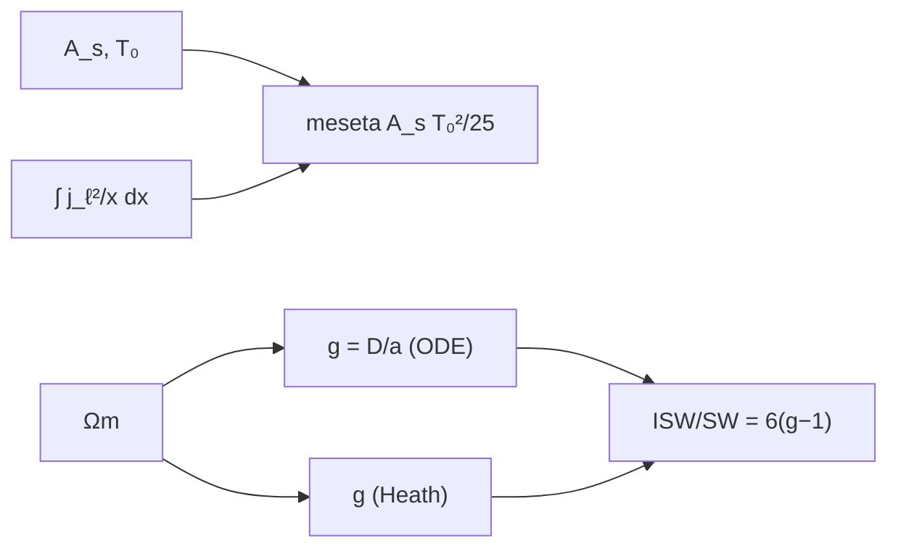

# B40-C09 — Efecto Sachs-Wolfe y efecto Sachs-Wolfe integrado

<!-- nav:top -->
[🏠 Programa](../../../../README.md) · [📚 Bloque B40](../../../tronco-comun/B40-universo-temprano-y-radiacion-cosmica-de-fondo.md) · [← Anterior: B40-C08 — Polarización E y B del fondo cósmico](../B40-C08-polarizacion-e-y-b-del-fondo-cosmico/CLASE.md) · [Siguiente: B40-C10 — Emisiones de primer plano galácticas y su separación →](../B40-C10-emisiones-de-primer-plano-galacticas-y-su-separacion/CLASE.md)
<!-- /nav -->

## 1. Ubicación, nivel y alcance

Clase 9 del bloque B40. Nivel N3. El efecto Sachs-Wolfe (SW) es el desplazamiento al rojo que sufren los fotones al salir de los pozos de potencial en la última dispersión; el integrado (ISW) añade el efecto del decaimiento de los potenciales por la energía oscura. Aquí calculas la **meseta** de SW con funciones de Bessel esféricas y el **factor de crecimiento** por dos vías. Usas [B26](../../../tronco-comun/B26-relatividad-y-cosmologia.md) y [B12](../../../tronco-comun/B12-probabilidad-estadistica-e-incertidumbre.md). La amplitud es ilustrativa.

## 2. Por qué esta clase existe

SW domina las escalas grandes; el ISW es una señal de la energía oscura. La decisión central: **¿qué amplitud tiene la meseta y cuánto decaen los potenciales?**

## 3. Lo que podrás hacer al terminar

1. Calcular `∫ j_ℓ²(x) dx/x` numéricamente.
2. Comparar con `1/(2ℓ(ℓ+1))`.
3. Obtener la meseta `A_s T₀²/25`.
4. Calcular el factor de crecimiento `g = D/a` por la ecuación diferencial.
5. Calcularlo por la integral de Heath.
6. Estimar la cota del cociente ISW/SW.

La evidencia es la **ficha de Sachs-Wolfe** del ejercicio 12 (sección 20).

## 4. Con qué llegas y cómo comprobarlo

1. ¿Qué es una incertidumbre?
2. ¿Qué es una simulación Monte Carlo?
3. ¿Qué es una tabla de resultados?
4. ¿Qué es un valor ilustrativo?
5. ¿Qué es una verificación?

<details>
<summary>Ver respuestas</summary>

1. Un intervalo en que se espera el valor verdadero. 2. Repetir con números aleatorios de semilla fija. 3. Un resumen ordenado de cálculos. 4. Un valor propuesto para el ejemplo, no medido. 5. Comparar un cálculo con un caso independiente.
</details>

Con cuatro o cinco aciertos, sigue; si no, repasa los prerrequisitos.

## 5. Un caso de contexto y casos de referencia

Con `A_s = 2,1 × 10⁻⁹` (ilustrativa) y `T₀ = 2,7255 K`, la meseta es `623,98 μK²`; con `Ω_m = 0,315` el factor de crecimiento hoy es `0,7878`. Es el **ejemplo conductor**. No se consultó el artículo original de 1967.

## 6. Vocabulario

El **potencial** gravitatorio `Φ`. Para un espectro invariante de escala, `ℓ(ℓ+1)C_ℓ/2π = A_s/25` (meseta de SW). El **factor de crecimiento** `g = D/a`. `j_ℓ` es la **función de Bessel esférica**. El **ISW** surge de `dΦ/dη ≠ 0`.

## 7. Modelo mental: una cuesta y un paseo

Como subir y bajar una cuesta: si la cuesta cambia de altura mientras la recorres, no recuperas toda la energía invertida.



*Descripción textual:* la integral de Bessel da la meseta de SW; la caída de los potenciales por Λ fija el ISW.

Analogía: una cuesta y un paseo. Límite: materia + Λ, un solo modo.

## 8. La explicación, paso a paso

### 8.1 Meseta

| ℓ | ∫ j_ℓ²/x numérica | 1/(2ℓ(ℓ+1)) | dif. relativa | D_ℓ (μK²) |
|---|---|---|---|---|
| 2 | 8,33333330 × 10⁻² | 8,33333333 × 10⁻² | −4,1 × 10⁻⁹ | 623,98 |
| 10 | 4,54545659 × 10⁻³ | 4,54545455 × 10⁻³ | 4,5 × 10⁻⁷ | 623,98 |
| 30 | 5,37628019 × 10⁻⁴ | 5,37634409 × 10⁻⁴ | −1,2 × 10⁻⁵ | 623,97 |

La meseta `A_s T₀²/25` es `623,98 μK²` (con `A_s` ilustrativa).

### 8.2 Crecimiento

`g` por la ecuación diferencial es `0,787831` y por la integral de Heath `0,787813` (diferencia `1,9 × 10⁻⁵`). Los potenciales decaen un `21,2 %`.

### 8.3 Cota del ISW

`ISW/SW = 6(g − 1) = −1,273` para un decaimiento instantáneo: signo opuesto al de SW. Es una **cota** para las escalas mayores: en escalas pequeñas el fotón atraviesa varias ondas y el efecto se cancela.

### 8.4 Lectura

La meseta de SW concuerda con la integral numérica a `10⁻⁵`. Las relaciones se toman de un tratamiento de libro de texto, no verificado contra el artículo de 1967.

## 9. Magnitudes, símbolos y unidades

| Símbolo | Qué es | Unidad | Valor / nota |
|---|---|---|---|
| `Φ` | potencial gravitatorio | — | — |
| `A_s` | amplitud escalar | — | 2,1 × 10⁻⁹ (ilustrativa) |
| `g` | factor de crecimiento | — | 0,7878 |
| `D_ℓ` | `ℓ(ℓ+1)C_ℓ/2π` | μK² | 623,98 |

## 10. Convenciones y referencias

`Ω_m = 0,315` de un resumen; `T₀` de un resumen; `A_s` ilustrativa; relaciones de libro de texto, no verificadas contra Sachs y Wolfe (1967).

## 11. De dónde sale lo que afirmamos

| ID | Fuente | Localizador | Respalda | Estado |
|---|---|---|---|---|
| S1 | Planck Collaboration, *Planck 2018 results. VI. Cosmological parameters* | https://arxiv.org/abs/1807.06209 | H₀ = 67,4 km/s/Mpc, Ωm = 0,315, Ωb h² = 0,0224, Ωc h² = 0,120, n_s = 0,965 y 100θ* = 1,0411 (solo del resumen) | Solo resumen, consultado el 2026-11-09 |
| S2 | Fixsen, *The Temperature of the Cosmic Microwave Background* | https://arxiv.org/abs/0911.1955 | T₀ = 2,72548 ± 0,00057 K (valor de la literatura citado en el resumen; el laboratorio usa 2,7255 K) | Solo resumen, consultado el 2026-11-09 |
| S3 | Sachs y Wolfe, 1967 | — | relaciones de SW e ISW, no consultado | No consultado |

Límites: S1 y S2 son solo resúmenes; S3 no se consultó.

## 12. Cómo ver la meseta

| Magnitud | Valor |
|---|---|
| meseta A_s T₀²/25 | 623,98 μK² |
| g (ODE) | 0,787831 |
| g (Heath) | 0,787813 |
| ISW/SW (cota) | −1,273 |

Descripción larga: los potenciales decaen un 21 % y el ISW se opone a SW.

## 13. Ejemplo trabajado: la meseta

**Paso 1 · Fracción.** `A_s/25 = 8,4 × 10⁻¹¹`.

**Paso 2 · Temperatura.** `T₀² = 7,428 × 10¹² μK²`.

**Paso 3 · Producto.** `623,98 μK²`.

## 14. Distintas formas de describir el resultado

**Por integral:** Bessel. **Por tabla:** meseta. **Por ODE e integral:** crecimiento. **Por código:** `sachs_wolfe.py`.

## 15. Práctica guiada

**Ejercicio 1 · con los pasos indicados.** `1/(2ℓ(ℓ+1))` para `ℓ = 2`. *Pasos:* `1/12`.

<details><summary>Solución comentada</summary>

`0,083333`.
</details>

**Ejercicio 2 · con una pista.** Lo mismo para `ℓ = 10`.

<details><summary>Solución comentada</summary>

`0,0045455`.
</details>

**Ejercicio 3 · casi autónomo.** Meseta. *Pasos:* ejemplo 13.

<details><summary>Solución comentada</summary>

`623,98 μK²`.
</details>

## 16. Práctica autónoma, transferencia e integrador

**Ejercicio 4.** `ΔT` si `Φ/3 = 10⁻⁵`.

<details><summary>Solución comentada</summary>

`27,3 μK`.
</details>

**Ejercicio 5.** `ISW/SW` con `g = 0,787831`.

<details><summary>Solución comentada</summary>

`−1,273`.
</details>

**Ejercicio 6.** Decaimiento de los potenciales.

<details><summary>Solución comentada</summary>

`1 − 0,7878 = 21,2 %`.
</details>

**Ejercicio 7.** Error relativo de la integral para `ℓ = 30`.

<details><summary>Solución comentada</summary>

`−1,2 × 10⁻⁵`.
</details>

**Ejercicio 8.** Diferencia entre las dos vías de `g`.

<details><summary>Solución comentada</summary>

`1,9 × 10⁻⁵`.
</details>

**Ejercicio 9 · transferencia.** **Transferencia.** Un compañero dice que 624 μK² es la meseta observada. Responde.

<details><summary>Solución comentada</summary>

`A_s` es ilustrativa y la meseta real incluye otras contribuciones.
</details>

**Ejercicio 10 · transferencia.** **Transferencia.** ¿Por qué ISW/SW es solo una cota?

<details><summary>Solución comentada</summary>

El decaimiento no es instantáneo y se cancela en escalas pequeñas.
</details>

**Ejercicio 11 · transferencia.** **Transferencia.** ¿Qué cambia sin Λ?

<details><summary>Solución comentada</summary>

`g = 1`: no hay ISW tardío.
</details>

**Ejercicio 12.** **Integrador.** Elabora tu *ficha de Sachs-Wolfe*: meseta, crecimiento y cota.

<details><summary>Solución comentada</summary>

Secciones 8.1–8.4.
</details>

**Ejercicio 12 · integrador.** **Integrador.** Elabora tu *ficha de Sachs-Wolfe*: meseta, crecimiento y cota.

<details><summary>Solución modelo</summary>

Secciones 8.1–8.4.
</details>

## 17. Laboratorio: meseta y crecimiento

El script [sachs_wolfe.py](sachs_wolfe.py) integra Bessel, resuelve el crecimiento por dos vías y calcula la cota (**comprueba** `10⁻⁴` en ambos).

**Datos:** `Ω_m` y `T₀` de resúmenes; `A_s` **ilustrativa**. **Predice antes de ejecutar:** ¿qué meseta saldrá? (≈ 624 μK².) **Ejecución del 2026-11-09 (Python 3.12.9):**

```text
Python 3.12.9 (biblioteca estandar)
  l  integral numerica de j_l^2/x   1/(2 l (l+1))  dif. relativa   l(l+1)C_l/2pi [uK^2]
  2                8.33333330e-02  8.33333333e-02      -4.08e-09                 623.98
 10                4.54545659e-03  4.54545455e-03       4.50e-07                 623.98
 30                5.37628019e-04  5.37634409e-04      -1.19e-05                 623.97
meseta A_s/25 * T_0^2 = 623.98 uK^2 (A_s ilustrativa)
factor de crecimiento g = D/a hoy: ecuacion diferencial = 0.787831 ; integral de Heath = 0.787813 ; diferencia = +1.9e-05
cociente ISW/SW instantaneo (cota) = 6 (g - 1) = -1.273 (signo opuesto: el decaimiento calienta lo que SW enfria)
Pruebas superadas.
```

```bash
python programa/clases/B40/B40-C09-efecto-sachs-wolfe-y-efecto-sachs-wolfe-integrado/sachs_wolfe.py
```

**Límites:** un modo, materia + Λ.

## 18. Errores frecuentes y cómo corregirlos

**Llamar observada a la meseta calculada.** Se corrige con la sección 10.

**Tomar la cota como el ISW real.** Se corrige con 8.3.

**Olvidar que `j_ℓ` necesita recurrencia estable.** Se corrige con la sección 8.

**Atribuir las relaciones al artículo de 1967.** Se corrige con la sección 11.

## 19. Cómo sabrás que vas bien

Tras la sección 8: ¿qué resultado esperabas y cuál obtuviste? Si dudas, repasa el ejemplo 13. Tras el laboratorio: ¿qué comprueba? (ver la sección 17).

## 20. Qué entregas y cómo se evalúa

El producto es tu **ficha de Sachs-Wolfe** (ejercicio 12).

| Criterio | Inicial | En desarrollo | Logrado | Destacado |
|---|---|---|---|---|
| Conceptos | Los confunde | Parciales | conceptos de la clase | Explica los límites |
| Cálculo | Sin unidades | Con errores | Tablas completas | Calcula casos nuevos |
| Numérico | Sin comprobar | Un caso | Contraste con el análisis | Interpreta las diferencias |
| Fuentes | Sin fuente | Sin fecha | fuentes con fecha | Declara lo ilustrativo |
| Límites | No los nombra | Uno | Tres | Discute qué falta del modelo |

**Condiciones críticas (no se compensan con promedio):** rotular `A_s` como ilustrativa; no atribuir las relaciones a una fuente no consultada; citar solo lo consultado.

## 21. Ética, seguridad y límites

Clase educativa: los modelos son simplificados. Accesibilidad: tablas equivalentes a las gráficas, fórmulas en texto, ejercicios sin conexión.

## 22. Para cerrar y seguir

La meseta de SW es `A_s T₀²/25 = 624 μK²` (con `A_s` ilustrativa), los potenciales decaen un 21 % y el ISW instantáneo se opone a SW en un factor 1,27. Queda una pregunta: ¿cómo se separan las emisiones galácticas?

**Glosario español–inglés.** Sachs-Wolfe · *Sachs-Wolfe*; potencial · *potential*; factor de crecimiento · *growth factor*; meseta · *plateau*.

**Continuidad.** [B40-C10](../B40-C10-emisiones-de-primer-plano-galacticas-y-su-separacion/CLASE.md) estudia los primeros planos galácticos.

**Referencias:** ver sección 11.

<!-- nav:bottom -->
---

[← Anterior: B40-C08 — Polarización E y B del fondo cósmico](../B40-C08-polarizacion-e-y-b-del-fondo-cosmico/CLASE.md) · [📚 Bloque B40](../../../tronco-comun/B40-universo-temprano-y-radiacion-cosmica-de-fondo.md) · [Siguiente: B40-C10 — Emisiones de primer plano galácticas y su separación →](../B40-C10-emisiones-de-primer-plano-galacticas-y-su-separacion/CLASE.md)
<!-- /nav -->
