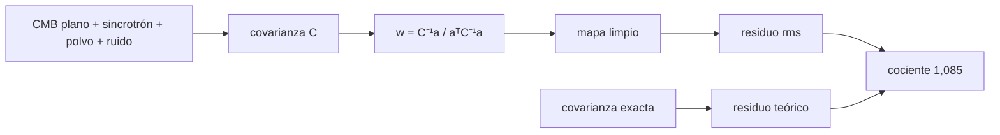

# B40-C10 — Emisiones de primer plano galácticas y su separación

<!-- nav:top -->
[🏠 Programa](../../../../README.md) · [📚 Bloque B40](../../../tronco-comun/B40-universo-temprano-y-radiacion-cosmica-de-fondo.md) · [← Anterior: B40-C09 — Efecto Sachs-Wolfe y efecto Sachs-Wolfe integrado](../B40-C09-efecto-sachs-wolfe-y-efecto-sachs-wolfe-integrado/CLASE.md) · [Siguiente: B40-C11 — Efecto Sunyaev-Zeldovich térmico y cinemático →](../B40-C11-efecto-sunyaev-zeldovich-termico-y-cinematico/CLASE.md)
<!-- /nav -->

## 1. Ubicación, nivel y alcance

Clase 10 del bloque B40. Nivel N3. El sincrotrón y el polvo galácticos contaminan el fondo, pero tienen espectros distintos del cuerpo negro del CMB. Aquí modelas sus leyes espectrales con los índices del resumen de Planck 2018 IV y separas el CMB con una **combinación lineal interna (ILC)** en un cielo sintético de 40 000 píxeles. Usas [B12](../../../tronco-comun/B12-probabilidad-estadistica-e-incertidumbre.md), [B10](../../../tronco-comun/B10-algebra-lineal-y-matematicas-geometricas.md) y [B15](../../../tronco-comun/B15-senales-imagenes-y-estimacion-cientifica.md). Amplitudes, ruidos y frecuencias son ilustrativos.

## 2. Por qué esta clase existe

Sin separar los primeros planos no se mide el fondo. La decisión central: **¿qué pesos por frecuencia minimizan la contaminación sin tocar la señal del CMB?**

## 3. Lo que podrás hacer al terminar

1. Convertir temperaturas RJ y brillo a `K_CMB`.
2. Construir las leyes del sincrotrón y del polvo.
3. Calcular pesos ILC con `w = C⁻¹a/(aᵀC⁻¹a)`.
4. Verificar `Σw = 1`.
5. Comparar el residuo simulado con el teórico.
6. Reconocer el sesgo ILC.

La evidencia es la **ficha de los primeros planos** del ejercicio 12 (sección 20).

## 4. Con qué llegas y cómo comprobarlo

1. ¿Qué es una incertidumbre?
2. ¿Qué es una simulación Monte Carlo?
3. ¿Qué es una tabla de resultados?
4. ¿Qué es un valor ilustrativo?
5. ¿Qué es una verificación?

<details>
<summary>Ver respuestas</summary>

1. Un intervalo en que se espera el valor verdadero. 2. Repetir con números aleatorios de semilla fija. 3. Un resumen ordenado de cálculos. 4. Un valor propuesto para el ejemplo, no medido. 5. Comparar un cálculo con un caso independiente.
</details>

Con cuatro o cinco aciertos, sigue; si no, repasa los prerrequisitos.

## 5. Un caso de contexto y casos de referencia

Con siete frecuencias de 30 a 353 GHz, el residuo de la ILC es `2,04 μK` frente a `1,88 μK` teórico, mientras un solo canal de 143 GHz deja `45,98 μK` (CMB de `100 μK` rms). Es el **ejemplo conductor**. Todo es **sintético** salvo los índices del resumen.

## 6. Vocabulario

El **sincrotrón** sigue una ley de potencias. El **polvo** un cuerpo gris modificado `ν^β B_ν(T_d)`. Las unidades **`K_CMB`** y **`K_RJ`**. Los **pesos ILC** minimizan la varianza con suma 1. El **sesgo ILC** aparece por usar la covarianza de la muestra.

## 7. Modelo mental: silenciar dos radios

Como combinar varios micrófonos para cancelar dos fuentes de ruido sin apagar la voz: los pesos explotan que la voz suena igual en todos.



*Descripción textual:* las leyes espectrales dan la covarianza y los pesos que minimizan la varianza con suma 1.

Analogía: silenciar dos radios. Límite: píxeles independientes, componentes sin correlación.

## 8. La explicación, paso a paso

### 8.1 Leyes espectrales

| GHz | sincrotrón (1 en 30 GHz) | polvo (1 en 353 GHz) | ruido (μK) |
|---|---|---|---|
| 30 | 1,0000 | 2,6599 × 10⁻³ | 8,0 |
| 44 | 3,1327 × 10⁻¹ | 4,8603 × 10⁻³ | 8,0 |
| 70 | 8,0076 × 10⁻² | 1,0417 × 10⁻² | 6,0 |
| 100 | 3,0092 × 10⁻² | 1,9792 × 10⁻² | 3,0 |
| 143 | 1,2761 × 10⁻² | 4,1905 × 10⁻² | 2,5 |
| 217 | 6,3364 × 10⁻³ | 1,3128 × 10⁻¹ | 4,0 |
| 353 | 6,0489 × 10⁻³ | 1,0000 | 12,0 |

### 8.2 Pesos

| GHz | peso exacto | peso empírico |
|---|---|---|
| 30 | −0,0323 | −0,0245 |
| 44 | 0,0270 | −0,0219 |
| 70 | 0,0824 | 0,1867 |
| 100 | 0,3500 | 0,3446 |
| 143 | 0,4838 | 0,4035 |
| 217 | 0,1349 | 0,1576 |
| 353 | −0,0458 | −0,0460 |

La suma de pesos empíricos es `1,000000000000`.

### 8.3 Residuo

La ILC deja `2,04 μK` y la teoría `1,88 μK` (cociente `1,085`): la covarianza de la muestra sesga el resultado. Un solo canal de 143 GHz deja `45,98 μK`, unas 22 veces más.

### 8.4 Lectura

Los pesos negativos (30 y 353 GHz) restan las plantillas de primer plano. Con tres componentes casi degeneradas los pesos empíricos son ruidosos (diferencia máxima de `0,10` con los exactos), pero el residuo es robusto.

## 9. Magnitudes, símbolos y unidades

| Símbolo | Qué es | Unidad | Valor / nota |
|---|---|---|---|
| `β_s` | índice del sincrotrón | — | −3,1 (resumen) |
| `β_d` | índice del polvo | — | 1,55 (resumen) |
| `T_d` | temperatura del polvo | K | 19,6 (ilustrativa) |
| `w` | pesos ILC | — | ver 8.2 |

## 10. Convenciones y referencias

`h` y `k_B` de NIST; índices de Planck 2018 IV (resumen); `T_d`, amplitudes, ruidos y frecuencias **ilustrativos**; semilla `20261109`.

## 11. De dónde sale lo que afirmamos

| ID | Fuente | Localizador | Respalda | Estado |
|---|---|---|---|---|
| S1 | NIST, *Fundamental Physical Constants* (CODATA 2022) | https://physics.nist.gov/cuu/Constants/Table/allascii.txt | constantes citadas en la sección 9 | Consultada el 2026-11-09 |
| S2 | Planck Collaboration, *Planck 2018 results. IV. Diffuse component separation* | https://arxiv.org/abs/1807.06208 | β_d = 1,55 ± 0,05 (polvo polarizado), β_s = −3,1 ± 0,1 (sincrotrón polarizado) y los métodos Commander, NILC, SEVEM y SMICA | Solo resumen, consultado el 2026-11-09 |
| S3 | Fixsen, *The Temperature of the Cosmic Microwave Background* | https://arxiv.org/abs/0911.1955 | T₀ = 2,72548 ± 0,00057 K (valor de la literatura citado en el resumen; el laboratorio usa 2,7255 K) | Solo resumen, consultado el 2026-11-09 |

Límites: S2 y S3 son solo resúmenes; la metodología de Planck no se leyó. Las leyes se aplican a la intensidad por simplicidad aunque los índices del resumen son polarizados.

## 12. Cómo ver los pesos

| GHz | peso exacto |
|---|---|
| 30 | −0,0323 |
| 100 | 0,3500 |
| 143 | 0,4838 |
| 353 | −0,0458 |

Descripción larga: los canales centrales pesan más y los extremos restan plantillas.

## 13. Ejemplo trabajado: la suma de pesos

**Paso 1 · Suma.** `−0,0323 + 0,0270 + 0,0824 + 0,3500`.

**Paso 2 · Resto.** `+ 0,4838 + 0,1349 − 0,0458`.

**Paso 3 · Total.** `1,0000`.

## 14. Distintas formas de describir el resultado

**Por ley:** potencias y cuerpo gris. **Por tabla:** pesos. **Por álgebra:** `C⁻¹a`. **Por código:** `primeros_planos.py`.

## 15. Práctica guiada

**Ejercicio 1 · con los pasos indicados.** Suma de los pesos exactos. *Pasos:* ejemplo 13.

<details><summary>Solución comentada</summary>

`1,0000`.
</details>

**Ejercicio 2 · con una pista.** Cociente de residuos canal 143 / ILC.

<details><summary>Solución comentada</summary>

`45,98/2,04 = 22,5`.
</details>

**Ejercicio 3 · casi autónomo.** Cociente residuo simulado / teórico.

<details><summary>Solución comentada</summary>

`2,04/1,88 = 1,085`.
</details>

## 16. Práctica autónoma, transferencia e integrador

**Ejercicio 4.** Cociente sincrotrón 30/143 GHz.

<details><summary>Solución comentada</summary>

`1/0,012761 = 78,4`.
</details>

**Ejercicio 5.** Cociente polvo 353/143 GHz.

<details><summary>Solución comentada</summary>

`1/0,041905 = 23,9`.
</details>

**Ejercicio 6.** `(143/30)^−3,1`.

<details><summary>Solución comentada</summary>

`0,00790`.
</details>

**Ejercicio 7.** ¿Por qué hay pesos negativos?

<details><summary>Solución comentada</summary>

Restan plantillas de primer plano.
</details>

**Ejercicio 8.** Diferencia máxima entre pesos empíricos y exactos.

<details><summary>Solución comentada</summary>

`0,10` (70 GHz).
</details>

**Ejercicio 9 · transferencia.** **Transferencia.** Un compañero dice que `β_s` y `β_d` son de intensidad. Responde.

<details><summary>Solución comentada</summary>

El resumen los da para la polarización; aquí se aplican por simplicidad.
</details>

**Ejercicio 10 · transferencia.** **Transferencia.** ¿Por qué el sesgo ILC?

<details><summary>Solución comentada</summary>

Los pesos usan la covarianza de la muestra, correlacionada con el CMB de esa muestra.
</details>

**Ejercicio 11 · transferencia.** **Transferencia.** ¿Qué pasa si CMB y polvo están correlacionados?

<details><summary>Solución comentada</summary>

La ILC deja de ser óptima.
</details>

**Ejercicio 12.** **Integrador.** Elabora tu *ficha de los primeros planos*: leyes, pesos, residuo y sesgo.

<details><summary>Solución comentada</summary>

Secciones 8.1–8.4.
</details>

**Ejercicio 12 · integrador.** **Integrador.** Elabora tu *ficha de los primeros planos*: leyes, pesos, residuo y sesgo.

<details><summary>Solución modelo</summary>

Secciones 8.1–8.4.
</details>

## 17. Laboratorio: separación ILC

El script [primeros_planos.py](primeros_planos.py) genera 40 000 píxeles, calcula pesos y residuo (**comprueba** `Σw = 1` a `10⁻¹²`, pesos a 0,12 y residuo entre 1 y 1,15 veces el teórico).

**Datos:** `h`, `k_B` de NIST; índices de un resumen; amplitudes y ruidos **ilustrativos**. **Predice antes de ejecutar:** ¿cuánto baja el residuo? (de ~46 a ~2 μK.) **Ejecución del 2026-11-09 (Python 3.12.9):**

```text
Python 3.12.9 (biblioteca estandar)
  GHz  sincrotron       polvo  ruido [uK]
   30  1.0000e+00  2.6599e-03         8.0
   44  3.1327e-01  4.8603e-03         8.0
   70  8.0076e-02  1.0417e-02         6.0
  100  3.0092e-02  1.9792e-02         3.0
  143  1.2761e-02  4.1905e-02         2.5
  217  6.3364e-03  1.3128e-01         4.0
  353  6.0489e-03  1.0000e+00        12.0
  GHz  peso exacto  peso empirico
   30      -0.0323        -0.0245
   44       0.0270        -0.0219
   70       0.0824         0.1867
  100       0.3500         0.3446
  143       0.4838         0.4035
  217       0.1349         0.1576
  353      -0.0458        -0.0460
suma de pesos = 1.000000000000 ; residuo rms ILC = 2.04 uK ; teorico = 1.88 uK ; solo el canal de 143 GHz = 45.98 uK (rms del CMB = 100 uK)
Pruebas superadas.
```

```bash
python programa/clases/B40/B40-C10-emisiones-de-primer-plano-galacticas-y-su-separacion/primeros_planos.py
```

**Límites:** píxeles independientes, componentes incorrelacionadas.

## 18. Errores frecuentes y cómo corregirlos

**Mezclar unidades `K_RJ` y `K_CMB`.** Se corrige con la sección 9.

**Olvidar `Σw = 1`.** Se corrige con el ejemplo 13.

**Creer que los pesos son estables con componentes degeneradas.** Se corrige con 8.4.

**Citar índices polarizados como si fueran de intensidad.** Se corrige con la sección 11.

## 19. Cómo sabrás que vas bien

Tras la sección 8: ¿qué resultado esperabas y cuál obtuviste? Si dudas, repasa el ejemplo 13. Tras el laboratorio: ¿qué comprueba? (ver la sección 17).

## 20. Qué entregas y cómo se evalúa

El producto es tu **ficha de los primeros planos** (ejercicio 12).

| Criterio | Inicial | En desarrollo | Logrado | Destacado |
|---|---|---|---|---|
| Conceptos | Los confunde | Parciales | conceptos de la clase | Explica los límites |
| Cálculo | Sin unidades | Con errores | Tablas completas | Calcula casos nuevos |
| Numérico | Sin comprobar | Un caso | Contraste con el análisis | Interpreta las diferencias |
| Fuentes | Sin fuente | Sin fecha | fuentes con fecha | Declara lo ilustrativo |
| Límites | No los nombra | Uno | Tres | Discute qué falta del modelo |

**Condiciones críticas (no se compensan con promedio):** rotular amplitudes y ruidos como ilustrativos; no presentar la ILC como el método de Planck; citar solo lo consultado.

## 21. Ética, seguridad y límites

Clase educativa: los modelos son simplificados. Accesibilidad: tablas equivalentes a las gráficas, fórmulas en texto, ejercicios sin conexión.

## 22. Para cerrar y seguir

Siete frecuencias reducen el residuo de 46 a 2 μK, con pesos que suman 1 y un sesgo del 8,5 % por la covarianza muestral. Queda una pregunta: ¿qué firma deja un cúmulo de galaxias?

**Glosario español–inglés.** primer plano · *foreground*; sincrotrón · *synchrotron*; polvo · *dust*; combinación lineal interna · *internal linear combination*; sesgo · *bias*.

**Continuidad.** [B40-C11](../B40-C11-efecto-sunyaev-zeldovich-termico-y-cinematico/CLASE.md) estudia el efecto Sunyaev-Zeldovich.

**Referencias:** ver sección 11.

<!-- nav:bottom -->
---

[← Anterior: B40-C09 — Efecto Sachs-Wolfe y efecto Sachs-Wolfe integrado](../B40-C09-efecto-sachs-wolfe-y-efecto-sachs-wolfe-integrado/CLASE.md) · [📚 Bloque B40](../../../tronco-comun/B40-universo-temprano-y-radiacion-cosmica-de-fondo.md) · [Siguiente: B40-C11 — Efecto Sunyaev-Zeldovich térmico y cinemático →](../B40-C11-efecto-sunyaev-zeldovich-termico-y-cinematico/CLASE.md)
<!-- /nav -->
