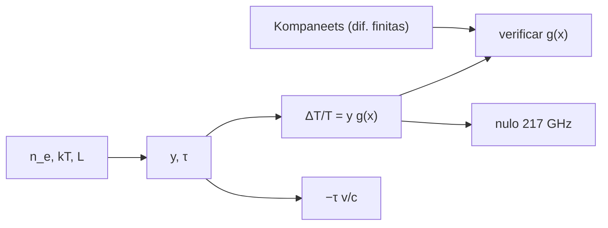

# B40-C11 — Efecto Sunyaev-Zeldovich térmico y cinemático

<!-- nav:top -->
[🏠 Programa](../../../../README.md) · [📚 Bloque B40](../../../tronco-comun/B40-universo-temprano-y-radiacion-cosmica-de-fondo.md) · [← Anterior: B40-C10 — Emisiones de primer plano galácticas y su separación](../B40-C10-emisiones-de-primer-plano-galacticas-y-su-separacion/CLASE.md) · [Siguiente: B40-C12 — Análisis de mapas del CMB: pixelización esférica y máscaras →](../B40-C12-analisis-de-mapas-del-cmb-pixelizacion-esferica-y-mascaras/CLASE.md)
<!-- /nav -->

## 1. Ubicación, nivel y alcance

Clase 11 del bloque B40. Nivel N3. Los electrones calientes del gas de un cúmulo dispersan los fotones del fondo y distorsionan su espectro (efecto **térmico**, tSZ); el movimiento del cúmulo añade un corrimiento Doppler (efecto **cinemático**, kSZ). Aquí verificas la función espectral con el operador de **Kompaneets** evaluado por diferencias finitas, hallas el nulo cerca de 217 GHz y calculas `y` y la señal de un cúmulo ilustrativo. Usas [B25](../../../tronco-comun/B25-galaxias-y-medio-interestelar.md), [B05](../../../tronco-comun/B05-fisica-fundamental-para-el-espacio.md) y [B36](../../../tronco-comun/B36-formacion-de-estructuras-cosmicas-y-materia-oscura.md).

## 2. Por qué esta clase existe

El tSZ no depende del corrimiento al rojo y permite detectar cúmulos lejanos. La decisión central: **¿cuánto vale la distorsión a cada frecuencia y dónde se anula?**

## 3. Lo que podrás hacer al terminar

1. Escribir `ΔT/T = y (x coth(x/2) − 4)`.
2. Verificarla con el operador de Kompaneets.
3. Hallar el nulo `x₀` y su frecuencia.
4. Calcular `y = σ_T/(m_e c²) ∫ n_e kT dl`.
5. Calcular la señal cinemática `−τ v_r/c`.
6. Reconocer los límites de Rayleigh-Jeans y Wien.

La evidencia es la **ficha del efecto Sunyaev-Zeldovich** del ejercicio 12 (sección 20).

## 4. Con qué llegas y cómo comprobarlo

1. ¿Qué es una incertidumbre?
2. ¿Qué es una simulación Monte Carlo?
3. ¿Qué es una tabla de resultados?
4. ¿Qué es un valor ilustrativo?
5. ¿Qué es una verificación?

<details>
<summary>Ver respuestas</summary>

1. Un intervalo en que se espera el valor verdadero. 2. Repetir con números aleatorios de semilla fija. 3. Un resumen ordenado de cálculos. 4. Un valor propuesto para el ejemplo, no medido. 5. Comparar un cálculo con un caso independiente.
</details>

Con cuatro o cinco aciertos, sigue; si no, repasa los prerrequisitos.

## 5. Un caso de contexto y casos de referencia

Para un cúmulo ilustrativo (`n_e = 10⁻² cm⁻³`, `kT = 5 keV`, `1 Mpc`, `v_r = 500 km/s`), `τ = 2,0527 × 10⁻²`, `y = 2,0086 × 10⁻⁴` y `ΔT = −569,5 μK` a 143 GHz. El nulo térmico está en `x₀ = 3,83002` (`217,51 GHz`). Es el **ejemplo conductor**.

## 6. Vocabulario

El **parámetro de Compton** `y`. La **función espectral** `g(x) = x coth(x/2) − 4`. El **nulo**: `g(x₀) = 0`. La **profundidad óptica** `τ = σ_T ∫ n_e dl`. El **operador de Kompaneets** describe la difusión de fotones en energía. El **kSZ** es `−τ v_r/c`.

## 7. Modelo mental: una pelota de ping-pong en un camión

Como una pelota que rebota en un camión veloz: gana energía (térmico) y, si el camión se mueve, el corrimiento depende de su velocidad (cinemático).



*Descripción textual:* la densidad y la temperatura del gas dan `y`; la función espectral se verifica con Kompaneets y fija el nulo.

Analogía: una pelota de ping-pong en un camión. Límite: cúmulo isotermo, sin correcciones relativistas.

## 8. La explicación, paso a paso

### 8.1 Verificación

| x | forma cerrada | Kompaneets | dif. relativa |
|---|---|---|---|
| 0,5 | −3,83641745 | −3,83641682 | 1,6 × 10⁻⁷ |
| 1,0 | −1,69039961 | −1,69039935 | 1,5 × 10⁻⁷ |
| 2,0 | −0,497404812 | −0,497404757 | 1,1 × 10⁻⁷ |
| 3,0 | −0,113418292 | −0,113418288 | 2,8 × 10⁻⁸ |
| 5,0 | 0,0364648716 | 0,0364648678 | 1,0 × 10⁻⁷ |
| 8,0 | 0,0107564290 | 0,0107564291 | 7,7 × 10⁻⁹ |

### 8.2 El cúmulo

`k T_e/m_e c² = 9,7848 × 10⁻³`, `τ = 2,0527 × 10⁻²`, `y = 2,0086 × 10⁻⁴` y kSZ `ΔT/T = −3,4236 × 10⁻⁵`.

| ν (GHz) | x | g(x) | tSZ (μK) | kSZ (μK) |
|---|---|---|---|---|
| 30 | 0,528 | −1,9537 | −1069,52 | −93,31 |
| 100 | 1,761 | −1,5081 | −825,58 | −93,31 |
| 143 | 2,518 | −1,0404 | −569,53 | −93,31 |
| 217,5 | 3,830 | −0,0001 | −0,06 | −93,31 |
| 353 | 6,216 | 2,2407 | 1226,65 | −93,31 |

### 8.3 Límites

`g(0,01) = −2,0000` (Rayleigh-Jeans) y `g(30) = 26,000 = x − 4` (Wien).

### 8.4 Lectura

El tSZ es un déficit por debajo de 217,5 GHz y un exceso por encima; el kSZ conserva la forma del cuerpo negro y no se anula. Con `kT/m_e c² ≈ 1 %`, las correcciones relativistas existen y no se incluyen. El resumen de Planck 2015 XXII indica que el mapa de `y` está dominado por la señal térmica en multipolos 20 a 600.

## 9. Magnitudes, símbolos y unidades

| Símbolo | Qué es | Unidad | Valor / nota |
|---|---|---|---|
| `y` | parámetro de Compton | — | 2,0086 × 10⁻⁴ (ilustrativo) |
| `τ` | profundidad óptica | — | 2,0527 × 10⁻² |
| `σ_T` | sección eficaz de Thomson | m² | 6,6524587051 × 10⁻²⁹ (NIST) |
| `x` | `hν/(k T₀)` | — | — |

## 10. Convenciones y referencias

NIST (`σ_T`, `m_e`, `c`, `k_B`, `h`, `eV`); `T₀` y el mapa de `y` de resúmenes; cúmulo y velocidad **ilustrativos**.

## 11. De dónde sale lo que afirmamos

| ID | Fuente | Localizador | Respalda | Estado |
|---|---|---|---|---|
| S1 | NIST, *Fundamental Physical Constants* (CODATA 2022) | https://physics.nist.gov/cuu/Constants/Table/allascii.txt | constantes citadas en la sección 9 | Consultada el 2026-11-09 |
| S2 | Fixsen, *The Temperature of the Cosmic Microwave Background* | https://arxiv.org/abs/0911.1955 | T₀ = 2,72548 ± 0,00057 K (valor de la literatura citado en el resumen; el laboratorio usa 2,7255 K) | Solo resumen, consultado el 2026-11-09 |
| S3 | Planck Collaboration, *Planck 2015 results. XXII. A map of the thermal Sunyaev-Zeldovich effect* | https://arxiv.org/abs/1502.01596 | el mapa y está dominado por la señal térmica en multipolos 20 a 600 (resumen) | Solo resumen, consultado el 2026-11-09 |

Límites: S2 y S3 son solo resúmenes. El tratamiento de Kompaneets no se contrastó con el artículo original (no consultado).

## 12. Cómo ver la distorsión

| ν (GHz) | tSZ (μK) |
|---|---|
| 30 | −1069,52 |
| 143 | −569,53 |
| 217,5 | −0,06 |
| 353 | 1226,65 |

Descripción larga: la distorsión cambia de signo en 217,5 GHz.

## 13. Ejemplo trabajado: `y`

**Paso 1 · `τ`.** `σ_T n_e L = 2,0527 × 10⁻²`.

**Paso 2 · Energía.** `kT/m_e c² = 9,7848 × 10⁻³`.

**Paso 3 · Producto.** `y = 2,0527 × 10⁻² × 9,7848 × 10⁻³ = 2,0085 × 10⁻⁴`.

**Paso 4 · Señal.** `ΔT = T₀ y g(x)`.

## 14. Distintas formas de describir el resultado

**Por fórmula:** `y g(x)`. **Por operador:** Kompaneets. **Por tabla:** frecuencias. **Por código:** `sz.py`.

## 15. Práctica guiada

**Ejercicio 1 · con los pasos indicados.** `y` con `τ` y `kT/m_e c²`. *Pasos:* ejemplo 13.

<details><summary>Solución comentada</summary>

`2,0085 × 10⁻⁴`.
</details>

**Ejercicio 2 · con una pista.** kSZ en μK. *Pasos:* `−τ v/c × T₀`.

<details><summary>Solución comentada</summary>

`−93,31 μK`.
</details>

**Ejercicio 3 · casi autónomo.** tSZ a 143 GHz.

<details><summary>Solución comentada</summary>

`T₀ y g = −569,5 μK`.
</details>

## 16. Práctica autónoma, transferencia e integrador

**Ejercicio 4.** Frecuencia del nulo.

<details><summary>Solución comentada</summary>

`217,51 GHz`.
</details>

**Ejercicio 5.** Cociente tSZ 353/143 GHz.

<details><summary>Solución comentada</summary>

`2,2407/1,0404 = 2,154`.
</details>

**Ejercicio 6.** Cociente tSZ/kSZ a 143 GHz.

<details><summary>Solución comentada</summary>

`569,53/93,31 = 6,1`.
</details>

**Ejercicio 7.** `kT/m_e c²` en porcentaje.

<details><summary>Solución comentada</summary>

`0,98 %`.
</details>

**Ejercicio 8.** Límite de Rayleigh-Jeans de `g`.

<details><summary>Solución comentada</summary>

`−2`.
</details>

**Ejercicio 9 · transferencia.** **Transferencia.** Un compañero dice que este cúmulo es real. Responde.

<details><summary>Solución comentada</summary>

Es un cúmulo ilustrativo.
</details>

**Ejercicio 10 · transferencia.** **Transferencia.** ¿Por qué el kSZ no se anula?

<details><summary>Solución comentada</summary>

Es un desplazamiento Doppler del cuerpo negro.
</details>

**Ejercicio 11 · transferencia.** **Transferencia.** ¿Por qué 217 GHz sirve para aislar el kSZ?

<details><summary>Solución comentada</summary>

Porque ahí el tSZ es nulo y queda solo el kSZ.
</details>

**Ejercicio 12.** **Integrador.** Elabora tu *ficha del efecto Sunyaev-Zeldovich*: `g(x)`, nulo, `y` y señal.

<details><summary>Solución comentada</summary>

Secciones 8.1–8.4.
</details>

**Ejercicio 12 · integrador.** **Integrador.** Elabora tu *ficha del efecto Sunyaev-Zeldovich*: `g(x)`, nulo, `y` y señal.

<details><summary>Solución modelo</summary>

Secciones 8.1–8.4.
</details>

## 17. Laboratorio: función espectral SZ

El script [sz.py](sz.py) verifica `g(x)` con Kompaneets por diferencias finitas y calcula la señal (**comprueba** `10⁻⁴` y el nulo a 0,5 GHz).

**Datos:** constantes de NIST; `T₀` de un resumen; cúmulo **ilustrativo**. **Predice antes de ejecutar:** ¿dónde cambia de signo? (≈ 217,5 GHz.) **Ejecución del 2026-11-09 (Python 3.12.9):**

```text
Python 3.12.9 (biblioteca estandar)
     x    forma cerrada   Kompaneets (dif. finitas)  dif. relativa
   0.5  -3.83641745e+00             -3.83641682e+00       1.63e-07
   1.0  -1.69039961e+00             -1.69039935e+00       1.53e-07
   2.0  -4.97404812e-01             -4.97404757e-01       1.11e-07
   3.0  -1.13418292e-01             -1.13418288e-01       2.84e-08
   5.0   3.64648716e-02              3.64648678e-02       1.04e-07
   8.0   1.07564290e-02              1.07564291e-02       7.73e-09
nulo de x coth(x/2) - 4: x0 = 3.83002 -> nu0 = 217.51 GHz (T_0 = 2.7255 K)
tau = sigma_T n_e L = 2.0527e-02 ; y = 2.0086e-04 ; k T_e/m_e c^2 = 9.7848e-03 ; kSZ Delta T/T = -3.4236e-05
 nu [GHz]       x      g(x)   tSZ [uK]   kSZ [uK]
     30.0   0.528   -1.9537   -1069.52     -93.31
    100.0   1.761   -1.5081    -825.58     -93.31
    143.0   2.518   -1.0404    -569.53     -93.31
    217.5   3.830   -0.0001      -0.06     -93.31
    353.0   6.216    2.2407    1226.65     -93.31
limites: g(0,01) = -2.0000 (Rayleigh-Jeans: -2) ; g(30) = 26.000 (Wien: x - 4 = 26)
Pruebas superadas.
```

```bash
python programa/clases/B40/B40-C11-efecto-sunyaev-zeldovich-termico-y-cinematico/sz.py
```

**Límites:** sin correcciones relativistas, isotermo.

## 18. Errores frecuentes y cómo corregirlos

**Confundir tSZ y kSZ.** Se corrige con 8.4.

**Usar `kT` en keV sin convertir.** Se corrige con la sección 9.

**Tomar el cúmulo por real.** Se corrige con la sección 10.

**Olvidar que `y` es adimensional.** Se corrige con la sección 9.

## 19. Cómo sabrás que vas bien

Tras la sección 8: ¿qué resultado esperabas y cuál obtuviste? Si dudas, repasa el ejemplo 13. Tras el laboratorio: ¿qué comprueba? (ver la sección 17).

## 20. Qué entregas y cómo se evalúa

El producto es tu **ficha del efecto Sunyaev-Zeldovich** (ejercicio 12).

| Criterio | Inicial | En desarrollo | Logrado | Destacado |
|---|---|---|---|---|
| Conceptos | Los confunde | Parciales | conceptos de la clase | Explica los límites |
| Cálculo | Sin unidades | Con errores | Tablas completas | Calcula casos nuevos |
| Numérico | Sin comprobar | Un caso | Contraste con el análisis | Interpreta las diferencias |
| Fuentes | Sin fuente | Sin fecha | fuentes con fecha | Declara lo ilustrativo |
| Límites | No los nombra | Uno | Tres | Discute qué falta del modelo |

**Condiciones críticas (no se compensan con promedio):** rotular el cúmulo como ilustrativo; citar los resúmenes como tales; no afirmar detecciones.

## 21. Ética, seguridad y límites

Clase educativa: los modelos son simplificados. Accesibilidad: tablas equivalentes a las gráficas, fórmulas en texto, ejercicios sin conexión.

## 22. Para cerrar y seguir

La distorsión térmica es `y g(x)` con nulo en 217,5 GHz; el cúmulo ilustrativo da `y = 2 × 10⁻⁴` y −570 μK a 143 GHz, frente a −93 μK de kSZ. Queda una pregunta: ¿cómo se guarda un mapa en una esfera?

**Glosario español–inglés.** efecto Sunyaev-Zeldovich · *Sunyaev-Zeldovich effect*; parámetro de Compton · *Compton parameter*; Kompaneets · *Kompaneets*; profundidad óptica · *optical depth*.

**Continuidad.** [B40-C12](../B40-C12-analisis-de-mapas-del-cmb-pixelizacion-esferica-y-mascaras/CLASE.md) estudia la pixelización de mapas.

**Referencias:** ver sección 11.

<!-- nav:bottom -->
---

[← Anterior: B40-C10 — Emisiones de primer plano galácticas y su separación](../B40-C10-emisiones-de-primer-plano-galacticas-y-su-separacion/CLASE.md) · [📚 Bloque B40](../../../tronco-comun/B40-universo-temprano-y-radiacion-cosmica-de-fondo.md) · [Siguiente: B40-C12 — Análisis de mapas del CMB: pixelización esférica y máscaras →](../B40-C12-analisis-de-mapas-del-cmb-pixelizacion-esferica-y-mascaras/CLASE.md)
<!-- /nav -->
