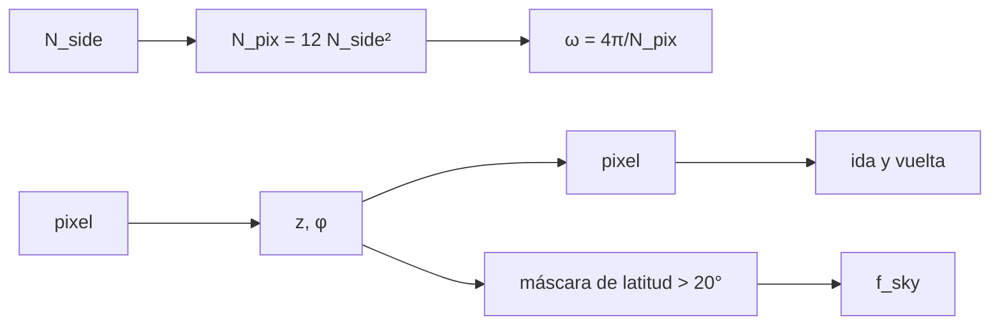

# B40-C12 — Análisis de mapas del CMB: pixelización esférica y máscaras

<!-- nav:top -->
[🏠 Programa](../../../../README.md) · [📚 Bloque B40](../../../tronco-comun/B40-universo-temprano-y-radiacion-cosmica-de-fondo.md) · [← Anterior: B40-C11 — Efecto Sunyaev-Zeldovich térmico y cinemático](../B40-C11-efecto-sunyaev-zeldovich-termico-y-cinematico/CLASE.md) · [Siguiente: B40-C13 — Ruido, haz y covarianza instrumental en mapas del fondo →](../B40-C13-ruido-haz-y-covarianza-instrumental-en-mapas-del-fondo/CLASE.md)
<!-- /nav -->

## 1. Ubicación, nivel y alcance

Clase 12 del bloque B40. Nivel N3. Un mapa del cielo completo necesita pixeles de igual área sobre la esfera. Aquí implementas un esquema **tipo HEALPix** en orden anillo (descrito en el resumen de Górski et al.), compruebas la **ida y vuelta** entre pixel y ángulo, la **uniformidad** con puntos aleatorios y la **fracción de cielo** de una máscara galáctica. Usas [B10](../../../tronco-comun/B10-algebra-lineal-y-matematicas-geometricas.md), [B15](../../../tronco-comun/B15-senales-imagenes-y-estimacion-cientifica.md) y [B05](../../../tronco-comun/B05-fisica-fundamental-para-el-espacio.md). La implementación es propia y no se contrastó con la biblioteca oficial.

## 2. Por qué esta clase existe

Sin una pixelización de área igual, el ruido y las estadísticas dependen de la posición. La decisión central: **¿cuántos pixeles, de qué tamaño, y cómo se cuenta la fracción de cielo de una máscara?**

## 3. Lo que podrás hacer al terminar

1. Calcular `N_pix = 12 N_side²` y el área del pixel.
2. Implementar pixel→ángulo y ángulo→pixel.
3. Comprobar la ida y vuelta de todos los pixeles.
4. Contrastar la uniformidad con un recuento aleatorio.
5. Calcular la fracción de cielo de un corte galáctico.
6. Ver cómo el error baja con `N_side`.

La evidencia es la **ficha de pixelización y máscaras** del ejercicio 12 (sección 20).

## 4. Con qué llegas y cómo comprobarlo

1. ¿Qué es una incertidumbre?
2. ¿Qué es una simulación Monte Carlo?
3. ¿Qué es una tabla de resultados?
4. ¿Qué es un valor ilustrativo?
5. ¿Qué es una verificación?

<details>
<summary>Ver respuestas</summary>

1. Un intervalo en que se espera el valor verdadero. 2. Repetir con números aleatorios de semilla fija. 3. Un resumen ordenado de cálculos. 4. Un valor propuesto para el ejemplo, no medido. 5. Comparar un cálculo con un caso independiente.
</details>

Con cuatro o cinco aciertos, sigue; si no, repasa los prerrequisitos.

## 5. Un caso de contexto y casos de referencia

Con `N_side = 64` hay `49 152` pixeles de `54,97` arcmin; con `1024`, `12 582 912` pixeles de `3,435` arcmin. La ida y vuelta es exacta para `N_side = 1…16`, `χ²/gl = 0,958` con 153 600 puntos y la fracción de cielo de un corte de 20° da `0,65755` frente a `0,65798` analítico. Es el **ejemplo conductor**.

## 6. Vocabulario

El **orden anillo** numera los pixeles por anillos de latitud. `N_side` es el parámetro de resolución. El **casquete polar** es la zona `abs(z) > 2/3`. La **fracción de cielo** `f_sky`. Una **máscara** marca los pixeles que se descartan.

## 7. Modelo mental: un balón de fútbol

Como las costuras de un balón: pedazos de igual área distribuidos en anillos y casquetes, no en una cuadrícula que se aprieta en los polos.



*Descripción textual:* `N_side` fija el número y el área de los pixeles; la ida y vuelta, el recuento y la máscara verifican la implementación.

Analogía: un balón de fútbol. Límite: orden anillo.

## 8. La explicación, paso a paso

### 8.1 Tamaños

| N_side | N_pix | ω (arcmin²) | resolución (arcmin) | anillos | ida y vuelta |
|---|---|---|---|---|---|
| 1 | 12 | 12 375 888,4 | 3517,94 | 3 | exacta |
| 2 | 48 | 3 093 972,1 | 1758,97 | 7 | exacta |
| 4 | 192 | 773 493,0 | 879,48 | 15 | exacta |
| 8 | 768 | 193 373,3 | 439,74 | 31 | exacta |
| 16 | 3072 | 48 343,3 | 219,87 | 63 | exacta |
| 64 | 49 152 | 3021,46 | 54,968 | 255 | — |
| 1024 | 12 582 912 | 11,80 | 3,435 | 4095 | — |

### 8.2 Uniformidad

Con `N_side = 8` y 153 600 puntos (200 por pixel) el mínimo es 160 y el máximo 241, con `χ²/gl = 0,958`.

### 8.3 Máscara galáctica

| N_side | ∫ z² dΩ | f_sky (abs(b) > 20°) | error |
|---|---|---|---|
| 64 | 4,188696 | 0,66146 | 3,5 × 10⁻³ |
| 256 | 4,188784 | 0,65755 | 4,3 × 10⁻⁴ |

El valor analítico es `1 − sin 20° = 0,65798` y `4π/3 = 4,188790`.

### 8.4 Lectura

El error de la fracción de cielo baja unas 8 veces al cuadruplicar `N_side`: el borde de la máscara cae en la discretización por anillos. La implementación es válida para esta comprobación, pero no se contrastó con la biblioteca oficial.

## 9. Magnitudes, símbolos y unidades

| Símbolo | Qué es | Unidad | Valor / nota |
|---|---|---|---|
| `N_side` | resolución | — | 64; 1024 |
| `N_pix` | número de pixeles | — | `12 N_side²` |
| `ω` | área del pixel | sr | `4π/N_pix` |
| `f_sky` | fracción de cielo | — | 0,65755 |

## 10. Convenciones y referencias

Sin constantes; puntos aleatorios con semilla `20261109`; corte galáctico de 20° **ilustrativo**; implementación propia.

## 11. De dónde sale lo que afirmamos

| ID | Fuente | Localizador | Respalda | Estado |
|---|---|---|---|---|
| S1 | Górski et al., *HEALPix* | https://arxiv.org/abs/astro-ph/0409513 | pixelización jerárquica de áreas iguales en anillos de latitud (resumen) | Solo resumen, consultado el 2026-11-09 |

Límites: S1 es solo resumen; las fórmulas se escribieron de memoria y se validaron por ida y vuelta y por área, no contra la biblioteca oficial.

## 12. Cómo ver el tamaño del pixel

| N_side | resolución (arcmin) |
|---|---|
| 8 | 439,74 |
| 64 | 54,968 |
| 1024 | 3,435 |

Descripción larga: cada duplicación de `N_side` divide a la mitad la resolución.

## 13. Ejemplo trabajado: el número de pixeles

**Paso 1 · `N_side²`.** `64² = 4096`.

**Paso 2 · Total.** `12 × 4096 = 49 152`.

**Paso 3 · Área.** `4π/49 152 = 2,557 × 10⁻⁴ sr`.

**Paso 4 · Resolución.** `√(3021,46) = 54,97 arcmin`.

## 14. Distintas formas de describir el resultado

**Por fórmula:** `12 N_side²`. **Por tabla:** tamaños. **Por ida y vuelta:** exactitud. **Por código:** `healpix.py`.

## 15. Práctica guiada

**Ejercicio 1 · con los pasos indicados.** `N_pix` para `N_side = 64`. *Pasos:* ejemplo 13.

<details><summary>Solución comentada</summary>

`49 152`.
</details>

**Ejercicio 2 · con una pista.** Área del pixel con `N_side = 8` en sr.

<details><summary>Solución comentada</summary>

`4π/768 = 0,016362`.
</details>

**Ejercicio 3 · casi autónomo.** Anillos con `N_side = 64`.

<details><summary>Solución comentada</summary>

`255`.
</details>

## 16. Práctica autónoma, transferencia e integrador

**Ejercicio 4.** `N_side` (potencia de 2) para pixeles ≤ 5 arcmin.

<details><summary>Solución comentada</summary>

`1024` (3,44 arcmin); 512 da 6,87.
</details>

**Ejercicio 5.** Fracción de cielo analítica del corte de 20°.

<details><summary>Solución comentada</summary>

`1 − 0,34202 = 0,65798`.
</details>

**Ejercicio 6.** Cociente de errores entre `N_side` 64 y 256.

<details><summary>Solución comentada</summary>

`3,5 × 10⁻³/4,3 × 10⁻⁴ ≈ 8`.
</details>

**Ejercicio 7.** Desviación típica de un pixel con 200 puntos.

<details><summary>Solución comentada</summary>

`√200 = 14,1`.
</details>

**Ejercicio 8.** Distancia del mínimo (160) en desviaciones.

<details><summary>Solución comentada</summary>

`−2,8 σ`.
</details>

**Ejercicio 9 · transferencia.** **Transferencia.** Un compañero dice que el código es el oficial de HEALPix. Responde.

<details><summary>Solución comentada</summary>

Es una implementación propia validada por ida y vuelta y por área.
</details>

**Ejercicio 10 · transferencia.** **Transferencia.** ¿Por qué se pide igual área?

<details><summary>Solución comentada</summary>

Para que el ruido y los recuentos sean uniformes.
</details>

**Ejercicio 11 · transferencia.** **Transferencia.** ¿Qué es una máscara apodizada?

<details><summary>Solución comentada</summary>

La que reduce el peso gradualmente en el borde.
</details>

**Ejercicio 12.** **Integrador.** Elabora tu *ficha de pixelización y máscaras*: tamaños, ida y vuelta y fracción de cielo.

<details><summary>Solución comentada</summary>

Secciones 8.1–8.4.
</details>

**Ejercicio 12 · integrador.** **Integrador.** Elabora tu *ficha de pixelización y máscaras*: tamaños, ida y vuelta y fracción de cielo.

<details><summary>Solución modelo</summary>

Secciones 8.1–8.4.
</details>

## 17. Laboratorio: pixelización de áreas iguales

El script [healpix.py](healpix.py) implementa pixel↔ángulo y mide ida y vuelta, uniformidad y fracción de cielo (**comprueba** ida y vuelta exacta y `f_sky` a `2 × 10⁻³`).

**Datos:** sin constantes; puntos **sintéticos**; implementación **propia**. **Predice antes de ejecutar:** ¿cuántos pixeles tiene `N_side = 1024`? (12 582 912.) **Ejecución del 2026-11-09 (Python 3.12.9):**

```text
Python 3.12.9 (biblioteca estandar)
 N_side     N_pix   omega_pix [arcmin^2]  resolucion [arcmin]  anillos  ida y vuelta
      1        12             12375888.4              3517.94        3        exacta
      2        48              3093972.1              1758.97        7        exacta
      4       192               773493.0               879.48       15        exacta
      8       768               193373.3               439.74       31        exacta
     16      3072                48343.3               219.87       63        exacta
     64     49152                3021.46               54.968
   1024  12582912                  11.80                3.435
N_side = 8: 153600 puntos, esperado 200 por pixel, minimo 160, maximo 241, chi^2/gl = 0.958
N_side = 64: integral de z^2 = 4.188696 (4 pi/3 = 4.188790) ; fraccion de cielo |b| > 20 grados = 0.66146 (analitica 1 - sin 20 = 0.65798) ; error 3.5e-03
N_side = 256: integral de z^2 = 4.188784 (4 pi/3 = 4.188790) ; fraccion de cielo |b| > 20 grados = 0.65755 (analitica 1 - sin 20 = 0.65798) ; error 4.3e-04
Pruebas superadas.
```

```bash
python programa/clases/B40/B40-C12-analisis-de-mapas-del-cmb-pixelizacion-esferica-y-mascaras/healpix.py
```

**Límites:** orden anillo, sin orden anidado.

## 18. Errores frecuentes y cómo corregirlos

**Confundir `N_side` y `N_pix`.** Se corrige con el ejemplo 13.

**Creer que la implementación es la oficial.** Se corrige con la sección 11.

**Contar fracción de cielo con pocos pixeles.** Se corrige con 8.3.

**Olvidar que el área del pixel es constante.** Se corrige con 8.1.

## 19. Cómo sabrás que vas bien

Tras la sección 8: ¿qué resultado esperabas y cuál obtuviste? Si dudas, repasa el ejemplo 13. Tras el laboratorio: ¿qué comprueba? (ver la sección 17).

## 20. Qué entregas y cómo se evalúa

El producto es tu **ficha de pixelización y máscaras** (ejercicio 12).

| Criterio | Inicial | En desarrollo | Logrado | Destacado |
|---|---|---|---|---|
| Conceptos | Los confunde | Parciales | conceptos de la clase | Explica los límites |
| Cálculo | Sin unidades | Con errores | Tablas completas | Calcula casos nuevos |
| Numérico | Sin comprobar | Un caso | Contraste con el análisis | Interpreta las diferencias |
| Fuentes | Sin fuente | Sin fecha | fuentes con fecha | Declara lo ilustrativo |
| Límites | No los nombra | Uno | Tres | Discute qué falta del modelo |

**Condiciones críticas (no se compensan con promedio):** rotular la implementación como propia y no contrastada; citar el resumen como tal; no usarla en análisis reales.

## 21. Ética, seguridad y límites

Clase educativa: los modelos son simplificados. Accesibilidad: tablas equivalentes a las gráficas, fórmulas en texto, ejercicios sin conexión.

## 22. Para cerrar y seguir

Un esquema de áreas iguales con `N_pix = 12 N_side²` pasa la ida y vuelta exacta y da una fracción de cielo de 0,65755 con `N_side = 256`. Queda una pregunta: ¿cómo afectan el haz y el ruido a un espectro estimado?

**Glosario español–inglés.** pixelización · *pixelization*; resolución · *resolution*; máscara · *mask*; fracción de cielo · *sky fraction*; orden anillo · *ring ordering*.

**Continuidad.** [B40-C13](../B40-C13-ruido-haz-y-covarianza-instrumental-en-mapas-del-fondo/CLASE.md) estudia el ruido, el haz y la covarianza instrumental.

**Referencias:** ver sección 11.

<!-- nav:bottom -->
---

[← Anterior: B40-C11 — Efecto Sunyaev-Zeldovich térmico y cinemático](../B40-C11-efecto-sunyaev-zeldovich-termico-y-cinematico/CLASE.md) · [📚 Bloque B40](../../../tronco-comun/B40-universo-temprano-y-radiacion-cosmica-de-fondo.md) · [Siguiente: B40-C13 — Ruido, haz y covarianza instrumental en mapas del fondo →](../B40-C13-ruido-haz-y-covarianza-instrumental-en-mapas-del-fondo/CLASE.md)
<!-- /nav -->
