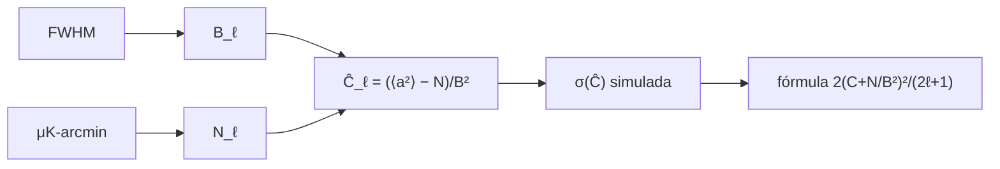

# B40-C13 — Ruido, haz y covarianza instrumental en mapas del fondo

<!-- nav:top -->
[🏠 Programa](../../../../README.md) · [📚 Bloque B40](../../../tronco-comun/B40-universo-temprano-y-radiacion-cosmica-de-fondo.md) · [← Anterior: B40-C12 — Análisis de mapas del CMB: pixelización esférica y máscaras](../B40-C12-analisis-de-mapas-del-cmb-pixelizacion-esferica-y-mascaras/CLASE.md) · [Siguiente: B40-C14 — Productos de datos de Planck y misiones del CMB →](../B40-C14-productos-de-datos-de-planck-y-misiones-del-cmb/CLASE.md)
<!-- /nav -->

## 1. Ubicación, nivel y alcance

Clase 13 del bloque B40. Nivel N3. El instrumento suaviza el cielo con un **haz** y añade **ruido**; ambos entran en el espectro estimado y en su covarianza. Aquí calculas la **ventana del haz gaussiano** por dos vías, el ruido blanco por pixel, el cruce señal–ruido y la dispersión del estimador `Ĉ_ℓ` con simulaciones. Usas [B12](../../../tronco-comun/B12-probabilidad-estadistica-e-incertidumbre.md), [B15](../../../tronco-comun/B15-senales-imagenes-y-estimacion-cientifica.md) y [B10](../../../tronco-comun/B10-algebra-lineal-y-matematicas-geometricas.md). Haz y ruido son ilustrativos y no describen ninguna misión.

## 2. Por qué esta clase existe

Un espectro sin su barra de error no sirve. La decisión central: **¿cuándo domina el ruido y cuánto vale la dispersión del espectro?**

## 3. Lo que podrás hacer al terminar

1. Convertir FWHM en `σ_b` y calcular `B_ℓ`.
2. Verificar `B_ℓ` por una transformada de Legendre.
3. Calcular `N_ℓ` desde μK-arcmin.
4. Hallar el multipolo de cruce.
5. Simular `Ĉ_ℓ` y su dispersión.
6. Aplicar `2(C + N/B²)²/((2ℓ+1) f_sky)`.

La evidencia es la **ficha del ruido y el haz** del ejercicio 12 (sección 20).

## 4. Con qué llegas y cómo comprobarlo

1. ¿Qué es una incertidumbre?
2. ¿Qué es una simulación Monte Carlo?
3. ¿Qué es una tabla de resultados?
4. ¿Qué es un valor ilustrativo?
5. ¿Qué es una verificación?

<details>
<summary>Ver respuestas</summary>

1. Un intervalo en que se espera el valor verdadero. 2. Repetir con números aleatorios de semilla fija. 3. Un resumen ordenado de cálculos. 4. Un valor propuesto para el ejemplo, no medido. 5. Comparar un cálculo con un caso independiente.
</details>

Con cuatro o cinco aciertos, sigue; si no, repasa los prerrequisitos.

## 5. Un caso de contexto y casos de referencia

Con FWHM `7 arcmin` y `30 μK-arcmin` (ilustrativos), `σ_b = 2,9726 arcmin`, `N_ℓ = 7,6154 × 10⁻⁵ μK² sr` y el ruido supera a la señal con haz desde `ℓ = 2009`. A `ℓ = 1000` la dispersión de `Ĉ_ℓ` es `2,0245 × 10⁻⁴` frente a `2,0353 × 10⁻⁴` de la fórmula. Es el **ejemplo conductor**.

## 6. Vocabulario

El **haz** `B_ℓ = exp(−ℓ(ℓ+1)σ_b²/2)`. El **FWHM** `= √(8 ln 2) σ_b`. El **ruido blanco** `N_ℓ`. El **estimador** `Ĉ_ℓ = (⟨abs(a_ℓm)²⟩ − N_ℓ)/B_ℓ²`. La **covarianza** `2(C + N/B²)²/((2ℓ+1) f_sky)`.

## 7. Modelo mental: una foto desenfocada y granulada

Como una foto desenfocada con grano: el desenfoque apaga los detalles finos (haz) y el grano los tapa (ruido).



*Descripción textual:* el haz y el ruido definen el estimador, y su dispersión simulada se compara con la fórmula.

Analogía: una foto desenfocada y granulada. Límite: ruido blanco homogéneo, haz simétrico, cielo completo.

## 8. La explicación, paso a paso

### 8.1 Haz y ruido

`σ_b = 8,647019 × 10⁻⁴ rad = 2,9726 arcmin`; `N_ℓ = 7,6154 × 10⁻⁵ μK² sr`.

| ℓ | B_ℓ analítica | B_ℓ numérica | C_ℓ B_ℓ² | N_ℓ/B_ℓ² |
|---|---|---|---|---|
| 100 | 0,9962312 | 0,9962312 | 0,61742 | 7,6732 × 10⁻⁵ |
| 500 | 0,9106009 | 0,9106009 | 2,0798 × 10⁻² | 9,1841 × 10⁻⁵ |
| 1000 | 0,6878197 | 0,6878197 | 2,9696 × 10⁻³ | 1,6097 × 10⁻⁴ |
| 1500 | 0,4309626 | 0,4309627 | 5,1831 × 10⁻⁴ | 4,1003 × 10⁻⁴ |
| 2000 | 0,2239871 | 0,2239872 | 7,8768 × 10⁻⁵ | 1,5179 × 10⁻³ |

El ruido supera a la señal con haz desde `ℓ = 2009`.

### 8.2 Dispersión del estimador (4000 repeticiones)

| ℓ | σ simulada | σ fórmula | cociente | sesgo medio |
|---|---|---|---|---|
| 100 | 6,2001 × 10⁻² | 6,2062 × 10⁻² | 0,999 | 0,0004 |
| 500 | 1,1286 × 10⁻³ | 1,1253 × 10⁻³ | 1,003 | 0,0017 |
| 1000 | 2,0245 × 10⁻⁴ | 2,0353 × 10⁻⁴ | 0,995 | 0,0005 |
| 1500 | 8,2282 × 10⁻⁵ | 8,2628 × 10⁻⁵ | 0,996 | −0,0003 |

### 8.3 Lectura

Con `f_sky = 0,6` la desviación crece por `1/√0,6 = 1,291` (por la fórmula; no se simuló una máscara). El ℓ = 100 se simula con suma directa de gaussianas y los demás con la distribución gamma equivalente. El espectro de juguete `C_ℓ ∝ 1/ℓ²` no tiene picos.

## 9. Magnitudes, símbolos y unidades

| Símbolo | Qué es | Unidad | Valor / nota |
|---|---|---|---|
| `σ_b` | ancho del haz | rad | 8,647019 × 10⁻⁴ |
| `B_ℓ` | ventana del haz | — | ver 8.1 |
| `N_ℓ` | ruido blanco | μK² sr | 7,6154 × 10⁻⁵ |
| `f_sky` | fracción de cielo | — | 1 (simulado); 0,6 (fórmula) |

## 10. Convenciones y referencias

Sin constantes; FWHM, ruido, `D₀ = 1000 μK²` y repeticiones **ilustrativos**; semilla `20261109`.

## 11. De dónde sale lo que afirmamos

| ID | Fuente | Localizador | Respalda | Estado |
|---|---|---|---|---|
| — | Sin fuente externa | — | relaciones estándar que verifica el laboratorio | No se consultó una fuente para esta clase |

Límites: no se consultó ninguna fuente; el haz y el ruido no describen ninguna misión.

## 12. Cómo ver el haz y el ruido

| ℓ | B_ℓ | N_ℓ/B_ℓ² |
|---|---|---|
| 500 | 0,9106 | 9,18 × 10⁻⁵ |
| 1000 | 0,6878 | 1,61 × 10⁻⁴ |
| 1500 | 0,4310 | 4,10 × 10⁻⁴ |

Descripción larga: el haz cae y el ruido efectivo sube con ℓ.

## 13. Ejemplo trabajado: `B_ℓ` en ℓ = 1000

**Paso 1 · `σ_b`.** `7′ × 0,42466 = 2,9726′ = 8,647 × 10⁻⁴ rad`.

**Paso 2 · Exponente.** `1000 × 1001 × (8,647 × 10⁻⁴)²/2 = 0,37424`.

**Paso 3 · Ventana.** `e^−0,37424 = 0,6878`.

## 14. Distintas formas de describir el resultado

**Por fórmula:** `B_ℓ`. **Por Legendre:** segunda vía. **Por simulación:** `σ(Ĉ)`. **Por código:** `ruido_haz.py`.

## 15. Práctica guiada

**Ejercicio 1 · con los pasos indicados.** `σ_b` para FWHM `7′`. *Pasos:* `7/√(8 ln 2)`.

<details><summary>Solución comentada</summary>

`2,9726′`.
</details>

**Ejercicio 2 · con una pista.** `N_ℓ` para `30 μK-arcmin`. *Pasos:* `(30π/10 800)²`.

<details><summary>Solución comentada</summary>

`7,6154 × 10⁻⁵`.
</details>

**Ejercicio 3 · casi autónomo.** `B_ℓ` en ℓ = 1000. *Pasos:* ejemplo 13.

<details><summary>Solución comentada</summary>

`0,6878`.
</details>

## 16. Práctica autónoma, transferencia e integrador

**Ejercicio 4.** `N_ℓ/B_ℓ²` en ℓ = 1500.

<details><summary>Solución comentada</summary>

`4,100 × 10⁻⁴`.
</details>

**Ejercicio 5.** `σ(Ĉ)/C` en ℓ = 1000.

<details><summary>Solución comentada</summary>

`2,0353 × 10⁻⁴/6,277 × 10⁻³ = 3,2 %`.
</details>

**Ejercicio 6.** `σ` con `f_sky = 0,6` en ℓ = 1000.

<details><summary>Solución comentada</summary>

`2,628 × 10⁻⁴`.
</details>

**Ejercicio 7.** Multipolo de cruce.

<details><summary>Solución comentada</summary>

`2009`.
</details>

**Ejercicio 8.** Sesgo medio relativo.

<details><summary>Solución comentada</summary>

`~0,05 %`.
</details>

**Ejercicio 9 · transferencia.** **Transferencia.** Un compañero dice que 30 μK-arcmin es el ruido de Planck. Responde.

<details><summary>Solución comentada</summary>

Es ilustrativo.
</details>

**Ejercicio 10 · transferencia.** **Transferencia.** ¿Por qué se usa la distribución gamma?

<details><summary>Solución comentada</summary>

Equivale a la suma de cuadrados de gaussianas y es más rápida.
</details>

**Ejercicio 11 · transferencia.** **Transferencia.** ¿Qué omite una máscara real?

<details><summary>Solución comentada</summary>

El acoplamiento entre multipolos.
</details>

**Ejercicio 12.** **Integrador.** Elabora tu *ficha del ruido y el haz*: ventana, ruido, cruce y covarianza.

<details><summary>Solución comentada</summary>

Secciones 8.1–8.3.
</details>

**Ejercicio 12 · integrador.** **Integrador.** Elabora tu *ficha del ruido y el haz*: ventana, ruido, cruce y covarianza.

<details><summary>Solución modelo</summary>

Secciones 8.1–8.3.
</details>

## 17. Laboratorio: haz, ruido y covarianza

El script [ruido_haz.py](ruido_haz.py) calcula `B_ℓ` por dos vías y simula `Ĉ_ℓ` (**comprueba** `B_ℓ` a `10⁻³` y `σ` al 5 %).

**Datos:** sin constantes; haz y ruido **ilustrativos**. **Predice antes de ejecutar:** ¿dónde cruza el ruido? (ℓ ≈ 2000.) **Ejecución del 2026-11-09 (Python 3.12.9):**

```text
Python 3.12.9 (biblioteca estandar)
sigma_b = 8.647019e-04 rad = 2.9726 arcmin ; N_l = 7.6154e-05 uK^2 sr
     l  B_l analitica  B_l numerica    C_l B_l^2          N_l    N_l/B_l^2
   100   9.962312e-01  9.962312e-01   6.1742e-01   7.6154e-05   7.6732e-05
   500   9.106009e-01  9.106009e-01   2.0798e-02   7.6154e-05   9.1841e-05
  1000   6.878197e-01  6.878197e-01   2.9696e-03   7.6154e-05   1.6097e-04
  1500   4.309626e-01  4.309627e-01   5.1831e-04   7.6154e-05   4.1003e-04
  2000   2.239871e-01  2.239872e-01   7.8768e-05   7.6154e-05   1.5179e-03
el ruido supera a la senal con haz (C_l B_l^2 < N_l) desde l = 2009
     l  sigma simulada  sigma formula  cociente  sesgo medio   metodo
   100      6.2001e-02     6.2062e-02     0.999       0.0004  directo
   500      1.1286e-03     1.1253e-03     1.003       0.0017    gamma
  1000      2.0245e-04     2.0353e-04     0.995       0.0005    gamma
  1500      8.2282e-05     8.2628e-05     0.996      -0.0003    gamma
con f_sky = 0,6 la desviacion crece por 1/sqrt(f_sky) = 1.2910 (formula, no simulado)
Pruebas superadas.
```

```bash
python programa/clases/B40/B40-C13-ruido-haz-y-covarianza-instrumental-en-mapas-del-fondo/ruido_haz.py
```

**Límites:** ruido blanco homogéneo, sin máscara simulada.

## 18. Errores frecuentes y cómo corregirlos

**Olvidar dividir por `B_ℓ²`.** Se corrige con 8.1.

**Confundir FWHM y `σ_b`.** Se corrige con el ejemplo 13.

**Mezclar μK-arcmin con μK rad.** Se corrige con la sección 9.

**Presentar el instrumento como real.** Se corrige con la sección 10.

## 19. Cómo sabrás que vas bien

Tras la sección 8: ¿qué resultado esperabas y cuál obtuviste? Si dudas, repasa el ejemplo 13. Tras el laboratorio: ¿qué comprueba? (ver la sección 17).

## 20. Qué entregas y cómo se evalúa

El producto es tu **ficha del ruido y el haz** (ejercicio 12).

| Criterio | Inicial | En desarrollo | Logrado | Destacado |
|---|---|---|---|---|
| Conceptos | Los confunde | Parciales | conceptos de la clase | Explica los límites |
| Cálculo | Sin unidades | Con errores | Tablas completas | Calcula casos nuevos |
| Numérico | Sin comprobar | Un caso | Contraste con el análisis | Interpreta las diferencias |
| Fuentes | Sin fuente | Sin fecha | fuentes con fecha | Declara lo ilustrativo |
| Límites | No los nombra | Uno | Tres | Discute qué falta del modelo |

**Condiciones críticas (no se compensan con promedio):** rotular haz y ruido como ilustrativos; no atribuirlos a una misión; citar solo lo consultado.

## 21. Ética, seguridad y límites

Clase educativa: los modelos son simplificados. Accesibilidad: tablas equivalentes a las gráficas, fórmulas en texto, ejercicios sin conexión.

## 22. Para cerrar y seguir

El haz de 7 arcmin y 30 μK-arcmin dejan el cruce en ℓ ≈ 2009 y una dispersión del estimador que coincide con la fórmula al 1 %. Queda una pregunta: ¿cómo se usan los productos de datos de las misiones?

**Glosario español–inglés.** haz · *beam*; ruido blanco · *white noise*; covarianza · *covariance*; ventana · *window*.

**Continuidad.** [B40-C14](../B40-C14-productos-de-datos-de-planck-y-misiones-del-cmb/CLASE.md) estudia los productos de datos de Planck y otras misiones.

**Referencias:** ver sección 11.

<!-- nav:bottom -->
---

[← Anterior: B40-C12 — Análisis de mapas del CMB: pixelización esférica y máscaras](../B40-C12-analisis-de-mapas-del-cmb-pixelizacion-esferica-y-mascaras/CLASE.md) · [📚 Bloque B40](../../../tronco-comun/B40-universo-temprano-y-radiacion-cosmica-de-fondo.md) · [Siguiente: B40-C14 — Productos de datos de Planck y misiones del CMB →](../B40-C14-productos-de-datos-de-planck-y-misiones-del-cmb/CLASE.md)
<!-- /nav -->
