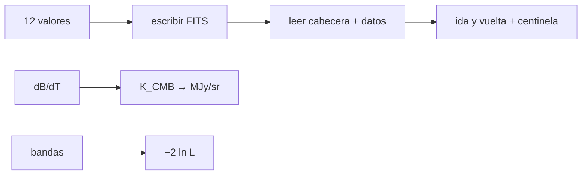

# B40-C14 — Productos de datos de Planck y misiones del CMB

<!-- nav:top -->
[🏠 Programa](../../../../README.md) · [📚 Bloque B40](../../../tronco-comun/B40-universo-temprano-y-radiacion-cosmica-de-fondo.md) · [← Anterior: B40-C13 — Ruido, haz y covarianza instrumental en mapas del fondo](../B40-C13-ruido-haz-y-covarianza-instrumental-en-mapas-del-fondo/CLASE.md) · [Siguiente: B40-C15 — Varianza cósmica y límites de las mediciones del fondo →](../B40-C15-varianza-cosmica-y-limites-de-las-mediciones-del-fondo/CLASE.md)
<!-- /nav -->

## 1. Ubicación, nivel y alcance

Clase 14 del bloque B40. Nivel N3. Los mapas, las máscaras y las verosimilitudes de las misiones se distribuyen en formatos como FITS, con unidades y convenciones en la cabecera. Aquí escribes y lees un archivo FITS **sintético** de 12 pixeles, conviertes `K_CMB` a `MJy/sr` por dos vías y construyes una **verosimilitud gaussiana por bandas**. Usas [B15](../../../tronco-comun/B15-senales-imagenes-y-estimacion-cientifica.md), [B12](../../../tronco-comun/B12-probabilidad-estadistica-e-incertidumbre.md) y [B10](../../../tronco-comun/B10-algebra-lineal-y-matematicas-geometricas.md). **No se descargó ningún producto de Planck.**

## 2. Por qué esta clase existe

Usar un producto sin leer su cabecera es una fuente clásica de errores de unidades y de orden de pixeles. La decisión central: **¿qué dice la cabecera y cómo se convierte y se compara con un modelo?**

## 3. Lo que podrás hacer al terminar

1. Escribir y leer cabeceras FITS de 80 caracteres.
2. Reconocer un valor centinela.
3. Convertir `K_CMB` a `MJy/sr` con `dB/dT`.
4. Comprobar `dB/dT` por diferencias finitas.
5. Construir `−2 ln L` con covarianza diagonal.
6. Ver el efecto de la asimetría de las bandas bajas.

La evidencia es la **ficha de los productos de datos** del ejercicio 12 (sección 20).

## 4. Con qué llegas y cómo comprobarlo

1. ¿Qué es una incertidumbre?
2. ¿Qué es una simulación Monte Carlo?
3. ¿Qué es una tabla de resultados?
4. ¿Qué es un valor ilustrativo?
5. ¿Qué es una verificación?

<details>
<summary>Ver respuestas</summary>

1. Un intervalo en que se espera el valor verdadero. 2. Repetir con números aleatorios de semilla fija. 3. Un resumen ordenado de cálculos. 4. Un valor propuesto para el ejemplo, no medido. 5. Comparar un cálculo con un caso independiente.
</details>

Con cuatro o cinco aciertos, sigue; si no, repasa los prerrequisitos.

## 5. Un caso de contexto y casos de referencia

El archivo sintético ocupa `8640` bytes (3 bloques de 2880), con 12 valores y 1 centinela; a 143 GHz `dB/dT = 379,9320 MJy/sr/K_CMB`. Con 7 bandas la media de `χ²` es `6,994` (exacta 7) y la desviación `3,844` frente a `3,742` gaussiana. Es el **ejemplo conductor**. Todo es **sintético**.

## 6. Vocabulario

**FITS**: bloques de 2880 bytes con tarjetas de 80 caracteres. **BINTABLE**: tabla binaria. **Centinela**: valor que marca pixeles sin dato. `K_CMB` frente a `MJy/sr`. La **verosimilitud gaussiana** `−2 ln L = (d − m)ᵀM⁻¹(d − m)`. Una **banda** agrupa multipolos.

## 7. Modelo mental: una etiqueta de envío

Como la etiqueta de una caja: dice qué lleva dentro, en qué unidades y cómo abrirla; sin leerla el contenido se interpreta mal.



*Descripción textual:* se escribe y se lee un FITS, se convierten unidades y se evalúa una verosimilitud por bandas.

Analogía: una etiqueta de envío. Límite: covarianza diagonal y bandas gaussianas.

## 8. La explicación, paso a paso

### 8.1 El archivo

`8640` bytes (`3` bloques de 2880), `2` HDU, tabla con `TTYPE1 = I_STOKES`, `TUNIT1 = K_CMB`, `ORDERING = RING`, `NSIDE = 1`, `NAXIS2 = 12`. Se recuperan los 12 valores exactos (float32); 11 son válidos (media `+44,031 μK`, rms `124,355 μK`) y 1 está marcado como centinela.

### 8.2 Conversión de unidades

| ν (GHz) | dB/dT analítico (MJy/sr/K_CMB) | diferencias finitas |
|---|---|---|
| 100 | 238,7922 | 238,7922 |
| 143 | 379,9320 | 379,9320 |
| 217 | 483,6447 | 483,6447 |
| 353 | 296,6515 | 296,6515 |
| 545 | 57,1170 | 57,1170 |

Las conversiones no se compararon con la tabla de ninguna misión.

### 8.3 Verosimilitud por bandas

| banda | grados de libertad | C medio (μK²) | σ/C | asimetría |
|---|---|---|---|---|
| 2–4 | 21 | 628,32 | 0,3086 | 0,6172 |
| 5–29 | 875 | 41,888 | 0,0478 | 0,0956 |
| 30–99 | 9100 | 2,0944 | 0,0148 | 0,0296 |
| 100–299 | 80 000 | 0,20944 | 0,0050 | 0,0100 |
| 300–599 | 270 000 | 0,034907 | 0,0027 | 0,0054 |
| 600–999 | 640 000 | 0,010472 | 0,0018 | 0,0035 |
| 1000–1499 | 1 250 000 | 0,0041888 | 0,0013 | 0,0025 |

### 8.4 Lectura

Con 5000 repeticiones, `χ²` tiene media `6,994` y desviación `3,844`; la media es exacta (7) pero la desviación supera a la gaussiana por la asimetría de la banda más baja. Las verosimilitudes publicadas usan covarianzas completas y parámetros de molestia.

## 9. Magnitudes, símbolos y unidades

| Símbolo | Qué es | Unidad | Valor / nota |
|---|---|---|---|
| `dB/dT` | conversión de unidades | MJy/sr/K_CMB | 379,9320 (143 GHz) |
| `NSIDE` | resolución del mapa | — | 1 |
| `ν` | grados de libertad de la banda | — | 21 a 1 250 000 |
| `χ²` | −2 ln L | — | media 6,994 |

## 10. Convenciones y referencias

`h`, `k_B`, `c` de NIST; `T₀` y las bandas de Planck de resúmenes; FITS, centinela y bandas **sintéticos/ilustrativos**; ningún producto descargado.

## 11. De dónde sale lo que afirmamos

| ID | Fuente | Localizador | Respalda | Estado |
|---|---|---|---|---|
| S1 | NIST, *Fundamental Physical Constants* (CODATA 2022) | https://physics.nist.gov/cuu/Constants/Table/allascii.txt | constantes citadas en la sección 9 | Consultada el 2026-11-09 |
| S2 | Fixsen, *The Temperature of the Cosmic Microwave Background* | https://arxiv.org/abs/0911.1955 | T₀ = 2,72548 ± 0,00057 K (valor de la literatura citado en el resumen; el laboratorio usa 2,7255 K) | Solo resumen, consultado el 2026-11-09 |
| S3 | Planck Collaboration, *Planck 2018 results. I. Overview and the cosmological legacy of Planck* | https://arxiv.org/abs/1807.06205 | nueve bandas de 30 a 857 GHz y 18 picos bien determinados (resumen) | Solo resumen, consultado el 2026-11-09 |

Límites: S2 y S3 son solo resúmenes. La estructura FITS se escribió de memoria para el ejemplo; la convención del centinela no se consultó.

## 12. Cómo ver las unidades

| ν (GHz) | MJy/sr/K_CMB |
|---|---|
| 100 | 238,79 |
| 143 | 379,93 |
| 353 | 296,65 |

Descripción larga: el factor de conversión alcanza su máximo cerca de 217 GHz.

## 13. Ejemplo trabajado: una conversión

**Paso 1 · Valor.** `dB/dT = 379,9320 MJy/sr/K` a 143 GHz.

**Paso 2 · Señal.** `100 μK = 10⁻⁴ K`.

**Paso 3 · Producto.** `379,9320 × 10⁻⁴ = 0,0380 MJy/sr`.

## 14. Distintas formas de describir el resultado

**Por cabecera:** tarjetas. **Por tabla:** conversión. **Por forma cuadrática:** `χ²`. **Por código:** `productos.py`.

## 15. Práctica guiada

**Ejercicio 1 · con los pasos indicados.** Bloques del archivo. *Pasos:* `8640/2880`.

<details><summary>Solución comentada</summary>

`3`.
</details>

**Ejercicio 2 · con una pista.** 100 μK a 143 GHz en MJy/sr. *Pasos:* ejemplo 13.

<details><summary>Solución comentada</summary>

`0,0380`.
</details>

**Ejercicio 3 · casi autónomo.** Pixeles válidos.

<details><summary>Solución comentada</summary>

`11` de 12.
</details>

## 16. Práctica autónoma, transferencia e integrador

**Ejercicio 4.** Grados de libertad de la banda 2–4.

<details><summary>Solución comentada</summary>

`5 + 7 + 9 = 21`.
</details>

**Ejercicio 5.** `σ/C` de esa banda.

<details><summary>Solución comentada</summary>

`√(2/21) = 0,3086`.
</details>

**Ejercicio 6.** Asimetría de esa banda.

<details><summary>Solución comentada</summary>

`2 × 0,3086 = 0,6172`.
</details>

**Ejercicio 7.** Media exacta de `χ²` con 7 bandas.

<details><summary>Solución comentada</summary>

`7`.
</details>

**Ejercicio 8.** Factor de conversión a 353 GHz respecto de 143 GHz.

<details><summary>Solución comentada</summary>

`296,65/379,93 = 0,781`.
</details>

**Ejercicio 9 · transferencia.** **Transferencia.** Un compañero dice que se usó un mapa de Planck. Responde.

<details><summary>Solución comentada</summary>

No: el archivo es sintético.
</details>

**Ejercicio 10 · transferencia.** **Transferencia.** ¿Por qué leer la cabecera antes de los datos?

<details><summary>Solución comentada</summary>

Define unidades, orden y centinelas.
</details>

**Ejercicio 11 · transferencia.** **Transferencia.** ¿Qué omite la verosimilitud diagonal?

<details><summary>Solución comentada</summary>

Correlaciones entre bandas y molestias.
</details>

**Ejercicio 12.** **Integrador.** Elabora tu *ficha de los productos de datos*: cabecera, conversión y verosimilitud.

<details><summary>Solución comentada</summary>

Secciones 8.1–8.4.
</details>

**Ejercicio 12 · integrador.** **Integrador.** Elabora tu *ficha de los productos de datos*: cabecera, conversión y verosimilitud.

<details><summary>Solución modelo</summary>

Secciones 8.1–8.4.
</details>

## 17. Laboratorio: formato, unidades y verosimilitud

El script [productos.py](productos.py) escribe y lee FITS, convierte unidades y simula `χ²` (**comprueba** la ida y vuelta exacta, `dB/dT` a `10⁻⁶` y la media de `χ²`).

**Datos:** `h`, `k_B`, `c` de NIST; `T₀` de un resumen; datos **sintéticos**. **Predice antes de ejecutar:** ¿cuántos bloques ocupará el archivo? (3.) **Ejecución del 2026-11-09 (Python 3.12.9):**

```text
Python 3.12.9 (biblioteca estandar)
archivo de 8640 bytes = 3 bloques de 2880 ; HDU: 2 ; tabla: TTYPE1=I_STOKES, TUNIT1=K_CMB, ORDERING=RING, NSIDE=1, NAXIS2=12
valores: 12 ; marcados como sin dato: 1 ; media de los validos = +44.031 uK ; rms = 124.355 uK
 nu [GHz]   dB/dT [MJy/sr/K_CMB] analitico  diferencias finitas
      100                         238.7922             238.7922
      143                         379.9320             379.9320
      217                         483.6447             483.6447
      353                         296.6515             296.6515
      545                          57.1170              57.1170
(las conversiones no se compararon con la tabla de ninguna mision)
       banda  grados de libertad  C medio [uK^2]  sigma/C = sqrt(2/nu)  asimetria 2 sqrt(2/nu)
         2-4                  21      6.2832e+02                0.3086                  0.6172
        5-29                 875      4.1888e+01                0.0478                  0.0956
       30-99                9100      2.0944e+00                0.0148                  0.0296
     100-299               80000      2.0944e-01                0.0050                  0.0100
     300-599              270000      3.4907e-02                0.0027                  0.0054
     600-999              640000      1.0472e-02                0.0018                  0.0035
   1000-1499             1250000      4.1888e-03                0.0013                  0.0025
chi^2 con 7 bandas: media = 6.994 (exacta 7: la media de la forma cuadratica no depende de la asimetria) ; desviacion = 3.844 (gaussiano puro: 3.742; la asimetria de la banda l = 2-4 la aumenta)
Pruebas superadas.
```

```bash
python programa/clases/B40/B40-C14-productos-de-datos-de-planck-y-misiones-del-cmb/productos.py
```

**Límites:** covarianza diagonal, bandas gaussianas.

## 18. Errores frecuentes y cómo corregirlos

**Ignorar la unidad de la cabecera.** Se corrige con 8.2.

**Tratar el centinela como dato.** Se corrige con 8.1.

**Creer que el laboratorio usa Planck.** Se corrige con la sección 10.

**Suponer gaussianas las bandas bajas.** Se corrige con 8.3.

## 19. Cómo sabrás que vas bien

Tras la sección 8: ¿qué resultado esperabas y cuál obtuviste? Si dudas, repasa el ejemplo 13. Tras el laboratorio: ¿qué comprueba? (ver la sección 17).

## 20. Qué entregas y cómo se evalúa

El producto es tu **ficha de los productos de datos** (ejercicio 12).

| Criterio | Inicial | En desarrollo | Logrado | Destacado |
|---|---|---|---|---|
| Conceptos | Los confunde | Parciales | conceptos de la clase | Explica los límites |
| Cálculo | Sin unidades | Con errores | Tablas completas | Calcula casos nuevos |
| Numérico | Sin comprobar | Un caso | Contraste con el análisis | Interpreta las diferencias |
| Fuentes | Sin fuente | Sin fecha | fuentes con fecha | Declara lo ilustrativo |
| Límites | No los nombra | Uno | Tres | Discute qué falta del modelo |

**Condiciones críticas (no se compensan con promedio):** rotular el archivo como sintético; no presentar las conversiones como las de una misión; citar los resúmenes como tales.

## 21. Ética, seguridad y límites

Clase educativa: los modelos son simplificados. Accesibilidad: tablas equivalentes a las gráficas, fórmulas en texto, ejercicios sin conexión.

## 22. Para cerrar y seguir

Un FITS sintético de 3 bloques recupera sus 12 valores, la conversión de 143 GHz es 379,93 MJy/sr/K_CMB y la verosimilitud por bandas da `χ²` medio 6,994. Queda una pregunta: ¿qué límite impone la propia física a la medición?

**Glosario español–inglés.** producto de datos · *data product*; cabecera · *header*; centinela · *sentinel value*; verosimilitud · *likelihood*; banda · *bin*.

**Continuidad.** [B40-C15](../B40-C15-varianza-cosmica-y-limites-de-las-mediciones-del-fondo/CLASE.md) estudia la varianza cósmica.

**Referencias:** ver sección 11.

<!-- nav:bottom -->
---

[← Anterior: B40-C13 — Ruido, haz y covarianza instrumental en mapas del fondo](../B40-C13-ruido-haz-y-covarianza-instrumental-en-mapas-del-fondo/CLASE.md) · [📚 Bloque B40](../../../tronco-comun/B40-universo-temprano-y-radiacion-cosmica-de-fondo.md) · [Siguiente: B40-C15 — Varianza cósmica y límites de las mediciones del fondo →](../B40-C15-varianza-cosmica-y-limites-de-las-mediciones-del-fondo/CLASE.md)
<!-- /nav -->
