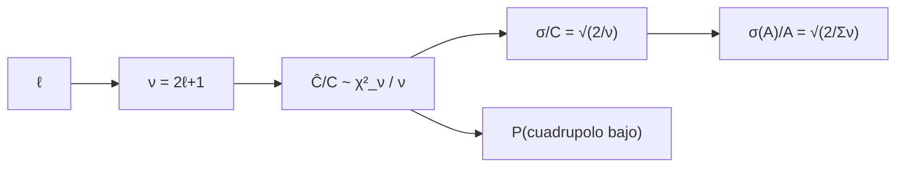

# B40-C15 — Varianza cósmica y límites de las mediciones del fondo

<!-- nav:top -->
[🏠 Programa](../../../../README.md) · [📚 Bloque B40](../../../tronco-comun/B40-universo-temprano-y-radiacion-cosmica-de-fondo.md) · [← Anterior: B40-C14 — Productos de datos de Planck y misiones del CMB](../B40-C14-productos-de-datos-de-planck-y-misiones-del-cmb/CLASE.md) · [Siguiente: B41-C01 — Naturaleza y propagación de la luz →](../../B41/B41-C01-naturaleza-y-propagacion-de-la-luz/CLASE.md)
<!-- /nav -->

## 1. Ubicación, nivel y alcance

Clase 15 del bloque B40. Nivel N3. Solo tenemos un cielo: cada `C_ℓ` se estima con `2ℓ + 1` modos y por eso tiene una incertidumbre mínima, aunque el instrumento sea perfecto. Aquí simulas la distribución de `Ĉ_ℓ`, mides su dispersión frente a `√(2/(2ℓ+1))`, calculas la probabilidad de un cuadrupolo bajo y la precisión máxima de una amplitud. Usas [B12](../../../tronco-comun/B12-probabilidad-estadistica-e-incertidumbre.md), [B26](../../../tronco-comun/B26-relatividad-y-cosmologia.md) y [B05](../../../tronco-comun/B05-fisica-fundamental-para-el-espacio.md). Todo es sintético.

## 2. Por qué esta clase existe

La varianza cósmica es el límite fundamental de la medición del fondo. La decisión central: **¿qué precisión máxima permite el número de modos disponibles?**

## 3. Lo que podrás hacer al terminar

1. Reconocer `(2ℓ+1) Ĉ_ℓ/C_ℓ ~ χ²` con `2ℓ+1` grados de libertad.
2. Medir `σ/C = √(2/(2ℓ+1))` por simulación.
3. Calcular percentiles 5–95 %.
4. Calcular la probabilidad de un cuadrupolo bajo.
5. Hallar `σ(A)/A = √(2/modos)`.
6. Incluir `f_sky` por la fórmula.

La evidencia es la **ficha de la varianza cósmica** del ejercicio 12 (sección 20).

## 4. Con qué llegas y cómo comprobarlo

1. ¿Qué es una incertidumbre?
2. ¿Qué es una simulación Monte Carlo?
3. ¿Qué es una tabla de resultados?
4. ¿Qué es un valor ilustrativo?
5. ¿Qué es una verificación?

<details>
<summary>Ver respuestas</summary>

1. Un intervalo en que se espera el valor verdadero. 2. Repetir con números aleatorios de semilla fija. 3. Un resumen ordenado de cálculos. 4. Un valor propuesto para el ejemplo, no medido. 5. Comparar un cálculo con un caso independiente.
</details>

Con cuatro o cinco aciertos, sigue; si no, repasa los prerrequisitos.

## 5. Un caso de contexto y casos de referencia

A `ℓ = 2` la dispersión relativa simulada es `0,6367` (teórica `0,6325`) y el intervalo 5–95 % va de `0,229` a `2,230`; `P(Ĉ_2 < 0,5 C_2) = 0,2235` (simulada `0,2265`). Con `ℓ_max = 200` en cielo completo, `σ(A)/A = 0,00704`. Es el **ejemplo conductor**. Todo es **sintético**.

## 6. Vocabulario

La **varianza cósmica**. Los **grados de libertad** `2ℓ + 1`. La **distribución χ²**. La **precisión de una amplitud** `σ(A)/A = √(2/Σ(2ℓ+1) f_sky)`. Un **percentil**. El **cuadrupolo** `ℓ = 2`.

## 7. Modelo mental: tirar pocos dados

Como estimar la media de un dado lanzándolo pocas veces: con `2ℓ + 1` lanzamientos la estimación fluctúa por azar, por buena que sea la balanza.



*Descripción textual:* cada multipolo aporta `2ℓ + 1` modos independientes cuya dispersión limita la precisión.

Analogía: tirar pocos dados. Límite: campo gaussiano, modos independientes, sin ruido.

## 8. La explicación, paso a paso

### 8.1 Dispersión

| ℓ | σ simulada | √(2/(2ℓ+1)) | cociente | p5 | p95 |
|---|---|---|---|---|---|
| 2 | 0,63671 | 0,63246 | 1,007 | 0,229 | 2,230 |
| 5 | 0,42369 | 0,42640 | 0,994 | 0,414 | 1,777 |
| 10 | 0,30954 | 0,30861 | 1,003 | 0,552 | 1,564 |
| 30 | 0,18073 | 0,18107 | 0,998 | 0,722 | 1,316 |
| 100 | 0,09997 | 0,09975 | 1,002 | 0,842 | 1,171 |
| 1000 | 0,03149 | 0,03161 | 0,996 | 0,949 | 1,052 |

### 8.2 Cuadrupolo bajo

`P(Ĉ_2 < 0,5 C_2)` analítica con `χ²` de 5 grados de libertad es `0,2235`; la simulada, `0,2265`: un cuadrupolo la mitad de lo esperado ocurre una de cada cuatro o cinco veces.

### 8.3 Precisión de una amplitud

| ℓ_max | f_sky | modos | σ(A)/A |
|---|---|---|---|
| 30 | 1,0 | 957 | 0,04572 |
| 30 | 0,6 | 574 | 0,05902 |
| 200 | 1,0 | 40 397 | 0,00704 |
| 200 | 0,6 | 24 238 | 0,00908 |
| 1000 | 1,0 | 1 001 997 | 0,00141 |
| 1000 | 0,6 | 601 198 | 0,00182 |
| 2000 | 1,0 | 4 003 997 | 0,00071 |
| 2000 | 0,6 | 2 402 398 | 0,00091 |

Con `ℓ_max = 200`, cielo completo y 5000 repeticiones, `σ(A)/A` simulada es `0,00704` frente a `0,00704` teórica (cociente `1,000`).

### 8.4 Lectura

El error relativo cae como `1/ℓ_max`. El factor `f_sky` es una corrección de primer orden de la fórmula; no se simuló una máscara. Con ruido o primeros planos la precisión es peor que este límite.

## 9. Magnitudes, símbolos y unidades

| Símbolo | Qué es | Unidad | Valor / nota |
|---|---|---|---|
| `ν` | grados de libertad | — | `2ℓ + 1` |
| `σ/C` | dispersión relativa | — | `√(2/ν)` |
| `σ(A)/A` | precisión de la amplitud | — | 0,00704 (ℓ_max = 200) |
| `f_sky` | fracción de cielo | — | 1; 0,6 (fórmula) |

## 10. Convenciones y referencias

Sin constantes; todo **sintético** con semilla `20261109`; `ℓ_max` y `f_sky` ilustrativos.

## 11. De dónde sale lo que afirmamos

| ID | Fuente | Localizador | Respalda | Estado |
|---|---|---|---|---|
| — | Sin fuente externa | — | relaciones estándar que verifica el laboratorio | No se consultó una fuente para esta clase |

Límites: no se consultó ninguna fuente; no se cita ninguna medición del cuadrupolo real.

## 12. Cómo ver la dispersión

| ℓ | σ/C |
|---|---|
| 2 | 0,632 |
| 30 | 0,181 |
| 1000 | 0,0316 |

Descripción larga: la incertidumbre relativa baja como la raíz del número de modos.

## 13. Ejemplo trabajado: `σ(A)/A`

**Paso 1 · Modos.** `(200 + 1)² − 4 = 40 397`.

**Paso 2 · Cociente.** `2/40 397 = 4,951 × 10⁻⁵`.

**Paso 3 · Raíz.** `0,00704`.

## 14. Distintas formas de describir el resultado

**Por distribución:** χ². **Por tabla:** dispersión. **Por suma de modos:** amplitud. **Por código:** `varianza_cosmica.py`.

## 15. Práctica guiada

**Ejercicio 1 · con los pasos indicados.** `σ/C` en `ℓ = 2`. *Pasos:* `√(2/5)`.

<details><summary>Solución comentada</summary>

`0,6325`.
</details>

**Ejercicio 2 · con una pista.** `σ/C` en `ℓ = 1000`.

<details><summary>Solución comentada</summary>

`0,0316`.
</details>

**Ejercicio 3 · casi autónomo.** `σ(A)/A` con `ℓ_max = 200`. *Pasos:* ejemplo 13.

<details><summary>Solución comentada</summary>

`0,00704`.
</details>

## 16. Práctica autónoma, transferencia e integrador

**Ejercicio 4.** `σ(A)/A` con `f_sky = 0,6`.

<details><summary>Solución comentada</summary>

`0,00909`.
</details>

**Ejercicio 5.** Intervalo 5–95 % en `ℓ = 2`.

<details><summary>Solución comentada</summary>

`[0,229; 2,230]`.
</details>

**Ejercicio 6.** `P(Ĉ_2 < 0,5 C_2)`.

<details><summary>Solución comentada</summary>

`0,2235`.
</details>

**Ejercicio 7.** `ℓ_max` para `σ(A)/A = 1 %` en cielo completo.

<details><summary>Solución comentada</summary>

`≈ 140`.
</details>

**Ejercicio 8.** Cociente simulado/teórico en `ℓ = 2`.

<details><summary>Solución comentada</summary>

`1,007`.
</details>

**Ejercicio 9 · transferencia.** **Transferencia.** Un compañero dice que un cuadrupolo bajo prueba física nueva. Responde.

<details><summary>Solución comentada</summary>

Su probabilidad ya es 22 %.
</details>

**Ejercicio 10 · transferencia.** **Transferencia.** ¿Por qué `f_sky` empeora la precisión?

<details><summary>Solución comentada</summary>

Hay menos modos independientes.
</details>

**Ejercicio 11 · transferencia.** **Transferencia.** ¿Se puede vencer la varianza cósmica con más ruido bajo?

<details><summary>Solución comentada</summary>

No: es una propiedad del cielo.
</details>

**Ejercicio 12.** **Integrador.** Elabora tu *ficha de la varianza cósmica*: dispersión, percentiles y precisión de la amplitud.

<details><summary>Solución comentada</summary>

Secciones 8.1–8.4.
</details>

**Ejercicio 12 · integrador.** **Integrador.** Elabora tu *ficha de la varianza cósmica*: dispersión, percentiles y precisión de la amplitud.

<details><summary>Solución modelo</summary>

Secciones 8.1–8.4.
</details>

## 17. Laboratorio: varianza cósmica

El script [varianza_cosmica.py](varianza_cosmica.py) simula `Ĉ_ℓ` y la amplitud (**comprueba** 3 % de la teoría y la probabilidad del cuadrupolo a 0,01).

**Datos:** sin constantes; datos **sintéticos**. **Predice antes de ejecutar:** ¿cuánta dispersión a ℓ = 2? (63 %.) **Ejecución del 2026-11-09 (Python 3.12.9):**

```text
Python 3.12.9 (biblioteca estandar)
    l  sigma simulada  sqrt(2/(2l+1))  cociente     p5 %    p95 %   metodo
    2         0.63671         0.63246     1.007    0.229    2.230  directo
    5         0.42369         0.42640     0.994    0.414    1.777  directo
   10         0.30954         0.30861     1.003    0.552    1.564  directo
   30         0.18073         0.18107     0.998    0.722    1.316  directo
  100         0.09997         0.09975     1.002    0.842    1.171    gamma
 1000         0.03149         0.03161     0.996    0.949    1.052    gamma
P(C^_2 < 0,5 C_2): analitica (chi^2 con 5 gl) = 0.2235 ; simulada = 0.2265
 l_max  f_sky   modos (2l+1) f_sky   sigma(A)/A = sqrt(2/modos)
    30    1.0                  957                      0.04572
    30    0.6                  574                      0.05902
   200    1.0                40397                      0.00704
   200    0.6                24238                      0.00908
  1000    1.0              1001997                      0.00141
  1000    0.6               601198                      0.00182
  2000    1.0              4003997                      0.00071
  2000    0.6              2402398                      0.00091
l_max = 200, cielo completo: sigma(A)/A simulada = 0.00704 ; teorica = 0.00704 ; cociente = 1.000
Pruebas superadas.
```

```bash
python programa/clases/B40/B40-C15-varianza-cosmica-y-limites-de-las-mediciones-del-fondo/varianza_cosmica.py
```

**Límites:** campo gaussiano, sin ruido, sin máscara simulada.

## 18. Errores frecuentes y cómo corregirlos

**Creer que el ruido mínimo elimina el límite.** Se corrige con 8.4.

**Olvidar `f_sky`.** Se corrige con 8.3.

**Interpretar un `C_2` bajo como anomalía.** Se corrige con 8.2.

**Presentar lo sintético como medición.** Se corrige con la sección 10.

## 19. Cómo sabrás que vas bien

Tras la sección 8: ¿qué resultado esperabas y cuál obtuviste? Si dudas, repasa el ejemplo 13. Tras el laboratorio: ¿qué comprueba? (ver la sección 17).

## 20. Qué entregas y cómo se evalúa

El producto es tu **ficha de la varianza cósmica** (ejercicio 12).

| Criterio | Inicial | En desarrollo | Logrado | Destacado |
|---|---|---|---|---|
| Conceptos | Los confunde | Parciales | conceptos de la clase | Explica los límites |
| Cálculo | Sin unidades | Con errores | Tablas completas | Calcula casos nuevos |
| Numérico | Sin comprobar | Un caso | Contraste con el análisis | Interpreta las diferencias |
| Fuentes | Sin fuente | Sin fecha | fuentes con fecha | Declara lo ilustrativo |
| Límites | No los nombra | Uno | Tres | Discute qué falta del modelo |

**Condiciones críticas (no se compensan con promedio):** rotular todo como sintético; no sacar conclusiones sobre el cuadrupolo real; citar solo lo consultado.

## 21. Ética, seguridad y límites

Clase educativa: los modelos son simplificados. Accesibilidad: tablas equivalentes a las gráficas, fórmulas en texto, ejercicios sin conexión.

## 22. Para cerrar y seguir

Cada multipolo tiene una dispersión mínima `√(2/(2ℓ+1))`: 63 % en el cuadrupolo y 0,7 % en la amplitud con `ℓ_max = 200`. Con esto se cierra el bloque: de la inflación a los límites de la medición del fondo.

**Glosario español–inglés.** varianza cósmica · *cosmic variance*; grados de libertad · *degrees of freedom*; percentil · *percentile*; cuadrupolo · *quadrupole*.

**Continuidad.** no hay clase siguiente en este bloque: B40 termina aquí.

**Referencias:** ver sección 11.

<!-- nav:bottom -->
---

[← Anterior: B40-C14 — Productos de datos de Planck y misiones del CMB](../B40-C14-productos-de-datos-de-planck-y-misiones-del-cmb/CLASE.md) · [📚 Bloque B40](../../../tronco-comun/B40-universo-temprano-y-radiacion-cosmica-de-fondo.md) · [Siguiente: B41-C01 — Naturaleza y propagación de la luz →](../../B41/B41-C01-naturaleza-y-propagacion-de-la-luz/CLASE.md)
<!-- /nav -->
