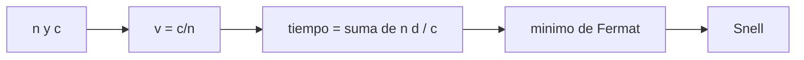

# B41-C01 — Naturaleza y propagación de la luz

<!-- nav:top -->
[🏠 Programa](../../../../README.md) · [📚 Bloque B41](../../../tronco-comun/B41-optica-geometrica-y-diseno-de-telescopios.md) · [← Anterior: B40-C15 — Varianza cósmica y límites de las mediciones del fondo](../../B40/B40-C15-varianza-cosmica-y-limites-de-las-mediciones-del-fondo/CLASE.md) · [Siguiente: B41-C02 — Índice de refracción y ley de Snell →](../B41-C02-indice-de-refraccion-y-ley-de-snell/CLASE.md)
<!-- /nav -->

## 1. Ubicación, nivel y alcance

Clase 1 del bloque B41. Nivel N3. Esta clase abre el bloque: la luz se describe como **rayos** que viajan a la velocidad `c/n` y que, entre dos puntos, siguen el camino de tiempo mínimo. Usas [B05](../../../tronco-comun/B05-fisica-fundamental-para-el-espacio.md) y [B42](../../../tronco-comun/B42-optica-fisica-y-optica-adaptativa.md) solo como contexto: aquí no hay ondas ni difracción. El ejemplo conductor es un rayo que cruza de aire a vidrio.

## 2. Por qué esta clase existe

Sin un modelo de rayos no se puede diseñar un telescopio. La decisión central: **¿cuándo basta con rayos y cuánto tarda la luz en cada medio?**

## 3. Lo que podrás hacer al terminar

1. Calcular la velocidad de la luz en un medio de índice `n`.
2. Calcular el camino óptico y el tiempo de tránsito de una pila de capas.
3. Aplicar el principio de Fermat con una búsqueda numérica.
4. Comprobar que el mínimo reproduce la ley de Snell.
5. Distinguir el ahorro de tiempo frente a la trayectoria recta.
6. Reconocer cuándo la óptica geométrica deja de valer.

La evidencia es la **ficha de la propagación de la luz** del ejercicio 12 (sección 20).

## 4. Con qué llegas y cómo comprobarlo

1. ¿Qué es un rayo de luz en óptica geométrica?
2. ¿Qué dice la ley de Snell?
3. ¿Qué es la distancia focal de una lente o un espejo?
4. ¿Qué es un valor ilustrativo?
5. ¿Qué es una verificación numérica?

<details>
<summary>Ver respuestas</summary>

1. Una línea que indica la dirección de propagación de la energía. 2. `n₁ sen θ₁ = n₂ sen θ₂`. 3. La distancia del elemento al punto donde converge un haz paralelo. 4. Un valor propuesto para el ejemplo, no medido. 5. Comparar un cálculo con un caso independiente.
</details>

Con cuatro o cinco aciertos, sigue; si no, repasa los prerrequisitos.

## 5. Un caso de contexto y casos de referencia

Con `n₁ = 1,0003` (aire) y `n₂ = 1,517` (vidrio, ilustrativos), un rayo de `A = (0 ; 0,30 m)` a `B = (0,40 m ; −0,20 m)` cruza la interfaz en `x = 295,5867 mm`: sale a `44,5754°` y entra a `27,5675°`, y tarda `2546,8929 ps`, `31,04 ps` menos que en línea recta. Es el **ejemplo conductor**.

## 6. Vocabulario

El **rayo**: línea de propagación de la energía. El **índice de refracción** `n = c/v`. El **camino óptico** `Σ nᵢdᵢ`. El **principio de Fermat**: el tiempo de tránsito es estacionario. El **medio homogéneo e isótropo**. La **interfaz**.

## 7. Modelo mental: un socorrista en la playa

Como un socorrista que corre más rápido en la arena que nadando: para llegar antes al bañista no va en línea recta, sino que entra al agua en el punto que minimiza el tiempo; la luz hace lo mismo entre medios de distinta velocidad.



*Descripción textual:* el índice fija la velocidad, la suma de `n d` da el tiempo y su mínimo reproduce la ley de Snell.

Analogía: un socorrista en la playa. Límite: medios homogéneos y objetos mucho mayores que la longitud de onda.

## 8. La explicación, paso a paso

### 8.1 Velocidad en cada medio

| Medio | n (ilustrativo) | v (km/s) | Tiempo en 1 m (ns) |
|---|---|---|---|
| vacío | 1,0000 | 299 792,5 | 3,33564 |
| aire | 1,0003 | 299 702,5 | 3,33664 |
| agua | 1,333 | 224 900,6 | 4,44641 |
| vidrio | 1,517 | 197 621,9 | 5,06017 |

`c = 299 792 458 m/s` es exacta (NIST, tabla local consultada el 2026-11-09).

### 8.2 Camino óptico

La pila vidrio 10 mm + agua 50 mm + aire 200 mm tiene `OPL = 281,8800 mm` y tarda `940,2505 ps`, igual a `OPL/c`.

### 8.3 Fermat frente a Snell

El mínimo numérico (búsqueda ternaria) da `x = 295,5867 mm`, `θ₁ = 44,5754°` y `θ₂ = 27,5675°`; la ley de Snell da `27,5675°` (diferencia `2,6 × 10⁻⁸ rad`). El tiempo mínimo es `2546,8929 ps` y el de la recta `2577,9311 ps`: el ahorro es `31,04 ps`.

### 8.4 Lectura

La ley de Snell no es un axioma aparte: es la condición de tiempo estacionario. Eso solo vale mientras los rayos sean una buena descripción (clase B42 trata lo contrario).

## 9. Magnitudes, símbolos y unidades

| Símbolo | Qué es | Unidad | Valor / nota |
|---|---|---|---|
| `c` | velocidad de la luz en el vacío | m/s | 299 792 458 (exacta) |
| `n` | índice de refracción | — | 1,0003 / 1,333 / 1,517 (ilustrativos) |
| `v` | velocidad en el medio | km/s | `c/n` |
| `OPL` | camino óptico | mm | 281,8800 en la pila |
| `t` | tiempo de tránsito | ps | 2546,8929 (mínimo) |

## 10. Convenciones y referencias

Distancias en milímetros salvo indicación; ángulos en radianes o grados según se rotule; las salidas del laboratorio usan punto decimal y el texto usa coma decimal. Los valores de vidrios, instrumentos y sensores son ilustrativos.

## 11. De dónde sale lo que afirmamos

| ID | Fuente | Localizador | Respalda | Estado |
|---|---|---|---|---|
| S1 | NIST, *Fundamental Physical Constants* (CODATA 2022) | https://physics.nist.gov/cuu/Constants/Table/allascii.txt | velocidad de la luz en el vacío (exacta) | Consultada el 2026-11-09 |
| — | Sin fuente externa | — | relaciones de óptica geométrica de libro que verifica el laboratorio | No se consultó una fuente para esta clase; las cifras son ilustrativas |

Límites: la velocidad de la luz en el vacío viene de la tabla del NIST consultada; los índices y distancias no se consultaron.

## 12. Cómo ver el camino de tiempo mínimo

Cada medio frena la luz según su índice y el rayo elige el cruce que minimiza el tiempo total.

## 13. Ejemplo trabajado: el tiempo de la pila

**Paso 1 · Camino óptico.** `1,517 × 10 + 1,333 × 50 + 1,0003 × 200 = 15,17 + 66,65 + 200,06 = 281,88 mm`.

**Paso 2 · Tiempo.** `0,28188 m / 299 792 458 m/s = 9,4025 × 10⁻¹⁰ s = 940,25 ps`.

**Paso 3 · Comprobación.** El laboratorio imprime `940,2505 ps` por la suma de `n d/c` y por `OPL/c`.

## 14. Distintas formas de describir el resultado

**Por fórmula:** la relación analítica. **Por tabla:** las cifras del laboratorio. **Por gráfica:** el diagrama de la sección 7. **Por código:** el script de la sección 17.

## 15. Práctica guiada

**Ejercicio 1 · con los pasos indicados.** Velocidad de la luz en agua con `n = 1,333`. *Pasos:* `c/n`.

<details><summary>Solución comentada</summary>

`299 792,5/1,333 = 224 900,6 km/s`.
</details>

**Ejercicio 2 · con una pista.** Tiempo que tarda en recorrer 1 m de vidrio con `n = 1,517`.

<details><summary>Solución comentada</summary>

`1,517/299 792 458 = 5,06017 ns`.
</details>

**Ejercicio 3 · casi autónomo.** Camino óptico de 10 mm de vidrio, 50 mm de agua y 200 mm de aire.

<details><summary>Solución comentada</summary>

`281,88 mm`.
</details>

## 16. Práctica autónoma, transferencia e integrador

**Ejercicio 4.** Tiempo de esa pila.

<details><summary>Solución comentada</summary>

`940,25 ps`.
</details>

**Ejercicio 5.** Retraso del vidrio frente al vacío en 1 m.

<details><summary>Solución comentada</summary>

`5,06017 − 3,33564 = 1,72453 ns`.
</details>

**Ejercicio 6.** Índice de un medio donde `v = 2,0 × 10⁸ m/s`.

<details><summary>Solución comentada</summary>

`299 792 458/2,0 × 10⁸ = 1,4990`.
</details>

**Ejercicio 7.** Ahorro de Fermat frente a la recta.

<details><summary>Solución comentada</summary>

`2577,9311 − 2546,8929 = 31,04 ps`.
</details>

**Ejercicio 8.** Ángulo de refracción de Snell para `θ₁ = 44,5754°`.

<details><summary>Solución comentada</summary>

`27,5675°`.
</details>

**Ejercicio 9 · transferencia.** **Transferencia.** Una fibra con `n = 1,468` (ilustrativo) mide 1 km. ¿Cuánto retrasa la señal?

<details><summary>Solución comentada</summary>

`1,468 × 1000/299 792 458 = 4,897 µs`.
</details>

**Ejercicio 10 · transferencia.** **Transferencia.** ¿Por qué decimos que la luz «se frena» si fotón y `c` no cambian?

<details><summary>Solución comentada</summary>

Es una descripción de la fase y de la propagación efectiva en el medio; el modelo de rayos solo usa `v = c/n`.
</details>

**Ejercicio 11 · transferencia.** **Transferencia.** Un vidrio de 20 mm con `n = 1,517` frente a 20 mm de aire: ¿cuánto camino óptico y tiempo añade?

<details><summary>Solución comentada</summary>

`30,34 − 20,00 = 10,34 mm` de camino y `34,5 ps`.
</details>

**Ejercicio 12.** **Integrador.** Elabora tu *ficha de la propagación de la luz*: tabla de velocidades, camino óptico, Fermat frente a Snell y límites.

<details><summary>Solución comentada</summary>

Secciones 8.1–8.4.
</details>

**Ejercicio 12 · integrador.** **Integrador.** Elabora tu *ficha de la propagación de la luz*: tabla de velocidades, camino óptico, Fermat frente a Snell y límites.

<details><summary>Solución modelo</summary>

Secciones 8.1–8.4.
</details>

## 17. Laboratorio: velocidad, camino óptico y Fermat

El script [propagacion.py](propagacion.py) calcula velocidades, el camino óptico de una pila y el cruce de tiempo mínimo (**comprueba** el ángulo de Fermat contra Snell a `10⁻⁶ rad`).

**Datos:** `c` del NIST; índices y distancias **ilustrativos**. **Predice antes de ejecutar:** ¿qué ángulo de refracción saldrá? (≈ 27,6°.) **Ejecución del 2026-11-09 (Python 3.12.9):**

```text
Python 3.12.9 (biblioteca estandar)
c = 299792458 m/s (exacta, NIST)
  medio       n     v [km/s]  t en 1 m [ns]
  vacio  1.0000     299792.5        3.33564
   aire  1.0003     299702.5        3.33664
   agua  1.3330     224900.6        4.44641
 vidrio  1.5170     197621.9        5.06017
camino optico de la pila = 281.8800 mm ; tiempo = 940.2505 ps ; OPL/c = 940.2505 ps
Fermat: cruce x = 295.5867 mm ; t1 = 44.5754 deg ; t2 = 27.5675 deg
Snell : t2 = 27.5675 deg ; diferencia = 2.61e-08 rad ; n1 sen t1 - n2 sen t2 = 3.52e-08
tiempo minimo = 2546.8929 ps ; trayecto recto = 2577.9311 ps ; ahorro = 31038.14 fs
Pruebas superadas.
```

```bash
python programa/clases/B41/B41-C01-naturaleza-y-propagacion-de-la-luz/propagacion.py
```

**Límites:** medios homogéneos, interfaz plana, sin difracción.

## 18. Errores frecuentes y cómo corregirlos

**Creer que `c` cambia en el medio.** Se corrige con 8.1: cambia `v`, no `c`.

**Olvidar multiplicar por `n` en el camino óptico.** Se corrige con 8.2.

**Tomar el mínimo de distancia en vez del de tiempo.** Se corrige con 8.3.

**Presentar los índices como medidos.** Se corrige con la sección 10.

## 19. Cómo sabrás que vas bien

Tras la sección 8: ¿qué resultado esperabas y cuál obtuviste? Si dudas, repasa el ejemplo 13. Tras el laboratorio: ¿qué comprueba? (ver la sección 17).

## 20. Qué entregas y cómo se evalúa

El producto es tu **ficha de la propagación de la luz** (ejercicio 12).

| Criterio | Inicial | En desarrollo | Logrado | Destacado |
|---|---|---|---|---|
| Conceptos | Los confunde | Parciales | conceptos de la clase | Explica los límites |
| Cálculo | Sin unidades | Con errores | Tablas completas | Calcula casos nuevos |
| Numérico | Sin comprobar | Un caso | Contraste con el análisis | Interpreta las diferencias |
| Fuentes | Sin fuente | Sin fecha | fuentes con fecha | Declara lo ilustrativo |
| Límites | No los nombra | Uno | Tres | Discute qué falta del modelo |

**Condiciones críticas (no se compensan con promedio):** rotular lo ilustrativo; no presentar el modelo como un instrumento real; citar solo lo consultado.

## 21. Ética, seguridad y límites

Clase educativa: los modelos son simplificados. Accesibilidad: tablas equivalentes a las gráficas, fórmulas en texto, ejercicios sin conexión.

## 22. Para cerrar y seguir

Los rayos de tiempo mínimo reproducen la ley de Snell y dan el cruce a `295,59 mm`. Queda por ver cómo se mide el desvío con precisión: la refracción.

**Glosario español–inglés.** rayo · *ray*; índice de refracción · *refractive index*; camino óptico · *optical path length*; principio de Fermat · *Fermat's principle*; interfaz · *interface*.

**Continuidad.** [B41-C02](../B41-C02-indice-de-refraccion-y-ley-de-snell/CLASE.md) estudia el índice de refracción y la ley de Snell.

**Referencias:** ver sección 11.

<!-- nav:bottom -->
---

[← Anterior: B40-C15 — Varianza cósmica y límites de las mediciones del fondo](../../B40/B40-C15-varianza-cosmica-y-limites-de-las-mediciones-del-fondo/CLASE.md) · [📚 Bloque B41](../../../tronco-comun/B41-optica-geometrica-y-diseno-de-telescopios.md) · [Siguiente: B41-C02 — Índice de refracción y ley de Snell →](../B41-C02-indice-de-refraccion-y-ley-de-snell/CLASE.md)
<!-- /nav -->
