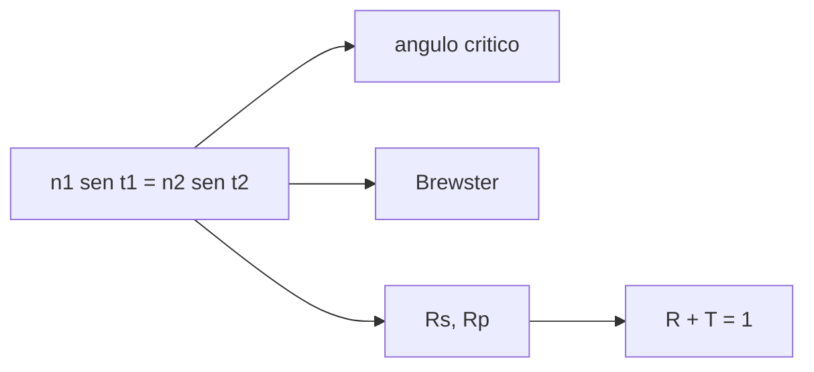

# B41-C02 — Índice de refracción y ley de Snell

<!-- nav:top -->
[🏠 Programa](../../../../README.md) · [📚 Bloque B41](../../../tronco-comun/B41-optica-geometrica-y-diseno-de-telescopios.md) · [← Anterior: B41-C01 — Naturaleza y propagación de la luz](../B41-C01-naturaleza-y-propagacion-de-la-luz/CLASE.md) · [Siguiente: B41-C03 — Reflexión y espejos planos →](../B41-C03-reflexion-y-espejos-planos/CLASE.md)
<!-- /nav -->

## 1. Ubicación, nivel y alcance

Clase 2 del bloque B41. Nivel N3. Aplicas la **ley de Snell** a una interfaz aire-vidrio, calculas el **ángulo crítico**, el **ángulo de Brewster** y la **reflectancia de Fresnel**. Usas [B05](../../../tronco-comun/B05-fisica-fundamental-para-el-espacio.md) y la clase anterior. Los índices son ilustrativos.

## 2. Por qué esta clase existe

Un telescopio refractor y los recubrimientos dependen de cuánta luz se refleja y a qué ángulo se dobla. La decisión central: **¿qué fracción de luz se pierde por reflexión y cuándo hay reflexión total?**

## 3. Lo que podrás hacer al terminar

1. Aplicar `n₁ sen θ₁ = n₂ sen θ₂`.
2. Calcular el ángulo crítico y el de Brewster.
3. Calcular `Rs` y `Rp` de Fresnel.
4. Verificar `R + T = 1`.
5. Comprobar el invariante `n sen θ` en una pila de capas.
6. Reconocer los límites de la onda plana.

La evidencia es la **ficha de la refracción** del ejercicio 12 (sección 20).

## 4. Con qué llegas y cómo comprobarlo

1. ¿Qué es un rayo de luz en óptica geométrica?
2. ¿Qué dice la ley de Snell?
3. ¿Qué es la distancia focal de una lente o un espejo?
4. ¿Qué es un valor ilustrativo?
5. ¿Qué es una verificación numérica?

<details>
<summary>Ver respuestas</summary>

1. Una línea que indica la dirección de propagación de la energía. 2. `n₁ sen θ₁ = n₂ sen θ₂`. 3. La distancia del elemento al punto donde converge un haz paralelo. 4. Un valor propuesto para el ejemplo, no medido. 5. Comparar un cálculo con un caso independiente.
</details>

Con cuatro o cinco aciertos, sigue; si no, repasa los prerrequisitos.

## 5. Un caso de contexto y casos de referencia

Para aire (`1,0003`) a vidrio (`1,517`), la reflectancia en incidencia normal es `0,042132`, el ángulo de Brewster es `56,5994°` (donde `Rp = 0`) y de vidrio a aire el ángulo crítico es `41,2536°`. Es el **ejemplo conductor**.

## 6. Vocabulario

La **ley de Snell**. El **ángulo crítico** `asin(n₂/n₁)`. El **ángulo de Brewster** `atan(n₂/n₁)`. La **reflectancia** `R` y la **transmitancia** `T`. Las polarizaciones **s** y **p**. La **reflexión total interna**.

## 7. Modelo mental: un coche que entra en el barro

Como un coche que entra de lado en un barrizal: la rueda que entra primero se frena y el coche gira hacia la normal; si el barro frena mucho y se entra muy tangente, la trayectoria no entra (reflexión total).



*Descripción textual:* la ley de Snell fija el ángulo y los coeficientes de Fresnel el reparto de energía.

Analogía: un coche que entra en el barro. Límite: onda plana y dieléctricos transparentes.

## 8. La explicación, paso a paso

### 8.1 Aire a vidrio

| θ₁ (°) | θ₂ (°) | Rs | Rp | R media |
|---|---|---|---|---|
| 0 | 0,000 | 0,04213 | 0,04213 | 0,04213 |
| 20 | 13,034 | 0,04950 | 0,03531 | 0,04240 |
| 40 | 25,078 | 0,08063 | 0,01533 | 0,04798 |
| 56,6 | 33,401 | 0,15518 | 0,00000 | 0,07759 |
| 60 | 34,824 | 0,18226 | 0,00157 | 0,09192 |
| 80 | 40,495 | 0,54504 | 0,23577 | 0,39041 |

### 8.2 Casos especiales

En incidencia normal `R = ((n₁−n₂)/(n₁+n₂))² = 0,042132`. El ángulo de Brewster es `56,5994°` con `Rp = 4 × 10⁻³³` y `Rs = 0,15518`. De vidrio a aire el ángulo crítico es `41,2536°`: a `41,1963°` la reflectancia es `0,84580` (s) y `0,67968` (p); a `41,3109°` hay reflexión total (`1,00000`).

### 8.3 Pila de capas

En aire–agua–vidrio–agua–aire el invariante `n sen θ = 0,573749` se conserva y el ángulo final vuelve a `35,0000°`.

### 8.4 Lectura

Cada superficie de vidrio sin tratamiento pierde alrededor del 4 % a incidencia normal; un refractor de varias lentes pierde mucho sin recubrimientos.

## 9. Magnitudes, símbolos y unidades

| Símbolo | Qué es | Unidad | Valor / nota |
|---|---|---|---|
| `θ₁, θ₂` | ángulos de incidencia y refracción | ° | ver tabla |
| `n` | índice | — | 1,0003 / 1,517 (ilustrativos) |
| `Rs, Rp` | reflectancias s y p | — | 0,04213 en incidencia normal |
| `θ_B` | ángulo de Brewster | ° | 56,5994 |
| `θ_c` | ángulo crítico | ° | 41,2536 (vidrio a aire) |

## 10. Convenciones y referencias

Distancias en milímetros salvo indicación; ángulos en radianes o grados según se rotule; las salidas del laboratorio usan punto decimal y el texto usa coma decimal. Los valores de vidrios, instrumentos y sensores son ilustrativos.

## 11. De dónde sale lo que afirmamos

| ID | Fuente | Localizador | Respalda | Estado |
|---|---|---|---|---|
| — | Sin fuente externa | — | relaciones de óptica geométrica de libro que verifica el laboratorio | No se consultó una fuente para esta clase; las cifras son ilustrativas |

Límites: los coeficientes de Fresnel se aplican con la fórmula de libro; no se consultó una fuente y los índices son ilustrativos.

## 12. Cómo ver la reflectancia

El reparto de energía depende del ángulo y de la polarización; en Brewster la polarización p no se refleja.

## 13. Ejemplo trabajado: ángulo crítico vidrio–aire

**Paso 1 · Razón.** `n₁/n₂ = 1,0003/1,517 = 0,65943`.

**Paso 2 · Ángulo.** `θ_c = asin(0,65943) = 41,25°`.

**Paso 3 · Comprobación.** El laboratorio imprime `41,2536°`.

## 14. Distintas formas de describir el resultado

**Por fórmula:** la relación analítica. **Por tabla:** las cifras del laboratorio. **Por gráfica:** el diagrama de la sección 7. **Por código:** el script de la sección 17.

## 15. Práctica guiada

**Ejercicio 1 · con los pasos indicados.** Ángulo de refracción para `θ₁ = 20°` de aire a vidrio. *Pasos:* `sen θ₂ = 1,0003 sen 20°/1,517`.

<details><summary>Solución comentada</summary>

`13,034°`.
</details>

**Ejercicio 2 · con una pista.** Reflectancia en incidencia normal. *Pasos:* `((n₁−n₂)/(n₁+n₂))²`.

<details><summary>Solución comentada</summary>

`0,042132`.
</details>

**Ejercicio 3 · casi autónomo.** Ángulo de Brewster aire a vidrio.

<details><summary>Solución comentada</summary>

`atan(1,517/1,0003) = 56,60°`.
</details>

## 16. Práctica autónoma, transferencia e integrador

**Ejercicio 4.** Ángulo crítico vidrio a aire.

<details><summary>Solución comentada</summary>

`41,25°`.
</details>

**Ejercicio 5.** Pérdida por reflexión de 4 superficies sin recubrir a incidencia normal (`T = 1 − R` por superficie).

<details><summary>Solución comentada</summary>

`0,957868⁴ = 0,8418`: pierde el `15,8 %`.
</details>

**Ejercicio 6.** `Rs` a `60°`.

<details><summary>Solución comentada</summary>

`0,18226`.
</details>

**Ejercicio 7.** ¿Hay refracción a `41,3109°` de vidrio a aire?

<details><summary>Solución comentada</summary>

No: hay reflexión total, `R = 1`.
</details>

**Ejercicio 8.** `n sen θ` del invariante en la pila.

<details><summary>Solución comentada</summary>

`0,573749`.
</details>

**Ejercicio 9 · transferencia.** **Transferencia.** ¿Por qué un prisma de reflexión total es mejor que un espejo metálico para desviar 90° un haz?

<details><summary>Solución comentada</summary>

Porque con `45° > 41,25°` la reflexión es total, sin la pérdida del metal; solo el vidrio sin recubrir aire–vidrio pierde en las caras de entrada y salida.
</details>

**Ejercicio 10 · transferencia.** **Transferencia.** Un compañero afirma que `R` no depende del ángulo. Respóndele con la tabla.

<details><summary>Solución comentada</summary>

`R media` pasa de `0,042` a `0,390` entre `0°` y `80°`.
</details>

**Ejercicio 11 · transferencia.** **Transferencia.** Con 6 superficies sin recubrir, ¿cuánta luz pasa?

<details><summary>Solución comentada</summary>

`0,957868⁶ = 0,772`.
</details>

**Ejercicio 12.** **Integrador.** Elabora tu *ficha de la refracción*: Snell, críticos, Fresnel y límites.

<details><summary>Solución comentada</summary>

Secciones 8.1–8.4.
</details>

**Ejercicio 12 · integrador.** **Integrador.** Elabora tu *ficha de la refracción*: Snell, críticos, Fresnel y límites.

<details><summary>Solución modelo</summary>

Secciones 8.1–8.4.
</details>

## 17. Laboratorio: refracción y Fresnel

El script [snell.py](snell.py) calcula ángulos, reflectancias de Fresnel, el ángulo de Brewster y el crítico (**comprueba** `Rs + Ts = 1` a `10⁻¹²`).

**Datos:** sin constantes; índices **ilustrativos**. **Predice antes de ejecutar:** ¿qué ángulo da `Rp = 0`? (≈ 56,6°.) **Ejecución del 2026-11-09 (Python 3.12.9):**

```text
Python 3.12.9 (biblioteca estandar)
aire -> vidrio (indices ilustrativos)
 t1 [deg]  t2 [deg]        Rs        Rp   R media
      0.0     0.000   0.04213   0.04213   0.04213
     20.0    13.034   0.04950   0.03531   0.04240
     40.0    25.078   0.08063   0.01533   0.04798
     56.6    33.401   0.15518   0.00000   0.07759
     60.0    34.824   0.18226   0.00157   0.09192
     80.0    40.495   0.54504   0.23577   0.39041
incidencia normal: R = 0.042132 ; formula cerrada = 0.042132
angulo de Brewster = 56.5994 deg ; Rp = 4.42e-33 ; Rs = 0.15518
vidrio -> aire: angulo critico = 41.2536 deg
  t1 = 41.1963 deg : Rs = 0.84580 Rp = 0.67968
  t1 = 41.3109 deg : Rs = 1.00000 Rp = 1.00000
pila de 5 medios: invariante n sen t = 0.573749 ; angulo final = 35.0000 deg (igual al inicial por simetria)
Pruebas superadas.
```

```bash
python programa/clases/B41/B41-C02-indice-de-refraccion-y-ley-de-snell/snell.py
```

**Límites:** dieléctricos sin absorción, onda plana.

## 18. Errores frecuentes y cómo corregirlos

**Usar grados en la calculadora en modo radianes.** Se corrige comprobando `θ₂` con la tabla 8.1.

**Aplicar el ángulo crítico de aire a vidrio.** Solo existe del medio denso al menos denso.

**Creer que el vidrio transmite el 100 %.** Se corrige con 8.2.

**Mezclar `Rs` y `Rp`.** Se corrige con la tabla 8.1.

## 19. Cómo sabrás que vas bien

Tras la sección 8: ¿qué resultado esperabas y cuál obtuviste? Si dudas, repasa el ejemplo 13. Tras el laboratorio: ¿qué comprueba? (ver la sección 17).

## 20. Qué entregas y cómo se evalúa

El producto es tu **ficha de la refracción** (ejercicio 12).

| Criterio | Inicial | En desarrollo | Logrado | Destacado |
|---|---|---|---|---|
| Conceptos | Los confunde | Parciales | conceptos de la clase | Explica los límites |
| Cálculo | Sin unidades | Con errores | Tablas completas | Calcula casos nuevos |
| Numérico | Sin comprobar | Un caso | Contraste con el análisis | Interpreta las diferencias |
| Fuentes | Sin fuente | Sin fecha | fuentes con fecha | Declara lo ilustrativo |
| Límites | No los nombra | Uno | Tres | Discute qué falta del modelo |

**Condiciones críticas (no se compensan con promedio):** rotular lo ilustrativo; no presentar el modelo como un instrumento real; citar solo lo consultado.

## 21. Ética, seguridad y límites

Clase educativa: los modelos son simplificados. Accesibilidad: tablas equivalentes a las gráficas, fórmulas en texto, ejercicios sin conexión.

## 22. Para cerrar y seguir

La ley de Snell, el ángulo crítico (`41,25°`) y Brewster (`56,60°`) cuantifican el desvío y la pérdida en una interfaz. Falta el caso del espejo, donde la luz no entra.

**Glosario español–inglés.** ley de Snell · *Snell's law*; ángulo crítico · *critical angle*; ángulo de Brewster · *Brewster's angle*; reflectancia · *reflectance*; reflexión total interna · *total internal reflection*.

**Continuidad.** [B41-C03](../B41-C03-reflexion-y-espejos-planos/CLASE.md) estudia la reflexión y los espejos planos.

**Referencias:** ver sección 11.

<!-- nav:bottom -->
---

[← Anterior: B41-C01 — Naturaleza y propagación de la luz](../B41-C01-naturaleza-y-propagacion-de-la-luz/CLASE.md) · [📚 Bloque B41](../../../tronco-comun/B41-optica-geometrica-y-diseno-de-telescopios.md) · [Siguiente: B41-C03 — Reflexión y espejos planos →](../B41-C03-reflexion-y-espejos-planos/CLASE.md)
<!-- /nav -->
