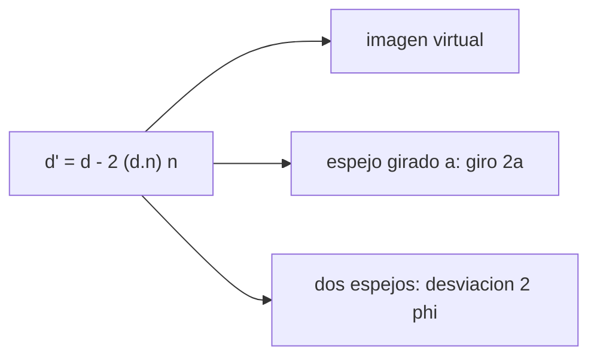

# B41-C03 — Reflexión y espejos planos

<!-- nav:top -->
[🏠 Programa](../../../../README.md) · [📚 Bloque B41](../../../tronco-comun/B41-optica-geometrica-y-diseno-de-telescopios.md) · [← Anterior: B41-C02 — Índice de refracción y ley de Snell](../B41-C02-indice-de-refraccion-y-ley-de-snell/CLASE.md) · [Siguiente: B41-C04 — Espejos esféricos y parabólicos →](../B41-C04-espejos-esfericos-y-parabolicos/CLASE.md)
<!-- /nav -->

## 1. Ubicación, nivel y alcance

Clase 3 del bloque B41. Nivel N3. Aplicas la **ley de la reflexión** vectorial a un espejo plano: la imagen virtual, el espejo girado y dos espejos en ángulo. Usas [B10](../../../tronco-comun/B10-algebra-lineal-y-matematicas-geometricas.md) para los vectores. Las distancias son ilustrativas.

## 2. Por qué esta clase existe

Los espejos planos pliegan el haz de un telescopio y de un periscopio. La decisión central: **¿dónde está la imagen y cuánto gira el haz cuando se mueve el espejo?**

## 3. Lo que podrás hacer al terminar

1. Reflejar un rayo con `d' = d − 2(d·n)n`.
2. Ubicar la imagen virtual por prolongación de rayos.
3. Mostrar que un espejo girado `a` gira el rayo `2a`.
4. Calcular la desviación de dos espejos en ángulo `φ`.
5. Contar imágenes con `360/φ − 1`.
6. Reconocer los límites de la reflexión ideal.

La evidencia es la **ficha de los espejos planos** del ejercicio 12 (sección 20).

## 4. Con qué llegas y cómo comprobarlo

1. ¿Qué es un rayo de luz en óptica geométrica?
2. ¿Qué dice la ley de Snell?
3. ¿Qué es la distancia focal de una lente o un espejo?
4. ¿Qué es un valor ilustrativo?
5. ¿Qué es una verificación numérica?

<details>
<summary>Ver respuestas</summary>

1. Una línea que indica la dirección de propagación de la energía. 2. `n₁ sen θ₁ = n₂ sen θ₂`. 3. La distancia del elemento al punto donde converge un haz paralelo. 4. Un valor propuesto para el ejemplo, no medido. 5. Comparar un cálculo con un caso independiente.
</details>

Con cuatro o cinco aciertos, sigue; si no, repasa los prerrequisitos.

## 5. Un caso de contexto y casos de referencia

Un objeto a `(0,50 ; 0,20 m)` frente a un espejo en `x = 0` tiene su imagen en `(−0,500000 ; 0,200000 m)`; un espejo girado `5°` gira el rayo `10°`; dos espejos a `60°` desvían `120°` y forman `5` imágenes. Es el **ejemplo conductor**.

## 6. Vocabulario

La **ley de la reflexión**. La **normal**. La **imagen virtual**. El **giro del espejo**. El **caleidoscopio**: dos espejos en ángulo. La **desviación**.

## 7. Modelo mental: una pelota en un billar

Como una bola de billar que rebota en una banda: sale con el mismo ángulo con que llegó; si giras la banda un poco, la bola sale girada el doble.



*Descripción textual:* la reflexión vectorial determina la imagen, el giro y la desviación.

Analogía: una pelota en un billar. Límite: espejo plano perfecto y rayos en un plano.

## 8. La explicación, paso a paso

### 8.1 Imagen

Los rayos reflejados, prolongados hacia atrás, se cortan en `(−0,500000 ; 0,200000) m`: la imagen virtual está a la misma distancia detrás del espejo y a la misma altura.

### 8.2 Espejo girado

| a (°) | giro del rayo (°) | 2a (°) |
|---|---|---|
| 1,00 | 2,000 | 2,000 |
| 5,00 | 10,000 | 10,000 |
| 12,50 | 25,000 | 25,000 |

### 8.3 Dos espejos

| φ (°) | desviación (°) | imágenes `360/φ − 1` |
|---|---|---|
| 30 | 60,000 | 11 |
| 60 | 120,000 | 5 |
| 75 | 150,000 | — |
| 90 | — | 3 |
| 45 | — | 7 |

(Las imágenes se tabulan con la fórmula de libro, sin simular.)

### 8.4 Lectura

Doblar el haz con un espejo plano mueve la imagen del campo al doble del giro del espejo: por eso un secundario plano mal inclinado descentra el campo (clase 19).

## 9. Magnitudes, símbolos y unidades

| Símbolo | Qué es | Unidad | Valor / nota |
|---|---|---|---|
| `d` | dirección del rayo | — | vector unitario |
| `n` | normal al espejo | — | vector unitario |
| `a` | giro del espejo | ° | 1 a 12,5 |
| `φ` | ángulo entre espejos | ° | 30 a 90 |
| `N` | número de imágenes | — | `360/φ − 1` |

## 10. Convenciones y referencias

Distancias en milímetros salvo indicación; ángulos en radianes o grados según se rotule; las salidas del laboratorio usan punto decimal y el texto usa coma decimal. Los valores de vidrios, instrumentos y sensores son ilustrativos.

## 11. De dónde sale lo que afirmamos

| ID | Fuente | Localizador | Respalda | Estado |
|---|---|---|---|---|
| — | Sin fuente externa | — | relaciones de óptica geométrica de libro que verifica el laboratorio | No se consultó una fuente para esta clase; las cifras son ilustrativas |

Límites: la ley de la reflexión se aplica como relación de libro; no se consultó una fuente y la cuenta de imágenes no se simula.

## 12. Cómo ver la imagen y el giro

Un espejo plano da imagen virtual simétrica y el giro del espejo se duplica en el rayo.

## 13. Ejemplo trabajado: espejo girado 5°

**Paso 1 · Normales.** Normal inicial `(−1 ; 0)`, final `(−cos 5° ; −sen 5°)`.

**Paso 2 · Rayos.** Se reflejan `(1 ; 0)` en ambas.

**Paso 3 · Giro.** La diferencia de ángulos es `10,000°`, igual a `2 × 5°`.

## 14. Distintas formas de describir el resultado

**Por fórmula:** la relación analítica. **Por tabla:** las cifras del laboratorio. **Por gráfica:** el diagrama de la sección 7. **Por código:** el script de la sección 17.

## 15. Práctica guiada

**Ejercicio 1 · con los pasos indicados.** Imagen de un objeto a 0,50 m de un espejo plano: ¿a qué distancia detrás?

<details><summary>Solución comentada</summary>

`0,50 m`.
</details>

**Ejercicio 2 · con una pista.** Giro del rayo cuando el espejo gira `1°`.

<details><summary>Solución comentada</summary>

`2°`.
</details>

**Ejercicio 3 · casi autónomo.** Desviación de dos espejos a `30°`.

<details><summary>Solución comentada</summary>

`60°`.
</details>

## 16. Práctica autónoma, transferencia e integrador

**Ejercicio 4.** Imágenes entre dos espejos a `90°`.

<details><summary>Solución comentada</summary>

`360/90 − 1 = 3`.
</details>

**Ejercicio 5.** Imágenes a `45°`.

<details><summary>Solución comentada</summary>

`7`.
</details>

**Ejercicio 6.** Giro del rayo con `a = 12,5°`.

<details><summary>Solución comentada</summary>

`25°`.
</details>

**Ejercicio 7.** Desviación a `75°`.

<details><summary>Solución comentada</summary>

`150°`.
</details>

**Ejercicio 8.** Altura de la imagen del objeto en `y = 0,20 m`.

<details><summary>Solución comentada</summary>

`0,20 m`.
</details>

**Ejercicio 9 · transferencia.** **Transferencia.** Un secundario plano de un Newton se inclina `0,1°`: ¿cuánto gira el haz?

<details><summary>Solución comentada</summary>

`0,2°`.
</details>

**Ejercicio 10 · transferencia.** **Transferencia.** ¿Por qué la imagen de un espejo plano está invertida izquierda–derecha?

<details><summary>Solución comentada</summary>

La reflexión invierte la componente normal al espejo, lo que equivale a una paridad.
</details>

**Ejercicio 11 · transferencia.** **Transferencia.** ¿Cuántas imágenes entre dos espejos paralelos (`φ → 0`)?

<details><summary>Solución comentada</summary>

Infinitas según la fórmula (`360/φ → ∞`); en la práctica las limita la reflectancia.
</details>

**Ejercicio 12.** **Integrador.** Elabora tu *ficha de los espejos planos*: imagen, giro, desviación y límites.

<details><summary>Solución comentada</summary>

Secciones 8.1–8.4.
</details>

**Ejercicio 12 · integrador.** **Integrador.** Elabora tu *ficha de los espejos planos*: imagen, giro, desviación y límites.

<details><summary>Solución modelo</summary>

Secciones 8.1–8.4.
</details>

## 17. Laboratorio: reflexión y espejos planos

El script [espejos_planos.py](espejos_planos.py) refleja rayos, ubica la imagen virtual y verifica el giro `2a` y la desviación `2φ` (**comprueba** a `10⁻⁹`).

**Datos:** sin constantes; geometría **ilustrativa**. **Predice antes de ejecutar:** ¿cuánto gira el rayo con `a = 5°`? (10°.) **Ejecución del 2026-11-09 (Python 3.12.9):**

```text
Python 3.12.9 (biblioteca estandar)
imagen por prolongacion de rayos = (-0.500000 ; 0.200000) m ; esperada (-0,500000 ; 0,200000) m
espejo girado: angulo a -> giro del rayo reflejado
  a =  1.00 deg : giro =   2.000 deg ; 2a =   2.000 deg
  a =  5.00 deg : giro =  10.000 deg ; 2a =  10.000 deg
  a = 12.50 deg : giro =  25.000 deg ; 2a =  25.000 deg
  espejos a  30.0 deg : desviacion =  60.000 deg ; 2 phi mod 360 =  60.000 deg
  espejos a  60.0 deg : desviacion = 120.000 deg ; 2 phi mod 360 = 120.000 deg
  espejos a  75.0 deg : desviacion = 150.000 deg ; 2 phi mod 360 = 150.000 deg
imagenes de un objeto entre dos espejos en angulo phi
  phi =  90 deg : imagenes = 3
  phi =  60 deg : imagenes = 5
  phi =  45 deg : imagenes = 7
  phi =  30 deg : imagenes = 11
Pruebas superadas.
```

```bash
python programa/clases/B41/B41-C03-reflexion-y-espejos-planos/espejos_planos.py
```

**Límites:** espejo ideal, sin absorción ni aberración.

## 18. Errores frecuentes y cómo corregirlos

**Creer que el rayo gira `a` y no `2a`.** Se corrige con 8.2.

**Confundir ángulos con la normal y con la superficie.** Se mide siempre respecto de la normal.

**Olvidar que la imagen es virtual.** No se puede proyectar en una pantalla.

**Contar imágenes de más.** La fórmula `360/φ − 1` es para `φ` divisor de `360°`.

## 19. Cómo sabrás que vas bien

Tras la sección 8: ¿qué resultado esperabas y cuál obtuviste? Si dudas, repasa el ejemplo 13. Tras el laboratorio: ¿qué comprueba? (ver la sección 17).

## 20. Qué entregas y cómo se evalúa

El producto es tu **ficha de los espejos planos** (ejercicio 12).

| Criterio | Inicial | En desarrollo | Logrado | Destacado |
|---|---|---|---|---|
| Conceptos | Los confunde | Parciales | conceptos de la clase | Explica los límites |
| Cálculo | Sin unidades | Con errores | Tablas completas | Calcula casos nuevos |
| Numérico | Sin comprobar | Un caso | Contraste con el análisis | Interpreta las diferencias |
| Fuentes | Sin fuente | Sin fecha | fuentes con fecha | Declara lo ilustrativo |
| Límites | No los nombra | Uno | Tres | Discute qué falta del modelo |

**Condiciones críticas (no se compensan con promedio):** rotular lo ilustrativo; no presentar el modelo como un instrumento real; citar solo lo consultado.

## 21. Ética, seguridad y límites

Clase educativa: los modelos son simplificados. Accesibilidad: tablas equivalentes a las gráficas, fórmulas en texto, ejercicios sin conexión.

## 22. Para cerrar y seguir

Un espejo plano da imagen virtual simétrica y duplica el giro. Falta el espejo curvo, que sí forma imagen real.

**Glosario español–inglés.** espejo plano · *plane mirror*; imagen virtual · *virtual image*; normal · *normal*; desviación · *deviation*; caleidoscopio · *kaleidoscope*.

**Continuidad.** [B41-C04](../B41-C04-espejos-esfericos-y-parabolicos/CLASE.md) estudia los espejos esféricos y parabólicos.

**Referencias:** ver sección 11.

<!-- nav:bottom -->
---

[← Anterior: B41-C02 — Índice de refracción y ley de Snell](../B41-C02-indice-de-refraccion-y-ley-de-snell/CLASE.md) · [📚 Bloque B41](../../../tronco-comun/B41-optica-geometrica-y-diseno-de-telescopios.md) · [Siguiente: B41-C04 — Espejos esféricos y parabólicos →](../B41-C04-espejos-esfericos-y-parabolicos/CLASE.md)
<!-- /nav -->
