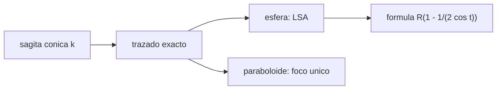

# B41-C04 — Espejos esféricos y parabólicos

<!-- nav:top -->
[🏠 Programa](../../../../README.md) · [📚 Bloque B41](../../../tronco-comun/B41-optica-geometrica-y-diseno-de-telescopios.md) · [← Anterior: B41-C03 — Reflexión y espejos planos](../B41-C03-reflexion-y-espejos-planos/CLASE.md) · [Siguiente: B41-C05 — Lentes delgadas y gruesas →](../B41-C05-lentes-delgadas-y-gruesas/CLASE.md)
<!-- /nav -->

## 1. Ubicación, nivel y alcance

Clase 4 del bloque B41. Nivel N3. El espejo cóncavo forma imágenes reales. Trazas rayos paralelos sobre una **esfera** y un **paraboloide** de `R = 2000 mm` y mides dónde cortan el eje. Usas [B10](../../../tronco-comun/B10-algebra-lineal-y-matematicas-geometricas.md). Las dimensiones son ilustrativas.

## 2. Por qué esta clase existe

El espejo primario de un telescopio reflector es una superficie cónica. La decisión central: **¿por qué se usa un paraboloide y no una esfera?**

## 3. Lo que podrás hacer al terminar

1. Escribir la sagita de una cónica.
2. Trazar exactamente un rayo paralelo y reflejarlo.
3. Calcular el foco paraxial `R/2`.
4. Medir la aberración esférica longitudinal.
5. Comprobar que el paraboloide enfoca todos los rayos.
6. Estimar el disco de aberración de una esfera f/5.

La evidencia es la **ficha de espejos esféricos y parabólicos** del ejercicio 12 (sección 20).

## 4. Con qué llegas y cómo comprobarlo

1. ¿Qué es un rayo de luz en óptica geométrica?
2. ¿Qué dice la ley de Snell?
3. ¿Qué es la distancia focal de una lente o un espejo?
4. ¿Qué es un valor ilustrativo?
5. ¿Qué es una verificación numérica?

<details>
<summary>Ver respuestas</summary>

1. Una línea que indica la dirección de propagación de la energía. 2. `n₁ sen θ₁ = n₂ sen θ₂`. 3. La distancia del elemento al punto donde converge un haz paralelo. 4. Un valor propuesto para el ejemplo, no medido. 5. Comparar un cálculo con un caso independiente.
</details>

Con cuatro o cinco aciertos, sigue; si no, repasa los prerrequisitos.

## 5. Un caso de contexto y casos de referencia

En `R = 2000 mm`, el foco paraxial está a `1000 mm`. La esfera enfoca el rayo a `h = 100 mm` a `998,747651 mm` (aberración `−1,252349 mm`); el paraboloide a `1000,000000 mm` para toda altura. Es el **ejemplo conductor**.

## 6. Vocabulario

La **sagita**. La **constante cónica** `k` (0 esfera, −1 paraboloide). El **foco paraxial** `R/2`. La **aberración esférica longitudinal** (LSA). El **espejo cóncavo**.

## 7. Modelo mental: una antena parabólica

Como una antena parabólica de TV: todas las señales paralelas al eje convergen en el mismo punto; con un plato esférico la señal de los bordes llega antes.



*Descripción textual:* el trazado exacto de rayos sobre una cónica mide cuánto se aparta cada zona del foco.

Analogía: una antena parabólica. Límite: rayos meridionales y reflexión perfecta.

## 8. La explicación, paso a paso

### 8.1 Corte con el eje

| h (mm) | esfera (mm) | LSA esfera (mm) | fórmula (mm) | paraboloide (mm) |
|---|---|---|---|---|
| 10 | 999,987500 | −0,012500 | −0,012500 | 1000,000000 |
| 50 | 999,687353 | −0,312647 | −0,312647 | 1000,000000 |
| 100 | 998,747651 | −1,252349 | −1,252349 | 1000,000000 |
| 150 | 997,175579 | −2,824421 | −2,824421 | 1000,000000 |
| 200 | 994,962185 | −5,037815 | −5,037815 | 1000,000000 |

### 8.2 Tercer orden

A `h = 100 mm` la aberración exacta es `−1,252349 mm` y la de tercer orden `−h²/(4R) = −1,250000 mm` (razón `1,0019`). En el límite `h = 0,001 mm` el corte es `1000,000000 mm`.

### 8.3 Disco de aberración

La esfera f/5 (`D = 200 mm`) forma en el foco paraxial un disco de unas `250,5 µm` de diámetro (aproximación de rayo marginal), muy por encima del disco de Airy (clase 12).

### 8.4 Lectura

El paraboloide corrige por construcción la aberración esférica **para un objeto en el infinito sobre el eje**; fuera del eje aparece la coma (clase 13).

## 9. Magnitudes, símbolos y unidades

| Símbolo | Qué es | Unidad | Valor / nota |
|---|---|---|---|
| `R` | radio de curvatura | mm | 2000 |
| `k` | constante cónica | — | 0 esfera; −1 paraboloide |
| `h` | altura del rayo | mm | 10 a 200 |
| `f` | foco paraxial | mm | `R/2 = 1000` |
| LSA | aberración esférica longitudinal | mm | −1,252349 (h = 100) |

## 10. Convenciones y referencias

Distancias en milímetros salvo indicación; ángulos en radianes o grados según se rotule; las salidas del laboratorio usan punto decimal y el texto usa coma decimal. Los valores de vidrios, instrumentos y sensores son ilustrativos.

## 11. De dónde sale lo que afirmamos

| ID | Fuente | Localizador | Respalda | Estado |
|---|---|---|---|---|
| — | Sin fuente externa | — | relaciones de óptica geométrica de libro que verifica el laboratorio | No se consultó una fuente para esta clase; las cifras son ilustrativas |

Límites: la geometría de las cónicas es de libro; no se consultó una fuente y el radio es ilustrativo.

## 12. Cómo ver las zonas de un espejo

Cada zona de la esfera corta el eje en un punto distinto; el paraboloide las reúne.

## 13. Ejemplo trabajado: esfera con `h = 100 mm`

**Paso 1 · Ángulo.** `sen t = 100/2000 = 0,05`, `t = 2,866°`.

**Paso 2 · Corte.** `R(1 − 1/(2 cos t)) = 2000 (1 − 1/1,997497) = 1000 − 1,2523`.

**Paso 3 · Resultado.** `998,7477 mm`, igual al laboratorio.

## 14. Distintas formas de describir el resultado

**Por fórmula:** la relación analítica. **Por tabla:** las cifras del laboratorio. **Por gráfica:** el diagrama de la sección 7. **Por código:** el script de la sección 17.

## 15. Práctica guiada

**Ejercicio 1 · con los pasos indicados.** Foco paraxial de un espejo de `R = 2000 mm`.

<details><summary>Solución comentada</summary>

`1000 mm`.
</details>

**Ejercicio 2 · con una pista.** `sen t` para `h = 50 mm`.

<details><summary>Solución comentada</summary>

`0,025`.
</details>

**Ejercicio 3 · casi autónomo.** LSA de tercer orden en `h = 100`: `−h²/(4R)`.

<details><summary>Solución comentada</summary>

`−1,25 mm`.
</details>

## 16. Práctica autónoma, transferencia e integrador

**Ejercicio 4.** Corte del paraboloide a `h = 150`.

<details><summary>Solución comentada</summary>

`1000 mm`.
</details>

**Ejercicio 5.** Corte de la esfera a `h = 200`.

<details><summary>Solución comentada</summary>

`994,962 mm`.
</details>

**Ejercicio 6.** Razón exacta/tercer orden a `h = 100`.

<details><summary>Solución comentada</summary>

`1,0019`.
</details>

**Ejercicio 7.** LSA a `h = 50` mm.

<details><summary>Solución comentada</summary>

`−0,3126 mm`.
</details>

**Ejercicio 8.** Diámetro aproximado del disco de la esfera f/5.

<details><summary>Solución comentada</summary>

`≈ 250 µm`.
</details>

**Ejercicio 9 · transferencia.** **Transferencia.** ¿Por qué los espejos de linterna se hacen parabólicos?

<details><summary>Solución comentada</summary>

Para que la fuente en el foco emita un haz paralelo.
</details>

**Ejercicio 10 · transferencia.** **Transferencia.** ¿Qué pasa con la LSA si se duplica `h`?

<details><summary>Solución comentada</summary>

Se cuadruplica (`∝ h²`).
</details>

**Ejercicio 11 · transferencia.** **Transferencia.** ¿Qué conserva el paraboloide fuera del eje?

<details><summary>Solución comentada</summary>

Nada: aparece coma; el foco único solo vale en el eje.
</details>

**Ejercicio 12.** **Integrador.** Elabora tu *ficha de espejos esféricos y parabólicos*: foco, LSA, paraboloide y límites.

<details><summary>Solución comentada</summary>

Secciones 8.1–8.4.
</details>

**Ejercicio 12 · integrador.** **Integrador.** Elabora tu *ficha de espejos esféricos y parabólicos*: foco, LSA, paraboloide y límites.

<details><summary>Solución modelo</summary>

Secciones 8.1–8.4.
</details>

## 17. Laboratorio: foco y aberración de espejos cónicos

El script [espejos_conicos.py](espejos_conicos.py) traza rayos exactos sobre una esfera y un paraboloide y mide la LSA (**comprueba** el trazado contra la fórmula a `10⁻⁹ mm`).

**Datos:** sin constantes; `R` y alturas **ilustrativos**. **Predice antes de ejecutar:** ¿dónde corta el rayo marginal de la esfera? (≈ 998,75 mm.) **Ejecución del 2026-11-09 (Python 3.12.9):**

```text
Python 3.12.9 (biblioteca estandar)
R = 2000 mm ; foco paraxial f = R/2 = 1000.0 mm
  h [mm]    f/N  esfera z_eje [mm]  LSA esfera [mm]  formula [mm]  parab. [mm]
      10  50.00         999.987500        -0.012500     -0.012500  1000.000000
      50  10.00         999.687353        -0.312647     -0.312647  1000.000000
     100   5.00         998.747651        -1.252349     -1.252349  1000.000000
     150   3.33         997.175579        -2.824421     -2.824421  1000.000000
     200   2.50         994.962185        -5.037815     -5.037815  1000.000000
h = 0,001 mm : z = 1000.000000 mm
h = 100 mm : LSA exacta = -1.252349 mm ; tercer orden -h^2/(4R) = -1.250000 mm ; razon = 1.0019
disco de aberracion de la esfera f/5 (D = 200 mm) en el foco paraxial = 250.5 micras de diametro (aprox. de rayo marginal)
Pruebas superadas.
```

```bash
python programa/clases/B41/B41-C04-espejos-esfericos-y-parabolicos/espejos_conicos.py
```

**Límites:** meridional, reflexión perfecta, sin difracción.

## 18. Errores frecuentes y cómo corregirlos

**Creer que la esfera enfoca todos los rayos.** Se corrige con 8.1.

**Confundir `R` con `f`.** `f = R/2`.

**Olvidar el signo de la LSA.** Aquí los bordes cortan antes.

**Usar el paraboloide para objetos cercanos.** Su foco único vale para el infinito.

## 19. Cómo sabrás que vas bien

Tras la sección 8: ¿qué resultado esperabas y cuál obtuviste? Si dudas, repasa el ejemplo 13. Tras el laboratorio: ¿qué comprueba? (ver la sección 17).

## 20. Qué entregas y cómo se evalúa

El producto es tu **ficha de espejos esféricos y parabólicos** (ejercicio 12).

| Criterio | Inicial | En desarrollo | Logrado | Destacado |
|---|---|---|---|---|
| Conceptos | Los confunde | Parciales | conceptos de la clase | Explica los límites |
| Cálculo | Sin unidades | Con errores | Tablas completas | Calcula casos nuevos |
| Numérico | Sin comprobar | Un caso | Contraste con el análisis | Interpreta las diferencias |
| Fuentes | Sin fuente | Sin fecha | fuentes con fecha | Declara lo ilustrativo |
| Límites | No los nombra | Uno | Tres | Discute qué falta del modelo |

**Condiciones críticas (no se compensan con promedio):** rotular lo ilustrativo; no presentar el modelo como un instrumento real; citar solo lo consultado.

## 21. Ética, seguridad y límites

Clase educativa: los modelos son simplificados. Accesibilidad: tablas equivalentes a las gráficas, fórmulas en texto, ejercicios sin conexión.

## 22. Para cerrar y seguir

El paraboloide reúne los rayos del eje en `1000 mm` y la esfera dispersa `1,25 mm` en el borde. Falta la lente, que forma imagen refractando.

**Glosario español–inglés.** esfera · *sphere*; paraboloide · *paraboloid*; aberración esférica · *spherical aberration*; constante cónica · *conic constant*; foco · *focus*.

**Continuidad.** [B41-C05](../B41-C05-lentes-delgadas-y-gruesas/CLASE.md) estudia las lentes delgadas y gruesas.

**Referencias:** ver sección 11.

<!-- nav:bottom -->
---

[← Anterior: B41-C03 — Reflexión y espejos planos](../B41-C03-reflexion-y-espejos-planos/CLASE.md) · [📚 Bloque B41](../../../tronco-comun/B41-optica-geometrica-y-diseno-de-telescopios.md) · [Siguiente: B41-C05 — Lentes delgadas y gruesas →](../B41-C05-lentes-delgadas-y-gruesas/CLASE.md)
<!-- /nav -->
