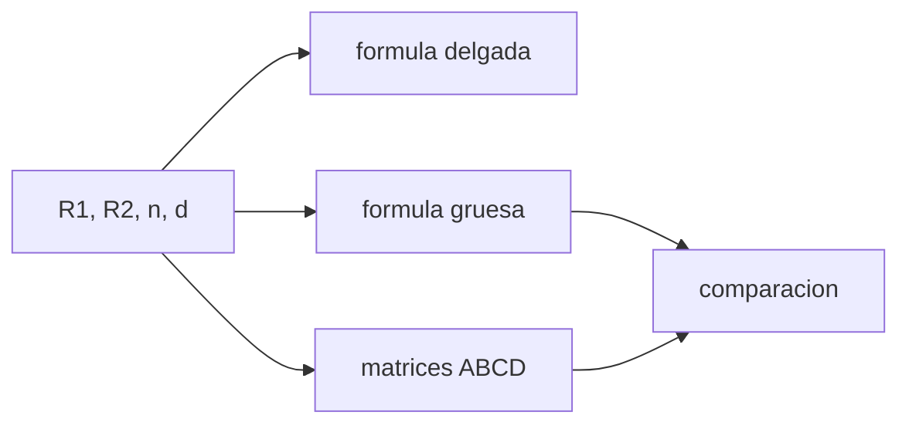

# B41-C05 — Lentes delgadas y gruesas

<!-- nav:top -->
[🏠 Programa](../../../../README.md) · [📚 Bloque B41](../../../tronco-comun/B41-optica-geometrica-y-diseno-de-telescopios.md) · [← Anterior: B41-C04 — Espejos esféricos y parabólicos](../B41-C04-espejos-esfericos-y-parabolicos/CLASE.md) · [Siguiente: B41-C06 — Distancias focales y formación de imagen →](../B41-C06-distancias-focales-y-formacion-de-imagen/CLASE.md)
<!-- /nav -->

## 1. Ubicación, nivel y alcance

Clase 5 del bloque B41. Nivel N3. Aplicas la **ecuación del fabricante de lentes** y la comparas con el producto de **matrices de rayos** para lentes delgadas y gruesas de vidrio `n = 1,517` (ilustrativo). Usas [B10](../../../tronco-comun/B10-algebra-lineal-y-matematicas-geometricas.md) (matrices).

## 2. Por qué esta clase existe

El objetivo de un refractor es una lente. La decisión central: **¿cuánto se equivoca la fórmula de lente delgada cuando la lente es gruesa?**

## 3. Lo que podrás hacer al terminar

1. Calcular `f` con la ecuación del fabricante.
2. Construir la matriz de una lente gruesa.
3. Obtener `f` y los planos principales de la matriz.
4. Comparar delgada, gruesa y matriz.
5. Comprobar el límite `d → 0`.
6. Verificar que el determinante vale 1.

La evidencia es la **ficha de lentes delgadas y gruesas** del ejercicio 12 (sección 20).

## 4. Con qué llegas y cómo comprobarlo

1. ¿Qué es un rayo de luz en óptica geométrica?
2. ¿Qué dice la ley de Snell?
3. ¿Qué es la distancia focal de una lente o un espejo?
4. ¿Qué es un valor ilustrativo?
5. ¿Qué es una verificación numérica?

<details>
<summary>Ver respuestas</summary>

1. Una línea que indica la dirección de propagación de la energía. 2. `n₁ sen θ₁ = n₂ sen θ₂`. 3. La distancia del elemento al punto donde converge un haz paralelo. 4. Un valor propuesto para el ejemplo, no medido. 5. Comparar un cálculo con un caso independiente.
</details>

Con cuatro o cinco aciertos, sigue; si no, repasa los prerrequisitos.

## 5. Un caso de contexto y casos de referencia

Una biconvexa de `R = ±200 mm` y 5 mm de espesor da `f = 193,424 mm` como delgada y `194,251 mm` como gruesa; una biconvexa de `R = ±100 mm` y 40 mm da `96,712` frente a `103,786 mm`. Es el **ejemplo conductor**.

## 6. Vocabulario

La **lente delgada**. La **ecuación del fabricante** `1/f = (n−1)(1/R₁−1/R₂)`. La **matriz de rayos** ABCD. Los **planos principales**. La **distancia focal posterior** (BFD).

## 7. Modelo mental: una pila de gafas

Como unas gafas gruesas frente a unas finas: el aumento depende de cuánto vidrio atraviesa la luz entre las dos caras; el espesor desplaza los planos desde donde se mide la focal.



*Descripción textual:* la fórmula cerrada y el producto de matrices dan la misma focal gruesa.

Analogía: una pila de gafas. Límite: rayos paraxiales y superficies esféricas.

## 8. La explicación, paso a paso

### 8.1 Cuatro lentes

| Caso | R₁ | R₂ | d | f delgada | f gruesa | f matrices |
|---|---|---|---|---|---|---|
| biconvexa simétrica | 200 | −200 | 5 | 193,424 | 194,251 | 194,251 |
| plano-convexa | 150 | ∞ | 8 | 290,135 | 290,135 | 290,135 |
| menisco convergente | 100 | 300 | 10 | 290,135 | 285,274 | 285,274 |
| biconvexa gruesa | 100 | −100 | 40 | 96,712 | 103,786 | 103,786 |

### 8.2 Planos principales

En la biconvexa gruesa, `f = 103,786 mm`, la distancia focal posterior medida desde el vértice es `89,638 mm` y el plano principal posterior está `14,148 mm` dentro de la lente (fórmula de libro `−14,148 mm`).

### 8.3 Comprobaciones

Con `d → 0` la matriz da `f = 193,423598 mm` igual a la delgada. El determinante vale `1,000000000000`.

### 8.4 Lectura

El error de la lente delgada crece con el espesor: `0,4 %` en la primera y `6,8 %` (respecto de la gruesa) en la última.

## 9. Magnitudes, símbolos y unidades

| Símbolo | Qué es | Unidad | Valor / nota |
|---|---|---|---|
| `n` | índice | — | 1,517 (ilustrativo) |
| `R₁, R₂` | radios de las caras | mm | ver tabla |
| `d` | espesor | mm | 5, 8, 10, 40 |
| `f` | distancia focal | mm | 193,424 a 290,135 |
| `BFD` | focal posterior desde el vértice | mm | 89,638 |

## 10. Convenciones y referencias

Distancias en milímetros salvo indicación; ángulos en radianes o grados según se rotule; las salidas del laboratorio usan punto decimal y el texto usa coma decimal. Los valores de vidrios, instrumentos y sensores son ilustrativos.

## 11. De dónde sale lo que afirmamos

| ID | Fuente | Localizador | Respalda | Estado |
|---|---|---|---|---|
| — | Sin fuente externa | — | relaciones de óptica geométrica de libro que verifica el laboratorio | No se consultó una fuente para esta clase; las cifras son ilustrativas |

Límites: las fórmulas son de libro; no se consultó una fuente y el vidrio es ilustrativo.

## 12. Cómo ver delgada frente a gruesa

El espesor mueve los planos principales y cambia la focal efectiva.

## 13. Ejemplo trabajado: biconvexa simétrica

**Paso 1 · Delgada.** `1/f = 0,517 (2/200) = 0,00517`, `f = 193,424 mm`.

**Paso 2 · Gruesa.** Suma `(n−1) d/(n R₁R₂) × (n−1) = 0,517 × 5 × 0,517/(1,517 × (−40000)) = −2,2 × 10⁻⁵`, con lo que `1/f = 0,00517 − 0,0000220 = 0,005148`, `f = 194,25 mm`.

**Paso 3 · Matrices.** `−1/C = 194,251 mm`.

## 14. Distintas formas de describir el resultado

**Por fórmula:** la relación analítica. **Por tabla:** las cifras del laboratorio. **Por gráfica:** el diagrama de la sección 7. **Por código:** el script de la sección 17.

## 15. Práctica guiada

**Ejercicio 1 · con los pasos indicados.** `f` delgada de `R₁ = 200`, `R₂ = −200`.

<details><summary>Solución comentada</summary>

`193,424 mm`.
</details>

**Ejercicio 2 · con una pista.** `f` delgada de la plano-convexa `R₁ = 150`.

<details><summary>Solución comentada</summary>

`1/(0,517/150) = 290,135 mm`.
</details>

**Ejercicio 3 · casi autónomo.** Diferencia relativa delgada-gruesa en la primera.

<details><summary>Solución comentada</summary>

`(194,251−193,424)/194,251 = 0,43 %`.
</details>

## 16. Práctica autónoma, transferencia e integrador

**Ejercicio 4.** Potencia en dioptrías de la primera (`1/f` en m).

<details><summary>Solución comentada</summary>

`5,148 D`.
</details>

**Ejercicio 5.** Plano principal posterior de la gruesa.

<details><summary>Solución comentada</summary>

`14,148 mm` dentro.
</details>

**Ejercicio 6.** ¿Cuánto vale el determinante?

<details><summary>Solución comentada</summary>

`1`.
</details>

**Ejercicio 7.** `f` del menisco gruesa.

<details><summary>Solución comentada</summary>

`285,274 mm`.
</details>

**Ejercicio 8.** Error de la delgada en la biconvexa gruesa.

<details><summary>Solución comentada</summary>

`(103,786−96,712)/103,786 = 6,8 %`.
</details>

**Ejercicio 9 · transferencia.** **Transferencia.** ¿Por qué dos lentes de la misma `f` delgada pueden tener focales distintas con el mismo vidrio?

<details><summary>Solución comentada</summary>

Por el espesor.
</details>

**Ejercicio 10 · transferencia.** **Transferencia.** ¿Qué pasa con `f` si `n` sube a 1,7 en la plano-convexa?

<details><summary>Solución comentada</summary>

`1/(0,7/150) = 214,3 mm`.
</details>

**Ejercicio 11 · transferencia.** **Transferencia.** ¿Por qué se usa la matriz en un objetivo de varias lentes?

<details><summary>Solución comentada</summary>

Porque es el producto ordenado, sin fórmulas especiales.
</details>

**Ejercicio 12.** **Integrador.** Elabora tu *ficha de lentes delgadas y gruesas*.

<details><summary>Solución comentada</summary>

Secciones 8.1–8.4.
</details>

**Ejercicio 12 · integrador.** **Integrador.** Elabora tu *ficha de lentes delgadas y gruesas*.

<details><summary>Solución modelo</summary>

Secciones 8.1–8.4.
</details>

## 17. Laboratorio: lentes por fórmula y por matrices

El script [lentes.py](lentes.py) compara la fórmula del fabricante y las matrices ABCD de cuatro lentes (**comprueba** a `10⁻⁹` relativo).

**Datos:** sin constantes; `n` y radios **ilustrativos**. **Predice antes de ejecutar:** ¿qué diferencia habrá entre delgada y gruesa en la última? (≈ 7 %.) **Ejecución del 2026-11-09 (Python 3.12.9):**

```text
Python 3.12.9 (biblioteca estandar)
                      caso      R1       R2     d  f delgada   f gruesa  f matrices
       biconvexa simetrica     200     -200     5    193.424    194.251     194.251
             plano-convexa     150 1000000000000     8    290.135    290.135     290.135
       menisco convergente     100      300    10    290.135    285.274     285.274
          biconvexa gruesa     100     -100    40     96.712    103.786     103.786
biconvexa gruesa: f = 103.786 mm ; distancia focal posterior (vertice) = 89.638 mm ; plano principal posterior a 14.148 mm dentro del vertice
  formula de libro del plano principal posterior = -14.148 mm
limite d -> 0: f = 193.423598 mm ; delgada = 193.423598 mm
det(M) = 1.000000000000
Pruebas superadas.
```

```bash
python programa/clases/B41/B41-C05-lentes-delgadas-y-gruesas/lentes.py
```

**Límites:** paraxial, esféricas, aire a ambos lados.

## 18. Errores frecuentes y cómo corregirlos

**Usar la fórmula delgada con lentes gruesas.** Se corrige con 8.1.

**Medir `f` desde el vértice.** Se mide desde el plano principal.

**Signo de `R₂`.** Positivo si el centro está del lado de salida.

**Olvidar `d/n` en la traslación.** Se corrige con la matriz.

## 19. Cómo sabrás que vas bien

Tras la sección 8: ¿qué resultado esperabas y cuál obtuviste? Si dudas, repasa el ejemplo 13. Tras el laboratorio: ¿qué comprueba? (ver la sección 17).

## 20. Qué entregas y cómo se evalúa

El producto es tu **ficha de lentes delgadas y gruesas** (ejercicio 12).

| Criterio | Inicial | En desarrollo | Logrado | Destacado |
|---|---|---|---|---|
| Conceptos | Los confunde | Parciales | conceptos de la clase | Explica los límites |
| Cálculo | Sin unidades | Con errores | Tablas completas | Calcula casos nuevos |
| Numérico | Sin comprobar | Un caso | Contraste con el análisis | Interpreta las diferencias |
| Fuentes | Sin fuente | Sin fecha | fuentes con fecha | Declara lo ilustrativo |
| Límites | No los nombra | Uno | Tres | Discute qué falta del modelo |

**Condiciones críticas (no se compensan con promedio):** rotular lo ilustrativo; no presentar el modelo como un instrumento real; citar solo lo consultado.

## 21. Ética, seguridad y límites

Clase educativa: los modelos son simplificados. Accesibilidad: tablas equivalentes a las gráficas, fórmulas en texto, ejercicios sin conexión.

## 22. Para cerrar y seguir

La fórmula del fabricante y las matrices coinciden para la lente gruesa y la delgada falla `7 %` en `d = 40 mm`. Falta formar la imagen.

**Glosario español–inglés.** lente delgada · *thin lens*; lente gruesa · *thick lens*; plano principal · *principal plane*; matriz de rayos · *ray transfer matrix*; fabricante de lentes · *lensmaker*.

**Continuidad.** [B41-C06](../B41-C06-distancias-focales-y-formacion-de-imagen/CLASE.md) estudia las distancias focales y la formación de imagen.

**Referencias:** ver sección 11.

<!-- nav:bottom -->
---

[← Anterior: B41-C04 — Espejos esféricos y parabólicos](../B41-C04-espejos-esfericos-y-parabolicos/CLASE.md) · [📚 Bloque B41](../../../tronco-comun/B41-optica-geometrica-y-diseno-de-telescopios.md) · [Siguiente: B41-C06 — Distancias focales y formación de imagen →](../B41-C06-distancias-focales-y-formacion-de-imagen/CLASE.md)
<!-- /nav -->
