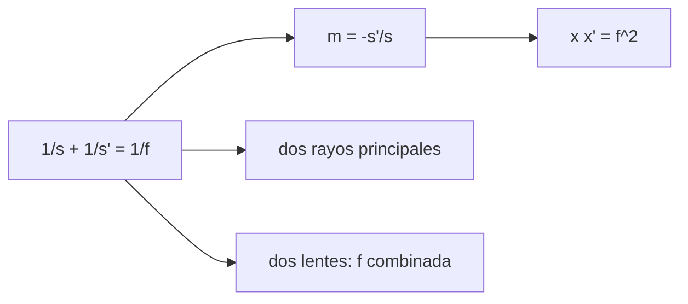

# B41-C06 — Distancias focales y formación de imagen

<!-- nav:top -->
[🏠 Programa](../../../../README.md) · [📚 Bloque B41](../../../tronco-comun/B41-optica-geometrica-y-diseno-de-telescopios.md) · [← Anterior: B41-C05 — Lentes delgadas y gruesas](../B41-C05-lentes-delgadas-y-gruesas/CLASE.md) · [Siguiente: B41-C07 — Aumentos y sistemas afocales →](../B41-C07-aumentos-y-sistemas-afocales/CLASE.md)
<!-- /nav -->

## 1. Ubicación, nivel y alcance

Clase 6 del bloque B41. Nivel N3. Con la **ecuación de imagen** de la lente delgada calculas dónde se forma la imagen, cuánto aumenta y cómo se combinan dos lentes. Usas [B10](../../../tronco-comun/B10-algebra-lineal-y-matematicas-geometricas.md). Las focales son ilustrativas.

## 2. Por qué esta clase existe

El foco de una cámara o de un telescopio decide el tamaño de la imagen. La decisión central: **¿dónde cae la imagen y de qué tamaño es?**

## 3. Lo que podrás hacer al terminar

1. Aplicar `1/s + 1/s' = 1/f`.
2. Calcular el aumento lateral `m = −s'/s`.
3. Verificar con dos rayos principales.
4. Usar la forma de Newton `x x' = f²`.
5. Combinar dos lentes con `1/f = 1/f₁ + 1/f₂ − d/(f₁f₂)`.
6. Diseñar un teleobjetivo.

La evidencia es la **ficha de distancias focales e imagen** del ejercicio 12 (sección 20).

## 4. Con qué llegas y cómo comprobarlo

1. ¿Qué es un rayo de luz en óptica geométrica?
2. ¿Qué dice la ley de Snell?
3. ¿Qué es la distancia focal de una lente o un espejo?
4. ¿Qué es un valor ilustrativo?
5. ¿Qué es una verificación numérica?

<details>
<summary>Ver respuestas</summary>

1. Una línea que indica la dirección de propagación de la energía. 2. `n₁ sen θ₁ = n₂ sen θ₂`. 3. La distancia del elemento al punto donde converge un haz paralelo. 4. Un valor propuesto para el ejemplo, no medido. 5. Comparar un cálculo con un caso independiente.
</details>

Con cuatro o cinco aciertos, sigue; si no, repasa los prerrequisitos.

## 5. Un caso de contexto y casos de referencia

Con `f = 200 mm` y un objeto de 10 mm a `s = 600 mm`, la imagen real está a `300 mm` con `m = −0,5` (altura `−5 mm`); a `s = 100 mm` la imagen es virtual, a `−200 mm`, con `m = +2`. Un disco de `0,52°` con `f = 1000 mm` mide `9,076 mm`. Es el **ejemplo conductor**.

## 6. Vocabulario

La **distancia objeto** `s` y la **distancia imagen** `s'`. El **aumento lateral** `m`. La **imagen real** y la **virtual**. La **forma de Newton**. La **escala de imagen** de un telescopio. El **teleobjetivo**.

## 7. Modelo mental: un proyector de diapositivas

Como un proyector: al acercar la diapositiva al foco, la imagen se aleja y crece; cuando la diapositiva pasa al interior del foco, la imagen deja de proyectarse (virtual).



*Descripción textual:* la ecuación y el trazado de dos rayos dan la misma imagen; la combinación se comprueba con matrices.

Analogía: un proyector de diapositivas. Límite: lente delgada y rayos paraxiales.

## 8. La explicación, paso a paso

### 8.1 Imagen de un objeto de 10 mm (f = 200 mm)

| s (mm) | s' (mm) | m | altura (mm) | tipo | x x' |
|---|---|---|---|---|---|
| 600 | 300,000 | −0,5000 | −5,000 | real | 40 000 |
| 400 | 400,000 | −1,0000 | −10,000 | real | 40 000 |
| 300 | 600,000 | −2,0000 | −20,000 | real | 40 000 |
| 250 | 1000,000 | −4,0000 | −40,000 | real | 40 000 |
| 100 | −200,000 | 2,0000 | 20,000 | virtual | 40 000 |

### 8.2 Objeto lejano

Con un objeto a `10¹² mm` la imagen está en `200,000000 mm`, el foco.

### 8.3 Dos lentes (f₁ = 200 mm, f₂ = 50 mm)

| d (mm) | f combinada (mm) |
|---|---|
| 0 | 40,000 |
| 50 | 50,000 |
| 100 | 66,667 |
| 150 | 100,000 |

Un teleobjetivo `f₁ = 200`, `f₂ = −100`, `d = 150` da `f = 400,000 mm` con el foco a `100,000 mm` de la segunda lente: longitud total `250,000 mm`.

### 8.4 Lectura

El teleobjetivo tiene una focal de 400 mm en 250 mm de largo: es la idea de los telescopios compactos (clase 17).

## 9. Magnitudes, símbolos y unidades

| Símbolo | Qué es | Unidad | Valor / nota |
|---|---|---|---|
| `f` | distancia focal | mm | 200 |
| `s, s'` | distancias objeto e imagen | mm | ver tabla |
| `m` | aumento lateral | — | −0,5 a +2 |
| `d` | separación de lentes | mm | 0 a 150 |
| `x, x'` | distancias al foco (Newton) | mm | `x x' = 40 000` |

## 10. Convenciones y referencias

Distancias en milímetros salvo indicación; ángulos en radianes o grados según se rotule; las salidas del laboratorio usan punto decimal y el texto usa coma decimal. Los valores de vidrios, instrumentos y sensores son ilustrativos.

## 11. De dónde sale lo que afirmamos

| ID | Fuente | Localizador | Respalda | Estado |
|---|---|---|---|---|
| — | Sin fuente externa | — | relaciones de óptica geométrica de libro que verifica el laboratorio | No se consultó una fuente para esta clase; las cifras son ilustrativas |

Límites: la ecuación de la lente delgada es de libro; no se consultó una fuente.

## 12. Cómo ver dónde y de qué tamaño

El producto de las distancias al foco es constante y define imagen real o virtual.

## 13. Ejemplo trabajado: objeto a 600 mm

**Paso 1 · Imagen.** `s' = s f/(s−f) = 600 × 200/400 = 300 mm`.

**Paso 2 · Aumento.** `m = −300/600 = −0,5`.

**Paso 3 · Altura.** `−0,5 × 10 = −5 mm`.

**Paso 4 · Newton.** `(600−200)(300−200) = 400 × 100 = 40 000 = f²`.

## 14. Distintas formas de describir el resultado

**Por fórmula:** la relación analítica. **Por tabla:** las cifras del laboratorio. **Por gráfica:** el diagrama de la sección 7. **Por código:** el script de la sección 17.

## 15. Práctica guiada

**Ejercicio 1 · con los pasos indicados.** `s'` para `s = 500 mm`, `f = 200 mm`. *Pasos:* `s f/(s−f)`.

<details><summary>Solución comentada</summary>

`333,33 mm`.
</details>

**Ejercicio 2 · con una pista.** `m` en ese caso.

<details><summary>Solución comentada</summary>

`−0,667`.
</details>

**Ejercicio 3 · casi autónomo.** `x x'` en ese caso.

<details><summary>Solución comentada</summary>

`300 × 133,33 = 40 000`.
</details>

## 16. Práctica autónoma, transferencia e integrador

**Ejercicio 4.** `f` de dos lentes pegadas de 200 y 50 mm.

<details><summary>Solución comentada</summary>

`40 mm`.
</details>

**Ejercicio 5.** Diámetro de la Luna (0,52°) con `f = 2000 mm`.

<details><summary>Solución comentada</summary>

`18,15 mm`.
</details>

**Ejercicio 6.** `s'` de un objeto en el infinito.

<details><summary>Solución comentada</summary>

`f`.
</details>

**Ejercicio 7.** `f` combinada con `d = 100 mm`.

<details><summary>Solución comentada</summary>

`66,667 mm`.
</details>

**Ejercicio 8.** Cociente de longitud del teleobjetivo.

<details><summary>Solución comentada</summary>

`250/400 = 0,625`.
</details>

**Ejercicio 9 · transferencia.** **Transferencia.** Un objetivo de 50 mm enfoca a 2 m: ¿cuánto se extiende?

<details><summary>Solución comentada</summary>

`s' = 2000 × 50/1950 = 51,28 mm`: `1,28 mm`.
</details>

**Ejercicio 10 · transferencia.** **Transferencia.** ¿Por qué la imagen real está invertida?

<details><summary>Solución comentada</summary>

Los rayos se cruzan en el foco.
</details>

**Ejercicio 11 · transferencia.** **Transferencia.** ¿Qué pasa si `s = f`?

<details><summary>Solución comentada</summary>

Los rayos salen paralelos: imagen en el infinito.
</details>

**Ejercicio 12.** **Integrador.** Elabora tu *ficha de distancias focales e imagen*.

<details><summary>Solución comentada</summary>

Secciones 8.1–8.4.
</details>

**Ejercicio 12 · integrador.** **Integrador.** Elabora tu *ficha de distancias focales e imagen*.

<details><summary>Solución modelo</summary>

Secciones 8.1–8.4.
</details>

## 17. Laboratorio: imagen y combinación de lentes

El script [imagen.py](imagen.py) calcula la imagen de una lente, verifica con dos rayos y combina lentes (**comprueba** a `10⁻⁹ mm`).

**Datos:** sin constantes; focales y distancias **ilustrativas**. **Predice antes de ejecutar:** ¿dónde y cómo es la imagen del objeto a 300 mm? (600 mm, ampliada y real.) **Ejecución del 2026-11-09 (Python 3.12.9):**

```text
Python 3.12.9 (biblioteca estandar)
lente delgada f = 200 mm, objeto de 10 mm
  s [mm]   s' [mm]        m  altura imagen       tipo       x x'
     600   300.000  -0.5000         -5.000       real    40000.0
     400   400.000  -1.0000        -10.000       real    40000.0
     300   600.000  -2.0000        -20.000       real    40000.0
     250  1000.000  -4.0000        -40.000       real    40000.0
     100  -200.000   2.0000         20.000    virtual    40000.0
objeto a 1e12 mm: s' = 200.000000 mm (el foco)
imagen de un disco de 0,52 deg con f = 1000 mm: diametro = 9.076 mm
combinacion de dos lentes f1 = 200 mm, f2 = 50 mm
  d =     0 mm : f =    40.000 mm (formula) ;    40.000 mm (matrices)
  d =    50 mm : f =    50.000 mm (formula) ;    50.000 mm (matrices)
  d =   100 mm : f =    66.667 mm (formula) ;    66.667 mm (matrices)
  d =   150 mm : f =   100.000 mm (formula) ;   100.000 mm (matrices)
teleobjetivo f1 = 200, f2 = -100, d = 150 : f = 400.000 mm ; foco a 100.000 mm tras la 2a lente ; longitud total = 250.000 mm
Pruebas superadas.
```

```bash
python programa/clases/B41/B41-C06-distancias-focales-y-formacion-de-imagen/imagen.py
```

**Límites:** paraxial, lente delgada, aire.

## 18. Errores frecuentes y cómo corregirlos

**Confundir `s'` negativo con error.** Indica imagen virtual.

**Olvidar el signo de `m`.** `m < 0` es invertida.

**Sumar focales en vez de potencias.** Se suman `1/f`.

**Usar la fórmula con lente gruesa.** Véase la clase 5.

## 19. Cómo sabrás que vas bien

Tras la sección 8: ¿qué resultado esperabas y cuál obtuviste? Si dudas, repasa el ejemplo 13. Tras el laboratorio: ¿qué comprueba? (ver la sección 17).

## 20. Qué entregas y cómo se evalúa

El producto es tu **ficha de distancias focales e imagen** (ejercicio 12).

| Criterio | Inicial | En desarrollo | Logrado | Destacado |
|---|---|---|---|---|
| Conceptos | Los confunde | Parciales | conceptos de la clase | Explica los límites |
| Cálculo | Sin unidades | Con errores | Tablas completas | Calcula casos nuevos |
| Numérico | Sin comprobar | Un caso | Contraste con el análisis | Interpreta las diferencias |
| Fuentes | Sin fuente | Sin fecha | fuentes con fecha | Declara lo ilustrativo |
| Límites | No los nombra | Uno | Tres | Discute qué falta del modelo |

**Condiciones críticas (no se compensan con promedio):** rotular lo ilustrativo; no presentar el modelo como un instrumento real; citar solo lo consultado.

## 21. Ética, seguridad y límites

Clase educativa: los modelos son simplificados. Accesibilidad: tablas equivalentes a las gráficas, fórmulas en texto, ejercicios sin conexión.

## 22. Para cerrar y seguir

La ecuación de imagen y la de Newton ubican la imagen y la combinación de lentes permite compactar el tubo. Falta pasar del aumento lateral al angular.

**Glosario español–inglés.** distancia imagen · *image distance*; aumento lateral · *lateral magnification*; imagen virtual · *virtual image*; teleobjetivo · *telephoto*; escala de imagen · *image scale*.

**Continuidad.** [B41-C07](../B41-C07-aumentos-y-sistemas-afocales/CLASE.md) estudia los aumentos y los sistemas afocales.

**Referencias:** ver sección 11.

<!-- nav:bottom -->
---

[← Anterior: B41-C05 — Lentes delgadas y gruesas](../B41-C05-lentes-delgadas-y-gruesas/CLASE.md) · [📚 Bloque B41](../../../tronco-comun/B41-optica-geometrica-y-diseno-de-telescopios.md) · [Siguiente: B41-C07 — Aumentos y sistemas afocales →](../B41-C07-aumentos-y-sistemas-afocales/CLASE.md)
<!-- /nav -->
