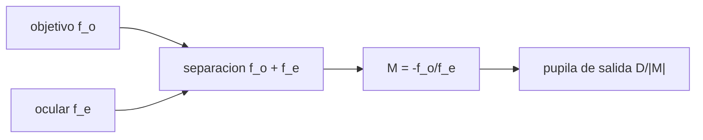

# B41-C07 — Aumentos y sistemas afocales

<!-- nav:top -->
[🏠 Programa](../../../../README.md) · [📚 Bloque B41](../../../tronco-comun/B41-optica-geometrica-y-diseno-de-telescopios.md) · [← Anterior: B41-C06 — Distancias focales y formación de imagen](../B41-C06-distancias-focales-y-formacion-de-imagen/CLASE.md) · [Siguiente: B41-C08 — Trazado de rayos para telescopios →](../B41-C08-trazado-de-rayos-para-telescopios/CLASE.md)
<!-- /nav -->

## 1. Ubicación, nivel y alcance

Clase 7 del bloque B41. Nivel N3. Un telescopio visual es un sistema **afocal**: un objetivo y un ocular separados por la suma de sus focales. Calculas el aumento angular, la pupila de salida y la longitud. Usas [B10](../../../tronco-comun/B10-algebra-lineal-y-matematicas-geometricas.md). Las focales son ilustrativas.

## 2. Por qué esta clase existe

El aumento decide qué se ve. La decisión central: **¿qué ocular da el aumento y la pupila de salida adecuados?**

## 3. Lo que podrás hacer al terminar

1. Calcular `M = −f_o/f_e`.
2. Construir la matriz de un sistema afocal.
3. Verificar que `C = 0` y `D = M`.
4. Calcular la pupila de salida `D/|M|`.
5. Distinguir Kepler y Galileo.
6. Fijar el aumento mínimo y el máximo útil.

La evidencia es la **ficha de aumentos y sistemas afocales** del ejercicio 12 (sección 20).

## 4. Con qué llegas y cómo comprobarlo

1. ¿Qué es un rayo de luz en óptica geométrica?
2. ¿Qué dice la ley de Snell?
3. ¿Qué es la distancia focal de una lente o un espejo?
4. ¿Qué es un valor ilustrativo?
5. ¿Qué es una verificación numérica?

<details>
<summary>Ver respuestas</summary>

1. Una línea que indica la dirección de propagación de la energía. 2. `n₁ sen θ₁ = n₂ sen θ₂`. 3. La distancia del elemento al punto donde converge un haz paralelo. 4. Un valor propuesto para el ejemplo, no medido. 5. Comparar un cálculo con un caso independiente.
</details>

Con cuatro o cinco aciertos, sigue; si no, repasa los prerrequisitos.

## 5. Un caso de contexto y casos de referencia

Con un objetivo `f = 1000 mm`, `D = 100 mm` y oculares de 25, 10 y 5 mm: `M = −40, −100, −200` con pupilas de `2,5; 1,0; 0,5 mm`. Un ocular negativo de `−50 mm` (Galileo) da `M = +20`. Es el **ejemplo conductor**.

## 6. Vocabulario

El **sistema afocal**. El **aumento angular** `M`. La **pupila de salida**. El **telescopio de Kepler** (imagen invertida, ocular positivo) y el de **Galileo** (derecho, ocular negativo). El **aumento útil**.

## 7. Modelo mental: unos prismáticos

Como unos prismáticos: el objetivo capta luz de un campo, el ocular lo ensancha en el ojo; el aumento es la razón de focales y la luz que entra al ojo es un cilindro más estrecho.



*Descripción textual:* dos lentes separadas por la suma de focales dan aumento angular y comprimen el haz.

Analogía: unos prismáticos. Límite: lentes delgadas, paraxial.

## 8. La explicación, paso a paso

### 8.1 Cuatro oculares

| Ocular (mm) | Tipo | M fórmula | M matriz | Pupila de salida (mm) | Longitud (mm) |
|---|---|---|---|---|---|
| 25 | Kepler | −40,00 | −40,00 | 2,500 | 1025 |
| 10 | Kepler | −100,00 | −100,00 | 1,000 | 1010 |
| 5 | Kepler | −200,00 | −200,00 | 0,500 | 1005 |
| −50 | Galileo | +20,00 | +20,00 | 5,000 | 950 |

El elemento `C` de la matriz es del orden de `10⁻¹⁷` (cero numérico): el sistema es afocal.

### 8.2 Un rayo oblicuo

Un rayo a `0,5°` con el ocular de 25 mm sale a `−20,000°` (`M = −40`) y con altura `8,945 mm`.

### 8.3 Límites del aumento

El aumento mínimo para que la pupila de salida no pase de `7 mm` (ilustrativo) con `D = 100 mm` es `14,29`; el máximo orientativo (`2 D` en mm) es `200`; con pupila de `0,5 mm` el aumento es `200`.

### 8.4 Lectura

El mismo objetivo da 40, 100 o 200 aumentos cambiando el ocular, pero la pupila de salida se estrecha y la imagen se oscurece.

## 9. Magnitudes, símbolos y unidades

| Símbolo | Qué es | Unidad | Valor / nota |
|---|---|---|---|
| `f_o, f_e` | focales de objetivo y ocular | mm | 1000; 25, 10, 5, −50 |
| `M` | aumento angular | — | −40 a +20 |
| `D` | apertura del objetivo | mm | 100 |
| `D_s` | pupila de salida | mm | 2,5; 1,0; 0,5; 5,0 |
| `L` | longitud del tubo | mm | `f_o + f_e` |

## 10. Convenciones y referencias

Distancias en milímetros salvo indicación; ángulos en radianes o grados según se rotule; las salidas del laboratorio usan punto decimal y el texto usa coma decimal. Los valores de vidrios, instrumentos y sensores son ilustrativos.

## 11. De dónde sale lo que afirmamos

| ID | Fuente | Localizador | Respalda | Estado |
|---|---|---|---|---|
| — | Sin fuente externa | — | relaciones de óptica geométrica de libro que verifica el laboratorio | No se consultó una fuente para esta clase; las cifras son ilustrativas |

Límites: las relaciones afocales son de libro y la regla `2 D` es orientativa, no consultada.

## 12. Cómo ver aumento y pupila

El aumento es la razón de focales; la pupila de salida es `D` dividido entre el aumento.

## 13. Ejemplo trabajado: Kepler con ocular de 25 mm

**Paso 1 · Aumento.** `M = −1000/25 = −40`.

**Paso 2 · Pupila.** `100/40 = 2,5 mm`.

**Paso 3 · Longitud.** `1000 + 25 = 1025 mm`.

## 14. Distintas formas de describir el resultado

**Por fórmula:** la relación analítica. **Por tabla:** las cifras del laboratorio. **Por gráfica:** el diagrama de la sección 7. **Por código:** el script de la sección 17.

## 15. Práctica guiada

**Ejercicio 1 · con los pasos indicados.** `M` con ocular de 10 mm.

<details><summary>Solución comentada</summary>

`−100`.
</details>

**Ejercicio 2 · con una pista.** Pupila de salida con 10 mm.

<details><summary>Solución comentada</summary>

`1,0 mm`.
</details>

**Ejercicio 3 · casi autónomo.** Longitud con ocular de 5 mm.

<details><summary>Solución comentada</summary>

`1005 mm`.
</details>

## 16. Práctica autónoma, transferencia e integrador

**Ejercicio 4.** Galileo con `−50 mm`: `M` y longitud.

<details><summary>Solución comentada</summary>

`+20`; `950 mm`.
</details>

**Ejercicio 5.** Tamaño aparente de la Luna (0,52°) con `M = 40`.

<details><summary>Solución comentada</summary>

`20,8°`.
</details>

**Ejercicio 6.** Ocular para `M = 60` con `f_o = 1000`.

<details><summary>Solución comentada</summary>

`16,67 mm`.
</details>

**Ejercicio 7.** Aumento mínimo con pupila de 7 mm.

<details><summary>Solución comentada</summary>

`14,29`.
</details>

**Ejercicio 8.** Aumento máximo orientativo.

<details><summary>Solución comentada</summary>

`200`.
</details>

**Ejercicio 9 · transferencia.** **Transferencia.** ¿Por qué el Galileo da imagen derecha y es corto?

<details><summary>Solución comentada</summary>

El ocular negativo no invierte la imagen y la separación es `f_o − |f_e|`.
</details>

**Ejercicio 10 · transferencia.** **Transferencia.** ¿Qué pasa con el brillo de un objeto extenso al subir el aumento?

<details><summary>Solución comentada</summary>

Baja con `1/M²` si la pupila de salida es menor que la del ojo.
</details>

**Ejercicio 11 · transferencia.** **Transferencia.** Con `D = 200` y ocular de 25 y `f = 1000`, ¿pupila?

<details><summary>Solución comentada</summary>

`200/40 = 5 mm`.
</details>

**Ejercicio 12.** **Integrador.** Elabora tu *ficha de aumentos y sistemas afocales*.

<details><summary>Solución comentada</summary>

Secciones 8.1–8.4.
</details>

**Ejercicio 12 · integrador.** **Integrador.** Elabora tu *ficha de aumentos y sistemas afocales*.

<details><summary>Solución modelo</summary>

Secciones 8.1–8.4.
</details>

## 17. Laboratorio: telescopio afocal

El script [afocal.py](afocal.py) construye el sistema por matrices y verifica `C = 0`, `M` y la pupila de salida (**comprueba** `M` a `10⁻¹²`).

**Datos:** sin constantes; focales **ilustrativas**. **Predice antes de ejecutar:** ¿qué pupila da el ocular de 5 mm? (0,5 mm.) **Ejecución del 2026-11-09 (Python 3.12.9):**

```text
Python 3.12.9 (biblioteca estandar)
objetivo f = 1000 mm, D = 100 mm (ilustrativo)
  ocular     tipo  M formula   M matriz          C  pupila salida [mm]  longitud [mm]
      25   Kepler     -40.00     -40.00   -3.5e-18               2.500           1025
      10   Kepler    -100.00    -100.00    8.7e-19               1.000           1010
       5   Kepler    -200.00    -200.00    2.3e-17               0.500           1005
     -50  Galileo      20.00      20.00   -1.3e-18               5.000            950
rayo a 0,5 deg con ocular de 25 mm: sale a -20.000 deg (M = -40.0), altura 8.945 mm
aumento minimo para que la pupila de salida no pase de 7 mm (ilustrativo): 14.29
aumento maximo orientativo (regla 2 D[mm]): 200.0
aumento con pupila de salida de 0,5 mm: 200.0
Pruebas superadas.
```

```bash
python programa/clases/B41/B41-C07-aumentos-y-sistemas-afocales/afocal.py
```

**Límites:** lentes delgadas, paraxial.

## 18. Errores frecuentes y cómo corregirlos

**Confundir aumento con tamaño de imagen.** El aumento es angular.

**Pensar que más aumento es mejor.** Se oscurece y se pierde nitidez.

**Olvidar el signo.** Kepler invierte.

**Medir `f_e` en pulgadas.** Convertir antes.

## 19. Cómo sabrás que vas bien

Tras la sección 8: ¿qué resultado esperabas y cuál obtuviste? Si dudas, repasa el ejemplo 13. Tras el laboratorio: ¿qué comprueba? (ver la sección 17).

## 20. Qué entregas y cómo se evalúa

El producto es tu **ficha de aumentos y sistemas afocales** (ejercicio 12).

| Criterio | Inicial | En desarrollo | Logrado | Destacado |
|---|---|---|---|---|
| Conceptos | Los confunde | Parciales | conceptos de la clase | Explica los límites |
| Cálculo | Sin unidades | Con errores | Tablas completas | Calcula casos nuevos |
| Numérico | Sin comprobar | Un caso | Contraste con el análisis | Interpreta las diferencias |
| Fuentes | Sin fuente | Sin fecha | fuentes con fecha | Declara lo ilustrativo |
| Límites | No los nombra | Uno | Tres | Discute qué falta del modelo |

**Condiciones críticas (no se compensan con promedio):** rotular lo ilustrativo; no presentar el modelo como un instrumento real; citar solo lo consultado.

## 21. Ética, seguridad y límites

Clase educativa: los modelos son simplificados. Accesibilidad: tablas equivalentes a las gráficas, fórmulas en texto, ejercicios sin conexión.

## 22. Para cerrar y seguir

El aumento angular es `f_o/f_e` y la pupila de salida `D/M`. Termina el recorrido de fórmulas simples; sigue el trazado de rayos reales.

**Glosario español–inglés.** sistema afocal · *afocal system*; aumento angular · *angular magnification*; pupila de salida · *exit pupil*; ocular · *eyepiece*; objetivo · *objective*.

**Continuidad.** [B41-C08](../B41-C08-trazado-de-rayos-para-telescopios/CLASE.md) estudia el trazado de rayos para telescopios.

**Referencias:** ver sección 11.

<!-- nav:bottom -->
---

[← Anterior: B41-C06 — Distancias focales y formación de imagen](../B41-C06-distancias-focales-y-formacion-de-imagen/CLASE.md) · [📚 Bloque B41](../../../tronco-comun/B41-optica-geometrica-y-diseno-de-telescopios.md) · [Siguiente: B41-C08 — Trazado de rayos para telescopios →](../B41-C08-trazado-de-rayos-para-telescopios/CLASE.md)
<!-- /nav -->
