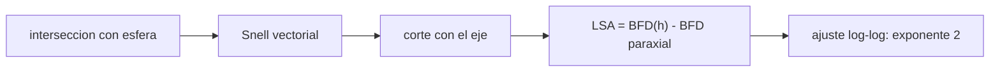

# B41-C08 — Trazado de rayos para telescopios

<!-- nav:top -->
[🏠 Programa](../../../../README.md) · [📚 Bloque B41](../../../tronco-comun/B41-optica-geometrica-y-diseno-de-telescopios.md) · [← Anterior: B41-C07 — Aumentos y sistemas afocales](../B41-C07-aumentos-y-sistemas-afocales/CLASE.md) · [Siguiente: B41-C09 — Pupilas y diafragmas ópticos →](../B41-C09-pupilas-y-diafragmas-opticos/CLASE.md)
<!-- /nav -->

## 1. Ubicación, nivel y alcance

Clase 8 del bloque B41. Nivel N3. Trazas **rayos exactos** a través de una lente biconvexa (`n = 1,517`, `R = ±200 mm`, 10 mm de espesor) con la ley de Snell en forma vectorial y los comparas con la óptica paraxial de matrices. Usas [B10](../../../tronco-comun/B10-algebra-lineal-y-matematicas-geometricas.md). Los datos son ilustrativos.

## 2. Por qué esta clase existe

Los programas de diseño óptico trazan rayos exactos. La decisión central: **¿cuándo se separa el rayo real del paraxial y cómo crece esa diferencia?**

## 3. Lo que podrás hacer al terminar

1. Intersecar un rayo con una superficie esférica.
2. Refractar con Snell vectorial.
3. Medir la distancia focal posterior exacta por altura.
4. Comparar con la focal paraxial de matrices.
5. Ajustar el exponente de la aberración esférica.
6. Interpretar el signo de la aberración.

La evidencia es la **ficha del trazado de rayos** del ejercicio 12 (sección 20).

## 4. Con qué llegas y cómo comprobarlo

1. ¿Qué es un rayo de luz en óptica geométrica?
2. ¿Qué dice la ley de Snell?
3. ¿Qué es la distancia focal de una lente o un espejo?
4. ¿Qué es un valor ilustrativo?
5. ¿Qué es una verificación numérica?

<details>
<summary>Ver respuestas</summary>

1. Una línea que indica la dirección de propagación de la energía. 2. `n₁ sen θ₁ = n₂ sen θ₂`. 3. La distancia del elemento al punto donde converge un haz paralelo. 4. Un valor propuesto para el ejemplo, no medido. 5. Comparar un cálculo con un caso independiente.
</details>

Con cuatro o cinco aciertos, sigue; si no, repasa los prerrequisitos.

## 5. Un caso de contexto y casos de referencia

La matriz da `f = 195,0857 mm` y una focal posterior desde el vértice de `191,7614 mm`. El rayo a `h = 20 mm` corta a `188,48149 mm` (aberración `−3,27995 mm`) y a `h = 40 mm` a `178,02306 mm`. El exponente ajustado es `2,038`. Es el **ejemplo conductor**.

## 6. Vocabulario

El **trazado exacto**. La **aproximación paraxial**. La **distancia focal posterior (BFD)**. La **aberración esférica longitudinal** de la lente. La **altura del rayo** `h`. La **forma vectorial de Snell**.

## 7. Modelo mental: un tiro con dos miras

Como disparar con una mira exacta y otra aproximada: con tiros cerca del eje coinciden; con tiros desviados la aproximación falla, y el error crece con el cuadrado de la desviación.



*Descripción textual:* cada rayo se traza superficie por superficie y su corte con el eje se compara con el paraxial.

Analogía: un tiro con dos miras. Límite: rayos meridionales y una sola longitud de onda.

## 8. La explicación, paso a paso

### 8.1 Corte con el eje

| h (mm) | BFD exacta (mm) | LSA (mm) | LSA/h² (×10⁻³/mm) |
|---|---|---|---|
| 0,001 | 191,76145 | −0,00000 | — |
| 5 | 191,55920 | −0,20224 | −8,08968 |
| 10 | 190,95031 | −0,81114 | −8,11136 |
| 20 | 188,48149 | −3,27995 | −8,19988 |
| 30 | 184,24259 | −7,51886 | −8,35429 |
| 40 | 178,02306 | −13,73839 | −8,58649 |

### 8.2 Comparación

La focal paraxial es `195,0857 mm`; la focal posterior paraxial `191,7614 mm`. El límite `h → 0` reproduce la matriz. El ajuste log-log entre `h = 10` y `40 mm` da exponente `2,038`: la aberración crece casi con `h²`.

### 8.3 Lectura

Una lente biconvexa enfoca más cerca los rayos del borde. Para `D = 80 mm` (`h = 40`) la zona del borde enfoca `13,74 mm` antes que el centro, `7 %` de la focal: una lente simple de ese diámetro no sirve como objetivo.

## 9. Magnitudes, símbolos y unidades

| Símbolo | Qué es | Unidad | Valor / nota |
|---|---|---|---|
| `h` | altura del rayo | mm | 0,001 a 40 |
| `BFD` | distancia focal posterior | mm | 191,76 a 178,02 |
| LSA | aberración esférica longitudinal | mm | −13,74 (h = 40) |
| `n` | índice | — | 1,517 (ilustrativo) |
| `e` | espesor | mm | 10 |

## 10. Convenciones y referencias

Distancias en milímetros salvo indicación; ángulos en radianes o grados según se rotule; las salidas del laboratorio usan punto decimal y el texto usa coma decimal. Los valores de vidrios, instrumentos y sensores son ilustrativos.

## 11. De dónde sale lo que afirmamos

| ID | Fuente | Localizador | Respalda | Estado |
|---|---|---|---|---|
| — | Sin fuente externa | — | relaciones de óptica geométrica de libro que verifica el laboratorio | No se consultó una fuente para esta clase; las cifras son ilustrativas |

Límites: el trazado es de libro; no se consultó una fuente y el vidrio es ilustrativo.

## 12. Cómo ver un rayo marginal

El rayo real se aparta del paraxial en una cantidad que crece con `h²`.

## 13. Ejemplo trabajado: rayo a h = 20 mm

**Paso 1 · Primera cara.** El rayo entra a `h = 20` y se refracta con Snell vectorial.

**Paso 2 · Segunda cara.** Se interseca con la segunda esfera y se refracta a aire.

**Paso 3 · Corte.** El corte con el eje cae a `188,48149 mm` del vértice 2: `3,27995 mm` antes del paraxial.

## 14. Distintas formas de describir el resultado

**Por fórmula:** la relación analítica. **Por tabla:** las cifras del laboratorio. **Por gráfica:** el diagrama de la sección 7. **Por código:** el script de la sección 17.

## 15. Práctica guiada

**Ejercicio 1 · con los pasos indicados.** LSA a `h = 10`.

<details><summary>Solución comentada</summary>

`−0,81114 mm`.
</details>

**Ejercicio 2 · con una pista.** Razón de LSA entre `h = 20` y `h = 10`.

<details><summary>Solución comentada</summary>

`3,27995/0,81114 = 4,04`.
</details>

**Ejercicio 3 · casi autónomo.** Focal posterior exacta a `h = 40`.

<details><summary>Solución comentada</summary>

`178,02306 mm`.
</details>

## 16. Práctica autónoma, transferencia e integrador

**Ejercicio 4.** Diferencia porcentual a `h = 40` frente a la paraxial.

<details><summary>Solución comentada</summary>

`13,738/191,761 = 7,2 %`.
</details>

**Ejercicio 5.** Exponente del ajuste.

<details><summary>Solución comentada</summary>

`2,038`.
</details>

**Ejercicio 6.** ¿Enfoca más cerca o más lejos el borde?

<details><summary>Solución comentada</summary>

Más cerca.
</details>

**Ejercicio 7.** LSA/h² a `h = 5`.

<details><summary>Solución comentada</summary>

`−8,09 × 10⁻³/mm`.
</details>

**Ejercicio 8.** `f` paraxial de la lente.

<details><summary>Solución comentada</summary>

`195,0857 mm`.
</details>

**Ejercicio 9 · transferencia.** **Transferencia.** Un compañero dice que el trazado paraxial basta para un objetivo f/2. Respóndele.

<details><summary>Solución comentada</summary>

A f/2 `h` es grande y la LSA no es despreciable.
</details>

**Ejercicio 10 · transferencia.** **Transferencia.** ¿Por qué el trazado exacto exige elegir la raíz de intersección correcta?

<details><summary>Solución comentada</summary>

Una esfera tiene dos cortes; se toma el del casquete que mira al rayo.
</details>

**Ejercicio 11 · transferencia.** **Transferencia.** ¿Qué haría el exponente con una cúbica?

<details><summary>Solución comentada</summary>

Sería 3; el ajuste lo detectaría.
</details>

**Ejercicio 12.** **Integrador.** Elabora tu *ficha del trazado de rayos*: tabla, exponente y límites.

<details><summary>Solución comentada</summary>

Secciones 8.1–8.3.
</details>

**Ejercicio 12 · integrador.** **Integrador.** Elabora tu *ficha del trazado de rayos*: tabla, exponente y límites.

<details><summary>Solución modelo</summary>

Secciones 8.1–8.3.
</details>

## 17. Laboratorio: trazado exacto frente a paraxial

El script [trazado.py](trazado.py) traza rayos exactos por dos esferas y mide la focal por altura (**comprueba** `h → 0` contra la matriz a `10⁻⁴ mm` y el exponente en `2 ± 0,2`).

**Datos:** sin constantes; lente **ilustrativa**. **Predice antes de ejecutar:** ¿cuánto antes enfoca el rayo de 40 mm? (≈ 13,7 mm.) **Ejecución del 2026-11-09 (Python 3.12.9):**

```text
Python 3.12.9 (biblioteca estandar)
paraxial (matrices): f = 195.0857 mm ; distancia focal posterior (vertice) = 191.7614 mm
  h [mm]  bfd exacta [mm]   LSA [mm]  LSA / h^2 [1e-3/mm]
   0.001        191.76145   -0.00000                  nan
   5.000        191.55920   -0.20224             -8.08968
  10.000        190.95031   -0.81114             -8.11136
  20.000        188.48149   -3.27995             -8.19988
  30.000        184.24259   -7.51886             -8.35429
  40.000        178.02306  -13.73839             -8.58649
exponente de la aberracion esferica longitudinal (ajuste log-log, h = 10 a 40 mm): 2.038
signo de la LSA: rayos marginales enfocan mas cerca (lente biconvexa)
Pruebas superadas.
```

```bash
python programa/clases/B41/B41-C08-trazado-de-rayos-para-telescopios/trazado.py
```

**Límites:** meridional, una longitud de onda, sin absorción.

## 18. Errores frecuentes y cómo corregirlos

**Usar la focal paraxial para rayos marginales.** Se corrige con 8.1.

**Elegir la raíz equivocada.** Se verifica con el signo del corte.

**Confundir BFD con `f`.** Se mide desde el vértice.

**Pensar que la LSA es lineal.** Crece con `h²`.

## 19. Cómo sabrás que vas bien

Tras la sección 8: ¿qué resultado esperabas y cuál obtuviste? Si dudas, repasa el ejemplo 13. Tras el laboratorio: ¿qué comprueba? (ver la sección 17).

## 20. Qué entregas y cómo se evalúa

El producto es tu **ficha del trazado de rayos** (ejercicio 12).

| Criterio | Inicial | En desarrollo | Logrado | Destacado |
|---|---|---|---|---|
| Conceptos | Los confunde | Parciales | conceptos de la clase | Explica los límites |
| Cálculo | Sin unidades | Con errores | Tablas completas | Calcula casos nuevos |
| Numérico | Sin comprobar | Un caso | Contraste con el análisis | Interpreta las diferencias |
| Fuentes | Sin fuente | Sin fecha | fuentes con fecha | Declara lo ilustrativo |
| Límites | No los nombra | Uno | Tres | Discute qué falta del modelo |

**Condiciones críticas (no se compensan con promedio):** rotular lo ilustrativo; no presentar el modelo como un instrumento real; citar solo lo consultado.

## 21. Ética, seguridad y límites

Clase educativa: los modelos son simplificados. Accesibilidad: tablas equivalentes a las gráficas, fórmulas en texto, ejercicios sin conexión.

## 22. Para cerrar y seguir

El trazado exacto muestra una aberración esférica que crece con `h²` y llega a `7 %` de la focal en `h = 40 mm`. Falta saber qué haz entra: las pupilas.

**Glosario español–inglés.** trazado de rayos · *ray tracing*; paraxial · *paraxial*; aberración esférica · *spherical aberration*; ley de Snell · *Snell's law*; altura del rayo · *ray height*.

**Continuidad.** [B41-C09](../B41-C09-pupilas-y-diafragmas-opticos/CLASE.md) estudia las pupilas y los diafragmas ópticos.

**Referencias:** ver sección 11.

<!-- nav:bottom -->
---

[← Anterior: B41-C07 — Aumentos y sistemas afocales](../B41-C07-aumentos-y-sistemas-afocales/CLASE.md) · [📚 Bloque B41](../../../tronco-comun/B41-optica-geometrica-y-diseno-de-telescopios.md) · [Siguiente: B41-C09 — Pupilas y diafragmas ópticos →](../B41-C09-pupilas-y-diafragmas-opticos/CLASE.md)
<!-- /nav -->
