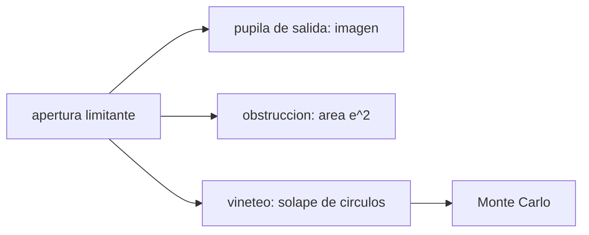

# B41-C09 — Pupilas y diafragmas ópticos

<!-- nav:top -->
[🏠 Programa](../../../../README.md) · [📚 Bloque B41](../../../tronco-comun/B41-optica-geometrica-y-diseno-de-telescopios.md) · [← Anterior: B41-C08 — Trazado de rayos para telescopios](../B41-C08-trazado-de-rayos-para-telescopios/CLASE.md) · [Siguiente: B41-C10 — Apertura y relación focal →](../B41-C10-apertura-y-relacion-focal/CLASE.md)
<!-- /nav -->

## 1. Ubicación, nivel y alcance

Clase 9 del bloque B41. Nivel N3. Calculas la **pupila de entrada y de salida** de un telescopio, la pérdida por una **obstrucción central** y el **viñeteo** de dos aperturas con un área exacta y un Monte Carlo (semilla 20261109). Usas [B12](../../../tronco-comun/B12-probabilidad-estadistica-e-incertidumbre.md) para el Monte Carlo. Las dimensiones son ilustrativas.

## 2. Por qué esta clase existe

La pupila limita la luz y el viñeteo oscurece los bordes. La decisión central: **¿qué diafragma manda y cuánta luz se pierde fuera del eje?**

## 3. Lo que podrás hacer al terminar

1. Hallar la pupila de salida por imagen.
2. Calcular el relieve ocular.
3. Calcular la pérdida por obstrucción central.
4. Calcular el viñeteo con áreas de círculos.
5. Verificar con un Monte Carlo.
6. Hallar el ángulo de viñeteo del 50 %.

La evidencia es la **ficha de pupilas y diafragmas** del ejercicio 12 (sección 20).

## 4. Con qué llegas y cómo comprobarlo

1. ¿Qué es un rayo de luz en óptica geométrica?
2. ¿Qué dice la ley de Snell?
3. ¿Qué es la distancia focal de una lente o un espejo?
4. ¿Qué es un valor ilustrativo?
5. ¿Qué es una verificación numérica?

<details>
<summary>Ver respuestas</summary>

1. Una línea que indica la dirección de propagación de la energía. 2. `n₁ sen θ₁ = n₂ sen θ₂`. 3. La distancia del elemento al punto donde converge un haz paralelo. 4. Un valor propuesto para el ejemplo, no medido. 5. Comparar un cálculo con un caso independiente.
</details>

Con cuatro o cinco aciertos, sigue; si no, repasa los prerrequisitos.

## 5. Un caso de contexto y casos de referencia

Un objetivo de 100 mm y un ocular de 25 mm dan una pupila de salida de `2,5000 mm` a `25,6250 mm` del ocular. Una obstrucción de `30 mm` deja `91,0 %` del área. Dos aperturas de 25 mm de radio separadas `300 mm` pierden la mitad de la luz a `3,85°`. Es el **ejemplo conductor**.

## 6. Vocabulario

La **apertura limitante**. La **pupila de entrada**. La **pupila de salida**. El **relieve ocular**. La **obstrucción central**. El **viñeteo**.

## 7. Modelo mental: mirar por dos agujeros

Como mirar por dos tubos de cartón alineados: de frente se ve todo el círculo, de lado el solape se estrecha hasta anularse; el solape es el área de dos círculos.



*Descripción textual:* la apertura limitante fija la luz; su imagen es la pupila de salida y el solape de aperturas, el viñeteo.

Analogía: mirar por dos agujeros. Límite: aperturas circulares y haz uniforme.

## 8. La explicación, paso a paso

### 8.1 Pupila de salida

La imagen del objetivo por el ocular está a `s' = 25,6250 mm` (relieve ocular) y mide `2,5000 mm`, igual a `D/M`.

### 8.2 Obstrucción central

Una obstrucción de `30 mm` en `100 mm` (`e = 0,300`) deja `91,0 %` del área, diámetro equivalente `95,39 mm`, pérdida `9,0 %` o `0,1024` magnitudes.

### 8.3 Viñeteo de dos aperturas

| Ángulo (°) | Desplazamiento (mm) | Área (mm²) | Fracción | Monte Carlo |
|---|---|---|---|---|
| 0,0 | 0,000 | 1963,495 | 1,0000 | 0,9995 |
| 1,0 | 5,237 | 1702,149 | 0,8669 | 0,8669 |
| 2,0 | 10,476 | 1443,542 | 0,7352 | 0,7362 |
| 3,0 | 15,722 | 1190,533 | 0,6063 | 0,6054 |
| 4,0 | 20,978 | 946,235 | 0,4819 | 0,4838 |

La mitad de la luz se pierde a `3,8518°`.

### 8.4 Lectura

La obstrucción central reduce poco la luz (9 %) pero cambia el contraste (clase 12); el viñeteo, en cambio, oscurece el borde del campo.

## 9. Magnitudes, símbolos y unidades

| Símbolo | Qué es | Unidad | Valor / nota |
|---|---|---|---|
| `s'` | posición de la pupila de salida | mm | 25,6250 |
| `D_s` | diámetro de la pupila de salida | mm | 2,5000 |
| `e` | razón de obstrucción | — | 0,300 |
| `r` | radio de apertura | mm | 25 |
| `L` | separación de aperturas | mm | 300 |

## 10. Convenciones y referencias

Distancias en milímetros salvo indicación; ángulos en radianes o grados según se rotule; las salidas del laboratorio usan punto decimal y el texto usa coma decimal. Los valores de vidrios, instrumentos y sensores son ilustrativos.

## 11. De dónde sale lo que afirmamos

| ID | Fuente | Localizador | Respalda | Estado |
|---|---|---|---|---|
| — | Sin fuente externa | — | relaciones de óptica geométrica de libro que verifica el laboratorio | No se consultó una fuente para esta clase; las cifras son ilustrativas |

Límites: las relaciones son geométricas y de libro; el Monte Carlo es sintético.

## 12. Cómo ver pupilas y viñeteo

La pupila de salida es la imagen de la apertura limitante; el viñeteo es el solape de aperturas desplazadas.

## 13. Ejemplo trabajado: obstrucción de 30 mm

**Paso 1 · Razón.** `e = 30/100 = 0,3`.

**Paso 2 · Área.** `1 − 0,3² = 0,91`.

**Paso 3 · Magnitud.** `−2,5 log10 (0,91) = 0,1024`.

## 14. Distintas formas de describir el resultado

**Por fórmula:** la relación analítica. **Por tabla:** las cifras del laboratorio. **Por gráfica:** el diagrama de la sección 7. **Por código:** el script de la sección 17.

## 15. Práctica guiada

**Ejercicio 1 · con los pasos indicados.** Pupila de salida con `D = 100`, `M = 40`.

<details><summary>Solución comentada</summary>

`2,5 mm`.
</details>

**Ejercicio 2 · con una pista.** Relieve ocular con `f_e = 25`.

<details><summary>Solución comentada</summary>

`25,625 mm`.
</details>

**Ejercicio 3 · casi autónomo.** Área de una apertura de radio 25.

<details><summary>Solución comentada</summary>

`1963,495 mm²`.
</details>

## 16. Práctica autónoma, transferencia e integrador

**Ejercicio 4.** Pérdida con obstrucción de `e = 0,5`.

<details><summary>Solución comentada</summary>

`25 %`.
</details>

**Ejercicio 5.** Magnitud perdida con `e = 0,3`.

<details><summary>Solución comentada</summary>

`0,1024`.
</details>

**Ejercicio 6.** Desplazamiento a `2°` con `L = 300`.

<details><summary>Solución comentada</summary>

`10,476 mm`.
</details>

**Ejercicio 7.** Fracción a `3°`.

<details><summary>Solución comentada</summary>

`0,6063`.
</details>

**Ejercicio 8.** Ángulo de viñeteo del 50 %.

<details><summary>Solución comentada</summary>

`3,85°`.
</details>

**Ejercicio 9 · transferencia.** **Transferencia.** Relieve ocular con `f_e = 10 mm` y objetivo de 1000 mm.

<details><summary>Solución comentada</summary>

`s = 1010`, `s' = 10,1 mm`: incómodo para gafas.
</details>

**Ejercicio 10 · transferencia.** **Transferencia.** ¿Por qué una obstrucción del 30 % apenas oscurece pero degrada el contraste?

<details><summary>Solución comentada</summary>

El área perdida es 9 % pero la luz se desplaza a los anillos.
</details>

**Ejercicio 11 · transferencia.** **Transferencia.** ¿Qué cambia si las aperturas son de distinto radio?

<details><summary>Solución comentada</summary>

El solape usa `min(r)` cuando una contiene a la otra.
</details>

**Ejercicio 12.** **Integrador.** Elabora tu *ficha de pupilas y diafragmas*.

<details><summary>Solución comentada</summary>

Secciones 8.1–8.4.
</details>

**Ejercicio 12 · integrador.** **Integrador.** Elabora tu *ficha de pupilas y diafragmas*.

<details><summary>Solución modelo</summary>

Secciones 8.1–8.4.
</details>

## 17. Laboratorio: pupilas, obstrucción y viñeteo

El script [pupilas.py](pupilas.py) calcula la pupila de salida, la obstrucción y el viñeteo con área exacta y Monte Carlo con semilla fija (**comprueba** a `0,5 %`).

**Datos:** sin constantes; dimensiones **ilustrativas**; Monte Carlo **sintético**. **Predice antes de ejecutar:** ¿a qué ángulo se pierde la mitad? (≈ 3,9°.) **Ejecución del 2026-11-09 (Python 3.12.9):**

```text
Python 3.12.9 (biblioteca estandar)
pupila de salida: posicion s' = 25.6250 mm tras el ocular (relieve ocular) ; diametro = 2.5000 mm ; D/M = 2.5000 mm
obstruccion central 30 mm de 100 mm: razon e = 0.300 ; area util = 91.0 % ; diametro equivalente = 95.39 mm
perdida de luz = 9.0 % ; magnitud perdida = 0.1024
viñeteo de dos aperturas de radio 25 mm separadas 300 mm
 angulo [deg]  desplaz. [mm]  area analitica [mm2]  fraccion  Monte Carlo
          0.0          0.000              1963.495    1.0000       0.9995
          1.0          5.237              1702.149    0.8669       0.8669
          2.0         10.476              1443.542    0.7352       0.7362
          3.0         15.722              1190.533    0.6063       0.6054
          4.0         20.978               946.235    0.4819       0.4838
angulo con viñeteo del 50 % = 3.8518 deg ; campo sin viñeteo (desplazamiento 0) solo en el eje
Pruebas superadas.
```

```bash
python programa/clases/B41/B41-C09-pupilas-y-diafragmas-opticos/pupilas.py
```

**Límites:** aperturas circulares, haz uniforme, sin difracción.

## 18. Errores frecuentes y cómo corregirlos

**Confundir pupila con apertura física.** La pupila es una imagen.

**Sumar la obstrucción lineal como si fuera de área.** El área va con `e²`.

**Creer que el viñeteo es una aberración.** Es una pérdida geométrica.

**Olvidar el relieve ocular.** Condiciona el uso con gafas.

## 19. Cómo sabrás que vas bien

Tras la sección 8: ¿qué resultado esperabas y cuál obtuviste? Si dudas, repasa el ejemplo 13. Tras el laboratorio: ¿qué comprueba? (ver la sección 17).

## 20. Qué entregas y cómo se evalúa

El producto es tu **ficha de pupilas y diafragmas** (ejercicio 12).

| Criterio | Inicial | En desarrollo | Logrado | Destacado |
|---|---|---|---|---|
| Conceptos | Los confunde | Parciales | conceptos de la clase | Explica los límites |
| Cálculo | Sin unidades | Con errores | Tablas completas | Calcula casos nuevos |
| Numérico | Sin comprobar | Un caso | Contraste con el análisis | Interpreta las diferencias |
| Fuentes | Sin fuente | Sin fecha | fuentes con fecha | Declara lo ilustrativo |
| Límites | No los nombra | Uno | Tres | Discute qué falta del modelo |

**Condiciones críticas (no se compensan con promedio):** rotular lo ilustrativo; no presentar el modelo como un instrumento real; citar solo lo consultado.

## 21. Ética, seguridad y límites

Clase educativa: los modelos son simplificados. Accesibilidad: tablas equivalentes a las gráficas, fórmulas en texto, ejercicios sin conexión.

## 22. Para cerrar y seguir

La pupila de salida mide `2,5 mm`, la obstrucción de `30 %` lineal quita `9 %` de la luz y dos aperturas pierden la mitad a `3,85°`. Falta relacionar apertura y focal: la relación focal.

**Glosario español–inglés.** pupila de entrada · *entrance pupil*; pupila de salida · *exit pupil*; viñeteo · *vignetting*; obstrucción · *obstruction*; relieve ocular · *eye relief*.

**Continuidad.** [B41-C10](../B41-C10-apertura-y-relacion-focal/CLASE.md) estudia la apertura y la relación focal.

**Referencias:** ver sección 11.

<!-- nav:bottom -->
---

[← Anterior: B41-C08 — Trazado de rayos para telescopios](../B41-C08-trazado-de-rayos-para-telescopios/CLASE.md) · [📚 Bloque B41](../../../tronco-comun/B41-optica-geometrica-y-diseno-de-telescopios.md) · [Siguiente: B41-C10 — Apertura y relación focal →](../B41-C10-apertura-y-relacion-focal/CLASE.md)
<!-- /nav -->
