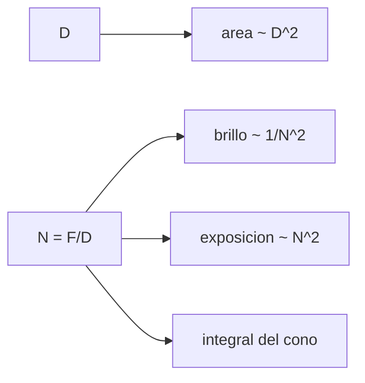

# B41-C10 — Apertura y relación focal

<!-- nav:top -->
[🏠 Programa](../../../../README.md) · [📚 Bloque B41](../../../tronco-comun/B41-optica-geometrica-y-diseno-de-telescopios.md) · [← Anterior: B41-C09 — Pupilas y diafragmas ópticos](../B41-C09-pupilas-y-diafragmas-opticos/CLASE.md) · [Siguiente: B41-C11 — Campo visual y escala de placa →](../B41-C11-campo-visual-y-escala-de-placa/CLASE.md)
<!-- /nav -->

## 1. Ubicación, nivel y alcance

Clase 10 del bloque B41. Nivel N3. Relacionas la **apertura** `D`, la **focal** `F` y la **relación focal** `N = F/D` con la luz captada, el brillo de un objeto extenso y el tiempo de exposición. Usas [B05](../../../tronco-comun/B05-fisica-fundamental-para-el-espacio.md). Las dimensiones son ilustrativas.

## 2. Por qué esta clase existe

La relación focal decide si un telescopio es «rápido» o «lento». La decisión central: **¿qué importa más, el diámetro o la relación focal?**

## 3. Lo que podrás hacer al terminar

1. Calcular `N = F/D`.
2. Calcular el área colectora relativa.
3. Calcular las magnitudes ganadas.
4. Calcular el brillo superficial `∝ 1/N²`.
5. Verificar con una integral del ángulo sólido.
6. Ajustar tiempos de exposición.

La evidencia es la **ficha de apertura y relación focal** del ejercicio 12 (sección 20).

## 4. Con qué llegas y cómo comprobarlo

1. ¿Qué es un rayo de luz en óptica geométrica?
2. ¿Qué dice la ley de Snell?
3. ¿Qué es la distancia focal de una lente o un espejo?
4. ¿Qué es un valor ilustrativo?
5. ¿Qué es una verificación numérica?

<details>
<summary>Ver respuestas</summary>

1. Una línea que indica la dirección de propagación de la energía. 2. `n₁ sen θ₁ = n₂ sen θ₂`. 3. La distancia del elemento al punto donde converge un haz paralelo. 4. Un valor propuesto para el ejemplo, no medido. 5. Comparar un cálculo con un caso independiente.
</details>

Con cuatro o cinco aciertos, sigue; si no, repasa los prerrequisitos.

## 5. Un caso de contexto y casos de referencia

Un telescopio de `200 mm` y `1000 mm` (f/5) capta `6,25` veces más luz que uno de `80 mm` (`1,990` magnitudes); a f/10 el brillo de un objeto extenso cae a `0,250`. Es el **ejemplo conductor**.

## 6. Vocabulario

La **relación focal** `N`. El **área colectora**. La **magnitud límite**. El **brillo superficial**. El **ángulo sólido** del cono. El **tiempo de exposición**.

## 7. Modelo mental: un embudo

Como un embudo: la apertura es la boca y la relación focal el ángulo; una boca grande capta más lluvia (fuente puntual), un cono más abierto concentra más sobre cada gota (objeto extenso).



*Descripción textual:* el diámetro controla la luz de fuentes puntuales y la relación focal el brillo de objetos extensos.

Analogía: un embudo. Límite: objeto en el infinito y transmisión unitaria.

## 8. La explicación, paso a paso

### 8.1 Cinco telescopios (base 80 mm f/5)

| D (mm) | F (mm) | N | Área relativa | 2,5 log₁₀ área | Brillo superficial relativo |
|---|---|---|---|---|---|
| 80 | 400 | 5,0 | 1,000 | 0,000 | 1,000 |
| 150 | 750 | 5,0 | 3,516 | 1,365 | 1,000 |
| 200 | 1000 | 5,0 | 6,250 | 1,990 | 1,000 |
| 200 | 2000 | 10,0 | 6,250 | 1,990 | 0,250 |
| 400 | 1600 | 4,0 | 25,000 | 3,495 | 1,562 |

### 8.2 Integral del cono

| N | θ (°) | integral | sen² | 1/(4N²) |
|---|---|---|---|---|
| 1,0 | 26,5651 | 0,200000 | 0,200000 | 0,250000 |
| 2,0 | 14,0362 | 0,058824 | 0,058824 | 0,062500 |
| 5,0 | 5,7106 | 0,009901 | 0,009901 | 0,010000 |
| 10,0 | 2,8624 | 0,002494 | 0,002494 | 0,002500 |
| 30,0 | 0,9548 | 0,000278 | 0,000278 | 0,000278 |

### 8.3 Exposición y ganancia

Una imagen de f/5 a `1/60 s` equivale a f/10 con `0,0667 s` (4 veces). Duplicar la apertura de una fuente puntual gana `1,505` magnitudes. Frente a un ojo de 7 mm, 80, 200 y 400 mm ganan `5,29; 7,28; 8,78` magnitudes (ideal).

### 8.4 Lectura

La aproximación `1/(4N²)` falla `20 %` en f/1 y es excelente desde f/10: para relaciones focales cortas hay que usar `sen²θ`.

## 9. Magnitudes, símbolos y unidades

| Símbolo | Qué es | Unidad | Valor / nota |
|---|---|---|---|
| `N` | relación focal | — | 4 a 10 |
| `D` | apertura | mm | 80 a 400 |
| `θ` | semiángulo del cono | ° | 0,95 a 26,57 |
| `t` | tiempo de exposición | s | 0,0167 y 0,0667 |
| `Δm` | ganancia | mag | 1,990 (6,25×) |

## 10. Convenciones y referencias

Distancias en milímetros salvo indicación; ángulos en radianes o grados según se rotule; las salidas del laboratorio usan punto decimal y el texto usa coma decimal. Los valores de vidrios, instrumentos y sensores son ilustrativos.

## 11. De dónde sale lo que afirmamos

| ID | Fuente | Localizador | Respalda | Estado |
|---|---|---|---|---|
| — | Sin fuente externa | — | relaciones de óptica geométrica de libro que verifica el laboratorio | No se consultó una fuente para esta clase; las cifras son ilustrativas |

Límites: las relaciones de brillo y exposición son de libro; el laboratorio las verifica numéricamente.

## 12. Cómo ver luz y brillo

El brillo de un objeto extenso depende solo de `N`; la luz de una fuente puntual, de `D²`.

## 13. Ejemplo trabajado: 200 mm f/5 frente a 80 mm f/5

**Paso 1 · Área.** `(200/80)² = 6,25`.

**Paso 2 · Magnitudes.** `2,5 log10 6,25 = 1,990`.

**Paso 3 · Brillo.** Ambos son f/5: brillo relativo `1,000`.

## 14. Distintas formas de describir el resultado

**Por fórmula:** la relación analítica. **Por tabla:** las cifras del laboratorio. **Por gráfica:** el diagrama de la sección 7. **Por código:** el script de la sección 17.

## 15. Práctica guiada

**Ejercicio 1 · con los pasos indicados.** `N` de 200 mm y 1000 mm.

<details><summary>Solución comentada</summary>

`5`.
</details>

**Ejercicio 2 · con una pista.** Área relativa de 150 mm frente a 80 mm.

<details><summary>Solución comentada</summary>

`3,516`.
</details>

**Ejercicio 3 · casi autónomo.** Magnitudes ganadas por 400 mm frente a 80 mm.

<details><summary>Solución comentada</summary>

`3,495`.
</details>

## 16. Práctica autónoma, transferencia e integrador

**Ejercicio 4.** Brillo de 200 mm f/10 frente a f/5.

<details><summary>Solución comentada</summary>

`0,250`.
</details>

**Ejercicio 5.** Tiempo en f/10 si en f/5 son `1/60 s`.

<details><summary>Solución comentada</summary>

`0,0667 s`.
</details>

**Ejercicio 6.** Error de `1/(4N²)` en f/2.

<details><summary>Solución comentada</summary>

`5,9 %`.
</details>

**Ejercicio 7.** Ganancia de duplicar la apertura.

<details><summary>Solución comentada</summary>

`1,505 mag`.
</details>

**Ejercicio 8.** Brillo de 400 mm f/4 frente a f/5.

<details><summary>Solución comentada</summary>

`1,5625`.
</details>

**Ejercicio 9 · transferencia.** **Transferencia.** ¿Por qué un refractor f/10 es mejor para planetas y uno f/4 para nebulosas?

<details><summary>Solución comentada</summary>

El f/4 da más brillo superficial; el f/10 una imagen más grande para el mismo ocular.
</details>

**Ejercicio 10 · transferencia.** **Transferencia.** Un compañero afirma que una cámara f/2 siempre capta 6 veces más que f/5. Respóndele.

<details><summary>Solución comentada</summary>

`(5/2)² = 6,25` solo para objetos extensos; para estrellas importa `D`.
</details>

**Ejercicio 11 · transferencia.** **Transferencia.** ¿Y si se usa un reductor 0,63×?

<details><summary>Solución comentada</summary>

`N` baja a `0,63 N`: brillo `×2,5`.
</details>

**Ejercicio 12.** **Integrador.** Elabora tu *ficha de apertura y relación focal*.

<details><summary>Solución comentada</summary>

Secciones 8.1–8.4.
</details>

**Ejercicio 12 · integrador.** **Integrador.** Elabora tu *ficha de apertura y relación focal*.

<details><summary>Solución modelo</summary>

Secciones 8.1–8.4.
</details>

## 17. Laboratorio: luz, brillo y exposición

El script [apertura.py](apertura.py) relaciona `D`, `N`, magnitudes y brillo con una integral del cono (**comprueba** la integral contra `sen²θ` a `10⁻⁹`).

**Datos:** sin constantes; todo **ilustrativo**. **Predice antes de ejecutar:** ¿cuánto más oscuro es el objeto extenso a f/10? (0,25.) **Ejecución del 2026-11-09 (Python 3.12.9):**

```text
Python 3.12.9 (biblioteca estandar)
 D [mm]  F [mm]      N  area rel.  2,5 log10 area  brillo sup. rel.
     80     400    5.0      1.000           0.000             1.000
    150     750    5.0      3.516           1.365             1.000
    200    1000    5.0      6.250           1.990             1.000
    200    2000   10.0      6.250           1.990             0.250
    400    1600    4.0     25.000           3.495             1.562
    N  theta [deg]   integral      sen^2   1/(4N^2)  error rel. 1/(4N^2)
  1.0      26.5651   0.200000   0.200000   0.250000            2.000e-01
  2.0      14.0362   0.058824   0.058824   0.062500            5.882e-02
  5.0       5.7106   0.009901   0.009901   0.010000            9.901e-03
 10.0       2.8624   0.002494   0.002494   0.002500            2.494e-03
 30.0       0.9548   0.000278   0.000278   0.000278            2.777e-04
misma imagen de brillo: f/5 con 1/60 s equivale a f/10 con 0.0667 s (= 4 veces)
fuente puntual: duplicar la apertura reduce el tiempo 4 veces y gana 1.505 magnitudes limite
  telescopio de 80 mm frente a un ojo de 7 mm: ganancia = 5.29 magnitudes (solo captacion, ideal)
  telescopio de 200 mm frente a un ojo de 7 mm: ganancia = 7.28 magnitudes (solo captacion, ideal)
  telescopio de 400 mm frente a un ojo de 7 mm: ganancia = 8.78 magnitudes (solo captacion, ideal)
Pruebas superadas.
```

```bash
python programa/clases/B41/B41-C10-apertura-y-relacion-focal/apertura.py
```

**Límites:** objeto en el infinito, transmisión unitaria.

## 18. Errores frecuentes y cómo corregirlos

**Creer que el brillo depende de `D`.** Solo de `N` para objetos extensos.

**Aplicar `1/(4N²)` a f/1.** Usar `sen²θ`.

**Olvidar el cuadrado.** Se corrige con 8.1.

**Confundir 2,5 log con 5 log.** Con `D` es `5 log₁₀`.

## 19. Cómo sabrás que vas bien

Tras la sección 8: ¿qué resultado esperabas y cuál obtuviste? Si dudas, repasa el ejemplo 13. Tras el laboratorio: ¿qué comprueba? (ver la sección 17).

## 20. Qué entregas y cómo se evalúa

El producto es tu **ficha de apertura y relación focal** (ejercicio 12).

| Criterio | Inicial | En desarrollo | Logrado | Destacado |
|---|---|---|---|---|
| Conceptos | Los confunde | Parciales | conceptos de la clase | Explica los límites |
| Cálculo | Sin unidades | Con errores | Tablas completas | Calcula casos nuevos |
| Numérico | Sin comprobar | Un caso | Contraste con el análisis | Interpreta las diferencias |
| Fuentes | Sin fuente | Sin fecha | fuentes con fecha | Declara lo ilustrativo |
| Límites | No los nombra | Uno | Tres | Discute qué falta del modelo |

**Condiciones críticas (no se compensan con promedio):** rotular lo ilustrativo; no presentar el modelo como un instrumento real; citar solo lo consultado.

## 21. Ética, seguridad y límites

Clase educativa: los modelos son simplificados. Accesibilidad: tablas equivalentes a las gráficas, fórmulas en texto, ejercicios sin conexión.

## 22. Para cerrar y seguir

La apertura cuadruplica la luz al duplicarse y la relación focal cuadruplica el tiempo al duplicarse. Falta saber qué tamaño de imagen y de campo resultan: escala de placa.

**Glosario español–inglés.** relación focal · *focal ratio*; apertura · *aperture*; brillo superficial · *surface brightness*; magnitud límite · *limiting magnitude*; exposición · *exposure*.

**Continuidad.** [B41-C11](../B41-C11-campo-visual-y-escala-de-placa/CLASE.md) estudia el campo visual y la escala de placa.

**Referencias:** ver sección 11.

<!-- nav:bottom -->
---

[← Anterior: B41-C09 — Pupilas y diafragmas ópticos](../B41-C09-pupilas-y-diafragmas-opticos/CLASE.md) · [📚 Bloque B41](../../../tronco-comun/B41-optica-geometrica-y-diseno-de-telescopios.md) · [Siguiente: B41-C11 — Campo visual y escala de placa →](../B41-C11-campo-visual-y-escala-de-placa/CLASE.md)
<!-- /nav -->
