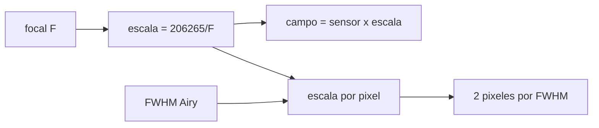

# B41-C11 — Campo visual y escala de placa

<!-- nav:top -->
[🏠 Programa](../../../../README.md) · [📚 Bloque B41](../../../tronco-comun/B41-optica-geometrica-y-diseno-de-telescopios.md) · [← Anterior: B41-C10 — Apertura y relación focal](../B41-C10-apertura-y-relacion-focal/CLASE.md) · [Siguiente: B41-C12 — Difracción y límite de Rayleigh →](../B41-C12-difraccion-y-limite-de-rayleigh/CLASE.md)
<!-- /nav -->

## 1. Ubicación, nivel y alcance

Clase 11 del bloque B41. Nivel N3. Conviertes la focal en **escala de placa**, calculas el **campo** que cubre un sensor y decides si la imagen está bien **muestreada** (Nyquist). Usas [B15](../../../tronco-comun/B15-senales-imagenes-y-estimacion-cientifica.md) y [B05](../../../tronco-comun/B05-fisica-fundamental-para-el-espacio.md). Telescopio, sensor y seeing son ilustrativos.

## 2. Por qué esta clase existe

Un sensor mal emparejado desperdicia resolución o campo. La decisión central: **¿qué focal y qué píxel dan el campo y el muestreo que busco?**

## 3. Lo que podrás hacer al terminar

1. Calcular la escala de placa `206 264,806/F`.
2. Calcular el campo exacto y el aproximado.
3. Obtener el FWHM del disco de Airy.
4. Aplicar 2 píxeles por FWHM.
5. Evaluar reductores y barlows.
6. Reconocer el límite del seeing.

La evidencia es la **ficha de campo y escala de placa** del ejercicio 12 (sección 20).

## 4. Con qué llegas y cómo comprobarlo

1. ¿Qué es un rayo de luz en óptica geométrica?
2. ¿Qué dice la ley de Snell?
3. ¿Qué es la distancia focal de una lente o un espejo?
4. ¿Qué es un valor ilustrativo?
5. ¿Qué es una verificación numérica?

<details>
<summary>Ver respuestas</summary>

1. Una línea que indica la dirección de propagación de la energía. 2. `n₁ sen θ₁ = n₂ sen θ₂`. 3. La distancia del elemento al punto donde converge un haz paralelo. 4. Un valor propuesto para el ejemplo, no medido. 5. Comparar un cálculo con un caso independiente.
</details>

Con cuatro o cinco aciertos, sigue; si no, repasa los prerrequisitos.

## 5. Un caso de contexto y casos de referencia

Con `F = 1000 mm` y píxeles de `4,3 µm`: `206,265 "/mm` y `0,8869 "/píxel`; el sensor de `22,3 × 14,9 mm` cubre `1,2776° × 0,8537°` (`17,97 Mpíxel`). El FWHM de difracción de un telescopio de 200 mm es `0,5837 "`. Es el **ejemplo conductor**.

## 6. Vocabulario

La **escala de placa** ("/mm). El **campo visual**. El **muestreo de Nyquist**. El **FWHM** (ancho a mitad de altura). El **seeing**. Un **reductor** y un **barlow**.

## 7. Modelo mental: una red de pesca

Como una red de pesca: si la malla (píxel) es mucho mayor que el pez (la estrella), se escapa el detalle; si es mucho menor, se gasta red sin ganar nada.



*Descripción textual:* la focal fija la escala, el sensor el campo y el FWHM el muestreo.

Analogía: una red de pesca. Límite: sensor plano perpendicular al eje, sin distorsión.

## 8. La explicación, paso a paso

### 8.1 Escala y campo

| Magnitud | Valor |
|---|---|
| Segundos de arco por radián | 206 264,806 |
| Escala de placa (F = 1000 mm) | 206,265 "/mm |
| Escala por píxel (4,3 µm) | 0,8869 "/píxel |
| Campo del sensor | 1,2776° × 0,8537° |
| Aproximación `w/F` | 1,2777° (diferencia relativa 4,1 × 10⁻⁵) |
| Píxeles | 5186 × 3465 = 17,97 Mpíxel |

### 8.2 Muestreo

El FWHM del disco de Airy se obtiene resolviendo `(2 J₁(x)/x)² = 1/2`: `x = 1,6163`, o `1,0290 λ/D`. Con `D = 200 mm` y `550 nm` es `0,5837 "` (`2,83 µm` en el plano focal). La escala máxima para 2 píxeles por FWHM de difracción es `0,2918 "/píxel`. Con seeing de `2,0 "` el límite es `1,00 "/píxel`: la escala real `0,8869` da `2,25` píxeles por FWHM (bien muestreado).

### 8.3 Reductor y barlow

| Factor | F (mm) | Escala ("/píxel) | Campo ancho (°) |
|---|---|---|---|
| 0,63 | 630 | 1,4078 | 2,0279 |
| 1,00 | 1000 | 0,8869 | 1,2776 |
| 2,00 | 2000 | 0,4435 | 0,6388 |

### 8.4 Lectura

Un reductor ensancha el campo pero submuestrea (`1,42` píxeles por FWHM de seeing); un barlow sobremuestrea el seeing y no gana detalle real.

## 9. Magnitudes, símbolos y unidades

| Símbolo | Qué es | Unidad | Valor / nota |
|---|---|---|---|
| `F` | distancia focal | mm | 630 a 2000 |
| `s` | escala de placa | "/mm | 206,265 (F = 1000) |
| `p` | tamaño del píxel | µm | 4,3 |
| `λ/D` | unidad de difracción | rad | FWHM = 1,0290 λ/D |
| `seeing` | FWHM atmosférico | " | 2,0 (ilustrativo) |

## 10. Convenciones y referencias

Distancias en milímetros salvo indicación; ángulos en radianes o grados según se rotule; las salidas del laboratorio usan punto decimal y el texto usa coma decimal. Los valores de vidrios, instrumentos y sensores son ilustrativos.

## 11. De dónde sale lo que afirmamos

| ID | Fuente | Localizador | Respalda | Estado |
|---|---|---|---|---|
| — | Sin fuente externa | — | relaciones de óptica geométrica de libro que verifica el laboratorio | No se consultó una fuente para esta clase; las cifras son ilustrativas |

Límites: la relación `206 264,806 = 648 000/π` es geométrica y el FWHM de Airy se calcula; el telescopio, el sensor y el seeing son ilustrativos.

## 12. Cómo ver escala y muestreo

La escala de placa es el recíproco de la focal expresado en segundos de arco por milímetro.

## 13. Ejemplo trabajado: sensor de APS-C a F = 1000 mm

**Paso 1 · Escala.** `206 264,806/1000 = 206,265 "/mm`.

**Paso 2 · Píxel.** `206,265 × 0,0043 = 0,8869 "`.

**Paso 3 · Campo.** `2 atan(22,3/2000) = 1,2776°`.

**Paso 4 · Muestreo.** `2,0/0,8869 = 2,25` píxeles por FWHM.

## 14. Distintas formas de describir el resultado

**Por fórmula:** la relación analítica. **Por tabla:** las cifras del laboratorio. **Por gráfica:** el diagrama de la sección 7. **Por código:** el script de la sección 17.

## 15. Práctica guiada

**Ejercicio 1 · con los pasos indicados.** Escala de placa a `F = 1000 mm`.

<details><summary>Solución comentada</summary>

`206,265 "/mm`.
</details>

**Ejercicio 2 · con una pista.** A `F = 2000 mm`.

<details><summary>Solución comentada</summary>

`103,13 "/mm`.
</details>

**Ejercicio 3 · casi autónomo.** Escala por píxel (4,3 µm) a `F = 2000`.

<details><summary>Solución comentada</summary>

`0,4435 "`.
</details>

## 16. Práctica autónoma, transferencia e integrador

**Ejercicio 4.** Ancho del campo `w/F` en grados con `w = 22,3`.

<details><summary>Solución comentada</summary>

`1,2777°`.
</details>

**Ejercicio 5.** FWHM de difracción de 200 mm a 550 nm.

<details><summary>Solución comentada</summary>

`0,5837 "`.
</details>

**Ejercicio 6.** Píxeles por FWHM de seeing a `0,8869 "`.

<details><summary>Solución comentada</summary>

`2,25`.
</details>

**Ejercicio 7.** Megapíxeles del sensor.

<details><summary>Solución comentada</summary>

`17,97`.
</details>

**Ejercicio 8.** Focal para `0,6667 "/píxel` (3 píxeles por FWHM).

<details><summary>Solución comentada</summary>

`1330 mm`.
</details>

**Ejercicio 9 · transferencia.** **Transferencia.** Con el reductor 0,63×, ¿cuántos píxeles por FWHM del seeing?

<details><summary>Solución comentada</summary>

`2,0/1,4078 = 1,42`: submuestreado.
</details>

**Ejercicio 10 · transferencia.** **Transferencia.** ¿Por qué la escala depende de `F` y no de `D`?

<details><summary>Solución comentada</summary>

La imagen se forma a la distancia focal; `D` solo fija la luz.
</details>

**Ejercicio 11 · transferencia.** **Transferencia.** Para `0,2918 "/píxel` (difracción), ¿qué focal?

<details><summary>Solución comentada</summary>

`≈ 3040 mm`.
</details>

**Ejercicio 12.** **Integrador.** Elabora tu *ficha de campo y escala de placa*.

<details><summary>Solución comentada</summary>

Secciones 8.1–8.4.
</details>

**Ejercicio 12 · integrador.** **Integrador.** Elabora tu *ficha de campo y escala de placa*.

<details><summary>Solución modelo</summary>

Secciones 8.1–8.4.
</details>

## 17. Laboratorio: escala, campo y muestreo

El script [campo.py](campo.py) calcula escala, campo exacto, FWHM de Airy por raíz numérica y el muestreo (**comprueba** `648000/π` y el FWHM `1,0290 λ/D`).

**Datos:** sin constantes del NIST; todo **ilustrativo**. **Predice antes de ejecutar:** ¿cuántos píxeles por FWHM de seeing? (≈ 2,25.) **Ejecución del 2026-11-09 (Python 3.12.9):**

```text
Python 3.12.9 (biblioteca estandar)
segundos de arco por radian = 206264.806
escala de placa = 206.265 arcsec/mm = 0.8869 arcsec/pixel (pixel de 4.3 micras)
campo del sensor: 1.2776 x 0.8537 deg ; aproximacion w/F = 1.2777 deg ; diferencia relativa = 4.14e-05
pixeles: 5186 x 3465 = 17.97 Mpix
mitad de altura del disco de Airy en x = 1.6163 ; FWHM = 1.0290 lambda/D
FWHM difraccion (D = 200 mm, 550 nm) = 0.5837 arcsec = 2.83 micras en el plano focal
escala maxima para 2 pixeles por FWHM de difraccion = 0.2918 arcsec/pixel
con seeing de 2.0 arcsec el FWHM es el del seeing: 2 pixeles por FWHM -> 1.00 arcsec/pixel
escala real 0.8869 arcsec/pixel : bien muestreado frente al seeing ; relacion FWHM/pixel (seeing) = 2.25
 factor   F [mm]  escala ["/pix]  campo ancho [deg]
   0.63      630          1.4078             2.0279
   1.00     1000          0.8869             1.2776
   2.00     2000          0.4435             0.6388
Pruebas superadas.
```

```bash
python programa/clases/B41/B41-C11-campo-visual-y-escala-de-placa/campo.py
```

**Límites:** campo pequeño, sin distorsión.

## 18. Errores frecuentes y cómo corregirlos

**Confundir escala por mm con por píxel.** Multiplica por el tamaño del píxel.

**Muestrear la difracción cuando manda el seeing.** Se corrige con 8.2.

**Usar `w/F` en campos grandes.** Usa `atan`.

**Olvidar convertir micras a milímetros.** Se corrige con la tabla.

## 19. Cómo sabrás que vas bien

Tras la sección 8: ¿qué resultado esperabas y cuál obtuviste? Si dudas, repasa el ejemplo 13. Tras el laboratorio: ¿qué comprueba? (ver la sección 17).

## 20. Qué entregas y cómo se evalúa

El producto es tu **ficha de campo y escala de placa** (ejercicio 12).

| Criterio | Inicial | En desarrollo | Logrado | Destacado |
|---|---|---|---|---|
| Conceptos | Los confunde | Parciales | conceptos de la clase | Explica los límites |
| Cálculo | Sin unidades | Con errores | Tablas completas | Calcula casos nuevos |
| Numérico | Sin comprobar | Un caso | Contraste con el análisis | Interpreta las diferencias |
| Fuentes | Sin fuente | Sin fecha | fuentes con fecha | Declara lo ilustrativo |
| Límites | No los nombra | Uno | Tres | Discute qué falta del modelo |

**Condiciones críticas (no se compensan con promedio):** rotular lo ilustrativo; no presentar el modelo como un instrumento real; citar solo lo consultado.

## 21. Ética, seguridad y límites

Clase educativa: los modelos son simplificados. Accesibilidad: tablas equivalentes a las gráficas, fórmulas en texto, ejercicios sin conexión.

## 22. Para cerrar y seguir

La escala `206,265 "/mm` y el píxel de `4,3 µm` dan `0,8869 "` y un campo de `1,28°`. Falta ver cuánta resolución impone la difracción.

**Glosario español–inglés.** escala de placa · *plate scale*; campo visual · *field of view*; muestreo · *sampling*; FWHM · *FWHM*; reductor · *focal reducer*.

**Continuidad.** [B41-C12](../B41-C12-difraccion-y-limite-de-rayleigh/CLASE.md) estudia la difracción y el límite de Rayleigh.

**Referencias:** ver sección 11.

<!-- nav:bottom -->
---

[← Anterior: B41-C10 — Apertura y relación focal](../B41-C10-apertura-y-relacion-focal/CLASE.md) · [📚 Bloque B41](../../../tronco-comun/B41-optica-geometrica-y-diseno-de-telescopios.md) · [Siguiente: B41-C12 — Difracción y límite de Rayleigh →](../B41-C12-difraccion-y-limite-de-rayleigh/CLASE.md)
<!-- /nav -->
