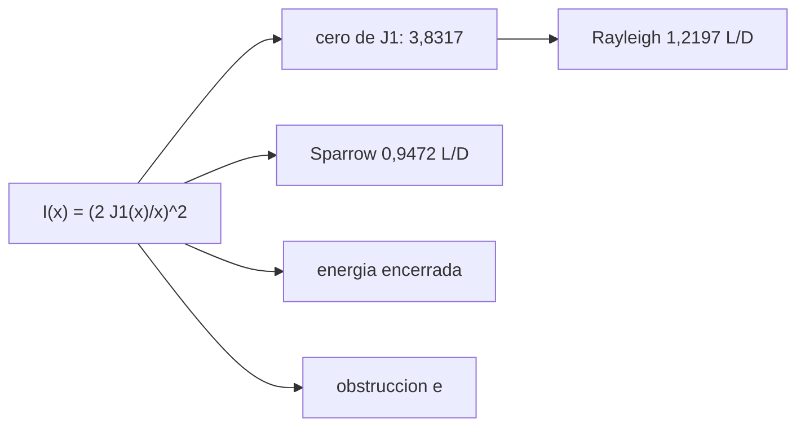

# B41-C12 — Difracción y límite de Rayleigh

<!-- nav:top -->
[🏠 Programa](../../../../README.md) · [📚 Bloque B41](../../../tronco-comun/B41-optica-geometrica-y-diseno-de-telescopios.md) · [← Anterior: B41-C11 — Campo visual y escala de placa](../B41-C11-campo-visual-y-escala-de-placa/CLASE.md) · [Siguiente: B41-C13 — Aberración esférica y coma →](../B41-C13-aberracion-esferica-y-coma/CLASE.md)
<!-- /nav -->

## 1. Ubicación, nivel y alcance

Clase 12 del bloque B41. Nivel N3. La apertura circular produce el **disco de Airy**. Calculas el criterio de **Rayleigh**, el de **Sparrow**, la regla de **Dawes** y el efecto de una **obstrucción central**. Usas [B42](../../../tronco-comun/B42-optica-fisica-y-optica-adaptativa.md) para el contexto ondulatorio. Los datos son ilustrativos.

## 2. Por qué esta clase existe

La difracción fija el mejor detalle posible. La decisión central: **¿cuándo se resuelven dos estrellas y qué cuesta una obstrucción?**

## 3. Lo que podrás hacer al terminar

1. Calcular `I(x) = (2 J₁(x)/x)²`.
2. Hallar el primer cero de `J₁`.
3. Calcular Rayleigh y Sparrow.
4. Calcular la energía encerrada.
5. Medir el efecto de una obstrucción.
6. Comparar con Dawes.

La evidencia es la **ficha de difracción y límite de Rayleigh** del ejercicio 12 (sección 20).

## 4. Con qué llegas y cómo comprobarlo

1. ¿Qué es un rayo de luz en óptica geométrica?
2. ¿Qué dice la ley de Snell?
3. ¿Qué es la distancia focal de una lente o un espejo?
4. ¿Qué es un valor ilustrativo?
5. ¿Qué es una verificación numérica?

<details>
<summary>Ver respuestas</summary>

1. Una línea que indica la dirección de propagación de la energía. 2. `n₁ sen θ₁ = n₂ sen θ₂`. 3. La distancia del elemento al punto donde converge un haz paralelo. 4. Un valor propuesto para el ejemplo, no medido. 5. Comparar un cálculo con un caso independiente.
</details>

Con cuatro o cinco aciertos, sigue; si no, repasa los prerrequisitos.

## 5. Un caso de contexto y casos de referencia

Con `D = 200 mm` y `550 nm`: Rayleigh `0,6918 "`, Sparrow `0,5373 "` (`0,9472 λ/D`) y Dawes `0,5800 "`. El primer cero está en `x = 3,8317`: el anillo oscuro a `1,2197 λ/D` y dentro de él cae el `83,78 %` de la energía. Es el **ejemplo conductor**.

## 6. Vocabulario

El **disco de Airy**. La **función de Bessel** `J₁`. El **criterio de Rayleigh**. El **criterio de Sparrow**. La **regla de Dawes**. La **energía encerrada**. La **obstrucción central**.

## 7. Modelo mental: las ondas de un estanque

Como las ondas en un estanque que pasan por un agujero: se abren en anillos; dos fuentes cercanas se confunden cuando el máximo de una cae sobre el primer mínimo de la otra.



*Descripción textual:* la apertura circular da un patrón de Bessel; los criterios fijan cuándo dos patrones se separan.

Analogía: las ondas de un estanque. Límite: apertura circular, onda plana, campo lejano.

## 8. La explicación, paso a paso

### 8.1 Ceros y criterios

| Magnitud | Valor |
|---|---|
| Primer cero de `J₁` | 3,8317 (`1,2197 λ/D`) |
| Segundo cero | 7,0156 (`2,2331 λ/D`) |
| Rayleigh (200 mm, 550 nm) | 0,6918 " |
| Sparrow | 0,5373 " (`0,9472 λ/D`) |
| Dawes (empírica) | 0,5800 " |
| Intensidad del punto medio en Rayleigh | 0,7350 del máximo de la suma |

### 8.2 Energía encerrada

| x | EE numérica | `1 − J₀² − J₁²` |
|---|---|---|
| 1,0000 | 0,220828 | 0,220828 |
| 3,8317 | 0,837785 | 0,837785 |
| 7,0156 | 0,909931 | 0,909931 |
| 10,1735 | 0,937647 | 0,937647 |

### 8.3 Obstrucción de 0,30

| | Sin obstrucción | Con obstrucción |
|---|---|---|
| EE hasta x = 3,8317 (normalizada a x = 60) | 0,8467 | 0,6939 |
| 1.er anillo / máximo | 0,0175 | 0,0475 |

### 8.4 Lectura

La obstrucción no cambia el diámetro del disco pero pasa energía a los anillos (de `1,75 %` a `4,75 %`): menos contraste en planetas.

## 9. Magnitudes, símbolos y unidades

| Símbolo | Qué es | Unidad | Valor / nota |
|---|---|---|---|
| `x` | variable `π D θ/λ` | — | 3,8317 (1.er cero) |
| `λ` | longitud de onda | nm | 550 (ilustrativo) |
| `D` | apertura | mm | 200 |
| `θ_R` | límite de Rayleigh | " | 0,6918 |
| `e` | razón de obstrucción | — | 0,30 |

## 10. Convenciones y referencias

Distancias en milímetros salvo indicación; ángulos en radianes o grados según se rotule; las salidas del laboratorio usan punto decimal y el texto usa coma decimal. Los valores de vidrios, instrumentos y sensores son ilustrativos.

## 11. De dónde sale lo que afirmamos

| ID | Fuente | Localizador | Respalda | Estado |
|---|---|---|---|---|
| — | Sin fuente externa | — | relaciones de óptica geométrica de libro que verifica el laboratorio | No se consultó una fuente para esta clase; las cifras son ilustrativas |

Límites: las funciones de Bessel se calculan numéricamente; la regla de Dawes es empírica y no se consultó.

## 12. Cómo ver el patrón de Airy

Los anillos de Bessel fijan dónde dos fuentes se mezclan.

## 13. Ejemplo trabajado: Rayleigh para 200 mm

**Paso 1 · Cero.** `x₁ = 3,8317`.

**Paso 2 · Ángulo.** `θ = x₁/π × λ/D = 1,2197 × 550 × 10⁻⁹/0,2 = 3,354 × 10⁻⁶ rad`.

**Paso 3 · Segundos de arco.** `× 206 264,8 = 0,6918 "`.

## 14. Distintas formas de describir el resultado

**Por fórmula:** la relación analítica. **Por tabla:** las cifras del laboratorio. **Por gráfica:** el diagrama de la sección 7. **Por código:** el script de la sección 17.

## 15. Práctica guiada

**Ejercicio 1 · con los pasos indicados.** Rayleigh para `D = 100 mm` a 550 nm. *Pasos:* `1,21967 λ/D`.

<details><summary>Solución comentada</summary>

`1,384 "`.
</details>

**Ejercicio 2 · con una pista.** Dawes `116/D` con `D = 100`.

<details><summary>Solución comentada</summary>

`1,16 "`.
</details>

**Ejercicio 3 · casi autónomo.** Sparrow para 100 mm.

<details><summary>Solución comentada</summary>

`1,075 "`.
</details>

## 16. Práctica autónoma, transferencia e integrador

**Ejercicio 4.** Energía dentro del 1.er cero.

<details><summary>Solución comentada</summary>

`83,78 %`.
</details>

**Ejercicio 5.** Radio del 2.º anillo oscuro.

<details><summary>Solución comentada</summary>

`2,2331 λ/D`.
</details>

**Ejercicio 6.** Cambio del 1.er anillo con obstrucción 0,30.

<details><summary>Solución comentada</summary>

De `0,0175` a `0,0475` (×2,7).
</details>

**Ejercicio 7.** Pérdida de EE central con obstrucción.

<details><summary>Solución comentada</summary>

`0,8467 − 0,6939 = 0,153`.
</details>

**Ejercicio 8.** Intensidad del punto medio en Rayleigh.

<details><summary>Solución comentada</summary>

`0,735`.
</details>

**Ejercicio 9 · transferencia.** **Transferencia.** Rayleigh de un espejo de 8 m a 550 nm.

<details><summary>Solución comentada</summary>

`0,0173 "`.
</details>

**Ejercicio 10 · transferencia.** **Transferencia.** ¿Por qué el seeing impide ese valor en tierra?

<details><summary>Solución comentada</summary>

El seeing típico de 2 " es mayor que el límite de 0,55 " de un 200 mm.
</details>

**Ejercicio 11 · transferencia.** **Transferencia.** ¿Qué criterio da el menor ángulo, Rayleigh, Sparrow o Dawes?

<details><summary>Solución comentada</summary>

Sparrow (`0,5373 "`).
</details>

**Ejercicio 12.** **Integrador.** Elabora tu *ficha de difracción y límite de Rayleigh*.

<details><summary>Solución comentada</summary>

Secciones 8.1–8.4.
</details>

**Ejercicio 12 · integrador.** **Integrador.** Elabora tu *ficha de difracción y límite de Rayleigh*.

<details><summary>Solución modelo</summary>

Secciones 8.1–8.4.
</details>

## 17. Laboratorio: disco de Airy y criterios

El script [difraccion.py](difraccion.py) calcula Airy, los ceros de `J₁`, la energía encerrada y la obstrucción (**comprueba** el 1.er cero a `10⁻⁴` y la EE contra la forma cerrada a `10⁻⁶`).

**Datos:** sin constantes; `D`, `λ` y `e` **ilustrativos**. **Predice antes de ejecutar:** ¿cuánta energía hay dentro del 1.er anillo? (≈ 84 %.) **Ejecución del 2026-11-09 (Python 3.12.9):**

```text
Python 3.12.9 (biblioteca estandar)
primeros ceros de J1: 3.8317 y 7.0156 -> radios de los anillos oscuros 1.2197 y 2.2331 lambda/D
D = 200 mm, 550 nm: Rayleigh = 0.6918 arcsec ; Sparrow = 0.5373 arcsec (0.9472 lambda/D) ; Dawes (empirica) = 0.5800 arcsec
intensidad en el punto medio con separacion de Rayleigh = 0.7350 del maximo de la suma
       x  EE numerica  1-J0^2-J1^2
  1.0000     0.220828     0.220828
  3.8317     0.837785     0.837785
  7.0156     0.909931     0.909931
 10.1735     0.937647     0.937647
obstruccion e = 0.30
                            sin obstruccion  con obstruccion
       EE hasta x = 3,8317           0.8467           0.6939
       1er anillo / maximo           0.0175           0.0475
Pruebas superadas.
```

```bash
python programa/clases/B41/B41-C12-difraccion-y-limite-de-rayleigh/difraccion.py
```

**Límites:** difracción escalar, campo lejano.

## 18. Errores frecuentes y cómo corregirlos

**Usar Rayleigh como límite absoluto.** Es un criterio, no un muro.

**Confundir diámetro con radio del disco.** El radio es `1,22 λ N`.

**Mezclar `λ/D` con segundos de arco.** Convertir con `206 265`.

**Creer que la obstrucción amplía el disco central.** Pasa luz a los anillos.

## 19. Cómo sabrás que vas bien

Tras la sección 8: ¿qué resultado esperabas y cuál obtuviste? Si dudas, repasa el ejemplo 13. Tras el laboratorio: ¿qué comprueba? (ver la sección 17).

## 20. Qué entregas y cómo se evalúa

El producto es tu **ficha de difracción y límite de Rayleigh** (ejercicio 12).

| Criterio | Inicial | En desarrollo | Logrado | Destacado |
|---|---|---|---|---|
| Conceptos | Los confunde | Parciales | conceptos de la clase | Explica los límites |
| Cálculo | Sin unidades | Con errores | Tablas completas | Calcula casos nuevos |
| Numérico | Sin comprobar | Un caso | Contraste con el análisis | Interpreta las diferencias |
| Fuentes | Sin fuente | Sin fecha | fuentes con fecha | Declara lo ilustrativo |
| Límites | No los nombra | Uno | Tres | Discute qué falta del modelo |

**Condiciones críticas (no se compensan con promedio):** rotular lo ilustrativo; no presentar el modelo como un instrumento real; citar solo lo consultado.

## 21. Ética, seguridad y límites

Clase educativa: los modelos son simplificados. Accesibilidad: tablas equivalentes a las gráficas, fórmulas en texto, ejercicios sin conexión.

## 22. Para cerrar y seguir

El primer anillo oscuro a `1,2197 λ/D` fija el límite de Rayleigh (`0,6918 "` en 200 mm); una obstrucción de `30 %` pasa luz a los anillos. Ahora toca ver los defectos del espejo: las aberraciones.

**Glosario español–inglés.** disco de Airy · *Airy disk*; criterio de Rayleigh · *Rayleigh criterion*; criterio de Sparrow · *Sparrow criterion*; energía encerrada · *encircled energy*; obstrucción · *obstruction*.

**Continuidad.** [B41-C13](../B41-C13-aberracion-esferica-y-coma/CLASE.md) estudia la aberración esférica y la coma.

**Referencias:** ver sección 11.

<!-- nav:bottom -->
---

[← Anterior: B41-C11 — Campo visual y escala de placa](../B41-C11-campo-visual-y-escala-de-placa/CLASE.md) · [📚 Bloque B41](../../../tronco-comun/B41-optica-geometrica-y-diseno-de-telescopios.md) · [Siguiente: B41-C13 — Aberración esférica y coma →](../B41-C13-aberracion-esferica-y-coma/CLASE.md)
<!-- /nav -->
